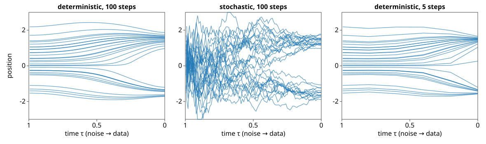
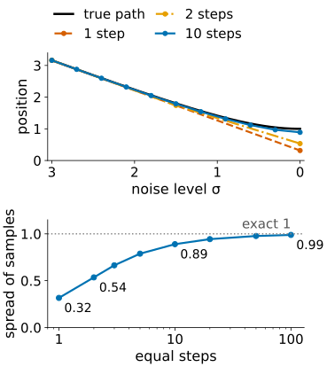
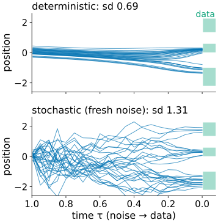
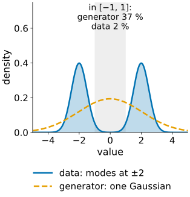

## About this lecture

*How do we get from noise to an image, how many steps does it take, and how do we know the samples are any good?*

- Two ways down: a **stochastic** path (denoise, add back a little fresh noise) and a **deterministic** path (follow the arrows). Same destinations, different paths.
- **Too few steps** cut corners: samples pulled to averages, too little spread. **Where** the steps go matters as much as how many.
- Fresh noise **forgets** errors in the position; a deterministic sampler is an invertible map (**inversion**).
- **Judging generated images as a distribution**: precision, recall, a Fréchet distance, and a memorisation check.

*Slides titled **The math** give the formulas and proofs; the ideas are complete without them.*

::: notes
Second unit of the diffusion-models day. Recalls the two one-step formulas of diffusion/ without re-deriving them. Demos: samplerpaths (1D, time as an axis, exact score), genmetrics (2D clouds of diffusion2d, distribution metrics). Owns the evaluation of generated images for the course.
:::

## Recall: sampling = repeated denoising

From [Diffusion models and generated detail](../diffusion/lec.qmd): start from pure noise; at each step estimate the clean image, move towards it, and continue at a lower noise level. Too few steps land **between** the blobs.

```{=html}
<link rel="stylesheet" href="../demos/dist/demo.css">
<div data-demo="diffusion2d" data-preset="few"></div>
<script src="../demos/dist/diffusion2d.js"></script>
```

## Two ways down, same destinations

- **Deterministic**: at every noise level, move along the arrows of the denoiser and nothing else. Smooth paths; the same start always gives the same image.
- **Stochastic** (ancestral): denoise a little more than needed, then add back **fresh noise**. Jittery paths.
- At every noise level both have the **same distribution** of points; only single paths differ. A knob η runs between them: 0 = deterministic, 1 = ancestral.

{width="100%"}

## Try it: paths through the noise levels

```{=html}
<link rel="stylesheet" href="../demos/dist/demo.css">
<div data-demo="samplerpaths" data-preset="same"></div>
<script src="../demos/dist/samplerpaths.js"></script>
```

::: notes
1D data (mixtures), exact denoiser, 2 000 samples; numbers from the demo's code. "same endpoints, different paths": two modes at ±1.5, 100 ancestral steps: endpoint sd 1.51 (data 1.51), Fréchet 0.0005; switch η to 0: sd 1.51, Fréchet 0.0000; smooth paths. "one step": all 2 000 samples at the mean 0 (sd 0.02), 100 % off the data. "5 steps: too narrow": three unequal modes, sd 1.18 against 1.38, 5.8 % off the data. "spacing matters": the same 5 steps uniform in log-SNR: sd 0.78, 12.8 % off the data; uniform in time (cosine schedule) is much better here. "stochastic forgets a bad start": starting noise 5 times too small; deterministic 20 steps sd 0.69, Fréchet 0.49; ancestral 20 steps sd 1.31, Fréchet 0.005. "inversion and back": x0 = 1.3 maps to noise 0.20 and back to 1.305 with 20 deterministic steps.
:::

## The math: an ODE and an SDE {.math}

Noise-level form $\mathbf x = \mathbf x_0 + \sigma\boldsymbol\varepsilon$, density $p_\sigma$ (data blurred by a Gaussian of width σ). Two processes have exactly these marginals as σ falls from $\sigma_{\max}$ to 0:

$$\textbf{probability-flow ODE:}\quad \frac{d\mathbf x}{d\sigma} = -\sigma\,\nabla\log p_\sigma(\mathbf x) = \frac{\mathbf x - D(\mathbf x, \sigma)}{\sigma},$$

$$\textbf{reverse SDE:}\quad d\mathbf x = -2\sigma\,\nabla\log p_\sigma(\mathbf x)\,d\sigma + \sqrt{2\sigma}\,d\bar{\mathbf w}\quad(\sigma \text{ decreasing}),$$

with $D(\mathbf x, \sigma) = \mathbb E[\mathbf x_0\mid\mathbf x] = \mathbf x + \sigma^2\nabla\log p_\sigma$ the denoiser. Both follow from the heat equation $\partial_\sigma p_\sigma = \sigma\,\Delta p_\sigma$ (Fokker–Planck; stated, not derived): the ODE moves probability along the arrows, the SDE moves twice as far along them and diffuses back by the same amount.

**Gaussian data** $\mathcal N(0, s^2)$: $D = \frac{s^2}{s^2+\sigma^2}\mathbf x$, so $\frac{dx}{d\sigma} = \frac{\sigma\,x}{s^2+\sigma^2}$ and $x(\sigma) \propto \sqrt{s^2+\sigma^2}$: each path is scaled down smoothly, from spread $\sqrt{s^2 + \sigma_{\max}^2}$ to $s$.

## Why steps matter

:::: {.columns}
::: {.column width="54%"}
Each step follows the arrows in a **straight line**, but the true paths **bend**, most near the data at low noise.

- Gaussian data with sd 1, start at noise level σ = 3 (spread $\sqrt{10}$ = 3.16):
  - **one** deterministic step to σ = 0 lands at the denoiser's answer: spread **0.32**;
  - **two** steps (3 → 1.5 → 0): **0.54**; with the middle step at σ = 1 instead: 0.63;
  - ten equal steps: 0.89; a hundred: 0.99. The exact answer is 1.
- Too few steps: samples land on **averages** and have **too little spread**. With several modes, samples fall between them.
- Cost is counted in **network evaluations**. Practice reaches a few to tens by better step placement, two-stage steps, or training a student network to jump (distillation).
:::
::: {.column width="46%"}
{fig-alt="Top: for Gaussian data with sd 1, the true deterministic path from position 3.16 at noise level 3 bends down to 1 at noise level 0; one Euler step ends at 0.32, two steps at 0.54, ten steps at 0.89. Bottom: the spread of the samples against the number of equal steps: 0.32, 0.54, 0.89 and 0.99 for 1, 2, 10 and 100 steps, approaching the exact 1." width="100%"}
:::
::::

## The math: one step is an Euler step {.math}

From the introduction, with $\hat{\mathbf x}_0 = (\mathbf x_i - \sqrt{1-\bar\alpha_i}\,\hat{\boldsymbol\varepsilon})/\sqrt{\bar\alpha_i}$, the deterministic step is $\mathbf x_{i-1} = \sqrt{\bar\alpha_{i-1}}\,\hat{\mathbf x}_0 + \sqrt{1-\bar\alpha_{i-1}}\,\hat{\boldsymbol\varepsilon}$. Divide by $\sqrt{\bar\alpha_{i-1}}$ and write $\mathbf y = \mathbf x/\sqrt{\bar\alpha}$, $\sigma = \sqrt{(1-\bar\alpha)/\bar\alpha}$:

$$\mathbf y_{i-1} = \hat{\mathbf x}_0 + \sigma_{i-1}\hat{\boldsymbol\varepsilon} = \mathbf y_i + (\sigma_{i-1} - \sigma_i)\,\frac{\mathbf y_i - \hat{\mathbf x}_0}{\sigma_i},$$

since $\hat{\boldsymbol\varepsilon} = (\mathbf y_i - \hat{\mathbf x}_0)/\sigma_i$: an **Euler step** of the probability-flow ODE. The stochastic step of the introduction is the same move plus Gaussian noise; with a weight η on the added variance, $c^2 = \eta^2\sigma_{i-1}^2(\sigma_i^2 - \sigma_{i-1}^2)/\sigma_i^2$:

$$\mathbf y_{i-1} = \hat{\mathbf x}_0 + \sqrt{\sigma_{i-1}^2 - c^2}\,\hat{\boldsymbol\varepsilon} + c\,\boldsymbol\xi,$$

η = 0 deterministic, η = 1 ancestral. Euler for Gaussian data: one step from σ to 0 multiplies by $s^2/(s^2+\sigma^2)$; from σ to σ′ by $1 - (\sigma - \sigma')\sigma/(s^2 + \sigma^2)$. For $s = 1$, 3 → 1.5 → 0: $(1 - 1.5\cdot 0.3)\cdot\frac{1}{3.25} = 0.169$, times 3.16 = 0.535.

## Stochastic steps forget; deterministic steps invert

:::: {.columns}
::: {.column width="58%"}
- **Fresh noise forgets**: an error in the **position** (a bad start, a too-large step) is partly washed out by the noise added later, and the following steps pull the point back to the right distribution. The price: it needs more steps for the same accuracy. It does **not** fix a wrong denoiser.
- Extra **correction steps** at a fixed noise level (Langevin: a small step along the score plus a little noise) form a random walk that keeps the distribution (see also [MCMC](../mcmc/lec.qmd), if you took that elective).
- **Deterministic sampling is a map** noise ↔ image, invertible: run it **backwards** from a real image to find "its" noise (**inversion**), then edit or interpolate there and run forwards again. Unlike the VAE's encoder, nothing was trained for the way back.
:::
::: {.column width="42%"}
{fig-alt="Thirty paths of the samplerpaths demo, preset stochastic forgets a bad start: three unequal modes, starting noise 5 times too small, 20 steps. Top, deterministic: the paths stay bunched near 0 and end with sd 0.69. Bottom, stochastic: the fresh noise spreads them out and they end on all three modes with sd 1.31 (data 1.38)." width="100%"}
:::
::::

## Judging generated images: a distribution

:::: {.columns}
::: {.column width="60%"}
No single generated image is right or wrong. Compare the **cloud** of samples with the cloud of real (held-out) images.

- **Precision**: the fraction of samples that lie where real images lie (realism). **Recall**: the fraction of real images that have samples nearby (coverage). Neighbourhoods: a ball around each point reaching its $k$-th nearest neighbour.
- **Fréchet distance**: fit one Gaussian to each cloud and compare means and covariances. Image papers compute it on features of a pretrained network (called FID). It is blind to everything a Gaussian cannot see: data at ±2 (sd 0.5) and a generator $\mathcal N(0, 4.25)$ have Fréchet distance **0**, yet 37 % of its samples fall in $[-1, 1]$, where only 2 % of the data are.
- **Memorisation**: distance from each sample to its nearest **training** image. Copies score well on everything else (recall [leakage](../leakage/lec.qmd): training images are no evidence of generalisation).
:::
::: {.column width="40%"}
{fig-alt="Density of data with two modes at ±2 (sd 0.5) and of a generator that is one Gaussian with the same mean and variance 4.25. The Fréchet distance between them is 0, yet in the shaded interval from −1 to 1 lie 37 % of the generated samples and 2 % of the data." width="100%"}
:::
::::

## The math: precision, recall and the Fréchet distance {.math}

Real points $R$, generated points $G$; $r_k(\mathbf a)$ = distance from $\mathbf a$ to its $k$-th nearest neighbour in its own set.

$$\text{precision} = \frac{1}{|G|}\sum_{\mathbf g\in G}\big[\exists\,\mathbf r\in R: \|\mathbf g - \mathbf r\| \le r_k(\mathbf r)\big],\qquad \text{recall: swap } R \text{ and } G.$$

Fréchet distance between $\mathcal N(\boldsymbol\mu_1, \Sigma_1)$ and $\mathcal N(\boldsymbol\mu_2, \Sigma_2)$:

$$d^2 = \|\boldsymbol\mu_1 - \boldsymbol\mu_2\|^2 + \operatorname{tr}\big(\Sigma_1 + \Sigma_2 - 2(\Sigma_1^{1/2}\Sigma_2\Sigma_1^{1/2})^{1/2}\big).$$

In 1D: $(\mu_1-\mu_2)^2 + s_1^2 + s_2^2 - 2s_1s_2 = (\mu_1-\mu_2)^2 + (s_1-s_2)^2$. Spreads 0.316, 0.535 and 1 against sd 1: $d^2$ = 0.468, 0.216, 0.

## Try it: four ways to fool a metric

```{=html}
<link rel="stylesheet" href="../demos/dist/demo.css">
<div data-demo="genmetrics" data-preset="between"></div>
<script src="../demos/dist/genmetrics.js"></script>
```

::: notes
1 000 held-out real points, 1 000 generated; k = 3. Numbers from the demo's code. "between the modes" (two blobs, one wide Gaussian matched in mean and covariance): Fréchet 0.014, even lower than the 100-step diffusion sampler (0.020), but precision 0.48. "mode dropping" (ring of 8, two blobs missing): precision 0.97, recall 0.73, Fréchet 0.32. "memoriser" (moons, copies of 50 training points): precision 0.95, Fréchet 0.022 (sampler 0.025), recall 0.09, median nearest-training distance 0.010 against 0.021 for held-out real points. "more steps" (moons): press "curve against steps": 1 step precision 0 and recall 0; 5 steps 0.75 / 0.69; 20 steps 0.965 / 0.907; 100 steps 0.957 / 0.960.
:::

## For science: evaluate the measurement you will make

- Image-level metrics compare generic features; a biologist needs the **readout**: compare the histograms of nucleus area, cell counts, intensities between generated and held-out real images.
- A generator can match the Fréchet distance and still get a rare phenotype's frequency wrong (the rare blob of the introduction: 5 % of the data, 1 % of the samples with a briefly trained network).
- Always also check memorisation: nearest training images next to the "new" ones.

## Summary

- Deterministic and stochastic samplers share the distribution at every noise level; paths differ. Deterministic = Euler steps of an ODE; stochastic adds fresh noise.
- Too few steps cut the corners of curved paths: samples too narrow, between modes. Step **placement** matters as much as number.
- Fresh noise forgets errors in the position; deterministic sampling can be inverted.
- Judge generated images as a **distribution**: precision (realism), recall (coverage), Fréchet distance (Gaussian summary, blind to shape), nearest-training distance (memorisation), and the **readout you care about**.
