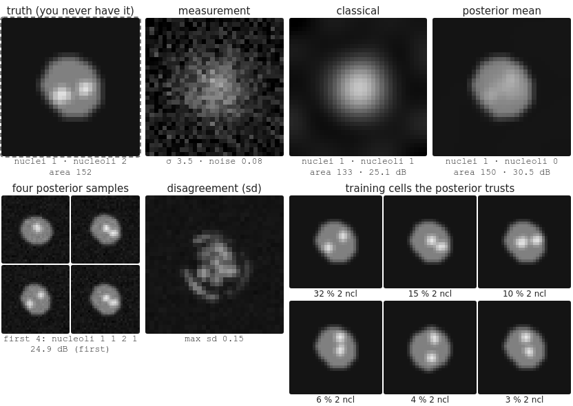

## Goal

By the end of this exercise you should be able to:

- compute a **forward** noising step, and say what the noise schedule controls,
- explain why the best **denoiser** returns an average, and how **sampling** turns averages into sharp samples,
- predict the effect of few steps, a finite training set, **conditioning** and **guidance**,
- tell a **posterior mean** from a **posterior sample**, recognise **hallucinated** detail, and decide what may be measured on a restored image.

Do the pen-and-paper part first, then the demos. Questions marked *(math)* are for those who want the derivations; the concept questions do not depend on them.

## Background

| Idea | What it means |
|---|---|
| Forward process | $x_\tau = \sqrt{\bar\alpha}\,x_0 + \sqrt{1 - \bar\alpha}\,\varepsilon$, from data ($\bar\alpha = 1$) to noise ($\bar\alpha \approx 0$) |
| Denoiser | predicts the noise $\varepsilon$ (or $x_0$) from $x_\tau$; the best one returns the average of the compatible clean images |
| Sampling | start from noise, denoise a little at a time; stochastic or deterministic |
| Conditioning | the denoiser also gets a label or a measurement; guidance $w$ pushes harder |
| Posterior mean | the average of all restorations compatible with the measurement |
| Posterior sample | one such restoration, drawn at random |

{width=70%}

{width=90%}

## By hand

**B1.** One forward step: $x_0 = 2$, $\sqrt{\bar\alpha} = 0.8$, $\sqrt{1 - \bar\alpha} = 0.6$, $\varepsilon = -1$.
(a) Compute $x_\tau$.
(b) If the whole training set is the single value $x_0 = 2$, which $\varepsilon$ must a perfect denoiser report for this $x_\tau$?
(c) At a later time $\sqrt{\bar\alpha} = 0.1$. What is left of $x_0$ in $x_\tau$, and what does $x_\tau$ look like whatever $x_0$ was?

**B2.** Data: $x_0 = +1$ or $-1$, equally likely. Noising: $x_\tau = 0.6\,x_0 + 0.8\,\varepsilon$. You observe $x_\tau = 0.5$.
(a) Which $x_0$ is more likely? Using the formula from the lecture, the best estimate of $x_0$ is $\tanh(0.6 \cdot 0.5/0.64)$: compute it.
(b) Why is the best estimate not $+1$?
(c) A sampler does not stop at this estimate. What does it do instead, and where do its samples end?

**B3.** Sampling with few steps. Two blobs of data at $-1.2$ and $+1.2$ (in 1D, equally likely).
(a) What is the average of the data? Where does a single denoising step from pure noise put **every** sample?
(b) Why do many small steps give samples in the blobs instead?

**B4.** A prior made of two training images: a cell with **one** nucleolus and a cell with **two**. A heavily blurred measurement is equally compatible with both.
(a) What does the posterior mean look like? How many nucleoli would a threshold count on it?
(b) What do posterior samples look like? What is the probability that a sample shows the wrong count if the truth has one nucleolus?
(c) Which of the two images is "better" for the PSNR against the truth, and which looks more like a real cell?

**B5.** A restoration network with a generative prior was used on 200 blurred images. For each measurement, may you report it from the restored images? (a) the nucleus area; (b) the number of nucleoli per nucleus, where the nucleoli are about the size of the blur; (c) the mean intensity of each cell; (d) the length of thin protrusions. What would you need to check first?

**B6.** A prior trained only on healthy cells is used to restore images of a mutant whose nuclei are ring-shaped. What will the restored images show, and why is this the most dangerous failure?

::: {.callout-note collapse="true" title="Solutions"}
**B1.** (a) $x_\tau = 0.8 \cdot 2 + 0.6 \cdot (-1) = 1.0$. (b) With one training value, $x_0 = 2$ is known, so $\varepsilon = (x_\tau - 0.8 \cdot 2)/0.6 = (1 - 1.6)/0.6 = -1$: the true noise. (c) $0.1\,x_0$: one tenth of the signal; $x_\tau$ is almost pure noise with variance $1 - 0.01 = 0.99$; it looks like $\mathcal N(0, 1)$ for any data.

**B2.** (a) $+1$ (the observation is positive). Estimate $\tanh(0.469) = 0.44$. (b) $x_\tau = 0.5$ could also come from $x_0 = -1$ with a positive noise; the best estimate under squared error is the average of $+1$ and $-1$ weighted by their probabilities: $P(+1 \mid x_\tau) = 0.72$, $P(-1 \mid x_\tau) = 0.28$, average $0.72 - 0.28 = 0.44$. (c) It moves a little towards 0.44, adds back some noise, and denoises again at a lower noise level; as the noise shrinks, the estimate is pushed to one of the two values. Its samples end at $+1$ (about 72 % of the time from this point) or at $-1$, never at 0.44.

**B3.** (a) Average 0. One step from pure noise returns the average of all data: every sample lands at 0, between the blobs. (b) Each small step only commits a little; at lower noise levels the denoiser's average is taken over the data **near** the current point, which lies in one blob: the samples end in the blobs.

**B4.** (a) The average of the two images: one nucleolus at full brightness where they share it, plus a half-bright spot where only the second has one; a threshold for "bright" may count 1 (or 0, if the shared one is also blurred). (b) Each sample is one of the two cells (sharp), each with probability 0.5. If the truth has one nucleolus, a sample shows the wrong count with probability 0.5. (c) The mean has the lower error (higher PSNR) on average; a sample looks more like a real cell, but its details are a coin flip.

**B5.** (a) Probably: the outline is large compared with the blur and is fixed by the data; check on images with ground truth. (b) No: structures of the size of the blur are exactly where the prior decides; the counts would come from the training set. (c) Probably, if the restoration preserves intensities (check: a restoration may sharpen and redistribute intensity); better measure it on the raw image. (d) No, not without validation: thin protrusions are below the resolution; the prior can add or remove them. First: restore images with known truth (synthetic, or high-quality acquisitions), compare the **measurements**, not only PSNR, and look at the disagreement between samples.

**B6.** The prior has never seen a ring; the posterior explains the measurement with the closest training cells: normal, filled nuclei. The phenotype you are looking for is "corrected" away, the restored images look healthy and convincing, and nothing in them warns you. A disagreement map may not either, since all samples agree on the wrong answer.
:::

### Math questions

**B7.** *(math)* Show that $n$ forward steps $x_t = \sqrt{1 - \beta_t}\,x_{t-1} + \sqrt{\beta_t}\,\varepsilon_t$ give $x_t = \sqrt{\bar\alpha_t}\,x_0 + \sqrt{1 - \bar\alpha_t}\,\varepsilon$ with $\bar\alpha_t = \prod_{s \le t}(1 - \beta_s)$, and that $x_t \to \mathcal N(0, 1)$ in distribution if $\bar\alpha_t \to 0$.

**B8.** *(math)* Derive the $\tanh$ of B2: for $x_0 = \pm 1$ with probability $\tfrac12$ each and $x_\tau = a\,x_0 + b\,\varepsilon$, show $\mathbb E[x_0 \mid x_\tau] = \tanh(a\,x_\tau/b^2)$.

**B9.** *(math)* Scalar Gaussian prior $x \sim \mathcal N(0, 1)$, measurement $y = x + n$, $n \sim \mathcal N(0, 0.25)$. Derive the posterior mean and variance. Show that a posterior sample has twice the expected squared error of the posterior mean, and compute both errors.

**B10.** *(math)* Prove Tweedie's formula for a Gaussian prior: $x_0 \sim \mathcal N(\mu, s^2)$, $x_t = \sqrt{\bar\alpha}\,x_0 + \sqrt{1 - \bar\alpha}\,\varepsilon$. Compute $\nabla\log p(x_t)$ and check that $(x_t + (1 - \bar\alpha)\nabla\log p(x_t))/\sqrt{\bar\alpha}$ equals the posterior mean of $x_0$.

::: {.callout-note collapse="true" title="Solutions (math)"}
**B7.** By induction: suppose $x_{t-1} = \sqrt{\bar\alpha_{t-1}}x_0 + \sqrt{1 - \bar\alpha_{t-1}}\,\eta$, $\eta \sim \mathcal N(0, 1)$ independent of $\varepsilon_t$. Then $x_t = \sqrt{\bar\alpha_t}x_0 + \sqrt{1 - \beta_t}\sqrt{1 - \bar\alpha_{t-1}}\,\eta + \sqrt{\beta_t}\,\varepsilon_t$; the last two terms are independent Gaussians with total variance $(1 - \beta_t)(1 - \bar\alpha_{t-1}) + \beta_t = 1 - \bar\alpha_t$. So $x_t \mid x_0 \sim \mathcal N(\sqrt{\bar\alpha_t}x_0, 1 - \bar\alpha_t)$. If $\bar\alpha_t \to 0$, the mean $\to 0$ and the variance $\to 1$ for every $x_0$ (and the data have finite variance), so $x_t \to \mathcal N(0, 1)$.

**B8.** $p(x_\tau \mid x_0 = \pm 1) \propto \exp(-(x_\tau \mp a)^2/2b^2)$. Ratio of posteriors: $\frac{P(+1 \mid x_\tau)}{P(-1 \mid x_\tau)} = \exp\!\big(\frac{(x_\tau + a)^2 - (x_\tau - a)^2}{2b^2}\big) = \exp(2ax_\tau/b^2)$. With $u = ax_\tau/b^2$: $P(+1) = e^{u}/(e^u + e^{-u})$, and $\mathbb E[x_0] = P(+1) - P(-1) = \tanh u$. B2: $a = 0.6$, $b^2 = 0.64$, $x_\tau = 0.5$: $\tanh(0.469) = 0.437$.

**B9.** $p(x \mid y) \propto \exp(-x^2/2)\exp(-(y - x)^2/0.5)$: Gaussian with precision $1 + 4 = 5$, variance $v = 0.2$, mean $4y/5 = 0.8y$. Mean estimate error: $\mathbb E[(0.8y - x)^2 \mid y] = v = 0.2$. A sample $\tilde x = 0.8y + \sqrt v\,\xi$ independent of $x$ given $y$: $\tilde x - x = (0.8y - x) + \sqrt v\,\xi$, two independent terms each with variance $v$: error $2v = 0.4$.

**B10.** $x_t \sim \mathcal N(\sqrt{\bar\alpha}\mu, \bar\alpha s^2 + 1 - \bar\alpha)$; write $c = \bar\alpha s^2 + 1 - \bar\alpha$. $\nabla\log p(x_t) = -(x_t - \sqrt{\bar\alpha}\mu)/c$. Tweedie: $\frac{1}{\sqrt{\bar\alpha}}\big(x_t - \frac{(1 - \bar\alpha)(x_t - \sqrt{\bar\alpha}\mu)}{c}\big) = \frac{1}{\sqrt{\bar\alpha}}\cdot\frac{\bar\alpha s^2 x_t + (1 - \bar\alpha)\sqrt{\bar\alpha}\mu}{c} = \frac{\sqrt{\bar\alpha}s^2x_t + (1 - \bar\alpha)\mu}{c}$. The posterior of the linear Gaussian model $x_t = \sqrt{\bar\alpha}x_0 + \text{noise}$ (as in B9, with gain $\sqrt{\bar\alpha}$ and noise variance $1 - \bar\alpha$) has mean $\mu + \frac{s^2\sqrt{\bar\alpha}}{\bar\alpha s^2 + 1 - \bar\alpha}(x_t - \sqrt{\bar\alpha}\mu) = \frac{\sqrt{\bar\alpha}s^2x_t + (1 - \bar\alpha)\mu}{c}$: the same.
:::

## Explore: diffusion in 2D {#explore-diffusion2d}

The data are 2D point clouds made of Gaussian blobs (grey), so the exact best denoiser is known at every noise level. **Forward**: 500 data points melt into noise as $\tau$ goes from 0 to 1; the small plot shows the schedule (signal $\sqrt{\bar\alpha}$, noise $\sqrt{1 - \bar\alpha}$). **Reverse**: 500 points (blue) start as pure noise and are denoised step by step; the arrows show where the denoiser pushes at the current noise level; one path is drawn in orange. Choose the number of steps, a stochastic or deterministic sampler, the exact score or a small **learned** denoiser (trained briefly or long), and a **condition** with guidance $w$.

```{=html}
<link rel="stylesheet" href="../demos/dist/demo.css">
<div data-demo="diffusion2d" data-preset="forward"></div>
<script src="../demos/dist/diffusion2d.js"></script>
```

**D1.** Preset **forward: data melts into noise**. Read $\sqrt{\bar\alpha}$ and $\sqrt{1 - \bar\alpha}$ at $\tau = 0.4$; check that their squares add to 1. At which $\tau$ can you no longer see the moons? Switch to the linear schedule: earlier or later?

**D2.** Preset **noise in, data out**. Where do the samples end? Use **back to noise** and **step**: describe the arrows at the start and near the end.

**D3.** Preset **too few steps: between the blobs** (2 deterministic steps). Where are the samples, and what fraction is off the data? Increase the steps to 5, 20, 100. Explain with B3.

**D4.** Preset **learned score: the rare blob** (the briefly trained network). Which fraction of the samples lands in the rare blob, against 5 % in the data? Switch to **learned: long** and to the exact score.

**D5.** Preset **perfect score of 20 points: copies**. Where do the samples end? Why is this "perfect" denoiser a bad generator?

**D6.** Presets **conditioning on one blob** and **strong guidance** (ring of 8, condition "upper half", $w = 4$). Count the samples per blob for $w = 0$ and $w = 4$ (the readout lists them from 0°, anticlockwise). Which blobs gain, and why?

::: {.callout-note collapse="true" title="Solutions"}
**D1.** $\sqrt{\bar\alpha} = 0.805$, $\sqrt{1 - \bar\alpha} = 0.594$; $0.648 + 0.353 = 1.00$. The moons are hard to see from about $\tau = 0.6$ (cosine schedule: $\sqrt{\bar\alpha} = 0.70$ at $\tau = 0.5$, $0.38$ at 0.75). The linear schedule removes the signal earlier: its $\bar\alpha$ falls quickly in the first half.

**D2.** On the two moons: 48 % and 52 % (data 50/50), 0 % off the data. At the start the arrows all point towards the middle of the whole cloud (at high noise the denoiser only knows "the data are somewhere around here"); near the end they point onto the nearest moon, short and local.

**D3.** The samples lie on a line between the two blobs; 38 % are off the data (each blob still gets 50 %). With more steps the samples move into the blobs: one or two steps return averages (B3), many small steps follow the local structure.

**D4.** 1 % in the rare blob (data 5 %), 7 % off the data: the briefly trained network has not learned the small, rare blob, so it is almost never generated. With the long-trained network and with the exact score the rare blob gets 6 % (off the data: 1 %), close to the data's 5 % (500 samples). A model can only generate what it has learned well; rare phenotypes are the first to go.

**D5.** Every sample lands on one of the 20 training points (100 % within 0.05). The perfect denoiser of a finite set **is** the training set: it only copies. Generalisation comes from imperfection (smoothing between training examples).

**D6.** $w = 0$: 135, 123, 124, 118 in the four upper blobs (0°, 45°, 90°, 135°), none below. $w = 4$: 55, 195, 195, 55. The blobs at 45° and 90° gain: they are farthest from the lower half, where the condition is most certain. Guidance favours the most typical members of the condition and reduces diversity: the blobs at the border of the condition (0°, 135°) lose most of their samples.
:::

## Explore: which details are real? {#explore}

A $32 \times 32$ synthetic cell (**truth**, which in practice you never have) is measured with blur and noise, or with holes (click the measurement to add or remove a hole). The **prior** is made of 300 training cells (one nucleus outline of six, 0–2 nucleoli, some with a protrusion, some dividing), each the centre of a narrow Gaussian, so the posterior is computed exactly. Panels: the **classical** restoration (Wiener, or smooth filling of holes), the **posterior mean**, **four posterior samples**, the **disagreement** (pixel standard deviation over 32 samples) and the training cells the posterior trusts most. Under each image: the number of nuclei and nucleoli and the area found by thresholds, and the PSNR against the truth.

```{=html}
<link rel="stylesheet" href="../demos/dist/demo.css">
<div data-demo="genrestore" data-preset="mild"></div>
<script src="../demos/dist/genrestore.js"></script>
```

**G1.** Preset **mild blur: everything agrees**. Compare the counts of truth, classical, mean and samples. What does the disagreement map show? Which restoration has the best PSNR?

**G2.** Preset **heavy blur: samples invent nucleoli** (σ 3.5, noise 0.08). How many nucleoli does the truth have, and how many do the mean, the classical restoration and the 32 samples show? Which has the best PSNR? Where is the disagreement large?

**G3.** Still on **heavy blur**, press **resample** a few times and look at the four samples. Would you count nucleoli on any single sample? On the mean?

**G4.** Preset **prior without dividing cells**. What is the truth, and what do the mean and the samples show? Which training cell does the posterior trust? Switch the prior to **all kinds**.

**G5.** Preset **unusual nucleus: made normal** (a ring-shaped nucleus). Compare the truth, the classical restoration, the mean and the samples. What does the disagreement map tell you here?

**G6.** Preset **three nucleoli: one is lost**. How many nucleoli do the samples show? Which PSNR is highest, and which count is right?

**G7.** Preset **inpainting: what is in the hole?** The hole covers the inside of the nucleus. What do the samples put there? What does the classical filling do?

::: {.callout-note collapse="true" title="Solutions"}
**G1.** Truth 1 nucleus, 2 nucleoli; classical, mean and all 32 samples also 1/2. The disagreement map is dark (max sd 0.03): all samples agree. Classical 34.2 dB, mean 32.1 dB, first sample 30.2 dB: with mild blur the cautious Wiener filter is already excellent.

**G2.** Truth 2 nucleoli. Mean: 0 (a smooth bright nucleus: the average of cells with nucleoli in different places), PSNR 30.5 dB. Classical: 1 nucleolus, 25.1 dB. Samples: 10 show 1 nucleolus, 22 show 2; each looks like a sharp, real cell; the first one 24.9 dB. The disagreement (max sd 0.15) is inside the nucleus, where the nucleoli may be. The mean has the best PSNR and the least detail.

**G3.** Each resample shows cells with nucleoli in different places and in different numbers: the detail comes from the training cells the posterior trusts (32 %, 15 %, 10 %, … of the weight). No single sample can be counted. The mean cannot be counted either (it shows none); the honest answer is "the measurement does not resolve the nucleoli".

**G4.** The truth is a dividing cell (2 nuclei). Mean and all samples: 1 nucleus (area 174), PSNR 18.9 dB: the posterior trusts a single training cell with a **protrusion** (100 %), the closest thing to two touching nuclei that it knows. The classical restoration shows one blurred blob (25.9 dB). With **all kinds**, the dividing training cells explain the measurement and the division comes back.

**G5.** The truth is a ring-shaped nucleus (area 114). The classical restoration keeps the measured shape (area 114, 26.7 dB). The mean and the samples show a normal, filled nucleus (area 150), PSNR 26.0 dB: the prior has never seen a ring, so the posterior uses normal cells (the top six training cells get 11 % each). The disagreement map is dark (max sd 0.03): the samples agree on the wrong answer. A low disagreement does not prove correctness when the prior lacks the phenotype.

**G6.** All 32 samples show 2 nucleoli (truth 3), the mean shows 2 with the best PSNR (30.9 dB), the classical restoration 1 (27.4 dB). The posterior puts 90 % on one training cell with two nucleoli: no training cell has three. The best-PSNR image has the wrong count.

**G7.** The samples fill the hole with 0, 1 or 2 nucleoli (16, 11 and 5 of 32); the truth has 1. The mean shows a smooth nucleus (0), the best PSNR (31.9 dB). The classical filling interpolates smoothly from the edge of the hole and leaves a dim patch (area 89 instead of 150). Whatever is shown inside the hole is the prior's guess.
:::

## Where this leads

This is the course's introduction to diffusion models; an elective day on **diffusion models** goes deeper (score matching, samplers, latent diffusion, diffusion priors for inverse problems). The rules for what may be measured on a restored image return in the unit on **images as evidence** (bit depth day).
