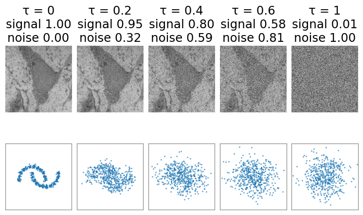
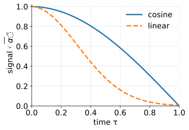
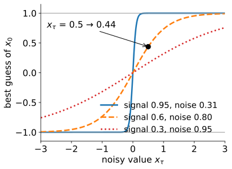
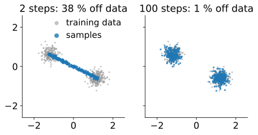
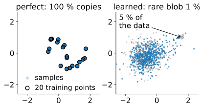
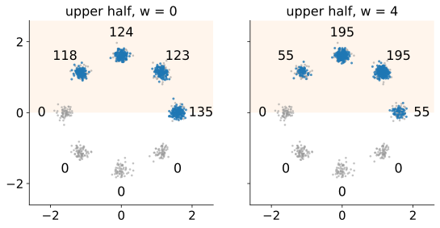
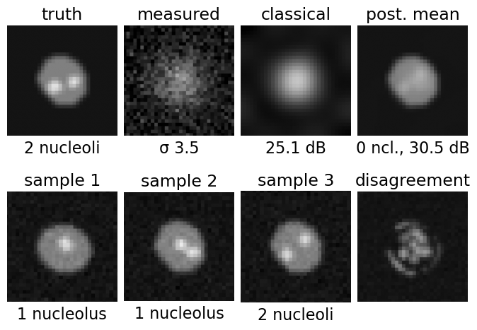
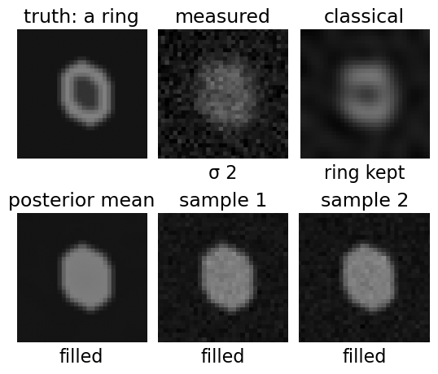

## About this lecture

*If a network can remove noise, can it make images from nothing? And if it restores my image, which details are real?*

- **Forward**: add a little noise, again and again, until only noise is left (the **noise schedule**).
- **Denoising** is the core operation; **sampling** = repeated denoising, starting from pure noise.
- **Conditioning** on a label or a measurement; **guidance**.
- **Restoration with a generative prior**: the posterior **mean** is blurry but honest, a posterior **sample** is sharp and may be **invented**. What may still be measured.

*Slides titled **The math** give the formulas and proofs; the ideas are complete without them.*

::: notes
Recalls the VAE day (latent variables, a decoder that outputs a mean gives blur, sampling new images), the cameranoise unit (noise, PSNR), and the deconvolution day (Wiener as the cautious classical restoration). Both demos are exact: the data are Gaussian mixtures, so the best denoiser and the exact posterior are known in closed form (diffusion2d also has small learned denoisers, trained offline; genrestore has none).
:::

## Recall: generating with a VAE

From the [VAE day](../vae-gen/lec.qmd): a **generative model** draws **new** images that look like the training images: samples from the distribution of the data, a cloud of points in a space with one axis per pixel.

- The VAE: sample a latent code, decode it. Its decoder outputs a **mean**, so samples are **blurry** where the model is uncertain.
- A diffusion model reaches the same goal by a different route: no encoder, no latent bottleneck; a single network that **removes noise**, applied many times.

## The forward process: drowning the data in noise

:::: {.columns}
::: {.column width="44%"}
Take a training image, add a little Gaussian noise and shrink the signal a little; repeat many times. After enough steps nothing is left but noise.

- The **noise schedule** says how fast: how much signal $\sqrt{\bar\alpha}$ and how much noise $\sqrt{1 - \bar\alpha}$ remain at each time $\tau$ from 0 (data) to 1 (noise).
- In 2D: a cloud of points melts into one round Gaussian blob.
- One step by hand: $x_0 = 2$, $\sqrt{\bar\alpha} = 0.8$, $\sqrt{1 - \bar\alpha} = 0.6$, noise $\varepsilon = -1$: $x_\tau = 0.8 \cdot 2 + 0.6 \cdot (-1) = 1.0$.
:::
::: {.column width="56%"}
{fig-alt="The forward process with the cosine schedule at τ = 0, 0.2, 0.4, 0.6 and 1. Top: a micrograph (scaled to −1…1) with signal 1.00, 0.95, 0.80, 0.58, 0.01 and noise 0.00, 0.32, 0.59, 0.81, 1.00; the cell is still visible at τ = 0.6 and gone at τ = 1. Bottom: 500 points from the two moons melt into one round blob." width="100%"}
:::
::::

::: notes
The micrograph: transmission electron micrograph of a mesenchymal stem cell, Robert M. Hunt, CC BY 3.0, via Wikimedia Commons. Same schedule and points as the diffusion2d demo's forward tab.
:::

## The math: the forward process {.math}

One step: $\mathbf x_t = \sqrt{1 - \beta_t}\,\mathbf x_{t-1} + \sqrt{\beta_t}\,\boldsymbol\varepsilon_t$. With $\bar\alpha_t = \prod_{s \le t}(1 - \beta_s)$, the steps combine into one:

$$\mathbf x_t = \sqrt{\bar\alpha_t}\,\mathbf x_0 + \sqrt{1 - \bar\alpha_t}\,\boldsymbol\varepsilon, \qquad \boldsymbol\varepsilon \sim \mathcal N(0, I),$$

so $\mathbf x_t \mid \mathbf x_0 \sim \mathcal N(\sqrt{\bar\alpha_t}\mathbf x_0, (1 - \bar\alpha_t)I)$ (sums of independent Gaussians are Gaussian; variances add). As $\bar\alpha_t \to 0$, $\mathbf x_t \to \mathcal N(0, I)$ whatever $\mathbf x_0$ was. Signal-to-noise ratio $\bar\alpha_t/(1 - \bar\alpha_t)$.

:::: {.columns}
::: {.column width="62%"}
Schedules: **linear** ($\beta$ rising linearly; in continuous time $\bar\alpha = e^{-(0.1\tau + 9.95\tau^2)}$) and **cosine** ($\bar\alpha = \cos^2(\frac{\tau + s}{1 + s}\frac\pi2)/\cos^2(\frac{s}{1+s}\frac\pi2)$, $s = 0.008$), which removes the signal more evenly.
:::
::: {.column width="38%"}
{fig-alt="Signal √ᾱ against time τ for the cosine schedule (solid) and the linear schedule (dashed): the linear one has lost most of the signal by τ = 0.5, the cosine one falls almost evenly." width="100%"}
:::
::::

## Denoising is the core operation

:::: {.columns}
::: {.column width="55%"}
Train a network that takes a noisy image and the noise level, and predicts the **noise** (equivalently the clean image).

- Ordinary supervised learning with **free labels**: we added the noise ourselves, so we know it.
- At high noise the best possible denoiser does **not** output a clean image: it outputs the **average of all clean images compatible** with the noisy one.
- Data at $\pm 1$ (equally likely), $x_\tau = 0.6\,x_0 + 0.8\,\varepsilon$, observed $x_\tau = 0.5$: the best guess of $x_0$ is $\tanh(0.6 \cdot 0.5/0.64) = 0.44$: neither $+1$ nor $-1$, but a compromise leaning towards $+1$.
:::
::: {.column width="45%"}
{fig-alt="The best denoiser for data at ±1: best guess of the clean value against the noisy value, at three noise levels. At low noise (0.31) it snaps to ±1; at noise 0.80 the observed 0.5 gives 0.44; at noise 0.95 every guess stays near 0, the average of the data." width="100%"}
:::
::::

## The math: the best denoiser is the score {.math .smaller}

Minimising $\mathbb E\|\boldsymbol\varepsilon - \boldsymbol\varepsilon_\theta(\mathbf x_t, t)\|^2$ over all functions gives the conditional mean $\boldsymbol\varepsilon^\star = \mathbb E[\boldsymbol\varepsilon \mid \mathbf x_t]$, equivalently $\hat{\mathbf x}_0 = \mathbb E[\mathbf x_0 \mid \mathbf x_t]$.

**Tweedie's formula**: with $p_t$ the density of $\mathbf x_t$,

$$\mathbb E[\mathbf x_0 \mid \mathbf x_t] = \frac{\mathbf x_t + (1 - \bar\alpha_t)\nabla\log p_t(\mathbf x_t)}{\sqrt{\bar\alpha_t}}, \qquad \boldsymbol\varepsilon^\star = -\sqrt{1 - \bar\alpha_t}\,\nabla\log p_t(\mathbf x_t).$$

A denoiser is an estimator of the **score** $\nabla\log p_t$: the direction in which the noisy data become more likely.

**Mixture data** (the demos): if $\mathbf x_0 \sim \sum_k\pi_k\mathcal N(\boldsymbol\mu_k, \Sigma_k)$, then $\mathbf x_t \sim \sum_k\pi_k\mathcal N(\sqrt{\bar\alpha_t}\boldsymbol\mu_k, \bar\alpha_t\Sigma_k + (1 - \bar\alpha_t)I)$ and the score is $\sum_k r_k(\mathbf x_t)\,C_k^{-1}(\sqrt{\bar\alpha_t}\boldsymbol\mu_k - \mathbf x_t)$ with responsibilities $r_k$ ("which component did this point come from", as a probability). For $\pm 1$ data this gives the $\tanh$.

## Sampling = repeated denoising

:::: {.columns}
::: {.column width="50%"}
Start from pure noise. At each step: estimate the clean image, move a little towards it, and (in the stochastic version) add back a bit less noise than before. After many steps a sample emerges.

- The arrows (where the denoiser pushes) form a field that points towards the data at every noise level, coarse at high noise, fine at low noise.
- **Few steps**: the samples land on the **averages**: between the blobs, off the data. **Many steps**: sharp samples on the data.
- **Deterministic** sampling (no added noise) follows smooth paths; **stochastic** sampling jitters.
:::
::: {.column width="50%"}
{fig-alt="Deterministic sampling of two blobs (grey: training data, blue: 500 samples). With 2 steps the samples line up on the segment between the blobs, 38 % off the data; with 100 steps they land on the blobs, 1 % off the data." width="100%"}
:::
::::

## The math: one sampling step {.math .smaller}

From $\mathbf x_i$ at $\bar\alpha_i$ to $\bar\alpha_{i-1} > \bar\alpha_i$, with $\hat{\boldsymbol\varepsilon} = \boldsymbol\varepsilon_\theta(\mathbf x_i)$ and $\hat{\mathbf x}_0 = (\mathbf x_i - \sqrt{1 - \bar\alpha_i}\,\hat{\boldsymbol\varepsilon})/\sqrt{\bar\alpha_i}$:

- **Deterministic** (DDIM): $\mathbf x_{i-1} = \sqrt{\bar\alpha_{i-1}}\,\hat{\mathbf x}_0 + \sqrt{1 - \bar\alpha_{i-1}}\,\hat{\boldsymbol\varepsilon}$: keep the same noise direction, at the smaller noise level.
- **Stochastic** (DDPM): sample the Gaussian $q(\mathbf x_{i-1} \mid \mathbf x_i, \hat{\mathbf x}_0)$ with $\alpha_i = \bar\alpha_i/\bar\alpha_{i-1}$, $\beta_i = 1 - \alpha_i$:
$$\text{mean } \frac{\sqrt{\bar\alpha_{i-1}}\,\beta_i}{1 - \bar\alpha_i}\hat{\mathbf x}_0 + \frac{\sqrt{\alpha_i}\,(1 - \bar\alpha_{i-1})}{1 - \bar\alpha_i}\mathbf x_i, \qquad \text{variance } \frac{\beta_i(1 - \bar\alpha_{i-1})}{1 - \bar\alpha_i}.$$
- With one step from pure noise both return $\hat{\mathbf x}_0 = \mathbb E[\mathbf x_0]$: the mean of the data.

## Try it: noise in, data out

```{=html}
<link rel="stylesheet" href="../demos/dist/demo.css">
<div data-demo="diffusion2d" data-preset="noise"></div>
<script src="../demos/dist/diffusion2d.js"></script>
```

::: notes
The data are Gaussian mixtures, so the exact score is known. Tour: "forward": two moons, slide τ: at 0.4 the signal is 0.805, the noise 0.594. "noise in, data out": 500 points, 100 stochastic steps: 48 % / 52 % on the two moons, 0 % off the data. Step through and watch the arrows: coarse at the start, fine at the end. "too few steps": two blobs, 2 deterministic steps: the samples line up between the blobs, 38 % off the data. "learned score": the rare blob (5 % of the data) gets 1 % of the samples with the briefly trained network. "perfect score of 20 points": every sample lands on a training point (100 % within 0.05). "conditioning on one blob" and "strong guidance": with w = 4 on "upper half" the samples crowd into the two upper blobs farthest from the lower half (55 195 195 55 instead of 135 123 124 118).
:::

## Memorising or generalising?

:::: {.columns}
::: {.column width="50%"}
- The **perfect** denoiser of a finite training set knows only those images: its samples are copies of training images (the demo's "20 points": every sample within 0.05 of a training point).
- Real networks are imperfect in a useful way: they smooth between training images and generate new ones. Small or under-trained networks also **drop rare modes**: a rare cell type in the training set may never be generated (the demo's rare blob: 5 % of the data, 1 % of the samples).
- Good to know when someone claims a generated image is "new" or "representative".
:::
::: {.column width="50%"}
{fig-alt="Left: sampling with the perfect score of 20 training points (circles): all 500 samples land on a training point. Right: a briefly trained network on data with a rare blob (5 % of the data, upper right): only 1 % of the samples go there." width="100%"}
:::
::::

## Conditioning and guidance

- Give the denoiser extra input: a **label** ("dividing cell"), a text, or a **measurement** (a blurred image). Sampling then draws from the images that fit the condition.
- **Guidance**: push harder towards the condition, $w > 0$. Samples become more **typical** of the condition and less **diverse**: they avoid anything that might also fit another condition.

{fig-alt="Ring of 8 blobs, condition 'upper half' (shaded). Without guidance the samples spread over the four upper blobs (135, 123, 124, 118 of 500); with guidance w = 4 they crowd into the two blobs farthest from the lower half (195, 195) and leave the edge blobs (55, 55)." width="62%" fig-align="center"}

## The math: conditioning by Bayes {.math}

$$\nabla\log p(\mathbf x \mid y) = \nabla\log p(\mathbf x) + \nabla\log p(y \mid \mathbf x)$$

(the normaliser $p(y)$ does not depend on $\mathbf x$). A conditional score = unconditional score + the score of the measurement. For a linear measurement $\mathbf y = A\mathbf x + \mathbf n$, $\mathbf n \sim \mathcal N(0, \sigma_n^2 I)$: $\nabla\log p(\mathbf y \mid \mathbf x) = A^\top(\mathbf y - A\mathbf x)/\sigma_n^2$.

**Guidance** with weight $w$: $\nabla\log p(\mathbf x) + (1 + w)\nabla\log p(y \mid \mathbf x) = (1 + w)\nabla\log p(\mathbf x \mid y) - w\nabla\log p(\mathbf x)$, the score of $p(\mathbf x)\,p(y \mid \mathbf x)^{1 + w}$: points where the condition is most certain are favoured.

## Restoration with a generative prior

:::: {.columns}
::: {.column width="48%"}
A degraded measurement (blurred, noisy, with holes) is compatible with **many** clean images.

- **Classical** (Wiener or Tikhonov, the [deconvolution day](../deconv/lec.qmd)): assumes "smooth"; returns a blurry but cautious answer.
- **Generative prior**: picks images that look like the **training** images: sharp, plausible, and possibly **invented**.
- The **posterior mean** (average of all plausible restorations): blurry where uncertain, the lowest error on average.
- A **posterior sample** (one plausible restoration): sharp everywhere; where the data are weak, its detail comes from the prior, not from the sample. Two samples **disagree** exactly there.
:::
::: {.column width="52%"}
{fig-alt="A heavily blurred synthetic cell with 2 nucleoli, restored with the exact posterior of a prior of 300 training cells. The classical restoration is smooth (25.1 dB); the posterior mean shows no nucleolus but has the best PSNR (30.5 dB); the samples are sharp and show 1, 1 and 2 nucleoli (the first: 24.9 dB); the disagreement map lights up inside the nucleus." width="100%"}
:::
::::

## The math: mean against sample {.math .smaller}

Scalar Gaussian prior $x \sim \mathcal N(\mu, s^2)$, measurement $y = x + n$, $n \sim \mathcal N(0, \sigma^2)$. The posterior is Gaussian:

$$x \mid y \sim \mathcal N\Big(\mu + \frac{s^2}{s^2 + \sigma^2}(y - \mu),\ v\Big), \qquad v = \frac{s^2\sigma^2}{s^2 + \sigma^2}.$$

- Mean: $\mathbb E[(\hat x_{\text{mean}} - x)^2 \mid y] = v$ (the smallest possible).
- Sample $\tilde x$ drawn independently from the same posterior: $\mathbb E[(\tilde x - x)^2 \mid y] = \mathrm{Var}(\tilde x - x) = v + v = 2v$: **twice** the error of the mean, although it "looks like" real data (the perception–distortion trade-off).
- **Mixture prior** (one narrow Gaussian per training image, the genrestore demo): the posterior is a mixture again, with weights $\propto \pi_k\,\mathcal N(\mathbf y; A\boldsymbol\mu_k, A\Sigma_kA^\top + \sigma^2I)$ ("how well training image $k$ explains the measurement"). With a blur that is diagonal in a cosine basis, everything is computed coefficient by coefficient.

## Try it: which details are real?

```{=html}
<link rel="stylesheet" href="../demos/dist/demo.css">
<div data-demo="genrestore" data-preset="heavy"></div>
<script src="../demos/dist/genrestore.js"></script>
```

::: notes
32 × 32 synthetic cells; prior = narrow Gaussians around 300 training cells, so the posterior is exact. Tour: "mild blur": everything agrees; mean, samples and classical all count 2 nucleoli. "heavy blur" (σ 3.5, noise 0.08): the truth has 2 nucleoli; the samples show 1 or 2 (10 and 22 of 32), each sharp; the mean shows a smooth nucleus (0 nucleoli by the threshold) and has the best PSNR (30.5 dB, against 25.1 classical and 24.9 for the first sample). The disagreement map lights up inside the nucleus. "prior without dividing cells": the dividing cell is restored as a single nucleus with a protrusion (the posterior trusts one protrusion cell 100 %). "unusual nucleus: made normal": a ring-shaped nucleus comes out as a normal filled nucleus in mean and samples; the classical restoration keeps the ring. "three nucleoli": all samples show 2. "inpainting": a hole over the nucleus: samples show 0, 1 or 2 nucleoli (16, 11, 5).
:::

## Hallucination in scientific images

:::: {.columns}
::: {.column width="56%"}
A generative restoration can **add** a nucleolus, a protrusion, a membrane, a dividing cell that was not there, or **remove** a real one that the prior did not expect: an unusual phenotype is "corrected" towards normal. The last case is the most dangerous in biology and medicine: the interesting cell looks ordinary.

- Higher PSNR (the [cameranoise unit](../cameranoise/lec.qmd)) does **not** mean the details are real: the posterior mean has the best PSNR and shows the fewest details.
- A disagreement map (several samples, or several models) shows where the details come from the prior.
:::
::: {.column width="44%"}
{fig-alt="An unusual ring-shaped nucleus, blurred (σ 2) and noisy. The classical restoration keeps a hint of the ring; the posterior mean and every posterior sample show an ordinary filled nucleus: the prior has corrected the phenotype away." width="100%"}
:::
::::

## What may be measured afterwards

1. Measure on the **raw data**, or on a restoration whose effect on **that** measurement was validated with ground truth.
2. Never count or measure structures **smaller than the measurement can resolve** on a generatively restored image.
3. Look at the **disagreement** between samples or models; do not trust details where they disagree.
4. Never train the prior on the condition you want to **discover** (and never without it).
5. Report the restoration method and show the raw data next to it.

Restoration for **display** or as a **segmentation aid** is different from restoration as **data**.

## Summary

- Forward: $\mathbf x_\tau = \sqrt{\bar\alpha}\,\mathbf x_0 + \sqrt{1 - \bar\alpha}\,\boldsymbol\varepsilon$; the schedule says how fast the signal goes.
- A network trained to **denoise** (free labels) estimates the average clean image, i.e. the score; **sampling** repeats denoising from pure noise; too few steps give averages.
- A perfect denoiser of a finite set copies it; real ones generalise, and may drop rare modes.
- **Conditioning** adds the measurement's score; **guidance** trades diversity for typicality.
- With a generative prior: the **mean** is blurry and honest, a **sample** sharp and possibly invented (twice the error). Measure on raw or validated data; check disagreement.
