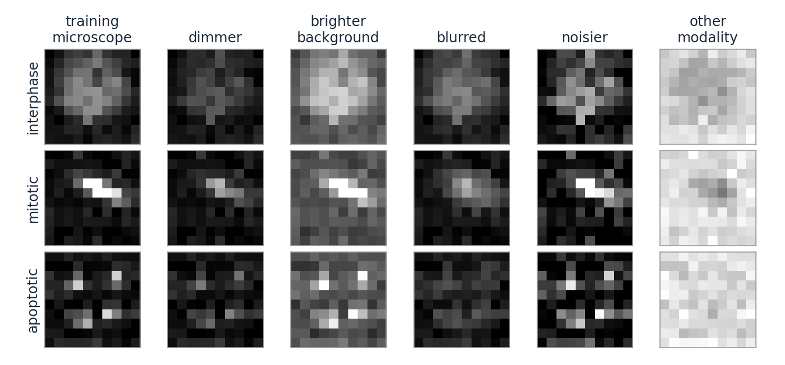
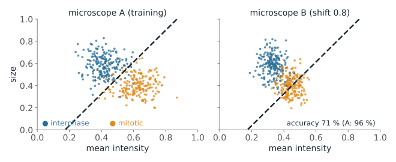
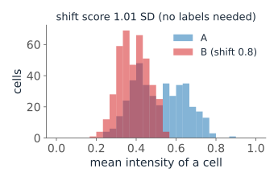
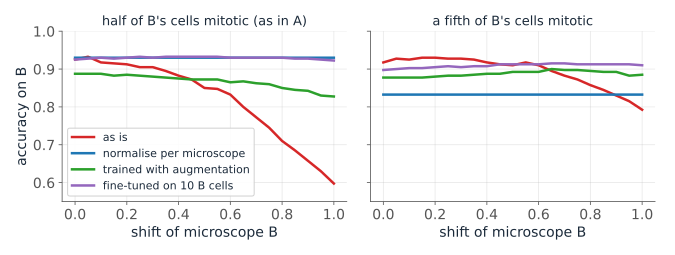

## About this lecture

A model trained on one microscope, stain or cell line often fails on another. The [leakage unit](../leakage/lec.qmd) showed how to **measure** that drop; this unit is about **why** it happens and what to do.

- What changes between microscopes, and why networks are sensitive to it.
- **Detecting** a shift without labels.
- Remedies: **intensity normalisation**, **re-estimating normalisation statistics**, **augmentation**, **fine-tuning** on a few new images.
- Each remedy has a trap; and the evaluation must use held-out experiments.

*Slides titled **The math** give the formulas and proofs; the ideas are complete without them.*

::: notes
Demo: domainshift (presets "same microscope", "dimmer microscope B", "normalise per microscope", "fewer mitoses in B", "fine-tune on 10 B cells"). Each cell is two numbers (mean intensity, size), so the whole story fits in one scatter plot; the figures with patches use the transfer toy. Numbers: tools/figs/few-labels/dump.ts.
:::

## The same cells, another microscope

{fig-alt="Three toy cells (interphase, mitotic, apoptotic) as 10 × 10 patches seen through six microscopes: the training microscope, a dimmer one, one with a brighter background, a blurred one, a noisier one, and another modality where the cells are dark on a bright background." width="78%" fig-align="center"}

- **Brightness and background**: lamp, exposure, detector gain, stain batch.
- **Blur and pixel size**: objective, focus, binning. **Noise**: exposure time, camera.
- **Modality**: fluorescence against bright field or stained tissue.
- And the **biology**: another cell line, another treatment, another share of each class.

## Why a trained model breaks

:::: {.columns}
::: {.column width="48%"}
- The model learnt a boundary in **its** input space. Shift the inputs and the cells move across the boundary, although they are the same cells.
- Here: two features, mean intensity and size. Microscope B is dimmer; the mitotic cells (bright and small) now look like interphase cells: **96 % → 71 %**.
- A network's **intermediate** statistics shift too: its normalisation layers (the [training day](../normalisation/lec.qmd)) use means and variances from the training images.
- Worst: **shortcuts**: a feature that predicted the class in training (a brighter plate for the treated wells) and means nothing elsewhere.
:::
::: {.column width="52%"}
{fig-alt="Two scatter plots of cells by mean intensity and size, blue interphase and orange mitotic, with the dashed decision line learnt on microscope A. Microscope A: the two clouds lie on either side of the line, accuracy 96 %. Microscope B (shift 0.8): the clouds have moved to lower intensity and squeezed together, and most mitotic cells lie on the interphase side: accuracy 71 %." width="100%"}
:::
::::

## The math: kinds of shift {.math}

Training data from $p_A(\mathbf x, y)$, use on $p_B(\mathbf x, y)$, with $p(\mathbf x, y) = p(y \mid \mathbf x)\,p(\mathbf x) = p(\mathbf x \mid y)\,p(y)$.

- **Covariate shift**: $p_B(\mathbf x) \ne p_A(\mathbf x)$ but $p(y \mid \mathbf x)$ the same: the images look different, the rule is the same. Remedies: make the inputs look alike (normalise, augment).
- **Label shift**: $p_B(y) \ne p_A(y)$ (fewer mitoses), $p(\mathbf x \mid y)$ the same. A calibrated classifier can be corrected by reweighting its outputs with $p_B(y)/p_A(y)$.
- **Concept shift**: $p(y \mid \mathbf x)$ itself changes (another definition of "mitotic", another annotator): only new labels help.
- Real shifts mix all three. The microscope change of this unit is a covariate shift in the image that becomes a shift of $p(\mathbf x \mid y)$ in the features.

## Detecting a shift without labels

:::: {.columns}
::: {.column width="52%"}
- Compare **statistics** of A and B: intensity histograms, means and spreads of features (or of a network's internal features). No labels needed.
- A simple score: $\max_k \lvert\bar f_k^B - \bar f_k^A\rvert / s_k^A$, the largest mean difference in A's standard deviations. Here 1.01 at shift 0.8.
- But a change of the **class balance** also moves the means: with a fifth instead of half of the cells mitotic, the score is 0.37 with **no** microscope change.
- A network's **confidence** is a poor detector: on shifted images it is often confidently wrong.
:::
::: {.column width="48%"}
{fig-alt="Histograms of the mean intensity of 400 cells from microscope A (blue, centred near 0.52, two humps) and microscope B at shift 0.8 (red, centred near 0.36, narrower). Shift score 1.01 SD." width="100%"}
:::
::::

## Remedies

| remedy | needs | fixes | trap |
|---|---|---|---|
| **normalise** intensities per image or per microscope | nothing | gain, offset | assumes the same mix of cells |
| **re-estimate** normalisation statistics on B | unlabelled B images | shifts inside the network | the same assumption |
| **augment** during training | foresight | every variation you simulate | only those; may cost accuracy on A |
| **fine-tune** on a few labelled B images | 10–100 labels | anything, including concept shift | overfitting; forgetting A |

Always: evaluate on **held-out experiments** of B, never on the images used to adapt.

## Normalisation, and its trap

{fig-alt="Accuracy on microscope B against the shift (0 to 1) for four remedies, two panels. Half of B's cells mitotic, as in A: as is falls from 92 % to 60 %; normalised per microscope stays at 93 %; trained with augmentation 89 % to 83 %; fine-tuned on 10 B cells about 92 to 93 %. A fifth of B's cells mitotic: normalised is 83 % at every shift, worse than as is up to a shift of about 0.85; as is falls from 92 % to 79 %; augmented stays near 88 to 90 %; fine-tuned near 90 to 91 %." width="92%" fig-align="center"}

- Standardising each microscope's features with **its own** mean and SD removes any gain and offset exactly: 93 % at every shift (left).
- But it also removes **real** differences: if B has fewer mitoses, its mean intensity is lower for a biological reason, and normalisation "corrects" it away: **83 %** even with no shift at all (right).

## The math: re-estimating normalisation statistics {.math}

A normalisation layer (batch norm in inference mode) stores the mean $\mu_j$ and variance $\sigma_j^2$ of unit $j$ over the training data, and computes

$$\hat z_j = \gamma_j\,\frac{z_j - \mu_j}{\sqrt{\sigma_j^2 + \epsilon}} + \beta_j$$

- On B the unit's activations have other statistics $(\mu_j^B, \sigma_j^B)$. **Re-estimating** them on unlabelled B images (forward passes, no training) and using them instead maps B's activations back to the range the next layer expects: for a gain $g$ and offset $o$ on $z_j$ the correction is exact.
- It is the per-feature standardisation of the demo, applied inside the network, layer by layer.
- Same trap: it also normalises away genuine differences of B's population; it needs enough B images (statistics of 8 images are noisy).

## Augmentation: show the variation in training

:::: {.columns}
::: {.column width="52%"}
- Train on A with random **gains, offsets, blur, noise**, so that the model learns to ignore them ([augmentation unit](../augmentation/lec.qmd)).
- In the demo, random intensity gains (0.4 to 1.2) and offsets make the classifier rely mostly on **size**: robust under shift (85 % at shift 0.8 instead of 71 %), and independent of B's class balance.
- The price: intensity **was** informative: on A itself 90 % instead of 96 %.
- It only helps with variations you **thought of**; a new modality is not a brighter version of the old one.
:::
::: {.column width="48%"}
{fig-alt="The same cells through six microscopes, as on the first slide: augmentations simulate these changes during training." width="100%"}
:::
::::

## Fine-tuning on a few images of B

:::: {.columns}
::: {.column width="55%"}
- Annotate **a few** B images and fine-tune the A model on them: the [transfer](../transfer/lec.qmd) and [strategies](../finetune-strategies/lec.qmd) units, with the A model as the pretrained network.
- In the demo: 10 labelled B cells (5 of each class), logistic regression pulled towards the A weights: **93 %** at shift 0.8, and 91 % when B has fewer mitoses (where normalisation gave 83 %).
- It handles **any** kind of shift, including changes of the biology, because it uses B's labels.
- Keep the A model, or check it on A again: fine-tuning forgets.
:::
::: {.column width="45%"}
{fig-alt="The A and B scatter plots with A's decision line, as before." width="100%"}
:::
::::

## Try it: two microscopes

```{=html}
<link rel="stylesheet" href="../demos/dist/demo.css">
<div data-demo="domainshift" data-preset="shift"></div>
<script src="../demos/dist/domainshift.js"></script>
```

::: notes
Each cell: (mean intensity, size). A: 400 cells, half mitotic; classifier: logistic regression, 96 % on A. B: intensity × (1 − 0.55 s) + 0.12 s. "same microscope": 92.5 % as is. "dimmer microscope B" (s = 0.8): as is 71.0 %, shift score 1.01. "normalise per microscope": 93.0 %. "fewer mitoses in B" (a fifth): normalised 83.3 %, as is 85.8 %, augmented 89.5 %. "fine-tune on 10 B cells": 91.3 % (the 10 cells are drawn as black dots).
:::

## Evaluate on held-out experiments

:::: {.columns}
::: {.column width="55%"}
- Adapting to B uses B's images (unlabelled for normalisation, labelled for fine-tuning). **Test** on **other** B images: other wells, slides, days, not the ones used to adapt.
- Split by the unit you will generalise over: if the method must work on **new** microscopes, hold out a whole microscope (or site), not images of the same one ([leakage unit](../leakage/lec.qmd): by image 92.2 %, by day 86.8 %).
- Report the accuracy **per domain**, not pooled: a mean over A and B hides a failure on B.
:::
::: {.column width="45%"}
{fig-alt="The intensity histograms of microscopes A and B again." width="100%"}
:::
::::

## Re-estimating statistics as pseudocode

```
model trained on microscope A, with normalisation layers (stored mean, variance per unit)
collect unlabelled images of microscope B (dozens, from several experiments)
for every normalisation layer, from the input to the output:
    run the B images through the network up to this layer
    mean_B[j], var_B[j] = mean and variance of unit j over all B images and positions
    replace the stored mean and variance by mean_B, var_B
# no weights are trained; check on held-out labelled B images
```

- Layer by layer, because each layer's statistics depend on the corrected layers before it.
- The coding exercise does the same with two features: statistics, standardisation, a shift score and augmentation.

::: notes
The coding exercise (finetuning/src/domain_shift/ in the course code download): feature statistics, standardisation with given statistics, the shift score and intensity augmentation; the program prints the accuracy on B against the shift for the four remedies, with B's mitotic share equal to A's and lower.
:::

## Summary

| Idea | In one line |
|---|---|
| Domain shift | the same cells measured differently: inputs cross the learnt boundary |
| Detection | compare feature statistics of A and B; no labels needed, but class balance moves them too |
| Normalisation | per microscope removes gain and offset; also removes real population differences |
| Re-estimated statistics | normalisation inside the network, from unlabelled B images |
| Augmentation | robust to simulated variations only; may cost accuracy on A |
| Fine-tuning | a few labelled B images fix any shift; keep testing on A and B |
| Evaluation | held-out experiments of each domain, reported per domain |

This closes the day. The [diffusion day](../score-matching/lec.qmd) turns from analysing images to generating them.
