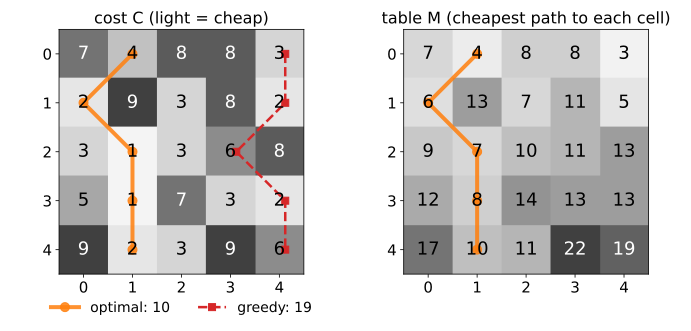

## About this lecture

Many image problems ask for the **cheapest path**: a boundary along dark pixels, a seam through an image, an alignment of two signals. There are far too many paths to try them all. **Dynamic programming** (DP) finds the best one exactly, with a table and a few additions.

- The question: the cheapest path from the top row to the bottom row of a cost image.
- **Why trying all paths fails**, and why the greedy choice fails.
- The key idea: an optimal path is made of **optimal sub-paths**.
- Fill a **table** row by row, then **backtrack** to read off the path.
- The general recipe, and two old friends that are the same recursion: the two-label chain of the graph-cut day and the distance transform.

*Slides titled **The math** give the formulas and proofs; the ideas are complete without them.*

::: notes
This is the first unit of the dynamic-programming day (elective group "Curves and energies", after snakes and level sets). Everything here is sums, minima and a table; no probability. The next units turn the same table sideways (closed boundaries in polar coordinates), drop the fixed order (Dijkstra, live-wire), and go continuous (fast marching).
:::

## The question

A small **cost image**: each pixel has a cost (light = cheap). Find the cheapest path from the top row to the bottom row that moves **one row down** per step, one column **left**, **straight** or **right**.

| | 0 | 1 | 2 | 3 | 4 |
|---|---|---|---|---|---|
| **0** | 7 | 4 | 8 | 8 | 3 |
| **1** | 2 | 9 | 3 | 8 | 2 |
| **2** | 3 | 1 | 3 | 6 | 8 |
| **3** | 5 | 1 | 7 | 3 | 2 |
| **4** | 9 | 2 | 3 | 9 | 6 |

The cost of a path is the sum of its five pixels. Try to guess the best path before the next slide.

::: notes
Give the class a minute. Most people start at the 3 in the top right (the cheapest first pixel) or look for the column of small numbers. The answer is 10, along columns 1, 0, 1, 1, 1; the "start at the cheapest pixel and keep going downhill" path costs 19.
:::

## Why not try all paths?

- From each pixel there are 3 ways down (2 at the image border). A path through $n$ rows has $n - 1$ steps, so there are about $m \cdot 3^{n-1}$ paths in an image with $m$ columns.
- $5 \times 5$: 259 paths (405 without the border effect). Still possible by hand, barely.
- $100 \times 100$: about $1.5 \cdot 10^{49}$ paths.
- $256 \times 256$: about $10^{124}$ paths, more than the roughly $10^{80}$ atoms in the observable universe.

Trying them all is hopeless. We need a way to **reuse** work: the paths overlap almost everywhere.

## Greedy fails

The obvious shortcut: start at the cheapest pixel of the top row and always step to the cheapest of the three pixels below.

- In the example: start at 3 (top right), then 2, 6, 2, 6: **19**.
- The best path costs **10**: 4, 2, 1, 1, 2. Its first pixel (4) is not the cheapest one.

A cheap first step can lead into an expensive region. To decide the first step well, we must know what comes **later**. Dynamic programming turns this around: it works out the best way to reach **every** pixel, so no decision is made too early.

## The key idea: optimal sub-paths

Suppose the best path to the bottom passes through pixel $p$. Then its part from the top to $p$ must be the **best path to $p$**: if there were a cheaper way to reach $p$, we could swap it in and get a cheaper path to the bottom.

So we only ever need to remember **one number per pixel**:

> $M(p)$ = the cost of the cheapest path from the top row to $p$.

and, for pixel $p$ in row $i$, it is known as soon as row $i - 1$ is known:

> $M(p)$ = cost of $p$ + the smallest $M$ among the (up to) three pixels above it.

This is Bellman's **principle of optimality** (1957).

## The math: the Bellman recursion {.math}

Cost image $C(i, j)$, rows $i = 0, \dots, n-1$, columns $j = 0, \dots, m-1$. A path is $j_0, j_1, \dots, j_{n-1}$ with $|j_{i} - j_{i-1}| \le 1$, cost $\sum_i C(i, j_i)$.

$$M(0, j) = C(0, j), \qquad M(i, j) = C(i, j) + \min_{d \in \{-1, 0, 1\}} M(i-1, j+d) \quad (i \ge 1),$$

with $M = \infty$ outside the image. Store the minimising $d$ as a **pointer** $B(i, j)$. The optimal cost is $\min_j M(n-1, j)$; the path follows the pointers back from that cell.

**Why it is correct** (by induction on $i$): every path to $(i, j)$ comes from one of the three cells above, and its cost is $C(i, j)$ plus the cost of its part up to row $i - 1$, which is at least $M(i-1, j+d)$. The recursion takes the best of these lower bounds, and it is reached by extending the optimal path to that cell.

## Filling the table, then backtracking

{width="80%" fig-align="center"}

- Row 0 of $M$ copies the costs. Row 1: $M(1,0) = 2 + \min(7, 4) = 6$; $M(1,1) = 9 + \min(7, 4, 8) = 13$; …
- Each cell also remembers **which** cell above gave the minimum: a pointer.
- At the end, the smallest $M$ in the last row is **10**. Follow the pointers back up: columns 1, 0, 1, 1, 1.

## Try it: the table step by step

```{=html}
<link rel="stylesheet" href="../demos/dist/demo.css">
<div data-demo="dpgrid" data-preset="exercise"></div>
<script src="../demos/dist/dpgrid.js"></script>
```

::: notes
Left: the costs; right: the table M. "step" fills one cell: the candidates in the row above are outlined, the chosen minimum is shaded green and an arrow points back to it. "next stage" fills a whole row, "fill all" the table, "backtrack" follows the arrows from the best cell of the last row; the last frame adds the greedy path (red "g"). Tour: by-hand grid (10 against greedy 19; 52 operations against 259 paths). "greedy fails": 9 against 20. "two equal optima": both mirror paths cost 9; the table keeps one pointer per cell (on a tie: straight, then left, then right), so it reports one of them. "a detour": the cheap channel turns back upwards; no monotone path can follow it (cost 24). That is the cliffhanger for the live-wire unit. Click the upper half of a cost cell to raise it, the lower half to lower it.
:::

## What it costs

- Each cell looks at (at most) **3** cells above: one addition and one comparison each. An $n \times m$ image needs about $3nm$ operations.
- $5 \times 5$: **52** operations instead of 259 paths. $256 \times 256$: about **195 000** operations instead of $10^{124}$ paths.
- **Memory**: the whole table and the pointers to recover the path; if only the **cost** is wanted, the previous row is enough.

The trick is the overlap: the cheapest way to each pixel is computed **once** and reused by every path that continues from it.

## The math: counting paths and operations {.math}

Let $N(i, j)$ be the number of paths from row 0 to $(i, j)$. Then $N(0, j) = 1$ and $N(i, j) = \sum_{d} N(i-1, j+d)$: the same recursion with $(+, \text{sum})$ in place of $(+, \min)$.

- Every cell has between 2 and 3 cells above it (for $m \ge 2$), so $m \cdot 2^{n-1} \le \sum_j N(n-1, j) \le m \cdot 3^{n-1}$: exponential in $n$.
- The table needs one candidate per (cell, step): $(n-1)(3m - 2)$ evaluations (the two border cells of each row have 2 candidates). Linear in the number of pixels.
- With $2\delta + 1$ allowed steps instead of 3: $O(nm\delta)$ work, about $m(2\delta+1)^{n-1}$ paths.

## The recipe

Dynamic programming in four steps:

1. **Stages and states**: here the rows are the stages and the column of the path is the state.
2. **A recursion**: the best value of a state from the best values of the previous stage.
3. **An order** in which every right-hand side is known before it is needed: here, row by row.
4. **Backtracking**: store where each minimum came from, and follow it back from the best final state.

Step 3 is the condition that matters later: if no such order exists, plain DP does not work (the live-wire unit).

## Same recursion, other states: the two-label chain

Recall from the graph-cut day (unit *Segmentation as energy minimisation*): the best labelling of a 1D profile, $E(L) = \sum_p D_p(L_p) + \lambda\,\#\{p : L_p \ne L_{p+1}\}$, solved exactly by DP.

- **Stage** = pixel $p$, **state** = its label 0 or 1. The table has two numbers per pixel.
- **Transition cost** $\lambda$ when the label changes: a "path" through a $2$-column grid with a step penalty.
- This is the **Viterbi** algorithm; the same idea decodes signals and aligns speech.

## Try it: the two-label chain

```{=html}
<link rel="stylesheet" href="../demos/dist/demo.css">
<div data-demo="segchain" data-lambda="3"></div>
<script src="../demos/dist/segchain.js"></script>
```

::: notes
The demo is the graph-cut day's own demo, embedded unchanged. Only make the link: two states per stage instead of m, and a penalty λ on a "sideways" step. The exercise (B3) fills the two-state table for the graph-cut day's 1 × 5 example.
:::

## Same recursion, other steps

The recursion does not care what the steps are, as long as each one goes **back** in the filling order.

- **One row down, up to $\delta$ columns sideways**, with a penalty $\alpha |d|$ for a step of $d$ columns: smoother paths. The next unit uses this for closed boundaries.
- **Right or down** (top-left to bottom-right): $M(i, j) = C(i, j) + \min\big(M(i-1, j),\ M(i, j-1)\big)$. Fill row by row, left to right. In the demo: **moves → ↓**. Adding the diagonal step gives the table used to align two signals (dynamic time warping).
- **Seams** through an image (seam carving) are the ↙↓↘ case on an energy image.

## Same recursion, other order: the distance transform

Recall from the morphology day: the two-pass (chamfer) distance transform. Its first pass is

$$D(i, j) = \min\big(D(i, j),\ D(i-1, j) + 1,\ D(i, j-1) + 1\big)$$

in raster order: a Bellman recursion where the "previous stage" is the pixel above and the pixel to the left.

- One pass is **not enough**: a pixel whose nearest background lies below or to the right gets the wrong value. A second pass in the opposite order fixes this case.
- So what happens when the best path may go up, down, left and right, and no fixed order works at all? That is the live-wire unit: let the algorithm **discover** the order.

## When is DP exact?

- DP is exact when the problem is a **chain** (one state per stage, each stage talks only to the next) or a **tree**, so that there is an order in which everything needed is already known.
- A 2D labelling with neighbours in both directions is **not** a chain: the grid has loops. The graph-cut day solves binary 2D labellings exactly in another way (max-flow, for submodular energies).
- A boundary that can be written as **one value per stage** (one column per row, one radius per angle) is a chain, so DP finds the **global** optimum, however many local minima the image has.

## Summary

- The cheapest path through a cost image cannot be found by trying all paths ($\sim 10^{124}$ for $256 \times 256$) or greedily.
- **Principle of optimality**: the best path to the end is made of best paths to its intermediate pixels.
- Fill the table $M$ = cost + the smallest $M$ above, **row by row**; store pointers; **backtrack** from the best final cell.
- About $3nm$ operations, exact.
- The recipe (stages, states, recursion, **order**, backtracking) also gives the two-label chain (Viterbi) and the passes of the distance transform.
