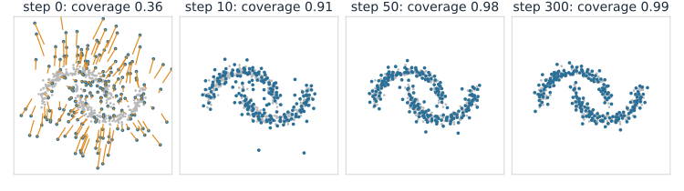
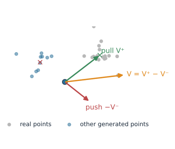
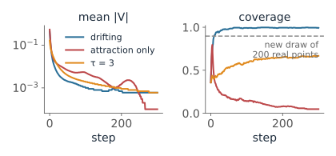
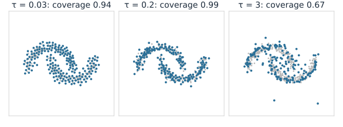
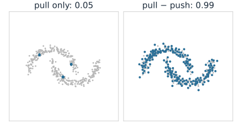
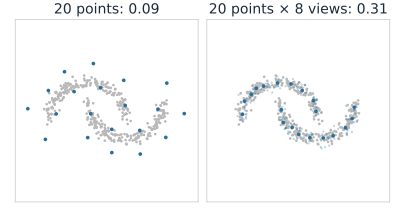
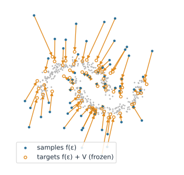
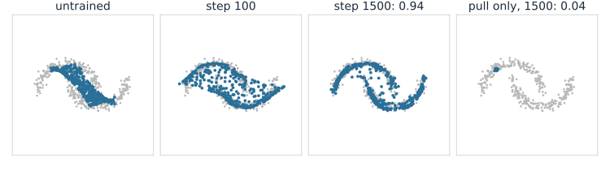

## About this lecture

*Diffusion needs tens of network passes per image. Can the iteration move into training, so that one pass makes an image?*

- **Particles first**: every generated point is **pulled** towards nearby real points and **pushed** away from nearby generated points. The difference is the **drifting field** $V$; it vanishes when the two clouds agree.
- The points can **be** the result: a handful of synthetic images that cover a data set (**dataset distillation**), judged by **coverage**.
- Or a network makes them: trained so that its outputs follow $V$, it then generates in **one pass**.
- How this relates to mean shift, GANs, diffusion and kernel distances, and what it does not guarantee.

A recent idea (2026), taught as an idea: neither paper shows microscopy.

*Slides titled **The math** give the formulas and proofs; the ideas are complete without them.*

::: notes
Last unit of the diffusion-models day. Two papers: Deng, Li, Li, Du and He, "Generative Modeling via Drifting" (arXiv 2602.04770, February 2026), and Cazenavette, Quan, Daras, Torralba and Sitzmann, "Dataset Distillation via Drifting" (arXiv 2611.16642, 2026). Demo: drifting (free points and a small generator, 2D). Every number on the slides comes from the demo's own model (tools/figs/drifting/data.ts) or from the papers, where marked.
:::

## Recall: one pass or many?

- A [VAE](../vae-gen/lec.qmd) decoder or a [GAN](../gan/lec.qmd) generator maps noise to an image in **one pass**. The GAN learns it from a **game** against a discriminator, which is hard to train.
- A [normalising flow](../flows/lec.qmd) is one pass too, through invertible layers.
- A diffusion model learns one easy thing, **denoising**, and pays at sampling time: [tens of steps](../diffusion-sampling/lec.qmd), each a network pass.
- **Drifting**: do the iterating **during training**, by moving the generated samples a little at every training step; keep a one-pass generator.

{fig-alt="Four panels: 200 points drifting onto the two-moons data. Step 0: the points are noise, each with an orange line showing its next move; coverage 0.36. Step 10: the points lie along the moons; coverage 0.91. Steps 50 and 300: coverage 0.98 and 0.99." width="92%" fig-align="center"}

## The pull and the push

:::: {.columns}
::: {.column width="52%"}
Look at one generated point $\mathbf x$.

- **Pull** $V^+$: from $\mathbf x$ to the **weighted mean of the real points** near it. Near points weigh most: weight $e^{-\text{distance}/\tau}$, normalised to sum to 1.
- **Push** $V^-$: the same towards the **other generated points**, with the sign flipped.
- **Drift** $V = V^+ - V^-$. Because both weights sum to 1, this is simply *(local mean of the real points) − (local mean of the generated points)*.
- Where the generated points are too dense, the push wins; where they are missing, the pull wins. Where the two clouds agree locally, the two means coincide and $V = 0$.
:::
::: {.column width="48%"}
{fig-alt="One generated point (dark blue) between a cloud of real points (grey, upper right) and a cloud of other generated points (light blue, left). A green arrow (pull V+) points to the weighted mean of the real points, a red arrow (push, minus V−) points away from the weighted mean of the generated points, and the orange arrow V = V+ − V− is their sum." width="100%"}
:::
::::

## The math: the drifting field {.math}

Real points $\mathbf y_j$ (distribution $p$), generated points $\mathbf x_k$ (distribution $q$), kernel $k(\mathbf x, \mathbf y) = \exp(-\|\mathbf x - \mathbf y\|/\tau)$:

$$V^+(\mathbf x) = \sum_j a_j(\mathbf y_j - \mathbf x),\quad a_j = \frac{k(\mathbf x, \mathbf y_j)}{\sum_{j'} k(\mathbf x, \mathbf y_{j'})};\qquad V^-(\mathbf x_i) = \sum_{k\ne i} b_k(\mathbf x_k - \mathbf x_i),\quad b_k \propto k(\mathbf x_i, \mathbf x_k).$$

- The weights are a **softmax** of $-\|\mathbf x - \mathbf y\|/\tau$, as in the attention and contrastive losses; a point is never its own negative.
- $V = V^+ - V^- = \sum_j a_j\mathbf y_j - \sum_k b_k\mathbf x_k$: the $-\mathbf x$ terms cancel.
- For distributions: $V_{p,q}(\mathbf x) = \frac{1}{Z_pZ_q}\,\mathbb E_{p,q}\big[k(\mathbf x, \mathbf y^+)\,k(\mathbf x, \mathbf y^-)\,(\mathbf y^+ - \mathbf y^-)\big]$ with $Z_p = \mathbb E_p[k(\mathbf x, \mathbf y^+)]$, $Z_q$ likewise (Deng et al. 2026).
- One drifting step for free points: $\mathbf x_i \leftarrow \mathbf x_i + \eta\,V(\mathbf x_i)$, all points at once.

## Try it: points drift onto the data

```{=html}
<link rel="stylesheet" href="../demos/dist/demo.css">
<div data-demo="drifting" data-preset="drift"></div>
<script src="../demos/dist/drifting.js"></script>
```

::: notes
Presets, 300 steps of η = 0.5 (numbers from the demo's model). "noise drifts to the moons" (200 points, τ = 0.2): mean |V| 0.451 → 0.015 after 10 steps → 0.001; coverage 0.357 → 0.905 → 0.993 (a new draw of 200 real points: 0.897). "start on the data": |V| starts at 0.034; coverage 0.875 → 0.995. "start far away": |V| 2.35 at the start, coverage 0 → 1.000. "τ small" (0.03): 0.943, |V| still 0.005; "τ large" (3): 0.667, some points left far outside. "attraction only": coverage falls to 0.048, the points collapse onto three spots. "20 points": 0.092; "20 points, 8 views": 0.313.
:::

## When does the drift stop?

:::: {.columns}
::: {.column width="50%"}
- From noise, the mean $|V|$ falls from 0.45 to 0.001 in 300 steps; **coverage** (next slides) rises from 0.36 to 0.99.
- Start on a **new draw of the data**: $|V|$ is 0.034 from the first step, 13 times smaller than from noise. The field barely moves a cloud that already matches.
- Not exactly zero: a point is not its own negative, so close neighbours push each other apart. Drifted points end up **more evenly spread** than a random draw: coverage 0.99 against 0.90 for 200 fresh real points.
- **Pull only** (red): $|V|$ also goes to 0, but every point has collapsed onto a few spots.
:::
::: {.column width="50%"}
{fig-alt="Two plots against the step (0 to 300). Left, mean |V| on a log scale: drifting falls from 0.45 to about 0.001; attraction only and tau = 3 also fall. Right, coverage: drifting rises to 0.99, above the dashed line of a new draw of 200 real points (0.90); tau = 3 creeps up to 0.67; attraction only first rises, then falls to 0.05." width="100%"}
:::
::::

## The math: zero drift, and what it does not prove {.math}

**Anti-symmetry**: swapping the roles of $p$ and $q$ swaps $V^+$ and $V^-$, so $V_{p,q}(\mathbf x) = -V_{q,p}(\mathbf x)$. If $q = p$, then $V = -V$, so $V = 0$ everywhere.

**The converse is false in general** (the paper's own caveat: "it remains unclear under what conditions $V \to 0$ leads to $q \to p$"). Training only sees $V$ **at the generated samples**:

- $p$ = points on a ring (symmetric about 0), $q$ = all mass at the centre. $V^+(\mathbf 0) = 0$ by symmetry and there are no other generated points to push: $V = 0$ on all of $q$, yet $q \neq p$. (An unstable rest point: any jitter breaks it.)
- In 1D with modes at $-1.5$ (3/4 of the data) and $+1.5$ (1/4), a generator whose samples all sit in the left mode feels almost no field when $\tau$ is small: the right mode is $e^{-3/\tau}$ away. In the coding exercise, a generator trained at $\tau = 0.2$ ends with 14 % of its samples in the right mode instead of 25 %.
- The paper gives conditions (full support, a linear-independence assumption) under which zero drift forces $q = p$.

## The temperature τ

{width="85%" fig-align="center" fig-alt="The two-moons data after 300 drifting steps of 200 points at three temperatures. tau = 0.03: the points follow the moons but more loosely, coverage 0.94. tau = 0.2: an even cover, 0.99. tau = 3: the points form a blurred version of the moons with some far outside, 0.67."}

- **Small** $\tau$: each point feels only its nearest neighbours. Fine local detail, but slow, and blind to anything far away (a missing mode).
- **Large** $\tau$: every point sees everything with almost equal weight; the field matches **averages** and leaves the shape blurred (coverage 0.67).
- The image paper sums the losses of several temperatures (0.02, 0.05 and 0.2, on normalised features).

## Pull only is mean shift

:::: {.columns}
::: {.column width="48%"}
- Without the push, every point climbs to the nearest peak of the density of the real points: exactly **mean shift** ([mixtures on images](../gmm-images/lec.qmd)).
- That is a **mode seeker**: 200 points collapse onto three spots, coverage 0.05.
- With 3 : 1 blobs, pull only puts 42 % of the points on the small blob; drifting puts 30 % (the data: 25 %).
- The push is what turns "find the peaks" into "match the distribution". In the image paper, pull only gives FID 177, the full field 8.5.
:::
::: {.column width="52%"}
{fig-alt="Two panels after 300 steps on the two moons. Left, pull only: all 200 points sit on three spots, coverage 0.05. Right, pull minus push: the points cover both moons evenly, coverage 0.99." width="100%"}
:::
::::

## Drifting as pseudocode

```
real = the real points (or their features)
x    = N generated points (noise, or the outputs of a generator)
repeat:
    for every generated point i:
        a = softmax over real points j of  −|x[i] − real[j]| / τ
        b = softmax over other generated points k ≠ i of  −|x[i] − x[k]| / τ
        V[i] = Σ a[j]·real[j]  −  Σ b[k]·x[k]
    x[i] = x[i] + η·V[i]             (free points)
    or: train the generator so that its output for ε moves to the fixed target x[i] + V[i]
```

- No discriminator, no noise levels, no likelihood: two softmax-weighted means per point.

::: notes
The coding exercise (diffusion/src/drifting/ in the course code download) writes the kernel mean, the field, coverage and the drifting loop for 1D points, then trains a 1 → 16 → 1 generator with the stop-gradient loss.
:::

## The points are the data set: distillation

:::: {.columns}
::: {.column width="50%"}
**Dataset distillation**: replace thousands of training images of a class by **10 synthetic ones** that a network can still learn from. Drifting makes the 10 images free points and moves them until they **cover** the class.

- **Coverage**: the fraction of real points whose $k$-nearest-neighbour ball contains a synthetic point ($k = 5$). Like the recall of [the sampling unit](../diffusion-sampling/lec.qmd), but with the balls around the **real** points: a few isolated synthetic points cannot cover much.
- Few points need **augmentation**: 8 jittered **views** per point. Each point then carries its own small cloud, and the push is measured locally.
- 20 points without views settle off the data (median 0.25 away), pushed apart by distant neighbours: coverage 0.09, **worse** than 20 random real points (0.25). With views: 0.31.
:::
::: {.column width="50%"}
{fig-alt="Two panels with 20 synthetic points on the two moons. Left, without augmentation: the points are spread far apart, many beside the moons, coverage 0.09. Right, with 8 jittered views per point (faint): the points sit on the moons, evenly spaced, coverage 0.31." width="100%"}
:::
::::

## Distillation on real images

- Cazenavette et al. (2026) drift the synthetic images of each ImageNet class directly (pixels, stored as image pyramids), with the field computed in the **features of a frozen self-supervised encoder** (as in contrastive learning).
- **No classifier in the loop**: the loss needs only features; classification appears only when testing the distilled set.
- Augmentations (crops, flips, noise) give 10 views per image per step; the views of one image are negatives for each other. Without augmentation every result collapses.
- 10 images per class, a ResNet-18 trained from scratch on them: 27.0 % ImageNet accuracy from noise starts against 11.7 % for the best earlier method from noise; coverage 83 % against at most 37 % for earlier methods.
- Cost: about 0.25 GPU hours per class. Audio and video sets work the same way.

::: notes
Numbers from arXiv 2611.16642 (hard labels, MoCo-v3 features, 10 images per class; coverage measured in DINOv3 features, k = 5, cosine distance). With soft labels from a teacher network: 40 % at 10 and 53 % at 50 images per class.
:::

## A generator instead of free points

:::: {.columns}
::: {.column width="52%"}
Now a network $f$ maps noise $\varepsilon$ to a point. At every training step:

1. Make a batch of samples $f(\varepsilon)$; compute $V$ at each (positives: a batch of real points; negatives: the other samples).
2. Give each sample the **target** $f(\varepsilon) + V$ and **freeze** it (stop-gradient): it is a fixed number, like a label.
3. One gradient step of ordinary regression: $\text{loss} = \text{mean}\,\|f(\varepsilon) - \text{target}\|^2$.

The network moves its outputs a little along the field. After training: **one pass** per sample.
:::
::: {.column width="48%"}
{fig-alt="Generated samples (blue dots) scattered around the two-moons data, each with an orange arrow to its target f(epsilon) + V (open orange circle), which lies closer to the moons." width="100%"}
:::
::::

## The math: the loss and its gradient {.math}

$$\mathcal L(\theta) = \mathbb E_\varepsilon\Big[\big\|f_\theta(\varepsilon) - \text{stopgrad}\big(f_\theta(\varepsilon) + V(f_\theta(\varepsilon))\big)\big\|^2\Big]$$

- Its **value** is $\mathbb E\|V\|^2$ (the target is $V$ away).
- Its **gradient** with respect to one output $\mathbf u = f_\theta(\varepsilon)$, with the target held fixed: $2(\mathbf u - \mathbf u - V) = -2V$. Gradient descent moves the output **along** $V$, and backpropagation turns that into a weight update: $\nabla_\theta\mathcal L = -2\,\mathbb E\big[J_\theta^\top V\big]$, $J_\theta = \partial f_\theta/\partial\theta$.
- For a free point ($f_\theta(\varepsilon) = \theta$): a step with learning rate $\eta/2$ is exactly $\mathbf x \leftarrow \mathbf x + \eta V$.
- Without the stop-gradient, the loss would be $\|V\|^2$ differentiated **through** $V$: the generator could shrink $V$ by moving the other samples, not by matching the data.

## Try it: a generator in one pass

```{=html}
<link rel="stylesheet" href="../demos/dist/demo.css">
<div data-demo="drifting" data-preset="gen"></div>
<script src="../demos/dist/drifting.js"></script>
```

::: notes
Generator: an MLP 2 → 32 → 32 → 2 (tanh), Adam with learning rate 0.003, batches of 128 noise vectors and 128 real points, τ = 0.1, 1500 steps; the plot shows 400 samples, one forward pass each. Coverage 0.287 untrained → 0.877 after 100 steps → 0.945 after 300 → 0.935 after 1500 (a new draw of 400 real points: 0.980). Loss (mean |V|²/2) 0.012 → 0.0016. "generator, attraction only": coverage 0.035 after 1500 steps, every sample on one spot.
:::

## What the generator learns

{width="90%" fig-align="center" fig-alt="Four panels of 400 generator samples on the two moons. Untrained: a twisted band across the middle. Step 100: the samples follow both moons roughly. Step 1500: they cover both moons, coverage 0.94. Pull only, step 1500: all samples on one spot, coverage 0.04."}

- One pass per sample, and no game: the targets are fixed numbers, so each step is a plain regression.
- On ImageNet (256 × 256) the paper reports FID 1.54 with **one** network pass, close to strong diffusion models that need many passes; the field is computed in the features of a frozen self-supervised encoder, not on pixels.

## Relatives

:::: {.columns}
::: {.column width="50%"}
- **GAN**: also one pass, also trained by comparing its samples with real ones. But the comparison is a **learned discriminator** in a game; here it is a fixed kernel average, and training is a regression.
- **Diffusion**: iterates at **sampling** time (tens of passes per image). Drifting iterates at **training** time; sampling is one pass.
- **Mean shift**: the pull alone.
:::
::: {.column width="50%"}
- **Kernel moment matching (MMD)**: compares two clouds through kernel averages. Its gradient for a sample is the drift **without** the normalisation (next slide); the paper reports that the plain MMD loss did not train well.
- **Contrastive learning**: the same softmax over positives and negatives, used to train features instead of moving samples.
- **Stop-gradient targets**: as in self-distillation, a fixed target computed by the model itself.
:::
::::

## The math: kernel moment matching {.math}

Squared **maximum mean discrepancy** with a kernel $k$:
$$\text{MMD}^2(p, q) = \mathbb E_{q,q}[k(\mathbf x, \mathbf x')] - 2\,\mathbb E_{p,q}[k(\mathbf y, \mathbf x)] + \mathbb E_{p,p}[k(\mathbf y, \mathbf y')].$$

Move one of $N$ generated samples $\mathbf x_i$. With a Gaussian kernel $k = e^{-\|\mathbf x - \mathbf y\|^2/2h^2}$, $\nabla_{\mathbf x}k(\mathbf x, \mathbf y) = k\,(\mathbf y - \mathbf x)/h^2$, so

$$-\frac{\partial\,\text{MMD}^2}{\partial\mathbf x_i} = \frac{2}{Nh^2}\Big(\mathbb E_p\big[k(\mathbf x_i, \mathbf y)(\mathbf y - \mathbf x_i)\big] - \mathbb E_q\big[k(\mathbf x_i, \mathbf x)(\mathbf x - \mathbf x_i)\big]\Big),$$

the drifting field **without** the normalisations $Z_p$, $Z_q$. Drifting divides the pull and the push separately by their total weight, so each is a local mean; it is then no longer the gradient of one fixed distance between $p$ and $q$.

## Five ways to generate

| | trained by | likelihood | samples | passes per sample |
|---|---|---|---|---|
| [VAE](../vae-gen/lec.qmd) | reconstruction + closeness to the prior | a lower bound | smooth, often blurry | 1 |
| [GAN](../gan/lec.qmd) | a game against a discriminator | none | sharp; can drop modes; fragile training | 1 |
| [Flow](../flows/lec.qmd) | maximum likelihood through invertible layers | exact | limited by invertible layers | 1 |
| [Diffusion](../diffusion/lec.qmd) | denoising at every noise level | a bound (exact via the ODE) | the best detail and coverage so far | tens to hundreds |
| Drifting | regression on drifted targets (pull − push) | none | ImageNet FID 1.54 reported | 1 |

All five can invent detail a measurement never contained: the [checks of the previous unit](../diffusion-inverse/lec.qmd) apply to every one of them.

## Is it new?

- A new **framing** built from known parts: mean shift (the pull), kernel moment matching, the positives/negatives softmax of contrastive learning, and stop-gradient regression targets.
- New is moving the iteration into training with an explicit field, and making it work at image scale (multiple temperatures, frozen feature encoders, large batches of positives and negatives).
- Open: when zero drift implies a matching distribution; how much depends on the feature encoder.
- For a lab: nothing here is a tool to use on microscopy yet. Generated or distilled images are judged like any generator's: coverage, nearest-training-image checks, and the measurement you will make.

## Summary

- **Drift** = local mean of the real points − local mean of the other generated points (kernel $e^{-d/\tau}$, softmax weights). It vanishes when the clouds agree; zero drift alone does not prove they do.
- **Free points**: drifting moves a synthetic set until it covers the data (dataset distillation); few points need augmented views. **Coverage** measures it.
- Pull only is **mean shift** and collapses onto modes; the push spreads the points.
- **Generator**: regress the outputs on frozen targets $f(\varepsilon) + V$ (gradient $-2V$); sampling is one pass.
- $\tau$ sets the reach: small sees detail but misses far modes, large sees only averages.
