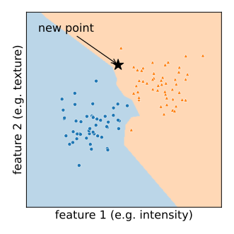
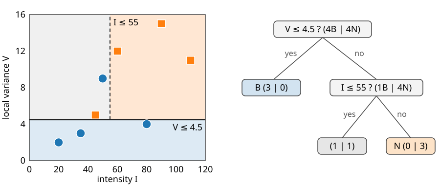
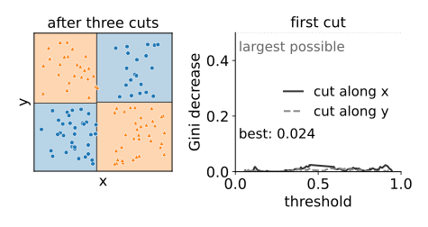
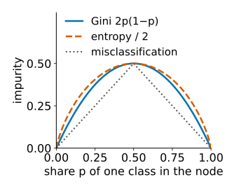
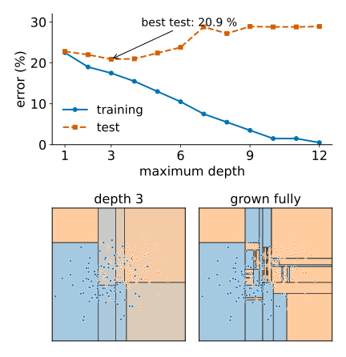
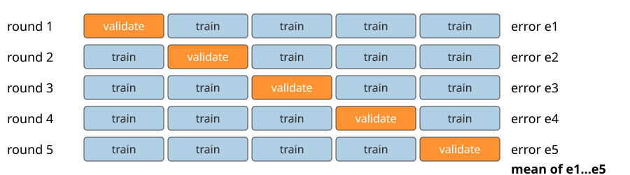
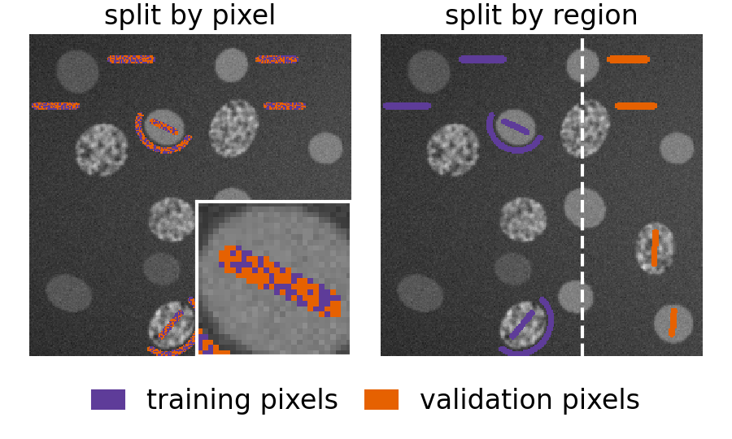
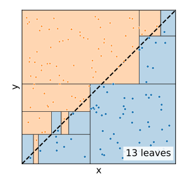

## About this lecture

The first day of learning from examples. So far we wrote every rule by hand: a threshold, a filter, an energy. Now the rule is **learned** from examples that someone has labelled.

- **Classification** = colouring a **feature space**: each pixel or object is a point.
- A **decision tree** asks yes/no questions about one feature at a time.
- It is **grown** greedily: the question that makes the two groups **purest**.
- A tree grown too far **memorises** the training data: **overfitting**.
- **Training, validation and test data**, and **cross-validation**: how to measure honestly.
- **Regression trees**: the same idea for numbers.

*Slides titled **The math** give the formulas and proofs; the ideas are complete without them.*

::: notes
This day owns the classification basics for the whole course: feature space, training/validation/test data, overfitting, cross-validation. Later days (neural networks, evaluation, SVM, mixtures) recall them from here. The next unit makes forests from many trees; unit 3 classifies objects from measurements; unit 4 classifies pixels.
:::

## Classification: colour the feature space


:::: {.columns}
::: {.column width="58%"}
- Measure a few numbers per pixel or per object: its **features** (intensity, local variance, area, …).
- Each pixel or object is then a **point**, one axis per feature.
- **Training data**: points whose class someone knows (nucleus / background, mitotic / not).
- The classifier must **colour the whole plane**: every new point gets a class from where it lands.

The simplest way: give a new point the class of its **nearest** training point (nearest neighbour). Trees do it with a few questions instead.
:::
::: {.column width="42%"}
{fig-alt="Two clouds of training points, blue circles and orange triangles, in a plane of two features. The background is coloured by the class of the nearest training point; a new point (star) lands in the orange region." width="100%"}

Nearest neighbour: every spot of the plane takes the class of the closest training point.
:::
::::

::: notes
Draw two clouds on the board, a new point between them. Nearest neighbour is mentioned only as the obvious baseline; it needs all training points at prediction time and depends on the units of the axes (a tree does not, see later).
:::

## A decision tree

{width="92%"}

Eight pixels, two features: intensity $I$ and local variance $V$ (texture). Each **node** asks "is feature $\le t$?"; each **leaf** holds a class (or the class proportions). Every question cuts the plane along an axis: a tree is a set of **axis-aligned rectangles**. A tree with one question is a **stump**.

::: notes
Read the tree: V ≤ 4.5 → background (3 smooth, dim pixels). Otherwise ask I ≤ 55: the left leaf still holds one of each, the right leaf three nuclei. The plane on the left is the same tree. Prediction is a handful of comparisons.
:::

## Growing a tree


:::: {.columns}
::: {.column width="50%"}
1. Take all training points in a node.
2. For **every feature** and **every threshold** between two neighbouring values: split the points into "≤" and ">".
3. Keep the split whose two children are **purest**.
4. Repeat in each child (**recursive partitioning**), until a stopping rule says no.

This is **greedy**: each question is the best one *now*. The best first question is not always part of the best tree. With four quadrants coloured like a chessboard (XOR), no single cut helps, yet two cuts solve it.
:::
::: {.column width="50%"}
{fig-alt="Left: XOR data, four quadrants coloured like a chessboard, cut into four rectangles by a tree with three splits. Right: the Gini decrease of the first cut against its threshold, for cuts along x and along y: both curves stay below 0.03, the best is 0.024, far from the possible 0.5." width="100%"}
:::
::::

::: notes
The XOR preset in the demo shows this: the split scan at the root is almost flat (best impurity decrease 0.024 of a possible 0.5), but after three splits the training error is 1 of 120. Finding the best tree overall is computationally hopeless, hence greedy.
:::

## Impurity: how mixed is a node?


:::: {.columns}
::: {.column width="56%"}
- **0** when the node holds a single class; **largest** when the classes are equally mixed.
- **Gini impurity**: the chance that two points drawn at random from the node (with replacement) have **different** classes. For two classes with shares $p$ and $1 - p$: $2p(1-p)$, at most $0.5$.
- **Entropy**: how many yes/no questions are still needed, on average, to name the class (at most 1 for two classes). It chooses almost the same splits; the full story is on the compression day.
- A split is good when the **weighted** impurity of the children is much lower than the parent's: the **impurity decrease**.
:::
::: {.column width="44%"}
{fig-alt="Gini impurity 2p(1−p), half the entropy, and the misclassification rate against the share p of one class: all are 0 at p = 0 and p = 1 and largest, 0.5, at p = 0.5; Gini and entropy are smooth curves, misclassification a tent." width="100%"}
:::
::::

## The math: impurity and its decrease {.math}

Class shares $p_k$ in a node. Gini, entropy and misclassification:
$$G = 1 - \sum_k p_k^2 = \sum_{k \ne l} p_k p_l, \qquad H = -\sum_k p_k \log_2 p_k, \qquad M = 1 - \max_k p_k .$$

A split of $n$ points into $n_L$ and $n_R$:
$$\Delta = I(\text{parent}) - \tfrac{n_L}{n}\, I(L) - \tfrac{n_R}{n}\, I(R) \;\ge\; 0 \quad\text{for concave } I .$$
(The parent's shares are the weighted mean of the children's; Jensen's inequality.) With $H$, $\Delta$ is called the **information gain**.

$M$ is a poor criterion: it is only piecewise linear, so many useful splits give $\Delta = 0$. Example: 400 + 400 points split into (300, 100) | (100, 300) or into (200, 400) | (200, 0). Both have $\Delta M = 0.25$; Gini prefers the second, which has a **pure** child ($\Delta G = 0.167$ against $0.125$).

## The eight pixels by hand

| $I$ | 20 | 35 | 45 | 50 | 60 | 80 | 90 | 110 |
|---|---|---|---|---|---|---|---|---|
| $V$ | 2 | 3 | 5 | 9 | 12 | 4 | 15 | 11 |
| class | B | B | N | B | N | B | N | N |

- Parent: 4 B, 4 N: $G = 0.5$.
- Best on $I$: $I \le 40$ gives (2 B) | (2 B, 4 N): weighted $G = \tfrac{6}{8}\cdot\tfrac{4}{9} = 0.333$ (the same for $I \le 85$).
- Best on $V$: $V \le 4.5$ gives (3 B) | (1 B, 4 N): weighted $G = \tfrac{5}{8}\cdot 0.32 = 0.200$.
- The root asks about **texture**, not brightness. Entropy agrees: information gain 0.549 bits on $V$, 0.311 on $I$.

## Try it: grow a tree

```{=html}
<link rel="stylesheet" href="../demos/dist/demo.css">
<div data-demo="treeplay" data-preset="blobs"></div>
<script src="../demos/dist/treeplay.js"></script>
```

::: notes
Left: points (click to add, drag to move), the tree's rectangles behind them, the split lines on top. Right: the tree, and for the selected node the split scan: impurity decrease against the threshold for a cut along x (blue) and y (green); click on a curve to force that cut. Tour: "two blobs": one stump at x ≤ 0.48, best decrease 0.48, 1 of 100 training points wrong. "XOR": the scan at the root is flat (0.024): next split three times, error drops to 1/120. "diagonal": grow fully, a staircase of 13 leaves. "one mislabelled point": a deep tree draws a thin sliver around it; min leaf size 3 removes it. "noisy overlap" with the error-vs-depth view: training error falls to 0.5 %, test error is lowest at depth 3 (20.9 %) and ends at 28.9 %.
:::

## When to stop: overfitting


:::: {.columns}
::: {.column width="52%"}
- Grown until every leaf is pure, a tree **memorises** the training points: zero training error, jagged boundaries, a sliver around every mislabelled point.
- Stopping rules: **maximum depth**, **minimum points per leaf**, **minimum impurity decrease** (or grow fully, then prune).
- **Training error** falls with depth; **test error** on new data first falls, then rises: the U-shaped curve.
- A deep tree is **unstable**: move a few points and you get a completely different tree (**high variance**). The next unit turns this weakness into a strength.
:::
::: {.column width="48%"}
{fig-alt="Top: training and test error against the maximum depth on the noisy-overlap data. Training error falls from 22.5 % to 0.5 %; test error is lowest at depth 3 (20.9 %) and rises to 28.9 %. Bottom: the partition at depth 3 (a few large rectangles) and fully grown (many small rectangles around single points)." width="88%"}
:::
::::

::: notes
Numbers from the "noisy overlap" preset (200 training points, 1000 test points from the same two overlapping clouds): depth 1: 22.5 % / 22.8 %; depth 3: 17.5 % / 20.9 %; depth 12: 0.5 % / 28.9 %.
:::

## Training, validation and test data

- **Training set**: fits the model (grows the tree).
- **Validation set**: chooses the settings (depth, leaf size) by comparing their errors.
- **Test set**: touched **once**, at the very end, to report the error. If you choose anything with it, it has become a validation set and the reported error is optimistic.

Few labelled examples? **k-fold cross-validation** reuses them:

{width="70%"}

## Images are not independent samples


:::: {.columns}
::: {.column width="50%"}
- Neighbouring pixels in one painted stroke are near copies of each other; cells in one image share its staining and its illumination.
- A random split **by pixel** puts near copies on both sides: the validation error looks far better than it will be on a new image.
- Rule: split **by image** (or by region, or by stroke), never by pixel.

The pixel-classification unit shows the effect; the evaluation and statistics day treats data leakage in full.
:::
::: {.column width="50%"}
{fig-alt="The painted strokes on a test image, coloured by which set each pixel goes to. Split by pixel: training and validation pixels alternate at random along every stroke (zoomed inset). Split by region: all strokes left of a dashed line are training, those on the right validation." width="100%"}
:::
::::

## Regression trees: steps

- Leaves hold a **number** (the mean of their points) instead of a class.
- Splits **reduce the spread**: the sum of squared differences from the mean.
- The fit is a **staircase**: a piecewise-constant function. Across a cell edge, a depth-2 tree gives four plateaus.
- A small neural network (the neural-networks day) fits the same profile with **bends** instead of steps.

## Try it: steps across a cell edge

```{=html}
<link rel="stylesheet" href="../demos/dist/demo.css">
<div data-demo="treeplay" data-preset="regression"></div>
<script src="../demos/dist/treeplay.js"></script>
```

::: notes
The profile: 60 samples across a blurred, noisy edge from 40 to 160. Depth 1: one step at x = 0.449, means 46 and 155, training MSE 262.8. Depth 2: four plateaus 40, 75, 129, 158, training MSE 124.7, test MSE 141.4. The test error is lowest at depth 3 (130.1) and rises again (224.2 at depth 6): overfitting looks the same for numbers.
:::

## The math: search cost and regression {.math}

- Sort each feature once; sweep the thresholds from left to right, updating the class counts of the left child: $O(d\, n \log n)$ per node for $d$ features and $n$ points.
- Finding the tree with the fewest errors at a given size is NP-hard: hence the greedy growth.
- Regression: a leaf predicts $\bar y_{\text{leaf}}$; the split criterion is the decrease of the sum of squared errors,
$$\Delta = \sum_{i \in P}(y_i - \bar y_P)^2 - \sum_{i \in L}(y_i - \bar y_L)^2 - \sum_{i \in R}(y_i - \bar y_R)^2 ,$$
i.e. the **variance reduction** times $n$.

## What trees are good at


:::: {.columns}
::: {.column width="60%"}
- **No scaling**: only the **order** of a feature's values matters. Measure area in µm² or in pixels, apply a logarithm: the same tree (with moved thresholds).
- **Mixed units**: intensities, areas, ratios and yes/no features side by side.
- **Fast**: a prediction is a handful of comparisons.
- **Readable**, when small.

Weak points: axis-aligned staircases for oblique boundaries, and the instability of deep trees.
:::
::: {.column width="40%"}
{fig-alt="Points above and below a diagonal boundary (dashed). A fully grown tree approximates it by a staircase of 13 axis-aligned rectangles." width="100%"}

A diagonal boundary needs a staircase of rectangles.
:::
::::

## Summary

- Classification colours a **feature space**; training points are examples with known class.
- A **tree** asks one-feature questions; its leaves are axis-aligned rectangles.
- Grow greedily by the largest **impurity decrease** (Gini; entropy is almost the same).
- Deep trees **overfit**: low training error, higher test error, unstable.
- Choose settings on **validation** data or by **cross-validation**; report the **test** error once; split images, not pixels.
- **Regression trees** fit steps.
