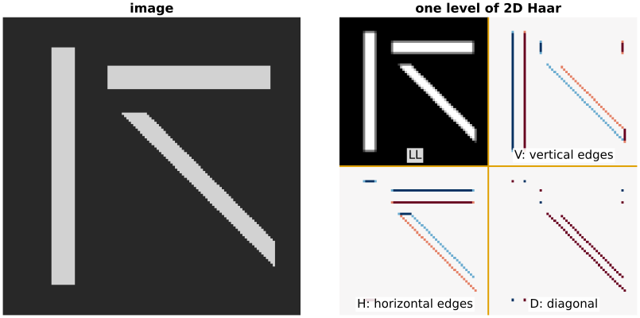
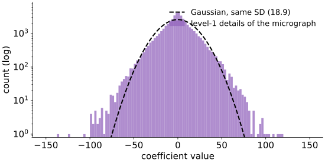

## About this lecture

The last two units transformed 1D signals. Images are 2D, and the 2D wavelet transform is the 1D one applied twice.

- **Separable**: transform every row, then every column. One level gives four **subbands**: LL, H, V, D.
- A $2 \times 2$ block by hand, and which band an edge lights up.
- Repeat on LL: the **subband pyramid**.
- How **sparse** a real image is in a wavelet basis, and "keep the $K$ largest" against Fourier and the $8 \times 8$ block DCT.
- **Shift variance**: move the image by one pixel and the coefficients change a lot.

*Slides titled **The math** give the formulas and proofs; the ideas are complete without them.*

::: notes
Third unit of the wavelets elective. Uses the filter bank of the previous unit, the 2D DFT's separability from the Fourier unit, and PSNR from the camera noise unit. The subband names LL / H / V / D are the course convention (also on the compression and integral-image days).
:::

## Separable: rows, then columns

As for the 2D DFT (*Images in frequency space*): a 2D transform built from 1D ones.

1. Run one level of the 1D filter bank on **every row**: left half = low-pass along $x$, right half = high-pass along $x$.
2. Run it on **every column** of the result: top = low-pass along $y$, bottom = high-pass along $y$.

Four quarter-size **subbands**:

| | low-pass along $x$ | high-pass along $x$ |
|---|---|---|
| **low-pass along $y$** | **LL**: approximation, a half-size thumbnail | **V**: vertical edges |
| **high-pass along $y$** | **H**: horizontal edges | **D**: diagonal detail |

## One level on an image

{width="88%"}

- **LL** looks like the image at half size.
- **V** responds where the image changes along $x$: the **vertical** bar's sides. **H** responds to changes along $y$: the **horizontal** bar's top and bottom. The diagonal bar changes along both axes, so it shows up in V, H **and** D.
- Flat regions give 0 in every detail band (white).

::: notes
128 × 128 synthetic image, one level of orthonormal 2D Haar. Detail bands in a diverging map (blue negative, red positive), each scaled to its own largest value; LL in grey. The sign tells the direction of the change (dark to bright or bright to dark).
:::

## The math: naming the bands {.math}

Write the 1D analysis as two operators: $L$ (low-pass $h$, keep every second sample) and $H$ (high-pass $g$, keep every second). With the image $X$ as a matrix (rows = $y$, columns = $x$), one level is
$$X \;\mapsto\; \begin{pmatrix} L \\ H \end{pmatrix} X \begin{pmatrix} L \\ H \end{pmatrix}^{\!\top} = \begin{pmatrix} L X L^\top & L X H^\top \\ H X L^\top & H X H^\top\end{pmatrix}.$$

- Two-letter names, **first letter = filter along $x$** (columns of $X$), second = along $y$: $LXL^\top$ = **LL**, $LXH^\top$ = **HL** (high along $x$) = our **V**, $HXL^\top$ = **LH** = our **H**, $HXH^\top$ = **HH** = **D**.
- Books disagree on whether "LH" means "low along $x$" or "low along $y$" (and on which band is called "horizontal"). This course uses LL / H / V / D by what they show; in the math layer, first letter = $x$.
- If the 1D transform $W = \binom{L}{H}$ is orthogonal, so is $X \mapsto W X W^\top$: $\|WXW^\top\|_F = \|X\|_F$.

## A $2 \times 2$ block by hand

Orthonormal Haar on a block $\begin{pmatrix} a & b \\ c & d\end{pmatrix}$ (rows, then columns):

| band | value |
|---|---|
| LL | $\tfrac12(a + b + c + d)$ |
| V | $\tfrac12(a - b + c - d)$: left minus right |
| H | $\tfrac12(a + b - c - d)$: top minus bottom |
| D | $\tfrac12(a - b - c + d)$: one diagonal minus the other |

- Flat block $\begin{pmatrix} 5 & 5\\ 5 & 5\end{pmatrix}$: LL $= 10$, all details $0$.
- Vertical edge $\begin{pmatrix} 2 & 8\\ 2 & 8\end{pmatrix}$: LL $= 10$, **V** $= -6$, H $=$ D $= 0$. An edge lights **one** band.

## The subband pyramid

Repeat on LL only (the cascade of the last unit, in 2D):

- Each level splits the current LL into a quarter-size LL and three detail bands.
- Drawn in place, this is the **Mallat layout**: the smallest LL in the top-left corner, then the bands of the coarsest level around it, then finer and finer bands outwards.
- $L$ levels on an $N \times N$ image: still exactly $N^2$ coefficients.

Displaying it: the bands have very different ranges, so each band is **rescaled on its own** (or all are shown as $\log|w|$). LL looks like a thumbnail; the detail bands look like edge maps at different scales.

## Try it: the 2D wavelet transform

```{=html}
<link rel="stylesheet" href="../demos/dist/demo.css">
<div data-demo="dwt2d" data-preset="orient"></div>
<script src="../demos/dist/dwt2d.js"></script>
```

::: notes
Panels: image, subbands, reconstruction, error. "one level: three orientations" (oriented bars, Haar, 1 level). Then "pyramid of the cell" (db2, 4 levels); switch to "log |w|". Mode "zero bands": click the three level-1 bands ("drop the finest level"): db4, 3 levels, 25 % of the coefficients kept, PSNR 23.9 dB; dropping only D costs much less (31.5 dB) than dropping V (27.5 dB). The PSNR plot is the next slide's subject.
:::

## How sparse is a real image?

:::: {.columns}
::: {.column width="55%"}
{width="100%"}
:::
::: {.column width="45%"}
The micrograph, db4, 4 levels:

- **LL** holds **95.7 %** of the energy in **0.4 %** of the coefficients.
- The level-1 details are **peaked at 0** with **heavy tails**: half of them have $|w| < 10$ (grey levels), a few reach 160. A Gaussian with the same spread would almost never exceed 76 (4 SD); here 0.19 % do.
- 90 % of the detail energy sits in **21 %** of the detail coefficients: along edges.
:::
::::

## Keep the $K$ largest

Keep a fraction of all coefficients, set the rest to 0, transform back. Same count for every basis:

| kept | Haar | db4 | CDF 9/7 | Fourier | $8\times8$ DCT |
|---|---|---|---|---|---|
| 1 % | 18.2 | 18.6 | 18.8 | 18.4 | 10.5 |
| 5 % | 20.9 | 21.5 | 21.8 | 21.0 | 21.2 |
| 20 % | 25.7 | 26.4 | 26.7 | 25.0 | 26.2 |

PSNR in dB on the micrograph (4 levels). On a cartoon-like image (the disc), at 2 %: Haar 47.6, db4 40.5, DCT 34.9, Fourier 29.8.

- Smooth wavelets beat global Fourier; the gap is small on the micrograph because its fine **texture** is incompressible in any basis.
- What you **see** differs: Haar leaves **blocks**, db4 a smooth blur with slight ringing, Fourier ringing everywhere, the DCT $8 \times 8$ blocks (at 1 % a third of the blocks lose even their average).

::: notes
Numbers from the demo's own code (lib/wavelet.ts and the block DCT of dwt2d), cell image 256 × 256, 4 levels, orthogonal wavelets with periodic border, CDF 9/7 with symmetric border. At 1 % the DCT keeps no DC coefficient in 369 of the 1024 blocks (at 0.5 %: 696), which is why it collapses: real codecs always keep the DC.
:::

## The math: $K$-term approximation and PSNR {.math}

For an orthonormal transform (all orthogonal wavelets, the orthonormal DCT, the DFT scaled by $1/N$):
$$\mathrm{MSE} = \frac{1}{N^2}\sum_{i,j}(x_{ij} - \hat x_{ij})^2 = \frac{1}{N^2}\sum_{\text{dropped}} |c|^2, \qquad \mathrm{PSNR} = 10\log_{10}\frac{255^2}{\mathrm{MSE}}.$$

- PSNR as defined in *Camera noise, SNR and PSNR* (peak 255 for 8 bits).
- So the PSNR-vs-$K$ curve follows from the sorted coefficient magnitudes alone, as in 1D. A basis is good for an image class when its sorted magnitudes fall fast.
- For piecewise-smooth images with edges (smooth regions bounded by smooth curves), the squared error of the best $K$-term wavelet approximation falls like $K^{-1}$, the Fourier one only like $K^{-1/2}$ (Mallat 2009, ch. 9): the edge costs Fourier coefficients at all frequencies.
- CDF 9/7 is biorthogonal, not orthonormal: the formula is then only approximate.

## Coefficients are not bits

Keeping 5 % of a $256 \times 256$ image is 3277 numbers, but a decoder also needs to know **where** they are:

- value (say 8 bits) + position (16 bits for one of 65 536 places): $3277 \times 24 = 78\,648$ bits against $524\,288$ for the raw image, a ratio of 6.7, not 20.
- Real codecs do much better: they **quantise** the values, code the positions cleverly (most large coefficients sit under each other across levels), and use entropy coding.
- **JPEG 2000** = 2D CDF 9/7 (or LeGall 5/3) DWT + quantisation + bit-plane coding. That is the subject of the **compression day**, the next day of this elective.

## Shift variance

Shift the image by **one pixel** and transform again:

- The Fourier magnitudes do not change at all (a shift is only a phase).
- The decimated wavelet coefficients change a lot: for a square, 68 % (relative change of all detail coefficients, Haar, 2 levels); for the micrograph, 92 % (db4, 3 levels).
- Why: keeping every second sample makes the transform depend on where an edge falls relative to the even–odd grid (Haar unit, B5: a jump between pairs gives fewer details than a jump inside a pair).
- The **energy** per band changes little; the individual coefficients do. For denoising this causes artefacts tied to the grid, and the fix (averaging over shifts) comes in the next unit.

## Try it: wavelets, Fourier and DCT

```{=html}
<link rel="stylesheet" href="../demos/dist/demo.css">
<div data-demo="dwt2d" data-preset="compare"></div>
<script src="../demos/dist/dwt2d.js"></script>
```

::: notes
"wavelets vs Fourier vs DCT at 5 %": db4 21.5, Fourier 21.0, DCT 21.2 dB on the micrograph; look at the kinds of error, not the numbers. Move keep % to 1: the DCT drops to 10.5 dB (blocks without their average). Switch to Haar (20.9 dB, blocks) and CDF 9/7 (21.8 dB). Change the image to "disc" at 2 %: Haar 47.6, db4 40.5, DCT 34.9, Fourier 29.8. Then "shift variance": the square shifted by 1 px; details changed by 68 %.
:::

## Summary

- 2D DWT = 1D filter bank on **rows**, then **columns**: four subbands **LL** (approximation), **V**, **H**, **D** (vertical, horizontal, diagonal detail). An edge lights the band of its orientation.
- Repeating on LL gives the **subband pyramid**: exactly $N^2$ coefficients, LL a thumbnail.
- Images are **sparse** in wavelet bases: most energy in LL, details peaked at 0 with heavy tails, large details along edges.
- **Keep the $K$ largest**: smooth wavelets beat global Fourier; Haar shows blocks, the DCT $8 \times 8$ blocks. Coefficient count is not bit count (compression day).
- The decimated transform is **shift-variant**.
