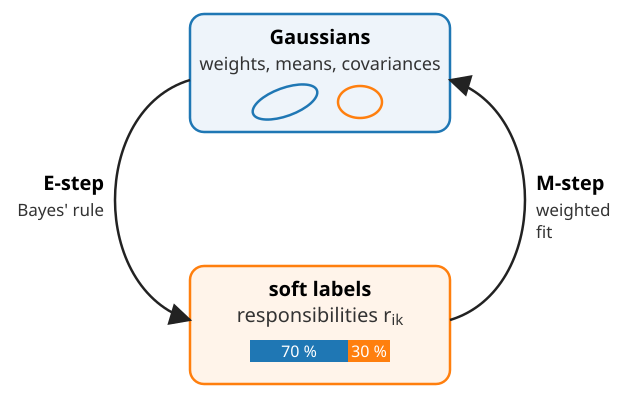
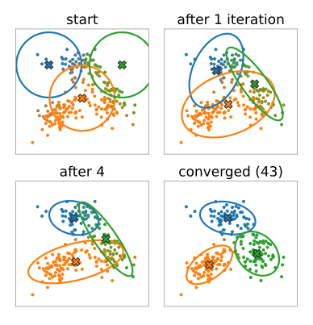
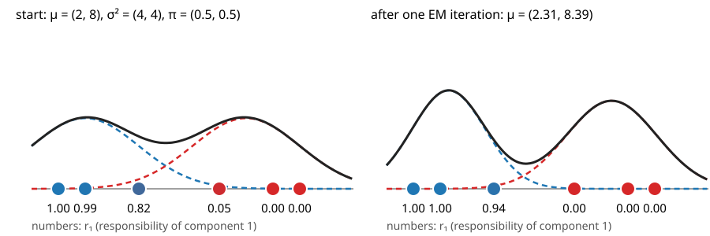
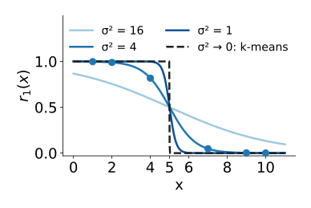
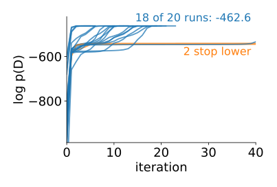
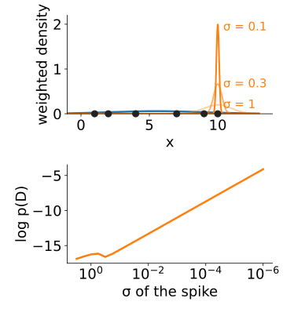
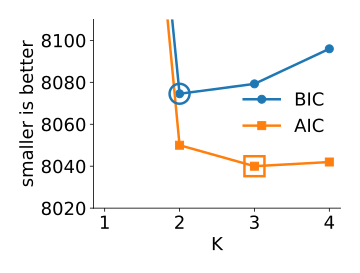

## About this lecture

[Last unit](../gaussian-mixture/lec.qmd): a mixture of Gaussians as a model, with **hidden** labels. Now: find its parameters from unlabelled data.

- **EM** (expectation–maximisation): guess soft labels, refit the Gaussians, repeat.
- **k-means is EM with hard labels** and round, equal groups.
- The **likelihood never decreases**; EM stops at a **local** maximum.
- **Collapse**: a component on a single point makes the likelihood infinite.
- Choosing $K$ and the covariance type: **BIC** and **AIC**.

Slides titled **The math** give the formulas and proofs; the ideas are complete without them.

## Chicken and egg

:::: {.columns}
::: {.column width="50%"}
- If we **knew the labels** (which component made each point), fitting is easy: each component gets the mean and covariance of its own points, and its weight is its share of the points.
- If we **knew the Gaussians**, we could compute the labels: Bayes' rule gives each point's responsibilities.

We know neither. **EM alternates** between the two, starting from a guess, and keeps the labels **soft**: a point that is 70 % component 1 counts as 0.7 of a point there and 0.3 of a point in component 2.
:::
::: {.column width="50%"}
{width="100%" fig-alt="EM as a loop between two boxes. Top: the Gaussians (weights, means, covariances). Bottom: the soft labels, for example a point that is 70 % component 1 and 30 % component 2. The E-step arrow goes from the Gaussians to the labels by Bayes' rule; the M-step arrow goes back by a weighted fit"}
:::
::::

## The EM algorithm

:::: {.columns}
::: {.column width="60%"}
Start with some $\pi_k$, $\boldsymbol\mu_k$, $\Sigma_k$. Repeat:

- **E-step** (expectation): for every point $i$ and component $k$, the responsibility
  $r_{ik} = \pi_k\mathcal N(\mathbf x_i \mid \boldsymbol\mu_k, \Sigma_k) \,/\, \sum_j \pi_j\mathcal N(\mathbf x_i \mid \boldsymbol\mu_j, \Sigma_j)$.
- **M-step** (maximisation): refit every component with the responsibilities as **weights**:
  - $N_k = \sum_i r_{ik}$ (the "number of points" of component $k$), $\pi_k = N_k / n$;
  - $\boldsymbol\mu_k$ = the weighted mean $\frac{1}{N_k}\sum_i r_{ik}\mathbf x_i$;
  - $\Sigma_k$ = the weighted covariance $\frac{1}{N_k}\sum_i r_{ik}(\mathbf x_i - \boldsymbol\mu_k)(\mathbf x_i - \boldsymbol\mu_k)^\top$ (restricted to the covariance type).

Stop when the log-likelihood $\sum_i \log p(\mathbf x_i)$ stops increasing.
:::
::: {.column width="40%"}
{width="100%" fig-alt="EM with three components on a 2D point cloud of three groups, shown at the start, after 1 iteration, after 4 and at convergence after 43 iterations. Each point is coloured by its responsibilities, mixed colours for shared points; each component is drawn as its 2σ ellipse. The badly placed starting circles move and reshape until each ellipse covers one group"}
:::
::::

## By hand: one EM iteration {.smaller}

{width="80%"}

Points $1, 2, 4, 7, 9, 10$ (the k-means example). Start $\mu = (2, 8)$, $\sigma^2 = (4, 4)$, $\pi = (0.5, 0.5)$.

- **E**: equal variances and weights, so $r_1(x) = 1/(1 + e^{-a})$ with $a = [(x - 8)^2 - (x - 2)^2]/8$. At $x = 4$: $a = 1.5$, $r_1 = 0.82$; at $x = 7$: $a = -3$, $r_1 = 0.05$. All six: $1.00, 0.99, 0.82, 0.05, 0.00, 0.00$.
- **M**: $N_1 = 2.85$, $\mu_1 = 2.31$, $\mu_2 = 8.39$, $\pi_1 = 0.48$; $\sigma^2 = (1.87, 2.83)$.
- The point 4 is **shared**: 82 % of it pulls $\mu_1$, 18 % pulls $\mu_2$. k-means gave $(2.33, 8.67)$.
- $\log p(\mathcal D)$: $-14.94 \to -14.22 \to -14.03 \to -13.99$: up at every iteration.

## Try it: EM step by step

```{=html}
<link rel="stylesheet" href="../demos/dist/demo.css">
<div data-demo="em1d" data-preset="hand"></div>
<script src="../demos/dist/em1d.js"></script>
```

::: notes
"the by-hand example": E-step: the table shows r_i1 = 1.00, 0.99, 0.82, 0.05, 0.00, 0.00 (rounded). M-step: N = 2.85 / 3.15, μ = 2.31 / 8.39, σ² = 1.87 / 2.83, π = 0.48 / 0.52. Keep alternating; the log p line: −14.94 → −14.22 → −14.03 → −13.99, then converged at μ = (2.34, 8.66), σ² = 1.57 both. Drag the point 4 towards 5.5: its colour mixes. "an ambiguous point in the middle": 5.5 stays 50/50 to the end. "hard EM = k-means": hard 0/1 assignments with equal variances and weights, started at (1, 2): μ ends at (2.33, 8.67), the k-means answer.
:::

## k-means is hard EM

Side by side, the same two-step loop:

| | k-means | EM |
|---|---|---|
| labels | hard: 0 or 1 (nearest centre) | soft: responsibilities $r_{ik}$ |
| centres | mean of own points | weighted mean |
| shape | none (round, all equal) | covariance per component |
| size | none | weight $\pi_k$ |
| objective | $J$ goes down | log-likelihood goes up |

:::: {.columns}
::: {.column width="55%"}
- Give every component the same round covariance $\sigma^2 I$ and the same weight. As $\sigma \to 0$ the responsibilities become 0 or 1 (the nearest centre wins), and EM **is** k-means.
- Common practice: **start EM from k-means**: cheap, and the centres are already in sensible places.
:::
::: {.column width="45%"}
{width="88%" fig-alt="The responsibility r1(x) of the six-point example with centres 2 and 8 and equal weights, for σ² = 16, 4, 1 and the limit σ² → 0: the curve gets steeper as σ² shrinks and becomes a step at 5, the k-means boundary. The six points are marked on the σ² = 4 curve"}
:::
::::

## The math: where the M-step comes from {.math .smaller}

$\log p(\mathcal D) = \sum_i\log\sum_k\pi_k\mathcal N(\mathbf x_i \mid \boldsymbol\mu_k, \Sigma_k)$. Differentiate with respect to $\boldsymbol\mu_k$:

$$\frac{\partial\log p(\mathcal D)}{\partial\boldsymbol\mu_k} = \sum_i \underbrace{\frac{\pi_k\mathcal N_k(\mathbf x_i)}{\sum_j\pi_j\mathcal N_j(\mathbf x_i)}}_{r_{ik}}\,\Sigma_k^{-1}(\mathbf x_i - \boldsymbol\mu_k) = 0 \;\Rightarrow\; \boldsymbol\mu_k = \frac{\sum_i r_{ik}\mathbf x_i}{\sum_i r_{ik}}.$$

- The responsibilities appear by themselves as weights. The same with $\Sigma_k$ gives the weighted covariance.
- For $\pi_k$, maximise subject to $\sum_k\pi_k = 1$ (Lagrange multiplier $\lambda$): $\sum_i r_{ik}/\pi_k = \lambda$, so $\pi_k = N_k/\lambda$, and summing over $k$ gives $\lambda = n$: $\pi_k = N_k/n$.
- These are not closed-form solutions: $r_{ik}$ depends on the parameters. EM **freezes** the $r_{ik}$ (E-step), solves (M-step), and repeats.
- With equal $\Sigma_k = \sigma^2I$, equal $\pi_k$: $r_{ik} \propto \exp(-\lVert\mathbf x_i - \boldsymbol\mu_k\rVert^2/2\sigma^2)$; as $\sigma \to 0$ the largest term dominates and $r_{ik} \to [k = \text{nearest centre}]$: k-means.

## Up, but only to a local maximum

:::: {.columns}
::: {.column width="55%"}
- Each EM iteration **never decreases** the log-likelihood (math slide). It increases quickly at first, then crawls.
- Like k-means, EM stops at a **local** maximum: a bad start (two components in one group) can stay bad.
- Remedies: start from k-means or k-means++ seeds; **restart** several times and keep the run with the **highest** log-likelihood.
- Convergence can be slow when components overlap strongly: many iterations with tiny gains.
:::
::: {.column width="45%"}
{width="100%" fig-alt="Log-likelihood against iteration for 20 EM runs from random starts on three well-separated groups: every curve only goes up; 18 runs reach the same highest value, 2 level off at a lower one"}
:::
::::

## The math: why the likelihood cannot go down {.math .smaller}

For any distribution $q_i(k)$ over the components (one per point), by **Jensen's inequality** ($\log$ is concave):

$$\log p(\mathbf x_i) = \log\sum_k q_i(k)\frac{\pi_k\mathcal N_k(\mathbf x_i)}{q_i(k)} \;\ge\; \sum_k q_i(k)\log\frac{\pi_k\mathcal N_k(\mathbf x_i)}{q_i(k)} =: \mathcal L_i(q_i, \theta).$$

- Equality holds for $q_i(k) = r_{ik}$ (then the ratio inside is $p(\mathbf x_i)$ for every $k$). The **E-step** makes the bound **touch** the log-likelihood at the current $\theta$.
- The **M-step** maximises $\sum_i\mathcal L_i(r_i, \theta)$ over $\theta$ (a weighted one-Gaussian fit per component). So
  $\log p(\mathcal D \mid \theta^{\text{new}}) \ge \mathcal L(r, \theta^{\text{new}}) \ge \mathcal L(r, \theta^{\text{old}}) = \log p(\mathcal D \mid \theta^{\text{old}})$.
- $\mathcal L$ is the **evidence lower bound** (ELBO). The [VAE day](../vae/lec.qmd) uses the same bound, with a neural network (the encoder) producing an approximate $q$ instead of the exact E-step.

## Collapse: infinite likelihood

:::: {.columns}
::: {.column width="58%"}
Put one component exactly on one data point and let its variance shrink:

- its density at that point is $1/\sqrt{2\pi\sigma^2} \to \infty$, so $\log p(\mathcal D) \to +\infty$;
- the other points are still explained by the other components, so nothing stops it.

The "best" fit is then nonsense: a spike on one pixel value. EM can run into this, especially with many components, small groups or outliers.

Remedies:

- a **variance floor**: add $\varepsilon I$ to every $\Sigma_k$ after the M-step;
- **restart** a component that collapses (or that becomes empty, $N_k \to 0$);
- a **prior** on $\Sigma_k$ (Bayesian mixtures; a pointer only).
:::
::: {.column width="42%"}
{width="100%" fig-alt="Top: the six points with a wide component over all of them and a second component on the point 10 whose spike grows taller as σ shrinks from 1 to 0.1. Bottom: the log-likelihood of the six points against the σ of the spike on a log axis: it keeps rising as σ goes to zero"}
:::
::::

## Try it: EM in 2D

```{=html}
<link rel="stylesheet" href="../demos/dist/demo.css">
<div data-demo="em2d" data-preset="separated"></div>
<script src="../demos/dist/em2d.js"></script>
```

::: notes
"well separated": start from k-means, run: log p = 179.7, π = 0.33 each. "20 restarts": 19 of 20 reach 179.7, one stops at 140.4. "bad start: local maximum" (centres by hand, two in the lower-left blob): run; it ends at log p = 123.4 with weights 0.08, 0.25, 0.67: one component covers two blobs. "collapse (floor off)": a third component starts on an outlier: log p jumps from −62.0 to 203.1 in one iteration and the readout warns that a component collapsed. Set the floor ε to 1e−4: log p = 190.1, the component stays a small circle on the outlier. "elongated": k-means (hard) first, J = 3.079, cuts across; switch to "EM (soft)", run: log p = 245.6 and 146 of 160 points are grouped as in the two cigars (k-means: 125).
:::

## How many components?

The log-likelihood always grows with more parameters: more components, or full instead of spherical covariances. In the extreme, one component per point gives infinite likelihood. So it cannot choose $K$ by itself.

**Penalise** the number of parameters $p$ (count from [unit 2](../gaussian-mixture/lec.qmd)):

$$\text{BIC} = -2\log p(\mathcal D) + p\ln n, \qquad \text{AIC} = -2\log p(\mathcal D) + 2p.$$

- Smaller is better. An extra component must **pay for itself**: improve $2\log p(\mathcal D)$ by more than its parameters cost.
- BIC's penalty grows with $n$ ($\ln 1000 = 6.9$ per parameter, against 2 for AIC): BIC picks **fewer** components on large data sets; AIC tends to pick more.
- The same criteria compare covariance types: full versus diagonal versus spherical.

## BIC and AIC by hand

:::: {.columns}
::: {.column width="60%"}
Intensities of $n = 1000$ pixels, 1D mixtures ($p = 3K - 1$):

| $K$ | $\log p(\mathcal D)$ | $p$ | BIC | AIC |
|---|---|---|---|---|
| 1 | −4210 | 2 | 8433.8 | 8424 |
| 2 | −4020 | 5 | **8074.5** | 8050 |
| 3 | −4012 | 8 | 8079.3 | **8040** |
| 4 | −4010 | 11 | 8096.0 | 8042 |

- From 1 to 2 components $\log p$ gains 190: clearly worth 3 parameters.
- From 2 to 3 it gains only 8: AIC (cost $2 \times 3 = 6$) accepts, BIC (cost $3 \times 6.9 = 20.7$) refuses.
:::
::: {.column width="40%"}
{width="100%" fig-alt="BIC and AIC from the table against K = 2, 3, 4 (K = 1 is far above the plot): BIC is smallest at K = 2 (8074.5), AIC at K = 3 (8040)"}
:::
::::

## Try it: too many components

```{=html}
<link rel="stylesheet" href="../demos/dist/demo.css">
<div data-demo="em2d" data-preset="toomany"></div>
<script src="../demos/dist/em2d.js"></script>
```

::: notes
"K too large": two blobs, 100 points, K = 5 full covariances. The bar chart is BIC and AIC for K = 1..6 (best of five starts each): BIC is smallest at K = 2, AIC at K = 4. "diagonal is enough": axis-aligned elongated clouds: with diagonal covariances BIC at K = 2 is −498.3, with full covariances −491.0: the extra two parameters do not pay. "diagonal is not enough": tilted cigars: with diagonal covariances BIC asks for 4 components (a staircase of axis-aligned blobs); switch to full and BIC drops to 1–2 components.
:::

## The math: EM in general {.math .smaller}

EM works for any model with **missing data** $\mathbf z$ (hidden labels, missing pixels, censored values) and observed $\mathbf x$ (Dempster, Laird & Rubin, 1977):

- **E**: compute the posterior of the missing data given the current $\theta^{(t)}$, and the expected complete-data log-likelihood $Q(\theta) = E_{\mathbf z \mid \mathbf x, \theta^{(t)}}[\log p(\mathbf x, \mathbf z \mid \theta)]$;
- **M**: $\theta^{(t+1)} = \arg\max_\theta Q(\theta)$.

The Jensen argument of the previous math slide shows $\log p(\mathbf x \mid \theta^{(t+1)}) \ge \log p(\mathbf x \mid \theta^{(t)})$ in general. For a mixture, $\mathbf z_i$ is the component of point $i$, the posterior is $r_{ik}$, and $Q(\theta) = \sum_i\sum_k r_{ik}[\log\pi_k + \log\mathcal N_k(\mathbf x_i)]$.

Relatives (pointers only): variational Bayesian and Dirichlet-process mixtures (priors on the parameters and on $K$), mixtures of Student-t distributions (heavy tails, robust to outliers), Poisson mixtures (photon counts).

## Summary

- **EM**: E-step = responsibilities (soft labels), M-step = weighted mean, covariance and weight per component; repeat.
- **k-means** = EM with hard labels, equal round covariances and equal weights.
- The **log-likelihood never decreases**; EM stops at a **local** maximum: start from k-means, restart, keep the best.
- **Collapse**: a component on one point has infinite likelihood; use a **variance floor** or restarts.
- Choose $K$ and the covariance type with **BIC** ($p\ln n$) or **AIC** ($2p$): an extra component must pay for itself.
