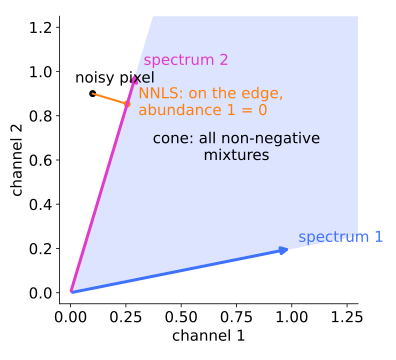
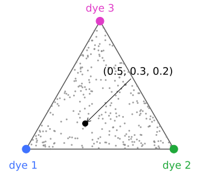
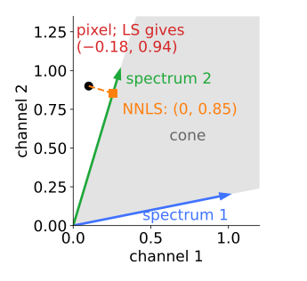
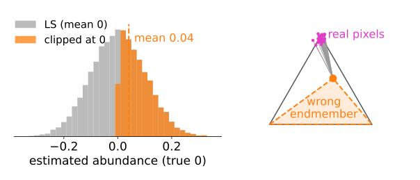
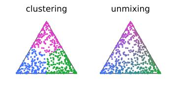
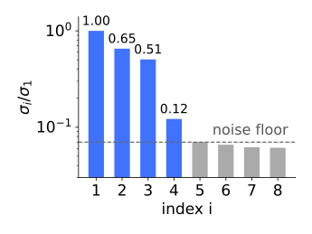
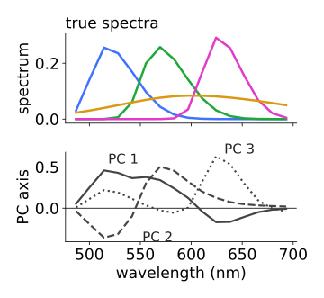
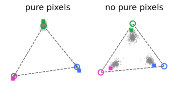
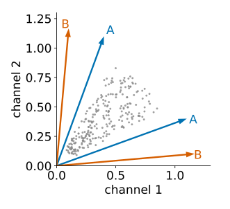

## About this lecture

Least squares (last unit) needs the spectra in advance and allows negative abundances. Both problems have a **picture**: the pixels form a cloud in channel space, and every physically possible mixture lies in a **cone**.

- Pixels as points; the cone, and the **simplex** after normalising.
- Constraints: **non-negative** (NNLS) and **sum to one**, and what they cost.
- **How many** components? The singular values of the pixels.
- Finding the spectra: **vertices** of the simplex, and **NMF**, with its non-uniqueness.

Slides titled **The math** give the formulas and proofs; the ideas are complete without them.

::: notes
Third unit of the spectral unmixing day, the densest one. The cone/simplex geometry is needed for the vertex methods anyway. Recall PCA (day 1, pca/) in one slide; KKT conditions and the NMF update stay in the math layer.
:::

## Pixels live in a cone

:::: {.columns}
::: {.column width="58%"}
Every pixel is a point in channel space (3 channels: a point in 3D).

- One unit of dye $k$ lands at its spectrum $\mathbf m_k$. Mixtures $a_1\mathbf m_1 + a_2\mathbf m_2 + \dots$ with **non-negative** amounts fill the **cone** spanned by the spectra.
- Pure pixels lie on the cone's **edges**; dim pixels near the origin; mixtures inside.
- Without noise, **every** pixel is inside the cone. The cone is the set of physically possible pixels.
:::
::: {.column width="42%"}
{width="100%"}
:::
::::

## Normalise: the cone becomes a simplex

:::: {.columns}
::: {.column width="60%"}
Divide every pixel by its total (sum over channels): brightness disappears, only the **colour** of the spectrum remains.

- Every ray of the cone becomes one point: the cone becomes a **simplex**, a triangle for three components (a segment for two, a tetrahedron for four).
- A mixture lies inside the triangle; its position gives the **fractions** of the components (barycentric coordinates).
- Same picture as the chromaticity diagram of the colour day: mixtures of two lights lie on the straight line between them.
:::
::: {.column width="40%"}
{fig-alt="A triangle with corners dye 1, dye 2 and dye 3; grey points of mixtures fill it. A black point with fractions (0.5, 0.3, 0.2) lies closest to the dye 1 corner." width="100%"}
:::
::::


## The math: cone and simplex {.math}

$$\text{cone}(M) = \{M\mathbf a : \mathbf a \ge 0\}, \qquad \text{simplex} = \{M\mathbf a : \mathbf a \ge 0,\ \textstyle\sum_k a_k = 1\}.$$

- If every column is scaled to sum 1 (fractions of the light), then $\sum_c (M\mathbf a)_c = \sum_k a_k$: normalising a pixel by its total is the same as asking the abundances to sum to one.
- Barycentric coordinates: for vertices $\mathbf e_1, \mathbf e_2, \mathbf e_3$ and a point $\mathbf p$ in the triangle, solve $\sum_k a_k \mathbf e_k = \mathbf p$, $\sum_k a_k = 1$.

## Try it: the cloud, the cone and the triangle

```{=html}
<link rel="stylesheet" href="../demos/dist/demo.css">
<div data-demo="unmixcloud" data-preset="clean"></div>
<script src="../demos/dist/unmixcloud.js"></script>
```

::: notes
Three channels, three components of the day's cell (nucleus, mitochondria, membrane); drag the cloud to rotate. Tour: "noise-free": every point inside the cone (grey faces), the three arms are the pure structures. "Noise: LS goes negative": a dim pixel is picked automatically; LS (red) reaches it exactly but with a negative abundance, NNLS (orange) lands on a face. "Normalise": the cone collapses onto the triangle; the right panel is the same triangle flat. Dim pixels scatter far: little light, much noise. "A wrong endmember": the membrane corner is dragged inward; real membrane pixels fall outside, and the constrained methods hide it (the residual readout grows). "Fourth component": granules with a spectrum outside the triangle: a fourth corner.
:::

## Noise pushes pixels outside: NNLS

A dim pixel with noise can land **outside** the cone. Unconstrained least squares then reports a **negative** abundance.

:::: {.columns}
::: {.column width="58%"}
- Two channels, spectra $(1, 0.2)$ and $(0.3, 1)$, pixel $(0.1, 0.9)$, just outside: LS gives $(-0.18,\ 0.94)$.
- **NNLS** (non-negative least squares) takes the closest point **in the cone**. Here it lies on the edge of spectrum 2: $(0,\ 0.85)$.
- The projection lands on a face or an edge; the components "behind" it get exactly **zero**. The active-set method (Lawson & Hanson) guesses which components are zero, solves least squares for the rest, and repairs the guess until no component wants to go negative or come back.
:::
::: {.column width="42%"}
{fig-alt="Channel 2 against channel 1: the grey cone between spectrum 1 (1, 0.2) and spectrum 2 (0.3, 1). The pixel (0.1, 0.9) lies just outside, above spectrum 2; least squares reaches it with (−0.18, 0.94); NNLS drops a perpendicular onto spectrum 2 and lands at (0, 0.85)." width="100%"}
:::
::::


## The math: NNLS and its optimality conditions {.math}

$$\min_{\mathbf a}\ \|\mathbf y - M\mathbf a\|^2 \quad\text{subject to}\quad \mathbf a \ge 0 .$$

A convex quadratic programme. With $\mathbf w = M^\top(\mathbf y - M\mathbf a)$ (minus half the gradient), $\hat{\mathbf a}$ is optimal if and only if (KKT):

$$\hat a_k \ge 0, \qquad w_k \le 0, \qquad \hat a_k\, w_k = 0 \quad\text{for every } k.$$

- A component in use ($\hat a_k > 0$) has zero gradient; a component at zero ($\hat a_k = 0$) would make the error worse if increased ($w_k \le 0$).
- Example above: $\hat{\mathbf a} = (0, 0.853)$, $\mathbf w = (-0.147,\ 0)$. Both conditions hold.

## Sum to one, and the price of constraints

**Fully constrained** least squares: non-negative **and** summing to one: the closest point **in the simplex** (for normalised pixels, or fractions).

- Honest costs: in dim regions the noise is clipped at zero from below but not from above: a **positive bias** (the mean of a clipped noisy zero is above zero).
- A **wrong endmember** puts real pixels outside the simplex, and the constraint projects them back in silence: the error moves into the residual, not into a negative abundance. Always look at the residual.

{fig-alt="Left: histogram of noisy estimates of a true abundance of 0: least squares is centred on 0, the clipped estimates pile up above 0 with mean 0.04. Right: a triangle whose top corner was dragged inward (wrong endmember); the real pixels near the true corner lie outside it and are projected onto it." width="78%" fig-align="center"}


## The math: the sum-to-one constraint {.math}

Without the sign constraint, minimise $\|\mathbf y - M\mathbf a\|^2$ subject to $\mathbf 1^\top\mathbf a = 1$ with a Lagrange multiplier:

$$\hat{\mathbf a} = \hat{\mathbf a}_\text{LS} + (M^\top M)^{-1}\mathbf 1\ \frac{1 - \mathbf 1^\top\hat{\mathbf a}_\text{LS}}{\mathbf 1^\top(M^\top M)^{-1}\mathbf 1}.$$

- Both constraints together (Heinz & Chang): add a row $\delta(1, \dots, 1)$ to $M$ and the value $\delta$ to $\mathbf y$, with $\delta$ large, and solve NNLS. The extra row is an "equation" that must hold almost exactly.

## What unmixing is not

:::: {.columns}
::: {.column width="57%"}
- **Clustering** (k-means on pixel colours, the colour day; Gaussian mixtures): each pixel belongs to **one** class. **Unmixing**: each pixel is a **mixture**, how much of each. Different questions about the same cloud.
- **Non-linear mixing**: quenching, energy transfer (FRET), absorption inside the sample, saturated pixels: the cloud **bends** and straight edges no longer fit.
- Neighbouring pixels have similar abundances: a spatial prior (a smoothness term, as in the Ising/MRF elective) can stabilise noisy maps. Not covered here.
:::
::: {.column width="43%"}
{fig-alt="The same triangle-shaped cloud of pixels twice. Clustering colours each point by one class (blue, green or magenta regions); unmixing colours each point by its blend of the three corner colours, a smooth gradient." width="100%"}
:::
::::


## How many components?

Best case: reference spectra from single-stained controls (the crosstalk unit). Often not possible: spectra shift inside cells, autofluorescence is unknown, a remote-sensing scene's materials are unknown.

:::: {.columns}
::: {.column width="60%"}
- First question: **how many** components? Stack the pixels as the columns of $Y$ (channels × pixels) and take its **singular values** (PCA without centring, recall the PCA unit of day 1).
- $K$ components without noise: exactly $K$ non-zero singular values. With noise: $K$ stand out above a **floor**.
- The day's cell, 16 channels, 4 components: $\sigma_i/\sigma_1 = 1,\ 0.65,\ 0.51,\ 0.12,\ 0.070,\ 0.066, \dots$: four above the floor (the fourth, the dim autofluorescence, only just).
:::
::: {.column width="40%"}
{fig-alt="Bar chart of the singular values of the cell divided by the largest, log scale: 1.00, 0.65, 0.51, 0.12 in blue, then grey bars at about 0.07 forming a flat noise floor." width="100%"}
:::
::::


## PCA axes are not spectra

:::: {.columns}
::: {.column width="55%"}
- The principal axes are **orthogonal** and have **negative** entries; spectra are neither.
- A triangle-shaped cloud: its principal axes point along its **spread**, its corners point at the **pure components**. Only the corners are spectra.
- PCA tells you **how many** and the **subspace** (the plane of the triangle); finding the spectra needs more: the corners, or non-negativity.
:::
::: {.column width="45%"}
{fig-alt="Top: the four true spectra of the cell, all non-negative, each with one peak (one broad). Bottom: the first three principal axes of the pixels, with negative lobes and shapes that match no spectrum." width="100%"}
:::
::::


## Pure pixels: the vertices are the spectra

:::: {.columns}
::: {.column width="54%"}
If some pixels contain only one component, they are the **corners** (vertices) of the normalised cloud.

- **Vertex finding** (the idea behind VCA): take the most extreme pixel, project it out, repeat. Each step finds one corner.
- **N-FINDR**: the $K$ pixels that span the simplex of **largest volume**.
- No pure pixels: the cloud's corners lie **inside** the true simplex, and vertex methods **undershoot**: found spectra are mixtures. In the demo: 3–5° from the true spectra with pure pixels, 7–11° without.
- Macenko's stain estimate (next unit) is the two-component case.
:::
::: {.column width="46%"}
{fig-alt="The normalised pixels of the cell projected on their two main directions, with the true spectra as open circles at the corners of a dashed triangle and the spectra found by vertex finding as filled squares. With pure pixels the cloud reaches the corners and the squares sit on the circles; without pure pixels the cloud forms three clusters inside the triangle and the squares fall short of the corners." width="100%"}
:::
::::


## The math: volume and the best rank-$K$ approximation {.math}

- Simplex volume: for $K$ vertices $\mathbf e_k$ in $K-1$ dimensions, $V = \frac{1}{(K-1)!}\left|\det\begin{pmatrix} 1 & \cdots & 1 \\ \mathbf e_1 & \cdots & \mathbf e_K \end{pmatrix}\right|$. N-FINDR swaps pixels in and out to maximise it.
- Eckart–Young: the truncated SVD $U_K\Sigma_K V_K^\top$ is the best rank-$K$ approximation of $Y$ in the Frobenius norm. Projecting the pixels onto the first $K$ left singular vectors removes the noise outside the signal space before looking for vertices.

## Try it: finding the spectra

```{=html}
<link rel="stylesheet" href="../demos/dist/demo.css">
<div data-demo="endmembers" data-preset="count"></div>
<script src="../demos/dist/endmembers.js"></script>
```

::: notes
The same cell, 16 channels, Poisson noise. Top left: singular values (log scale). Bottom left: the normalised bright pixels projected onto their two main principal directions, true spectra as circles, found ones as squares. Right: true (dashed) and found spectra, the found abundance maps. Tour: "count the components": four bars above the floor; the PCA axes as spectra have negative lobes. "Pure pixels": three steps of vertex finding land on the corners (angles 4.5°, 3.8°, 2.6°). "No pure pixels": the cloud shrinks to three clusters inside the true triangle; vertex finding returns mixtures (11°, 7°, 10°). "NMF from two seeds": seed 1, then seed 2: different spectra, same error. "Three spectra known": the fourth still has dips at the known dyes' peaks.
:::

## NMF: factorise without pure pixels

:::: {.columns}
::: {.column width="60%"}
**Non-negative matrix factorisation**: $Y \approx WH$ with **both** $W$ (spectra, channels × $K$) and $H$ (abundances, $K$ × pixels) non-negative.

- Start from a seeded positive guess; alternately improve $H$ and $W$ with multiplicative updates. The error never increases.
- **Not unique**: any cone that contains all the data and lies inside the positive orthant fits equally well. Without pure pixels, two seeds give two answers with the same error (demo: 3.195 and 3.201, the true spectra give 3.199; seed 1 lands 4.5°, 3.2°, 9.1° from the true spectra, seed 2 10.2°, 7.4°, 8.9°).
- Remedies: pure pixels, smallest volume, sparse abundances, known spectra. Even with three of four spectra known, a broad fourth one is found only up to "minus a bit of the known ones" (dips at their peaks).
:::
::: {.column width="40%"}
{fig-alt="Two channels: a grey wedge of data points between 28 and 62 degrees. Two pairs of arrows, A at 20 and 70 degrees and B at 5 and 85 degrees, both enclose all the points and both stay in the positive quadrant." width="100%"}
:::
::::


## The math: the NMF updates {.math}

Minimise $\|Y - WH\|_F^2$ over $W, H \ge 0$. Lee & Seung's multiplicative updates (element-wise $\odot$, $\oslash$):

$$H \leftarrow H \odot (W^\top Y) \oslash (W^\top W H), \qquad W \leftarrow W \odot (Y H^\top) \oslash (W H H^\top).$$

- Gradient descent with a step chosen per entry, $\eta = H \oslash (W^\top W H)$: non-negative stays non-negative, and the error never increases.
- Non-uniqueness: $WH = (WR^{-1})(RH)$ for any invertible $R$ that keeps both factors non-negative (scalings and permutations always do; others sometimes).
- With Poisson noise, the Kullback–Leibler version of NMF is the maximum-likelihood estimate (pointer).

## Validation without ground truth

- The **residual** at the noise level everywhere (unit 2).
- **Non-negativity**: abundances clearly below zero mean the model or the spectra are wrong.
- **Agreement with a control**: a found spectrum should match a single-stained control where one exists.
- **Stability**: the same answer from different seeds, subsets of the image, or neighbouring numbers of components.

## Summary

- Pixels form a cloud; without noise it lies in the **cone** of the spectra; normalised, in their **simplex**.
- Noise pushes dim pixels outside: LS goes **negative**; **NNLS** projects onto the cone (components behind the face get zero); **fully constrained** onto the simplex. Costs: a positive bias, and wrong endmembers hidden in the residual.
- **How many** components: singular values above the noise floor. **PCA axes are not spectra.**
- **Pure pixels**: spectra = vertices (vertex finding, largest simplex). No pure pixels: vertex methods undershoot.
- **NMF** needs no pure pixels but is **not unique**; constrain it, and validate with residual, signs and controls.
