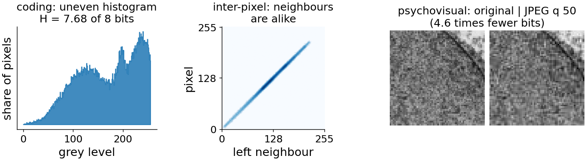
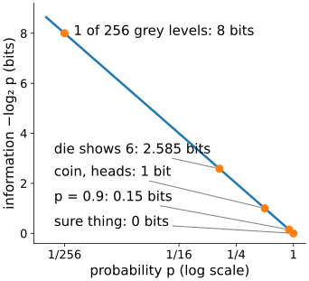
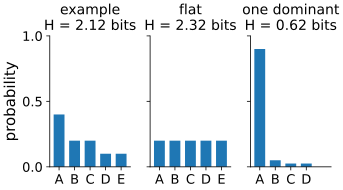
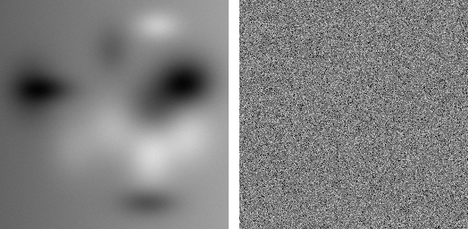
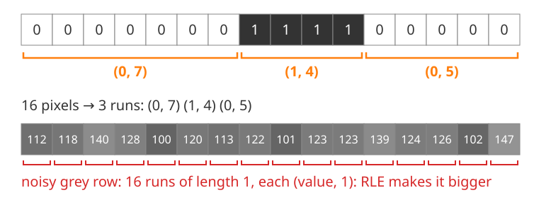
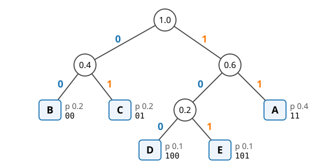
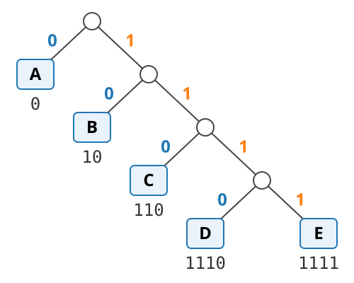
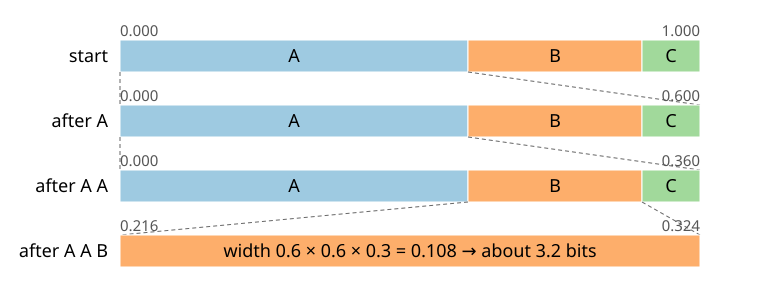

## About this lecture

Images are big. How few bits does an image really need, and how do we get close to that number without losing a single pixel value?

- Why compress, and the **three redundancies** a codec can remove: the map for the whole day.
- **Information** of an outcome and **entropy** of a histogram: the lower bound for a lossless code.
- What entropy does **not** see: neighbours.
- **Run-length** coding, **Huffman** coding by hand, and the idea of **arithmetic** coding.

*Slides titled **The math** give the formulas and proofs; the ideas are complete without them.*

::: notes
This unit owns entropy for the whole course: random forests (information gain), the measurements day (texture entropy) and the neural-network day (cross-entropy) recall it from here. Probability needed: a histogram as probabilities, an expected value, log base 2. Coins and dice come before images on purpose.
:::

## Why compress?

- One camera frame: 2048 × 2048 pixels × 16 bits = **8.4 MB**. A time-lapse of z-stacks: 30 slices × 2 channels × 500 time points = **about 250 GB**.
- **Lossless** compression: the decoded image is **exactly** the original. **Lossy**: close enough, by some measure.
- Two numbers describe a codec's size:
  - **compression ratio** = original size / compressed size (e.g. 2.5 : 1);
  - **bits per pixel** (bpp): compressed bits / number of pixels. An 8-bit image stored raw has 8 bpp.

Compression is only possible because images are **not random**: some values are more common than others, and neighbours are alike.

## Three redundancies: the map of the day {.smaller}

| Redundancy | What is wasted | Removed by | Unit |
|---|---|---|---|
| **Coding** | common values get as many bits as rare ones | entropy codes (Huffman, arithmetic) | this one |
| **Inter-pixel** | neighbours are similar, so a pixel is partly known in advance | prediction, transforms, dictionaries | lossless, DCT |
| **Psychovisual** | detail the eye (or the analysis) does not need | quantisation | JPEG |

- **Lossless** codecs remove only the first two: every pixel value comes back.
- Only **lossy** codecs touch the third, and that is where the danger for measurements lies (last unit of the day).

{.nostretch width="90%" fig-align="center" fig-alt="The three redundancies on real images. Left: the grey-level histogram of the cell micrograph is uneven, entropy 7.68 of 8 bits. Middle: each pixel of a smooth synthetic image plotted against its left neighbour lies on a narrow diagonal band. Right: a crop of the micrograph and its JPEG at quality 50, which look alike although the JPEG needs 4.6 times fewer bits."}

::: notes
Figure: left, histogram of the cell micrograph (transmission electron micrograph of a mesenchymal stem cell, Robert M. Hunt, CC BY 3.0, via Wikimedia Commons); middle, the smooth synthetic image of the lossless unit's demo, pixel against left neighbour; right, a crop of the micrograph and its JPEG at quality 50 (1.75 bits per pixel, from the JPEG demo's coder). Script: tools/figs/compression/figs.py.
:::

## Information of an outcome

:::: {.columns}
::: {.column width="56%"}
How surprising is an outcome with probability $p$? Measure it in **bits**:

$$I = -\log_2 p$$

- A fair coin comes up heads: $p = \tfrac12$, **1 bit**. One yes/no answer.
- One of 256 equally likely grey levels: $p = \tfrac1{256}$, **8 bits**. Exactly what an 8-bit pixel stores.
- A fair die shows 6: $p = \tfrac16$, **2.585 bits**: not a whole number, and that is fine.
- A pixel of a mostly-white background is white: $p = 0.9$, only **0.15 bits**. A sure thing: **0 bits**.

Rare outcomes carry much information, common ones little. A good code gives **short code words to common values**.
:::
::: {.column width="44%"}
{width="100%" fig-alt="Information −log₂ p against the probability p on a log axis: a falling curve from 8 bits at p = 1/256 through 2.585 bits for a die, 1 bit for a coin and 0.152 bits at p = 0.9 to 0 bits for a sure outcome."}
:::
::::

## Entropy: the average information

The **entropy** of a histogram is the information per symbol, averaged over the symbols:

$$H = -\sum_k p_k \log_2 p_k \quad \text{bits per symbol}$$

:::: {.columns}
::: {.column width="55%"}
- $p = (0.4, 0.2, 0.2, 0.1, 0.1)$: $H = 0.4 \cdot 1.32 + 2 \cdot 0.2 \cdot 2.32 + 2 \cdot 0.1 \cdot 3.32 =$ **2.12 bits**, while a fixed-length code for 5 symbols needs 3.
- **Flat** histogram over $K$ values: $H = \log_2 K$, the largest possible. 256 equal grey levels: 8 bits, nothing to gain.
- **Constant** image: $H = 0$.
:::
::: {.column width="45%"}
{width="100%" fig-alt="Three histograms over five symbols A to E with their entropies: the worked example (0.4, 0.2, 0.2, 0.1, 0.1) has H = 2.12 bits; the flat histogram has H = 2.32 bits, the most for five symbols; one dominant symbol (0.9, 0.05, 0.025, 0.025, as in the demo) has H = 0.62 bits."}
:::
::::

**Shannon's source coding theorem** (1948): no lossless code for independent symbols uses fewer than $H$ bits per symbol on average, and codes come arbitrarily close to $H$.

## The math: entropy {.math}

For a histogram $p_1, \dots, p_K$ (with $0 \log 0 = 0$):

- $H \ge 0$, with equality only if one $p_k = 1$.
- $H \le \log_2 K$, with equality only for the flat histogram. Proof (Jensen, $\log$ concave): $H = \sum_k p_k \log_2 \frac{1}{p_k} \le \log_2 \sum_k p_k \frac{1}{p_k} = \log_2 K$.
- **Gibbs' inequality**: for any other distribution $q$, $-\sum_k p_k \log_2 q_k \ge H$; the left side is the **cross-entropy**. Equality iff $q = p$.
- Source coding theorem: a uniquely decodable code with lengths $L_k$ has $\bar L = \sum_k p_k L_k \ge H$. With $q_k = 2^{-L_k}$ (Kraft, next math slide) this is Gibbs' inequality.

## What entropy does not see

{width="62%"}

Left: a smooth synthetic image. Right: **the same pixels, shuffled**. Same histogram, so the same entropy: **7.08 bits/pixel** for both.

- But a real compressor that also looks at neighbours (DEFLATE, next unit) stores the left one in **44 457** bytes and the shuffled one in **58 519**.
- $H$ of the grey-level histogram treats pixels as **independent**. Neighbours are not: that is the **inter-pixel** redundancy, and the next two units are about removing it before the entropy coder runs.

::: notes
Numbers: the smooth synthetic image of the lossless unit's demo (256 × 256), shuffled with a fixed seed. Both DEFLATE sizes are computed with the browser's compressor, the same one the predict demo uses (raw 65 536 bytes). Ask first: which one is easier to describe in words?
:::

## Run-length encoding

Replace each **run** of equal values by (value, length):

{.nostretch width="76%" fig-align="center" fig-alt="Top: a binary row of 16 pixels, seven 0s, four 1s and five 0s, bracketed into the three runs (0, 7), (1, 4), (0, 5). Bottom: a noisy grey row where every pixel differs from its neighbour, so each of the 16 pixels is its own run of length 1."}

- Binary masks and label images have long runs: store only the run lengths, 7 4 5 (fax machines do this).
- Noisy grey-level images have runs of length 1: RLE makes them **bigger**.
- The run lengths themselves are then entropy-coded. RLE comes back inside JPEG: the long runs of **zeros** among the quantised coefficients.

## Huffman coding

Huffman (1952): build the code from the bottom up.

1. Every symbol is a tree with its probability.
2. **Merge the two least probable trees** into one, with the summed probability.
3. Repeat until one tree is left. Label each split 0 / 1; a code word is the path from the root.

:::: {.columns}
::: {.column width="55%"}
{width="100%"}
:::
::: {.column width="45%"}
$p = (0.4, 0.2, 0.2, 0.1, 0.1)$:

- merge D + E (0.2), then B + C (0.4), then DE + A (0.6), then the rest;
- lengths 2, 2, 2, 3, 3: $\bar L = 2 \cdot 0.8 + 3 \cdot 0.2 =$ **2.2 bits**;
- $H = 2.12 \le 2.2 < 3$ (fixed length).
:::
::::

## Why Huffman codes work

:::: {.columns}
::: {.column width="60%"}
- **Prefix-free**: no code word is the start of another (every symbol is a leaf). So a bit string decodes without separators: walk from the root, output a symbol at a leaf, start again.
- **Ties** can be broken either way: a different tree, possibly different lengths (here 1, 2, 3, 4, 4), but the same $\bar L = 2.2$.
- **Optimal** among codes that give each symbol its own code word: $H \le \bar L < H + 1$.
- The gap matters when one symbol dominates: a mask with 94% black pixels has $H = 0.33$ bits, but every code word has at least **1 bit**. Run lengths, or coding several pixels at once, or arithmetic coding get below 1 bit per pixel.
:::
::: {.column width="40%"}
{width="100%" fig-alt="The Huffman tree for p = (0.4, 0.2, 0.2, 0.1, 0.1) with ties broken the other way: A gets code 0, B 10, C 110, D 1110 and E 1111, lengths 1, 2, 3, 4, 4 and the same average 2.2 bits. Every symbol is a leaf, so no code word is the start of another."}

`0 10 110 1111` decodes as A B C E.
:::
::::

## The math: Kraft and the bounds {.math}

- **Kraft inequality**: code word lengths $L_k$ of a prefix code satisfy $\sum_k 2^{-L_k} \le 1$. (A code word of length $L$ takes $2^{-L}$ of the leaves of a full binary tree of depth $\max L$; prefix-free words take disjoint parts.) Conversely, any lengths with $\sum 2^{-L_k} \le 1$ have a prefix code. A Huffman tree is full: equality.
- **Lower bound**: with $q_k = 2^{-L_k}/\sum_j 2^{-L_j}$, $\bar L = -\sum p_k \log_2 2^{-L_k} \ge -\sum p_k \log_2 q_k \ge H$ by Gibbs.
- **Upper bound**: the lengths $L_k = \lceil -\log_2 p_k \rceil$ satisfy Kraft, and $\bar L < \sum p_k(-\log_2 p_k + 1) = H + 1$. Huffman is at least as good.
- $\bar L = H$ exactly iff every $p_k$ is a power of $\tfrac12$ (**dyadic**).
- Coding blocks of $n$ symbols: $H \le \bar L_n / n < H + \tfrac1n$.

## Try it: build a Huffman code

```{=html}
<link rel="stylesheet" href="../demos/dist/demo.css">
<div data-demo="huffman" data-preset="example" data-step="0" data-table="0"></div>
<script src="../demos/dist/huffman.js"></script>
```

::: notes
Tour: worked example, press "next merge" four times: the green dashed pair is merged next, the orange pair was just merged. Switch ties to "newer first": a deeper tree (lengths 1, 2, 3, 4, 4), same L = 2.2. "Flat": H = L = 3. "Dyadic": L = H = 1.875 exactly. "One dominant symbol": H = 0.62 but L = 1.15. "Binary mask": H = 0.33, L = 1. "Prediction residuals": a 12-symbol histogram from the next unit, H = 3.24, L = 3.29, against 4 bits fixed. Drag bars to make your own histogram. The message line shows the bits of a 16-symbol message and the decoded string.
:::

## Arithmetic coding: fractional bits

Code the **whole message** as one number in $[0, 1)$. Each symbol narrows the interval to its share:

{width="70%"}

- Message A A B with $p = (0.6, 0.3, 0.1)$: final width $0.6 \cdot 0.6 \cdot 0.3 = 0.108$.
- A number in an interval of width $w$ needs about $-\log_2 w$ bits: **3.2 bits** $= I(A) + I(A) + I(B)$. Huffman needs 1 + 1 + 2 = 4.
- So each symbol costs its own $-\log_2 p$, even when that is 0.15 bits. Adaptive versions update $p$ as they go; modern codecs (JPEG 2000, JPEG-XL, video) use them.

## The math: arithmetic coding {.math}

- After symbols $s_1, \dots, s_n$ the interval has width $w = \prod_i p_{s_i}$; its lower end is $\sum_i \big(\prod_{j<i} p_{s_j}\big) F(s_i)$, with $F$ the cumulative probability below $s_i$.
- Any interval of width $w$ contains a binary fraction with $\lceil -\log_2 w \rceil + 1$ digits whose whole dyadic cell lies inside it, so the code is prefix-free.
- Total length $\le -\log_2 \prod p_{s_i} + 2 = \sum_i I(s_i) + 2$ bits: at most 2 bits above the information of the message, whatever $n$. Per symbol: $\to H$ as $n$ grows.
- In practice: integer arithmetic with renormalisation (output bits as soon as the leading digits agree), and context models that predict $p$ from neighbours.

## Summary

- Three redundancies: **coding** (entropy codes), **inter-pixel** (prediction, transforms), **psychovisual** (quantisation, lossy only).
- **Information** $-\log_2 p$; **entropy** $H$ = average information = the lower bound for a lossless code of independent symbols.
- The grey-level entropy ignores **neighbours**: shuffled pixels have the same $H$ but compress much worse.
- **RLE** for long runs; **Huffman**: merge the two rarest, prefix-free, $H \le \bar L < H + 1$, at least 1 bit per symbol.
- **Arithmetic coding**: one interval for the whole message, fractional bits per symbol.
- Next: **prediction** removes the inter-pixel redundancy, so that the entropy coder has less to do.
