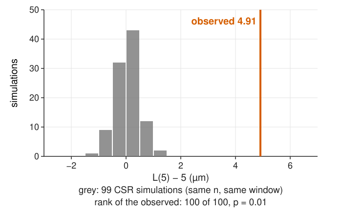
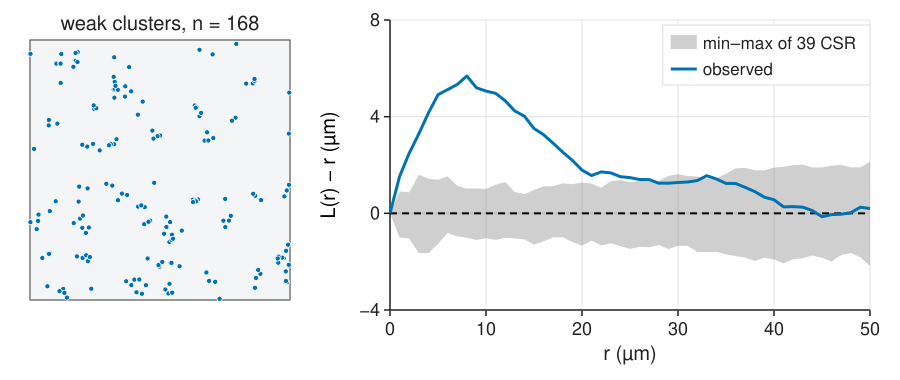
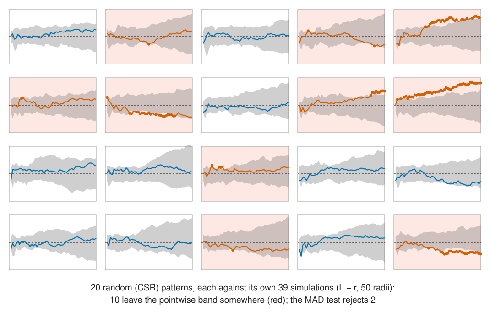
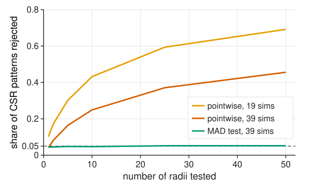
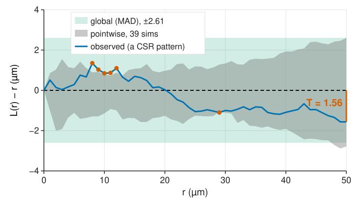
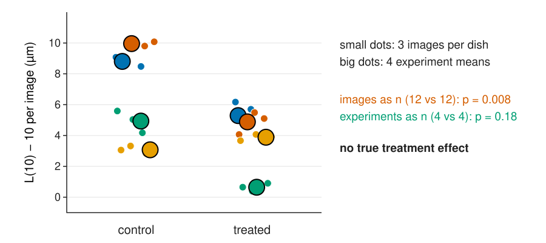

## About this lecture

An observed $L(r) - r$ is never exactly 0. How far can it stray **by chance**?

- Simulate CSR with the same n in the same window, compute the same curve: the null distribution **by simulation**.
- The **Monte Carlo p-value** at one pre-chosen r.
- The **pointwise envelope**, and the trap of reading it at many r at once.
- **Global tests**: one number for the whole curve (the MAD test), and the global envelope.
- What a significant result means, and what it does not.
- **Comparing conditions**: one summary per image, experiments as n.

*Slides titled **The math** give the formulas and proofs; the ideas are complete without them.*

::: notes
Fourth unit of the spatial statistics day. The evaluation day (37) owns replicates, pseudoreplication and multiple comparisons; this unit introduces the Monte Carlo p-value from scratch (one slide) because this day may come first, and points to `replicates/` for the rest. Demo: envelopetest. Numbers in this deck: L − r with translation correction, r = 1 … 50 µm in steps of 1 (50 radii), 200 × 200 µm window.
:::

## What would chance give?

:::: {.columns}
::: {.column width="55%"}
{width="100%" fig-alt="Histogram of L(5) − 5 for 99 CSR simulations with 168 points: between −1.3 and 1.4 µm, centred near 0. The observed value of a weakly clustered pattern, 4.91 µm, lies far to the right of all of them: rank 100 of 100, p = 0.01."}
:::
::: {.column width="45%"}
1. Simulate CSR with the **same n** in the **same window**, and compute the **same** curve with the **same** edge correction.
2. Repeat, say 99 times (seeded).
3. Compare the observed value with the simulated ones.

The null distribution is **drawn, not derived**: this works for any function, any window shape, any correction. Recall the randomisation tests of [colocalisation](../coloc-null/lec.qmd).
:::
::::

## The Monte Carlo p-value

For **one pre-chosen** r (say 5 µm):

$$p = \frac{1 + \#\{\text{simulations at least as extreme as the observed}\}}{1 + \text{number of simulations}}.$$

- Previous slide: the observed 4.91 is larger than all 99: $p = 1/100 = 0.01$, the smallest possible with 99 simulations. With 19 simulations the smallest is 0.05.
- Two-sided: double the smaller of the two one-sided p-values.
- No formula, no normality: valid because, **if** the pattern is CSR, the observed and the simulated values are exchangeable.
- The "+1" counts the observed pattern itself as one of the possible outcomes.

## The math: Monte Carlo tests {.math}

Let $T_0$ be the statistic of the data and $T_1, \dots, T_s$ those of $s$ simulations from $H_0$.

- Under $H_0$ the $s + 1$ values are **exchangeable** (and, with continuous values, distinct with probability 1), so the rank of $T_0$ among them is uniform on $\{1, \dots, s + 1\}$.
- Hence $P(\text{rank from the top} \le k) = k/(s + 1)$: rejecting when $T_0$ is among the $k$ largest has level exactly $k/(s + 1)$ (Barnard 1963). Ties: break at random, or count them against $H_0$ (conservative).
- Composite null: ρ is estimated from the data. Conditioning on $n$ (simulate exactly $n$ points) removes it; the test is then exact for the binomial process and slightly conservative otherwise.
- More simulations do not change the level; they make the p-value less coarse and the test a little more powerful.

## The pointwise envelope

{width="100%" fig-alt="A weakly clustered pattern of 168 points, and its L(r) − r against the grey band of the minimum and maximum of 39 CSR simulations at each r. The observed curve rises to about 5.5 µm near r = 8 and stays above the band from 1 to 33 µm."}

At every r: the **min and max** of the simulated curves form a grey band. The picture in almost every paper (and in the cross-L tab of [object colocalisation](../coloc-objects/lec.qmd)). At **one** r, with 39 simulations, leaving it has probability $2/40 = 5$ % under CSR.

## The trap: many r at once

{width="100%" fig-alt="20 small plots, each a random pattern's L − r against its own pointwise band of 39 CSR simulations over 50 radii. 10 of the 20 curves leave the band somewhere (red, with dots where they leave); the MAD test rejects 2."}

Reading "the curve leaves the band **somewhere**" as significant is a **multiple test**: one test per r. Here 10 of 20 **random** patterns "escape".

## How often is CSR rejected?

:::: {.columns}
::: {.column width="55%"}
{width="100%" fig-alt="Share of CSR patterns (100 points) rejected against the number of radii tested, from 1 to 50. Pointwise with 19 simulations: 10 % at one radius, 59 % at 25 radii, 69 % at 50. Pointwise with 39: 4 % at one radius, 37 % at 25, 46 % at 50. The MAD test stays near 5 % throughout."}
:::
::: {.column width="45%"}
1000 random patterns of 100 points each, $L - r$ at up to 50 radii:

- pointwise band of 39 simulations, 25 radii: **37 %** of random patterns rejected;
- 19 simulations (a 10 % band per r): **59 %**;
- the **MAD test** (next slide): **5 %**, at any number of radii.

The same problem as testing 300 features at once ([multiple comparisons](../replicates/lec.qmd)).
:::
::::

## A global test: the MAD test

{width="80%" fig-align="center" fig-alt="L − r of a random pattern (seed 6) with the pointwise band of 39 simulations (grey) and the global MAD band of ±2.61 µm (green). The curve leaves the grey band at 6 radii (red dots near 8–12 µm and 29 µm) but stays inside the green band; the largest deviation, T = 1.56 µm at r = 50, is marked."}

Choose the r range **in advance**. Summarise the whole curve by one number, the **maximum absolute deviation** $T = \max_r |\hat L(r) - r|$, and rank it among the simulations' T values. One test, the right error rate. Here: T = 1.56, rank 31 of 40, p = 0.25.

## The global envelope

- The **global envelope** is the band $0 \pm T_\text{crit}$, with $T_\text{crit}$ the 2nd largest of 39 simulated T values (the largest of 19; the 5th of 99).
- A curve that leaves the global envelope **is** significant at 5 %, and **where** it leaves tells at which scale.
- It is wider than the pointwise band: that is the price of looking at all r.
- Alternatives: the integrated squared deviation (DCLF test), more powerful when the departure is spread over many r; the **rank envelope** (Myllymäki et al., 2017), which adapts the width to each r.

## The math: global error and the MAD test {.math}

- A two-sided min/max envelope of $s$ simulations at one r has level $2/(s + 1)$: 0.05 for $s = 39$, 0.10 for $s = 19$.
- Over $m$ radii the events are dependent (neighbouring r share most pairs), so the global rate lies between the pointwise level and $1 - (1 - \alpha)^m$ ($m = 25$: between 5 % and 72 %); only simulation tells (37 %).
- MAD: $T = \max_{r \in [r_1, r_2]}|\hat L(r) - r|$; reject if $T_0$ is among the $\lfloor\alpha(s + 1)\rfloor$ largest of $T_0, \dots, T_s$. Exact by the rank argument.
- DCLF: $T = \int_{r_1}^{r_2}(\hat L(r) - r)^2\,dr$.
- Use the deviation from the **theoretical** curve (or from the mean of a separate set of simulations); L rather than K, because its variance is more even across r.

## Try it: envelopes

```{=html}
<link rel="stylesheet" href="../demos/dist/demo.css">
<div data-demo="envelopetest" data-preset="trap"></div>
<script src="../demos/dist/envelopetest.js"></script>
```

::: notes
Envelope tab: observed L − r (blue), the pointwise band (grey), the global MAD band (green, tick it), red dots where the curve leaves the pointwise band; the two orange dashed lines are the r range (sliders). Tour: "pointwise trap" (CSR, 150 points, seed 6): leaves the band at 6 of 50 radii (8–12 and 29 µm), MAD T = 1.56, rank 31 of 40, p = 0.25. "global envelope": tick it: no false alarm (T_crit = 2.61). "199 simulations": the pointwise band (now 1 % per r) is wider and no escape; MAD p = 0.26. "CSR: inside the band" (seed 4): no escape, p = 0.68. "weak clusters" (168 points): above the band from 1 to 33 µm, T = 5.68, rank 40 of 40, p = 0.025 (the smallest possible with 39). "choose the r range first": the same pattern with r = 20–50: p = 0.15, the effect lives at small r. "hard core": L − r = −7 µm at 7 µm, p = 0.025.
:::

## What a significant result means

- Only "**not CSR**". It does not say:
  - whether points **interact** or the intensity is **uneven** (unit 5);
  - which **model** fits (fit one and test it the same way).
- With enough points, CSR is rejected for almost any real tissue. Report **how** (above or below) and **at which r**, with an **effect size**: L − r at its peak, g at its peak, the number of extra neighbours within the cluster radius ($\rho\,(K(r) - \pi r^2)$).
- **Envelopes are not confidence bands**: the grey band describes the **null**, not the uncertainty of the observed curve. That needs replicates (next slide).
- Fix **before** looking: function, r range, correction, number of simulations, window. Changing them until p < 0.05 is tuning on the test set ([leakage](../leakage/lec.qmd)).

## Comparing conditions

:::: {.columns}
::: {.column width="55%"}
{width="100%" fig-alt="A SuperPlot of L(10) − 10 per image: 4 experiments in 4 colours, 3 images per dish, for control and treated. Small dots are images, big dots experiment means. There is no true treatment effect, but dishes differ a lot. Images as n: p = 0.008. Experiments as n: p = 0.18."}
:::
::: {.column width="45%"}
The points of one image are **not** independent observations of a treatment, and neither are the images of one dish.

- One **summary per image** (e.g. $L(r_0) - r_0$ at a pre-chosen $r_0$, or the area between $L - r$ and 0 over the chosen range).
- Average per **experiment**, test across experiments: the recipe of [replicates](../replicates/lec.qmd).
- Here, with **no** treatment effect: images as n give p = 0.008, experiments as n p = 0.18.
:::
::::

## The math: pooling replicate images {.math}

Several images $k = 1, \dots, m$ of one condition, with $n_k$ points and estimates $\hat K_k$:

$$\bar K(r) = \frac{\sum_k n_k^2\,\hat K_k(r)}{\sum_k n_k^2}.$$

- $\hat K_k$ is a ratio of a pair count (about $n_k^2$ pairs) to $n_k^2$; weighting by $n_k^2$ is the ratio of the **summed** pair counts to the summed normalisers, so images with more pairs count more.
- An image of 200 points gets 16 times the weight of one with 50.
- The pooled curve is **better**, not "more n": the test across conditions still has the experiments as its unit (Diggle, Mateu & Clough, 2000).
- Between-image variation of $\hat K_k$ estimates the uncertainty of $\bar K$; a bootstrap over images (not over points) gives a confidence band.

## Try it: conditions

```{=html}
<link rel="stylesheet" href="../demos/dist/demo.css">
<div data-demo="envelopetest" data-preset="images"></div>
<script src="../demos/dist/envelopetest.js"></script>
```

::: notes
Tab "conditions": 2 conditions × 4 experiments × 3 images of 120 cells; a share of the cells sits in small clusters, and that share varies from dish to dish (sd slider); one L(10) − 10 per image. "images as n: tiny p" (no true effect): images as n p = 0.008, experiments as n p = 0.18. Press "new experiment" several times: images-as-n is "significant" far more often than 5 % (about 30 % over 40 seeds), experiments-as-n about 10 % (Welch with 4 vs 4 is rough). "a real effect": effect +0.3: both small, experiments as n p = 0.0004. Tab "how often is CSR rejected?": run 200 CSR patterns live; the dots should land near the precomputed lines at 25 radii.
:::

## Where this leads

- **[Unit 5](../marked-patterns/lec.qmd)**: other nulls for other questions: two cell types (independence or random labelling) and an uneven density (inhomogeneous Poisson).
- The same simulation logic in time: the mean squared displacement of [tracks](../track-analysis/lec.qmd) against a random walk.
- The full statistics of experiments (unit of replication, confidence intervals, multiple comparisons): the [evaluation day](../replicates/lec.qmd).

## Summary

- Null distribution **by simulation**: same n, same window, same function and correction.
- **Monte Carlo p-value** at one r: $(1 + \#\text{as extreme})/(1 + s)$; smallest 1/(s + 1).
- The **pointwise envelope** at many r is a multiple test: 37 % of random patterns escape a 39-simulation band over 25 radii.
- **Global tests** (MAD, DCLF) and the **global envelope** keep 5 %; fix the r range in advance.
- Significant means "not CSR"; report how, where, and how much. Envelopes are not confidence bands.
- Comparing conditions: **one summary per image**, **experiments as n**.
