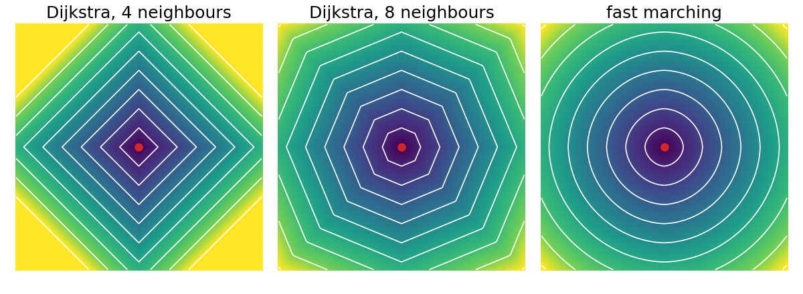
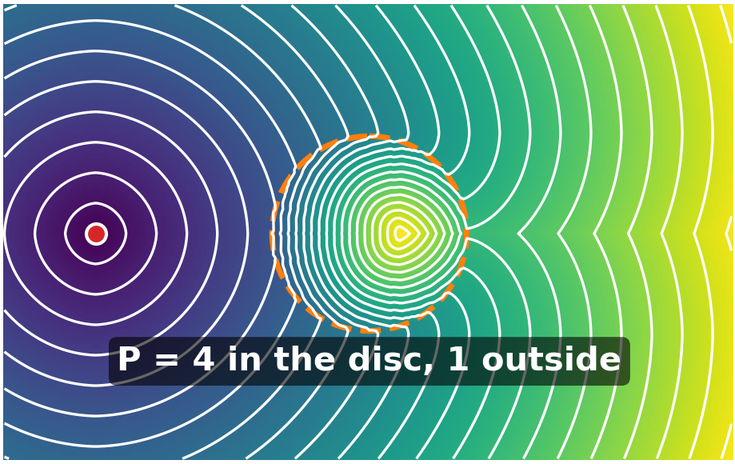
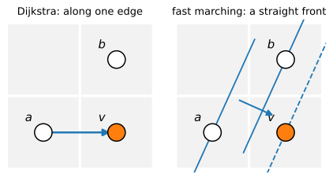
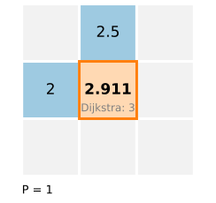
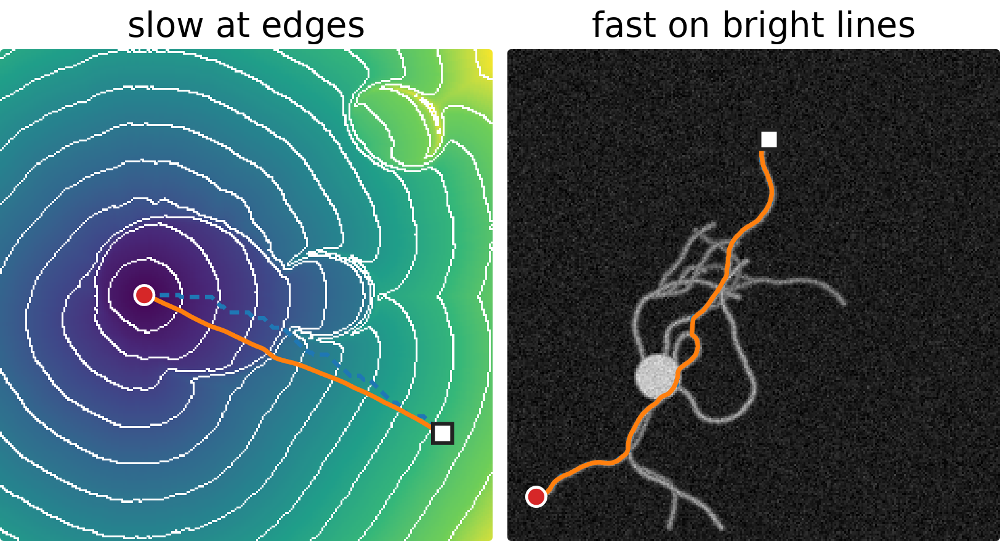
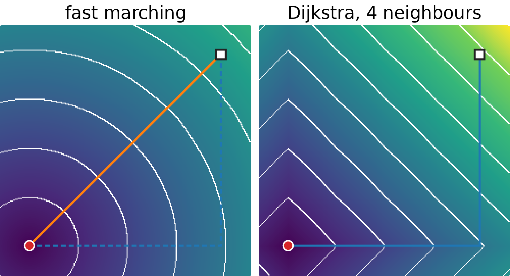
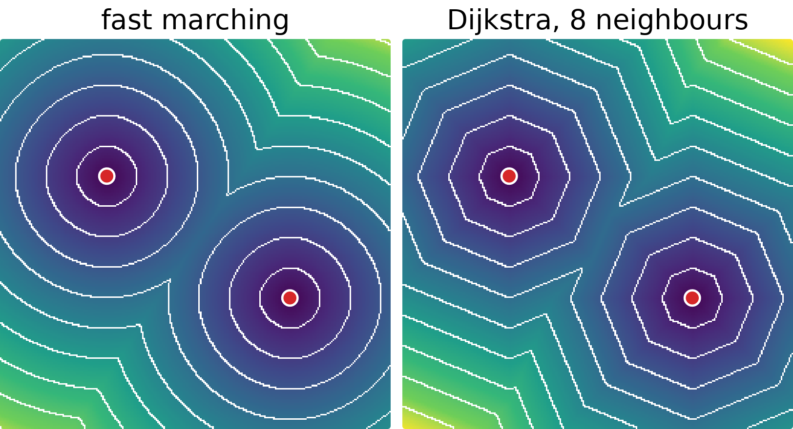

## About this lecture

Dijkstra finds the cheapest path **on the pixel graph**. But the graph's distances are not the distances of the plane: on a flat image the distance from a point grows in **diamonds** (4 neighbours) or **octagons** (8 neighbours), not circles.

- The **arrival time** of a front that starts at a seed and moves with a given speed.
- **Fast marching**: Dijkstra's order, with a better update from two neighbours at once (Sethian, 1996).
- One update **by hand**; why it approximates the Euclidean distance.
- Costs from the image, and **minimal paths** by descending the arrival time.
- How it relates to live-wire, geodesic active contours and watershed.

*Slides titled **The math** give the formulas and proofs; the ideas are complete without them.*

::: notes
This unit moved here from the level-set day (it closes this day's arc: grid DP → polar DP → Dijkstra → fast marching). Prerequisites: Dijkstra (previous unit); the level set equation (previous day of this chain) is recalled on one slide; the Euclidean distance transform is owned by the morphology day.
:::

## Distances on the grid are not round

{fig-alt="Arrival time from one seed in the middle, colour map with white iso-lines every 10 pixels, for three methods: Dijkstra with 4 neighbours gives diamonds, Dijkstra with 8 neighbours gives octagons, fast marching gives circles." width="95%" fig-align="center"}

The same flat cost (1 per pixel of length), the same seed: lines of equal distance every 10 pixels.

- **4 neighbours**: the city-block distance. At 45° a point 100 px away gets 141: 41% too far.
- **8 neighbours**: steps of 1 and $\sqrt2$. Exact on the axes and diagonals, up to 8% too far in between (at 22.5°).
- **Fast marching**: circles, within about 1–2% here.

## The arrival time of a front

:::: {.columns}
::: {.column width="56%"}
Light a fire at the seed. It spreads in every direction, with a **speed** that may depend on the place: fast on cheap pixels, slow on expensive ones.

- $T(x)$ = the **time** at which the fire reaches the point $x$. Lines of equal $T$ are the successive **fronts**.
- With speed 1 everywhere, $T$ is the **Euclidean distance** from the seed: the fronts are circles.
- With the speed low on edges, the fronts slow down there: $T$ becomes a distance that "costs more" across edges.
- Running time is a cost per unit of **length**: $P = 1/\text{speed}$. $T$ is the cheapest total cost of a continuous path, measured along its length, not counted in pixel steps.
:::
::: {.column width="44%"}
{fig-alt="Arrival time from a seed on the left, colour map with white fronts every 10 time units. The fronts are circles until they meet a disc where the cost is 4 times higher; inside the disc the fronts crowd together, and behind it the fronts close in from above and below, forming a notch." width="100%"}
:::
::::

## The math: the Eikonal equation {.math}

Where the front passes $x$ moving with speed $F(x) > 0$, it travels a distance $F\,\Delta t$ in time $\Delta t$ along the normal, so

$$|\nabla T(x)|\, F(x) = 1, \qquad \text{or}\qquad |\nabla T| = P,\quad P = 1/F, \qquad T = 0 \text{ at the seeds}.$$

This is the **Eikonal equation**. With $P = 1$ its solution is the Euclidean distance to the seeds (the distance transform of the [morphology day](../morph-openclose/lec.qmd), from the seed set). $T(x)$ is also the minimal **weighted length** $\min_\gamma \int_\gamma P\, ds$ over all curves $\gamma$ from a seed to $x$.

Recall from the level-set day ([the level set equation](../levelset-eq/lec.qmd)): a front moving with normal speed $F$ is the zero level of $\phi$ with $\phi_t + F|\nabla\phi| = 0$. When $F$ never changes sign, each point is passed once, and $\phi(x, t) = T(x) - t$ solves it: the arrival time is a level-set function that never needs to be updated in time.

## Fast marching: Dijkstra with a better update

Keep everything of Dijkstra:

- tentative values in a **priority queue**, the smallest is made **final**, then its neighbours are updated.

Change one thing, the **update**:

- Dijkstra: $d(v) = \min_u \big(d(u) + \text{cost}\big)$: the front arrives along **one** grid edge.
- Fast marching: use the final neighbour along $x$ **and** the final neighbour along $y$ together, and solve for the time at which a **straight front** passing both would arrive. A front crossing the pixel diagonally is now seen as diagonal.

:::: {.columns}
::: {.column width="45%"}
The values still only grow along the front, so "the smallest is final" still holds.
:::
::: {.column width="55%"}
{fig-alt="Two 2 by 2 pixel sketches with known neighbours a (left of v) and b (above v). Left, Dijkstra: an arrow from a to v, the value comes along one grid edge. Right, fast marching: parallel straight front lines through a and through b, and a dashed front line through v, with the front's direction of motion drawn as an arrow." width="100%"}
:::
::::

## The math: the upwind update {.math}

At pixel $v$ (spacing 1), let $a$ = the smaller final value of its left and right neighbours, $b$ = the smaller final value of its upper and lower neighbours (∞ if none is final). Discretise $T_x^2 + T_y^2 = P^2$ with one-sided ("upwind") differences towards the known side:

$$(T - a)^2 + (T - b)^2 = P^2, \qquad T \ge \max(a, b).$$

If $|a - b| < P$: $\displaystyle T = \frac{a + b + \sqrt{2P^2 - (a - b)^2}}{2}$. Otherwise (only one useful neighbour): $T = \min(a, b) + P$, which is Dijkstra's update.

Each $T$ is larger than both $a$ and $b$, so values never decrease along the front, and Dijkstra's argument gives the order. Work $O(N \log N)$, as Dijkstra.

## One update by hand

:::: {.columns}
::: {.column width="70%"}
A pixel with known neighbours $T = 2$ on its left and $T = 2.5$ above, flat cost $P = 1$:

- Dijkstra (4 neighbours): $\min(2, 2.5) + 1 = 3$.
- Fast marching: $|2 - 2.5| = 0.5 < 1$, so $T = \big(4.5 + \sqrt{2 - 0.25}\big)/2 = 2.911$.
- With only the left neighbour known: $2 + 1 = 3$; with $2$ and $3.2$: too far apart, again $3$.
:::
::: {.column width="30%"}
{fig-alt="A 3 by 3 block of pixels: the left neighbour holds 2 and the upper neighbour 2.5 (both known, blue); the centre pixel gets 2.911 by fast marching, against 3 for Dijkstra; cost P = 1." width="100%"}
:::
::::

From a seed at $(0, 0)$: $T(1, 0) = T(0, 1) = 1$, then $T(1, 1) = \big(2 + \sqrt 2\big)/2 = 1.707$, against $\sqrt2 = 1.414$ exactly and 2 for 4-neighbour Dijkstra. Next to a **point** seed the first-order update is crude; implementations set the pixels within a few pixels of the seed to their exact distance first (the demo uses 3 px). Far from the seed the error is small.

## Try it: fronts on a grid

```{=html}
<link rel="stylesheet" href="../demos/dist/demo.css">
<div data-demo="fastmarch" data-preset="flat"></div>
<script src="../demos/dist/fastmarch.js"></script>
```

::: notes
Left: fast marching, right: Dijkstra on 4 or 8 neighbours, same cost P and same seeds; colour = arrival time, white lines = fronts at equal time steps. Click places a target (or a seed, after "add seed"); orange = gradient descent on T, blue = Dijkstra's pixel path. Tour: "flat cost": circles against diamonds. "Dijkstra 4-nbr vs fast marching": from the bottom-left to the top-right: T = 277.3 for a straight line of 275.8, Dijkstra 390.0 (city block); with 8 neighbours 275.8 on the exact diagonal. "two seeds": the fronts meet on the perpendicular bisector (a Voronoi boundary). "neurite": cost low on bright lines: the path follows the neurite. "edge cost": P = 1 + (|∇I|/k)², the fronts slow down and bunch up at the nucleus boundary.
:::

## Costs from the image

:::: {.columns}
::: {.column width="56%"}
As for live-wire, the cost $P$ comes from the image:

- **Slow at edges**: $P = 1/g$ with the edge-stopping function $g = 1/\big(1 + (|\nabla I|/k)^2\big)$ of the level-set day ([geodesic active contours](../geodesic/lec.qmd)): $P \approx 1$ in flat regions and large on strong edges. A front from a seed inside a nucleus fills it quickly and then stalls at its boundary.
- **Fast along lines**: $P$ small on a bright thin structure (a neurite, a vessel): the front runs along it, and $T$ measures the cost **along** the structure.
- $k$ (contrast) sets which edges count, like $\sigma$ in the contrast weights of the [graph-cut day](../graphcut-seg/lec.qmd).
:::
::: {.column width="44%"}
{fig-alt="Two stills of the fast-marching demo. Left, cost slow at edges on the synthetic nuclei: from a seed inside the nucleus the fronts spread evenly inside and bunch up at its boundary and at the neighbour's boundary. Right, cost fast on bright lines on the synthetic neurite: the minimal path (orange) from one tip to another follows the neurite." width="100%"}
:::
::::

## Minimal paths: descend the arrival time

:::: {.columns}
::: {.column width="56%"}
$T$ has a single minimum, at the seeds, and no other local minima. So from any target:

- **Gradient descent** on $T$ (small steps against $\nabla T$) runs down to a seed. The curve it traces is the **minimal path**, at sub-pixel precision, not restricted to grid steps.
- Dijkstra's path follows the **pointers**: grid steps only, so a straight line at 30° becomes a staircase, longer than the line.

Same principle as before: compute the "table" ($T$) once, then read off any path by backtracking.
:::
::: {.column width="44%"}
{fig-alt="Two stills of the fast-marching demo with a flat cost, seed at the bottom left and target at the top right. Left: fast marching, circular fronts, and the gradient-descent path is the straight diagonal (T = 277.3 for a straight line of 275.8). Right: Dijkstra with 4 neighbours, diamond fronts, and the pixel path goes right along the bottom and then straight up (390.0)." width="100%"}
:::
::::

## Three relatives

| | path | optimum |
|---|---|---|
| [Live-wire](../livewire/lec.qmd) (previous unit) | discrete, on the pixel graph | global (for its graph) |
| Fast marching + descent (today) | continuous | global (up to the discretisation) |
| [Geodesic active contours](../geodesic/lec.qmd) (level-set day) | continuous | local, from a starting curve |

The geodesic active contour minimises the same kind of weighted length $\int g\, ds$, but by moving a curve downhill: it can stop in a local minimum. Fast marching computes the **global** minimal path between two points directly, as live-wire does on the grid.

## Fronts, flooding and watershed

Recall from the [watershed day](../ws-flooding/lec.qmd): flooding from markers also processes pixels in the order of a priority queue, and the basins meet at the watershed lines.

:::: {.columns}
::: {.column width="60%"}
- Fast marching with several seeds: each pixel is reached first by one seed's front; the fronts meet where the arrival times from two seeds are equal (with $P = 1$, the perpendicular bisector: a Voronoi diagram).
- Watershed flooding uses the **maximum** height along the way, not the accumulated time; its basins meet at the ridges of the image.
- Same machinery, different "cost of a path": sum (Dijkstra, live-wire), integral of $P$ (fast marching), maximum (watershed).
:::
::: {.column width="40%"}
{fig-alt="Two seeds with a flat cost. Left, fast marching: circular fronts that meet along a straight line halfway between the seeds. Right, Dijkstra with 8 neighbours: octagonal fronts meeting along a bent line." width="100%"}
:::
::::

## Summary

- Dijkstra's grid distances are blocky: diamonds with 4 neighbours, octagons with 8.
- The **arrival time** $T$ of a front with speed $1/P$ solves $|\nabla T| = P$; with $P = 1$ it is the Euclidean distance.
- **Fast marching** = Dijkstra's order + the **upwind update** from the smaller known neighbour along $x$ and along $y$; $O(N\log N)$; nearly round fronts.
- Costs from the image (slow at edges, fast along lines); **minimal paths** by gradient descent on $T$, at sub-pixel precision.
- The day's arc: DP table (fixed order) → polar DP (closed curves) → Dijkstra (order found on the fly) → fast marching (continuous fronts).
