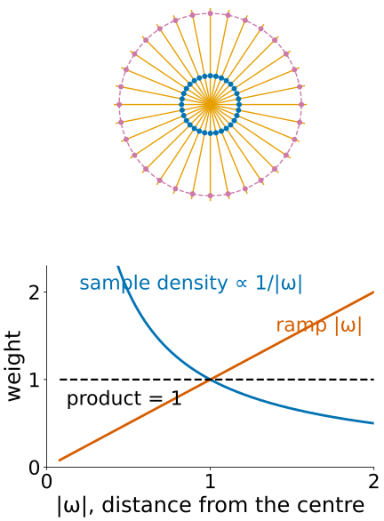
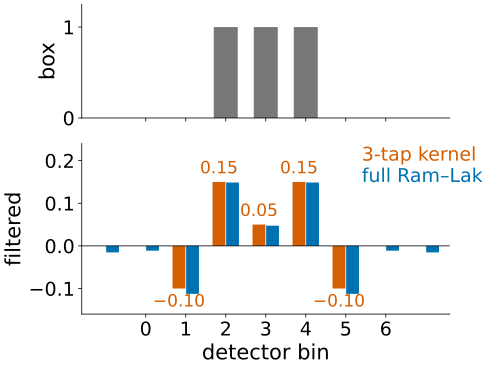
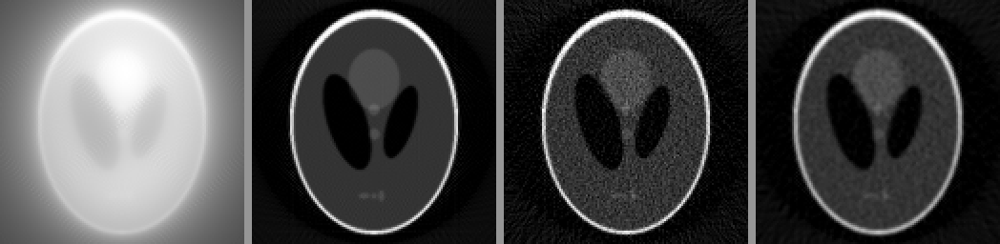
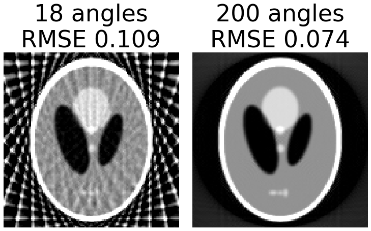
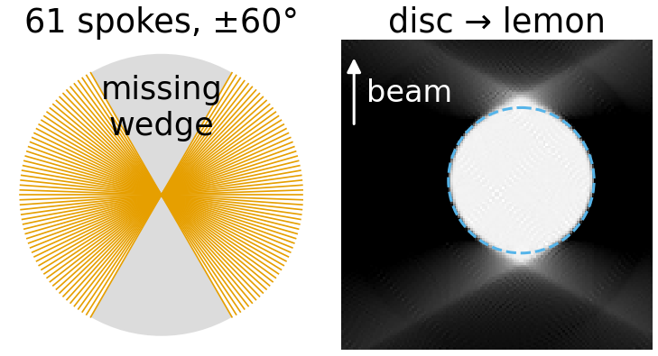

## About this lecture

Plain back-projection blurs every point with a $1/r$ halo, because the spokes of the Fourier slice theorem crowd at the centre of the spectrum. Today: the fix, and what a scan needs to work.

- **Filtered back-projection** (FBP): filter each projection with a **ramp** before smearing it back.
- **Noise**: the ramp amplifies fine detail and noise alike; **tapered** ramps trade sharpness for less noise.
- **How many angles?** The angle rule $N_\theta \approx \tfrac{\pi}{2}N$; too few give **streaks**.
- **Limited angle**: the **missing wedge** of electron tomography.

*Slides titled **The math** give the formulas and proofs; the ideas are complete without them.*

::: notes
FBP is still the workhorse of clinical CT; iterative methods (next unit) take over at low dose and with few views. Demos: backproj (filters, dose, padding), tomosampling (angles, range, bins, dose).
:::

## Filter first, then smear

:::: {.columns}
::: {.column width="56%"}
Before back-projecting, replace each projection by a **filtered** version that has a positive peak and **negative sidelobes** around every feature.

- Back-projecting the filtered projection of a point: each smear is a positive stripe flanked by two negative stripes.
- Near the point, where the smears of all angles overlap, the negative parts of one angle cancel the positive tails of the others: the **halo disappears**.
- Far from the point, positive and negative contributions cancel on average: no glow.

Same total work as plain back-projection plus one 1D filter per projection. That is all FBP is.
:::
::: {.column width="44%"}
{width="100%"}
:::
::::

## Why a ramp

:::: {.columns}
::: {.column width="62%"}
Use the spokes picture. Every projection fills one spoke of the 2D spectrum, so near the centre the spokes crowd and far out they thin:

- at distance $|\omega|$ from the centre the spokes are $\pi|\omega|/N_\theta$ apart,
- so each spoke should count in proportion to the gap it has to cover: weight $\propto |\omega|$.

The filter multiplies each projection's 1D spectrum by $|\omega|$, a **ramp**: slow waves (over-counted) are turned down, fine ones up. It undoes exactly the $1/|\omega|$ of back-projection.

Filtering is the convolution theorem of the Fourier unit: multiplying the spectrum = convolving the projection with a small kernel. Here it is done in 1D, on each projection: cheap.
:::
::: {.column width="38%"}
{width="88%"}
:::
::::

## The math: deriving FBP {.math}

Write the 2D inverse Fourier transform in polar coordinates $\boldsymbol\omega = \omega\,\mathbf n_\theta$, $\omega \in \mathbb R$, $\theta \in [0, \pi)$. The area element is $d\boldsymbol\omega = |\omega|\,d\omega\,d\theta$ (the polar Jacobian):

$$f(\mathbf x) = \iint F(\boldsymbol\omega)e^{2\pi i\boldsymbol\omega\cdot\mathbf x}d\boldsymbol\omega = \int_0^\pi\!\!\int_{-\infty}^{\infty} \underbrace{F(\omega\mathbf n_\theta)}_{P_\theta(\omega)}\,|\omega|\,e^{2\pi i\omega\,\mathbf x\cdot\mathbf n_\theta}\,d\omega\,d\theta = \int_0^\pi q_\theta(\mathbf x\cdot\mathbf n_\theta)\,d\theta.$$

- $q_\theta$ is $p_\theta$ filtered with the ramp: its 1D spectrum is $|\omega|P_\theta(\omega)$ (slice theorem for $P_\theta$).
- The outer integral is back-projection. So $f = \mathcal B(\text{ramp} * p)$: **the ramp is the Jacobian.**
- Discretely: $f \approx \frac{\pi}{N_\theta}\sum_k q_{\theta_k}(\mathbf x\cdot\mathbf n_{\theta_k})$.

## By hand: what the filter does to a box

The ramp as a kernel (bin spacing 1), the Ram–Lak kernel: centre $\tfrac14$, odd neighbours $-\tfrac{1}{\pi^2 k^2}$, even ones 0:

| $k$ | 0 | ±1 | ±2 | ±3 | ±5 |
|---|---|---|---|---|---|
| $h[k]$ | 0.25 | −0.101 | 0 | −0.011 | −0.004 |

:::: {.columns}
::: {.column width="58%"}
Truncated to three taps, $(-0.1,\ 0.25,\ -0.1)$, applied to the projection of a box $(0, 0, 1, 1, 1, 0, 0)$:

$$(0,\ -0.1,\ 0.15,\ 0.05,\ 0.15,\ -0.1,\ 0)$$

- The **edges are raised** (0.15) relative to the inside (0.05): the box's edges are fine detail, turned up.
- **Negative** just outside (−0.1): when this is smeared back, it cancels the positive tails from other angles: no glow outside the object.
- The sum of the full kernel is 0: a constant projection filters to (almost) nothing.
:::
::: {.column width="42%"}
{width="100%"}
:::
::::

## The math: the discrete ramp and zero padding {.math}

- The sampled ramp $|f|$, $|f| \le \tfrac12$ cycles per bin, has the kernel $h[0] = \tfrac14$, $h[k] = -1/(\pi k)^2$ for odd $k$, $0$ for even $k \ne 0$ (inverse DTFT of $|f|$, integrate by parts).
- Its sum is $\tfrac14 - 2\sum_{k\ \text{odd}}\frac{1}{\pi^2k^2} = \tfrac14 - \frac{2}{\pi^2}\cdot\frac{\pi^2}{8} = 0$.
- Filtering by FFT multiplies the DFTs: that is **circular** convolution. A projection of $N$ bins must be **zero-padded** to at least $2N$ before the FFT; otherwise the kernel's tail wraps one edge of the projection onto the other.
- Taking the DFT of the spatial kernel (rather than sampling $|f|$ directly) keeps a small positive value at DC, correct for a finite detector.

## Try it: the ramp cancels the star

```{=html}
<link rel="stylesheet" href="../demos/dist/demo.css">
<div data-demo="backproj" data-preset="pointramp"></div>
<script src="../demos/dist/backproj.js"></script>
```

::: notes
Preset "one point: ramp cancels the star": 16 angles, ramp filter, filtered sinogram shown in colour (red positive, blue negative). The lower plot shows the projection before (grey) and after (red) filtering: a peak with negative sidelobes. Press clear, then step angle by angle: each smear is a stripe with negative borders; where they overlap at the point they add, around it they cancel. With 16 angles a faint star remains far out (streaks); set 180 angles: a clean point. Then "ramp: sharp" on the Shepp–Logan phantom: RMSE 0.039, flat region std 0.003.
:::

## Noise and tapered ramps

The ramp is largest at the highest frequencies, where a low-dose projection holds mostly **noise**. Few photons → noisy line integrals → **grainy** reconstruction.

- **Tapered ramps** multiply the ramp by a taper that rolls off towards a **cutoff** (the Fourier unit's tapers): Shepp–Logan (a sinc), cosine, Hann (the strongest).
- The trade: less noise, less sharpness. The same trade as low-pass filtering.

{width="88%"}

Demo, Shepp–Logan, 1000 photons per ray, noise = standard deviation in a flat region: ramp 0.048, Shepp–Logan 0.038, cosine 0.023, Hann 0.016. Without noise the ramp has RMSE 0.039 and Hann 0.074: Hann blurs the edges.

## The math: noise in FBP {.math}

Model each filtered projection bin as signal plus white noise of variance $\sigma_n^2$. Filtering with $|\omega|W(\omega)$ (taper $W$, cutoff $\omega_c$) and back-projecting $N_\theta$ angles gives, at every pixel,

$$\operatorname{Var}\hat f \;\propto\; \frac{\sigma_n^2}{N_\theta}\int_{-\omega_c}^{\omega_c}|\omega|^2\,W(\omega)^2\,d\omega \;\propto\; \sigma_n^2\,\omega_c^3 \quad\text{(fixed taper shape)}.$$

- Halving the cutoff divides the noise variance by 8 (standard deviation by 2.8). The demo: Hann at cutoff 0.5 has noise std 0.016, at 0.25 it has 0.005 (ratio 3.2).
- Finer pixels need a higher cutoff **and** collect fewer photons per detector bin: resolution is expensive in dose.
- $\sigma_n^2$ for one line integral is about $1/(\text{counts})$ (shot noise, the camera-noise unit): worst where few photons get through.

## Try it: dose and filters

```{=html}
<link rel="stylesheet" href="../demos/dist/demo.css">
<div data-demo="backproj" data-preset="lowdose"></div>
<script src="../demos/dist/backproj.js"></script>
```

::: notes
"ramp, low dose": 1000 photons per ray, flat-region std 0.048. Switch filters: Shepp–Logan 0.038, cosine 0.023, Hann 0.016; RMSE moves the other way for edges. Lower the cutoff with Hann: smoother still. Raise the photons: 1e4 gives std 0.017, 1e5 gives 0.005 (about 1/√dose). "Forgot to pad": the large disc without zero padding comes out too dark towards its rim (0.79 instead of 1 near the edge); tick zero padding and it is flat.
:::

## How many angles?

:::: {.columns}
::: {.column width="60%"}
Use the spokes again. A detector with $N$ bins gives spectrum samples out to radius $N/2$ (in frequency steps). With $N_\theta$ angles over 180°, neighbouring spokes at that radius are $\frac{\pi}{N_\theta}\cdot\frac{N}{2}$ steps apart. Asking for at most one step:

$$N_\theta \gtrsim \frac{\pi}{2}\,N \qquad \text{(the angle rule)}.$$

- 128 bins: about 200 angles; 256 bins: about 400; 512 bins: about 800.
- **Too few angles**: **streaks** radiating from high-contrast edges. Each smear is no longer cancelled by its neighbours. Demo: Shepp–Logan with 18 angles (Hann), RMSE 0.109 against 0.074 with 200.
- **Too few bins** (wide detector elements): blur. 64 bins instead of 128: RMSE 0.126; 32 bins: 0.164.
:::
::: {.column width="40%"}
{width="100%"}
:::
::::

## Limited angle: the missing wedge

:::: {.columns}
::: {.column width="56%"}
In electron tomography the specimen holder tilts only to about $\pm 60°$–$70°$; beyond, the specimen gets too thick or the holder blocks the beam.

- A tilt series from $-60°$ to $+60°$ in $2°$ steps has 61 images. The spokes cover 120° of the spectrum; a **60° wedge** around the beam direction stays **empty**.
- Missing frequencies cannot be filtered back in: whatever lived there is gone from the data.
- Effect: objects are **elongated along the beam**; edges facing the beam (perpendicular to it) blur away, edges parallel to it stay sharp. A disc becomes a **lemon**: in the demo a disc of diameter 61 pixels comes out 58 wide and 70 tall.
- Priors (the next unit) can fill part of the wedge; filtering cannot.
:::
::: {.column width="44%"}
{width="100%"}
:::
::::

## Try it: angles, range, bins and dose

```{=html}
<link rel="stylesheet" href="../demos/dist/demo.css">
<div data-demo="tomosampling" data-preset="wedge"></div>
<script src="../demos/dist/tomosampling.js"></script>
```

::: notes
Panels: FBP with Hann, the error, and the spectrum of the reconstruction with the measured spokes in orange. "±60°: missing wedge": the empty sector around the vertical axis (beam vertical at 0° tilt), the phantom stretched vertically. "a disc becomes a lemon". "18 angles: streaks". "Few bins: blur". Then the design question: "equal photons: many noisy views…" (180 views, RMSE 0.075) "…or few clean ones" (30 views with 6 times the photons each, 0.083; 15 views 0.128): with a fixed photon budget, spreading it over many views wins, because few views streak and more photons per view cannot fix that.
:::

## The output scale

FBP returns attenuation coefficients $\mu$ per pixel. Clinical CT reports them in **Hounsfield units**: $\text{HU} = 1000\,(\mu - \mu_\text{water})/\mu_\text{water}$, so water is 0 and air −1000; dense bone reaches over +1000. The display window/level that makes such 12-bit data readable is covered on the bit-depth day (12- and 16-bit images in practice).

## Summary

- **FBP**: filter each projection with a **ramp** $|\omega|$, then back-project. The ramp is the polar Jacobian; it undoes the $1/|\omega|$ of plain back-projection.
- The filtered projection has **negative sidelobes**; their smears cancel the halo. Filter by FFT with **zero padding**, or the projection wraps around.
- The ramp amplifies **noise**; **tapered** ramps (Shepp–Logan, cosine, Hann) and a lower cutoff trade sharpness for less noise. Noise variance grows like the cutoff cubed.
- **Angle rule** $N_\theta \approx \tfrac{\pi}{2}N$; too few angles → **streaks**, too few bins → blur.
- A **limited tilt range** leaves a **missing wedge**: objects stretch along the beam, and no filter brings the wedge back.
