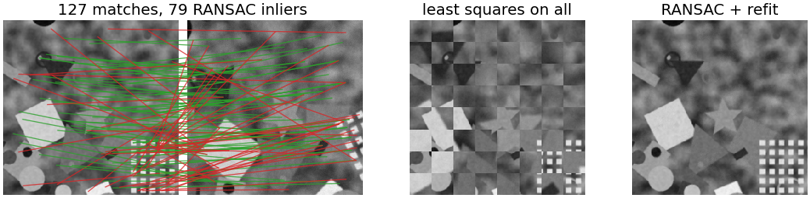
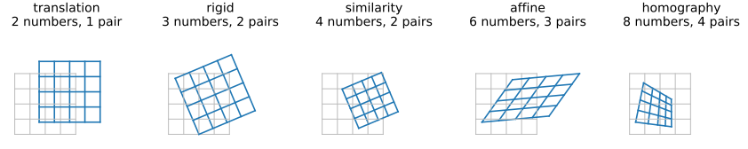
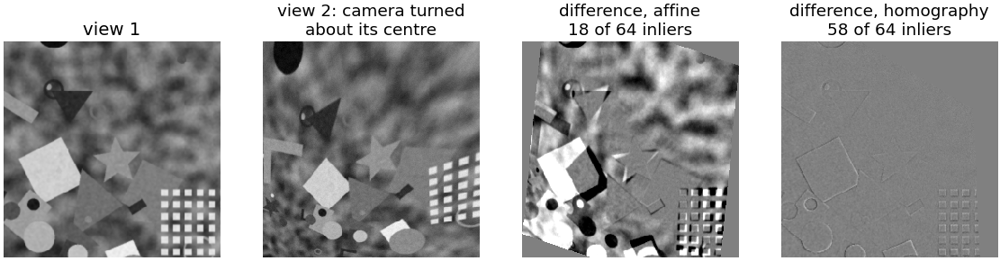
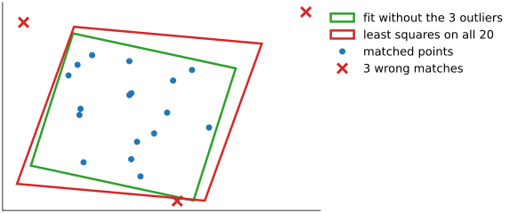
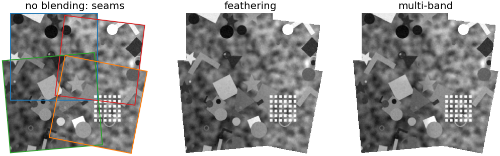
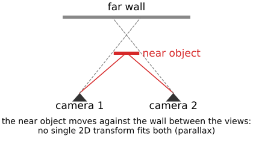
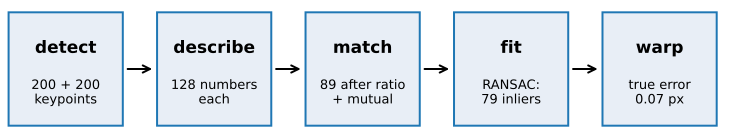

## About this lecture

The [matching unit](../feature-matching/lec.qmd) left us with pairs of points, most of them right, some wrong. Now we find the **transform** that maps image 2 onto image 1, and ignore the wrong pairs.

- **Which transform?** Translation, rigid, similarity, affine, homography: degrees of freedom and pairs needed.
- **Fitting** to clean pairs by least squares, and why one wrong pair ruins it.
- **RANSAC** (recall, [Hough day](../ransac/lec.qmd)) on matches: how many iterations, choosing ε, checking the result.
- Uses: **stitching** tiles and panoramas, **registration** (features vs intensities), and a pointer to **geometry from images**.

*Slides titled **The math** give the formulas and proofs; the ideas are complete without them.*

::: notes
This unit teaches the application of RANSAC to transforms between images (RANSAC itself is owned by the Hough day's [ransac/](../ransac/lec.qmd) unit; the homography by [cameras/](../cameras/lec.qmd), Procrustes by [shape-models/](../shape-models/lec.qmd)). Notation: a 2D transform T (3 × 3 in homogeneous coordinates), a homography H, inlier fraction w, minimal sample size s, tolerance ε, success probability p, as in [ransac/](../ransac/lec.qmd). Demo numbers: view 2 turned 25°, zoomed 1.2×, noise 3; 89 matches after ratio 0.8 + mutual, plus 38 added wrong matches (30 %).
:::

## The goal

{fig-alt="Left: matches between two views, green for the RANSAC inliers (79) and red for the rest (48 of 127). Middle: view 1 and view 2 warped by a least-squares fit to all matches, shown as a checkerboard of 32-pixel squares: the squares do not line up. Right: the same with RANSAC plus refit: the checkerboard is seamless." width="100%"}

From the matched pairs, the transform from image 2 to image 1, **ignoring the wrong pairs**. Check: warp image 2 onto image 1 and show them as a **checkerboard**: seams vanish when the transform is right.

## Which transform?

{fig-alt="A unit square with a grid (grey) and its image (blue) under five models: translation (moved), rigid (moved and turned), similarity (also scaled), affine (sheared, parallel lines stay parallel), homography (lines stay straight but parallel lines converge)." width="80%" fig-align="center" .nostretch}

| model | numbers | pairs | keeps | typical case |
|---|---|---|---|---|
| translation | 2 | 1 | everything but position | stage, tiles |
| rigid | 3 | 2 | lengths, angles | remounted slide |
| similarity | 4 | 2 | angles, length ratios | + magnification |
| affine | 6 | 3 | parallel lines | shear |
| homography | 8 | 4 | straight lines | plane at an angle; turning camera |

## As simple as the physics allows

- Choose the model from **what the scene and the camera can do**, not from the data.
- A microscope stage: translation (plus rotation if the sample was remounted). Serial sections: rigid or similarity, then [non-rigid](../nonrigid-reg/lec.qmd). A poster photographed from an angle, a panorama from a tripod: homography.
- More freedom fits more **noise**, needs more pairs per RANSAC sample, and extrapolates worse outside the matched area.

## Try it: the transform zoo

```{=html}
<link rel="stylesheet" href="../demos/dist/demo.css">
<div data-demo="transformzoo" data-preset="three"></div>
<script src="../demos/dist/transformzoo.js"></script>
```

::: notes
Drag the orange target points. Presets: one pair (translation), two (similarity, exact), three (affine, exact: parallel lines stay parallel), four (homography, exact: lines may meet), six pairs (least squares, RMS residual: translation 54.9, rigid 34.1, similarity 22.3, affine 11.3, homography 2.2 on the default targets, which come from a mild perspective map), one outlier (affine RMS 44.7; on the five good pairs 27.1 instead of about 11).
:::

## The homography

A 3 × 3 matrix on homogeneous coordinates $(x, y, 1)$ ([images unit](../images/lec.qmd)), defined up to scale: **8 numbers**, 4 point pairs. Straight lines stay straight; parallel lines may meet.

- It maps the image of a **plane** seen by one camera to its image seen by another.
- It relates **any** two images taken by a camera **turning about its centre** (no parallax): this is why panoramas work. Derivation: [cameras](../cameras/lec.qmd); pure rotation: [two views](../two-view/lec.qmd).

{fig-alt="Four panels: view 1; view 2 taken by a camera turned about its centre; the difference between view 1 and view 2 warped by the best affine fit (strong structure away from the centre, 18 of 64 inliers); the same with the best homography (almost flat grey, 58 of 64 inliers)." width="88%" fig-align="center" .nostretch}

## Fitting clean pairs: least squares

:::: {.columns}
::: {.column width="52%"}
Every pair gives **two equations** (x and y).

- **Translation**: the mean of the differences.
- **Similarity**: closed form: centre both point sets, best rotation from an SVD, scale from the spread (Procrustes, [shape models](../shape-models/lec.qmd)).
- **Affine**: 6 unknowns, linear least squares.
- **Homography**: also linear after multiplying out the division (the DLT), with normalised coordinates.

But **one wrong pair pulls them all**: right, 3 wrong matches among 20 skew the affine fit visibly.
:::
::: {.column width="48%"}
{fig-alt="20 matched points, 3 of them wrong (red crosses far away). The square mapped by the affine fit without the outliers (green) and by least squares on all 20 (red, skewed and enlarged)." width="100%"}
:::
::::

## The math: the transform hierarchy {.math}

In homogeneous coordinates ($\mathbf x' \simeq T\mathbf x$, equal up to scale):

$$\text{translation } \begin{pmatrix} I & \mathbf t\\ \mathbf 0^\top & 1\end{pmatrix},\quad \text{similarity } \begin{pmatrix} sR & \mathbf t\\ \mathbf 0^\top & 1\end{pmatrix},\quad \text{affine } \begin{pmatrix} A & \mathbf t\\ \mathbf 0^\top & 1\end{pmatrix},\quad \text{homography } H \in \mathbb R^{3\times3}/\text{scale}.$$

- Invariants: rigid keeps lengths; similarity angles and ratios of lengths; affine parallelism and ratios of lengths along a line; homography collinearity and the cross-ratio of four points on a line.
- **Affine least squares**: $x' = a_{11}x + a_{12}y + t_x$, $y' = a_{21}x + a_{22}y + t_y$. Stacked, $M\mathbf a = \mathbf b$ with $M$ of size $2n \times 6$; it splits into two $n \times 3$ problems with the **same** matrix (rows $[x_i, y_i, 1]$), solved by the normal equations.
- **Similarity** (Procrustes): centre both sets, $C = \sum\mathbf y_i\mathbf x_i^\top = U\Sigma V^\top$, $R = U\,\mathrm{diag}(1, \det UV^\top)V^\top$, $s = \operatorname{tr}(\Sigma\,\mathrm{diag}(1, \det UV^\top))/\sum\|\mathbf x_i\|^2$, $\mathbf t = \bar{\mathbf y} - sR\bar{\mathbf x}$.

## The math: the homography (DLT) {.math}

- $\mathbf x' \simeq H\mathbf x$ means $\mathbf x' \times H\mathbf x = \mathbf 0$. With $\mathbf h$ the 9 entries of $H$, each pair gives two independent linear rows (the third is a combination):
$$\begin{pmatrix} \mathbf 0^\top & -\mathbf x^\top & y'\mathbf x^\top \\ \mathbf x^\top & \mathbf 0^\top & -x'\mathbf x^\top\end{pmatrix}\mathbf h = \mathbf 0 .$$
- Stack $n \ge 4$ pairs: $A\mathbf h = \mathbf 0$, $A$ of size $2n \times 9$; $\mathbf h$ = the right singular vector of the smallest singular value.
- **Normalise** both point sets first (centroid at 0, mean distance √2), fit $\hat H$, undo: $H = T'^{-1}\hat HT$.
- The DLT minimises an **algebraic** error, not a distance in pixels: refine on the **transfer error** $\sum\|\mathbf x'_i - H(\mathbf x_i)\|^2$ by Gauss–Newton (as in [spot fitting](../spot-fit/lec.qmd)).
- A camera turning about its centre: $\mathbf x \simeq K\mathbf X$, $\mathbf x' \simeq KR\mathbf X$, so $\mathbf x' \simeq KRK^{-1}\mathbf x$: a homography.

## Recall: RANSAC

From the [RANSAC unit](../ransac/lec.qmd) of the Hough day: **guess and check**.

1. Pick a **minimal sample**: $s$ pairs (1 for a translation, 2 for a similarity, 3 affine, 4 homography).
2. **Fit exactly** to the sample.
3. Map all points of image 2 and count the pairs that land within **ε px** of their partner: the **inliers**.
4. Keep the transform with the most inliers; **refit** by least squares on its inliers.

Number of iterations for success probability $p$: $N = \log(1 - p)/\log(1 - w^s)$, with $w$ the fraction of correct matches.

## Try it: RANSAC on a line (recall)

```{=html}
<link rel="stylesheet" href="../demos/dist/demo.css">
<div data-demo="ransac" data-preset="seventeen"></div>
<script src="../demos/dist/ransac.js"></script>
```

::: notes
The Hough day's demo, as a reminder: 50 % outliers, 17 iterations for a line (s = 2). The same loop now runs on matched pairs, with a transform instead of a line.
:::

## The numbers that matter

Iterations $N$ for $p = 0.99$:

| inlier fraction $w$ | translation $s = 1$ | similarity $s = 2$ | affine $s = 3$ | homography $s = 4$ |
|---|---|---|---|---|
| 0.7 | 4 | 7 | 11 | 17 |
| 0.5 | 7 | 17 | 35 | 72 |
| 0.3 | 13 | 49 | 169 | 567 |

- Simple models need few samples: one more reason to choose the simplest model.
- A good ratio test raises $w$, which matters more than anything else: in the demo, ratio 0.7 gives $w = 0.99$, and a homography needs **2** iterations; with 65 % added wrong matches ($w = 0.31$) it needs **516**.

## The math: the number of iterations {.math}

- Derived in the [RANSAC unit](../ransac/lec.qmd) (its math slide "the number of iterations"): all $N$ samples fail with probability $(1 - w^s)^N$, so $N \ge \log(1 - p)/\log(1 - w^s)$.
- For small $w^s$: $\log(1 - w^s) \approx -w^s$, so $N \approx -\log(1 - p)/w^s = 4.6/w^s$ for $p = 0.99$: 74 instead of 72 for $w = 0.5$, $s = 4$.
- **Adaptive stopping**: $w$ is unknown; start pessimistic and update $w$ from the best inlier count so far, stopping when $N(w)$ iterations have been done.

## Try it: RANSAC on matches

```{=html}
<link rel="stylesheet" href="../demos/dist/demo.css">
<div data-demo="featurealign" data-preset="sim"></div>
<script src="../demos/dist/featurealign.js"></script>
```

::: notes
127 matches: 89 from ratio + mutual (79 truly correct) plus 38 added wrong ones: w = 0.62. "one sample" steps through: the yellow pairs are the sample, the dashed yellow outline the exact fit, green the pairs within ε. Similarity: N(0.62, 2) = 10, found at iteration 2; 79 inliers, RMS 0.54 px, true error 0.07 px (mean over the corners and the centre, against the known transform). "least squares on all matches fails": true error 79 px. "homography needs hundreds": 280 matches, w = 0.31, N = 516 (this seed happens to find it at iteration 49). "affine on a rotating-camera pair": affine 18 inliers (true error 71 px at the corners), homography 58 inliers (0.88 px).
:::

## Choosing ε, and checking the result

- **ε**: a few pixels: larger than the keypoints' position error, smaller than the scene's structure. Too large: near-misses count as inliers and pull the refit (demo: ε = 25 px gives an RMS of 4.2 px and a true error of 2.0 px instead of 0.07). Too small: correct matches at the image borders are rejected.
- After the refit, **report** the number of inliers and the **residual** (RMS distance of the inliers).
- **Too few inliers** (say fewer than 10, or under 4 % of the matches) means "**no reliable alignment**", not "a bad one". Demo: a blurred, noisy, textureless pair gives 12 matches and 5 inliers.
- Skip **degenerate samples**: three collinear points for an affine map, three collinear of four for a homography.

## Stitching tiles and panoramas

:::: {.columns}
::: {.column width="45%"}
For tiles with rotation or large unknown offsets:

1. match each **overlapping pair** of tiles, fit by RANSAC;
2. make the transforms **consistent**: chaining pairwise transforms accumulates error. Recall the tile graph and its global least squares from [stitching](../stitching/lec.qmd); with rotations it stays linear for similarities, with homographies it becomes a nonlinear least squares (bundle adjustment, [structure from motion](../sfm/lec.qmd)).

Demo, matches with 1.5 px noise: chain 1 → 2 → 4 → 3: corner errors 0.8, 2.2, 1.6 px; global fit: 0.5, 1.0, 0.5 px.
:::
::: {.column width="55%"}
{fig-alt="A mosaic of four overlapping tiles of the synthetic scene, turned and zoomed differently and with different exposures, three times: without blending (visible seams; tile outlines drawn), with feathering, and with multi-band blending." width="100%"}
:::
::::

## Blending

- **Exposure** differs between tiles: correct each tile's gain first (one number per tile, from the overlaps); blending only hides what is left.
- **Feathering**: weights falling linearly to zero at each tile's edge; a weighted average in the overlaps. Simple, but blurs where the tiles disagree slightly.
- **Multi-band blending**: split each tile into the levels of its **Laplacian pyramid** ([scale space](../scale-space/lec.qmd)); blend coarse levels over a wide zone and fine levels over a narrow one; collapse. Smooth exposure transitions, sharp detail.

## Try it: a mosaic

```{=html}
<link rel="stylesheet" href="../demos/dist/demo.css">
<div data-demo="featurealign" data-mode="mosaic" data-preset="chain"></div>
<script src="../demos/dist/featurealign.js"></script>
```

::: notes
Four 256² tiles of the synthetic scene, turned 0°, 7°, −5°, 11°, zoomed 1, 1.08, 0.94, 1.04, with gains 1, 1.22, 0.85, 1.12. All six tile pairs overlap (23 to 62 inliers). With 1.5 px of added match noise: pairwise chain 1 → 2 → 4 → 3 gives corner errors 0.76, 2.21, 1.56 px; the global least squares 0.54, 1.00, 0.50 px. Without blending the seams and the exposure steps show; feathering hides the steps; multi-band keeps the detail sharper.
:::

## The math: global alignment and multi-band blending {.math}

- Tiles with similarities $S_k(\mathbf p) = \begin{pmatrix} a_k & -b_k\\ b_k & a_k\end{pmatrix}\mathbf p + \mathbf t_k$ (tile → world, $S_0$ = identity). Every inlier pair $(\mathbf p \in$ tile $i$, $\mathbf q \in$ tile $j)$ gives $S_i(\mathbf p) - S_j(\mathbf q) = \mathbf 0$: two equations, **linear** in $(a, b, \mathbf t)$. One least-squares solve uses all pairs at once; the redundant overlaps average out the errors that a chain accumulates.
- With homographies the same idea is nonlinear: minimise $\sum\|H_i\mathbf p - H_j\mathbf q\|^2$ (after the division) by Gauss–Newton or Levenberg–Marquardt.
- **Multi-band blending**: Laplacian pyramids $L^{(k)}_\ell$ of the tiles, Gaussian pyramids $G^{(k)}_\ell$ of their masks (1 where tile $k$ is chosen); blend level by level, $B_\ell = \sum_k G^{(k)}_\ell L^{(k)}_\ell / \sum_k G^{(k)}_\ell$, and collapse. Level $\ell$ is blended over a zone about $2^\ell$ pixels wide.

## Features or intensities?

| | intensity-based ([phase correlation](../phasecorr/lec.qmd), [template matching](../matching/lec.qmd)) | feature-based (this day) |
|---|---|---|
| needs | overlap with some contrast | texture: keypoints |
| uses | all pixels | a few hundred points |
| handles | translation, very precisely | rotation, zoom, perspective, large offsets, small overlap, occlusion |
| fails | rotation, zoom (without extensions), small overlap | empty or repetitive images; different modalities |

Common practice: **features for the rough transform, then intensity-based refinement** ([template matching](../matching/lec.qmd), [non-rigid registration](../nonrigid-reg/lec.qmd)). Repetitive texture defeats both, in different ways.

## Registration in practice

- **Serial sections**: each section to its neighbour, rigid or similarity by features + RANSAC, then a non-rigid refinement; global consistency over the stack as for tiles.
- **Time-lapse with drift and rotation**: each frame to a key frame, not only to its predecessor (recall [drift](../stitching/lec.qmd): chaining accumulates error). Moving cells are outliers; the static background gives the transform.
- **Correlative overviews** (light and electron microscopy): few keypoints match across modalities, so a handful of **manual landmarks** and the same least-squares fits.
- Image libraries call the whole pipeline "feature-based registration" or "panorama stitching".

## Geometry from multiple images

:::: {.columns}
::: {.column width="55%"}
Two views of a **3D** scene from **different positions** do not obey any 2D transform: near and far points move differently (**parallax**).

- Instead, every correct match lies on an **epipolar line**; RANSAC fits the fundamental matrix (7 or 8 pairs per sample): [two views](../two-view/lec.qmd).
- Many views: [structure from motion](../sfm/lec.qmd); dense depth: [stereo](../stereo/lec.qmd).
- A homography that fits almost all matches flags the degenerate cases: a flat scene, or a camera that only turned.
:::
::: {.column width="45%"}
{fig-alt="Sketch: two cameras look at a far wall and a near object; the rays to the near object cross the line of sight to the wall at different places, so the near object moves against the wall between the views." width="100%"}
:::
::::

## Summary

{fig-alt="The pipeline: detect (200 plus 200 keypoints), describe (128 numbers each), match (89 after ratio plus mutual), fit (RANSAC: 79 inliers), warp (true error 0.07 px)." width="80%" fig-align="center" .nostretch}

- Choose the **simplest model** the physics allows: translation, rigid, similarity, affine, homography (2 to 8 numbers, 1 to 4 pairs).
- **Least squares** fits clean pairs; one wrong pair ruins it.
- **RANSAC**: minimal sample, exact fit, count inliers within ε, keep the best, refit. $N = \log(1 - p)/\log(1 - w^s)$: few iterations for simple models and good matches.
- Report inliers and residual; **too few inliers = no alignment**.
- **Stitching**: pairwise fits made consistent by a **global** least squares; correct exposure, then feather or multi-band blend.
- Features for large and rotated displacements, intensities for precision; 3D scenes need [epipolar geometry](../two-view/lec.qmd).
