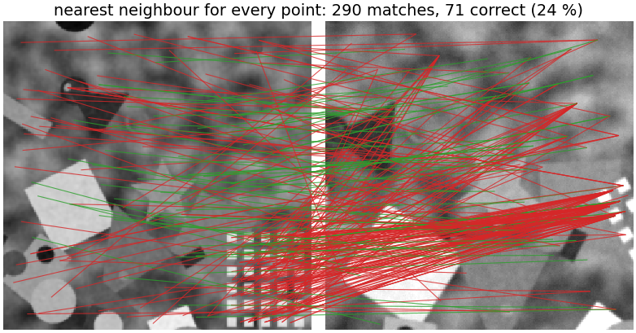
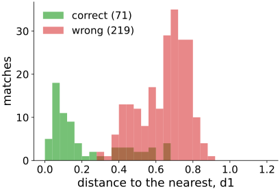
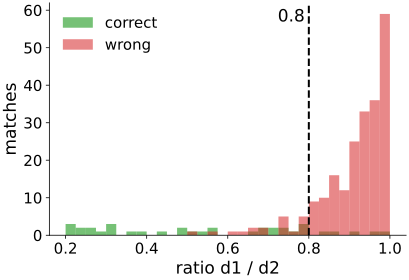
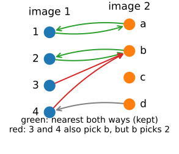
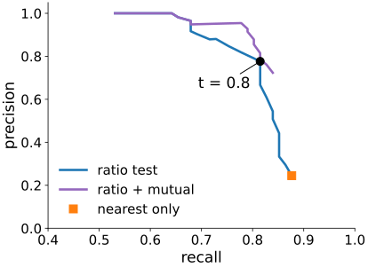
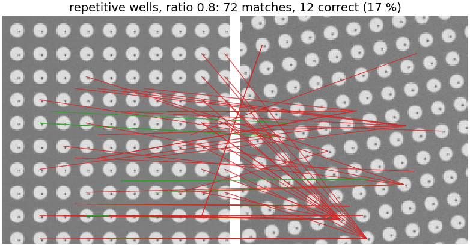
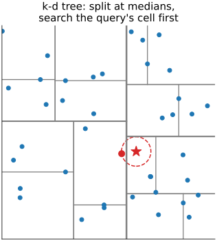
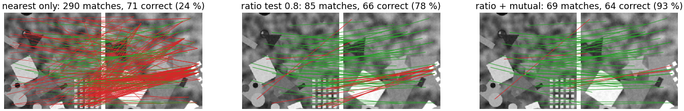

## About this lecture

Two images, a few hundred [descriptors](../descriptors/lec.qmd) each. Which descriptor in image 2 belongs to which in image 1?

- **Nearest neighbour** matching, and why it gives a mess.
- Why a **distance threshold** is not enough.
- The **ratio test**: is the best clearly better than the second best?
- **Mutual nearest neighbours**, and one-to-one assignment.
- How good are the matches: **precision and recall** against a known transform.
- What still goes wrong, and how to search fast.

*Slides titled **The math** give the formulas and proofs; the ideas are complete without them.*

::: notes
This unit owns feature matching for the course (nearest neighbour in descriptor space, ratio test, mutual check, match precision/recall, fast search). The two-view unit of the geometry day and structure from motion recall it; linking detections over time stays with the tracking day. All numbers below: the featurematch demo's scene (view 2 turned 30°, zoomed 1.3×, gain 1.2, noise 3; 200 DoG keypoints per view, 290 and 144 descriptors after orientation assignment; ε = 3 px).
:::

## From two lists to pairs

:::: {.columns}
::: {.column width="62%"}
{fig-alt="Two views side by side with a line from every keypoint of view 1 to its nearest descriptor in view 2: 290 lines, 71 green (correct) and many red (wrong), a crossing mess." width="100%"}
:::
::: {.column width="38%"}
For every descriptor of image 1, take the **nearest** descriptor of image 2.

- 290 matches, only **71 correct** (24 %).
- Most points of image 1 have **no partner** at all in image 2 (outside the overlap, or not detected there), but nearest-neighbour matching still gives them one.
- Correct = the known transform puts the point within ε = 3 px of its match.
:::
::::

## Why a distance threshold is not enough

:::: {.columns}
::: {.column width="45%"}
Accept a match only if its distance $d_1$ is small?

- Correct matches have small distances (median 0.14), wrong ones large (median 0.68), but the two **overlap**.
- At $d_1 < 0.45$: 81 matches, 57 correct (70 %): it keeps 80 % of the correct ones and still 11 % of the wrong ones.
- Some features are just less distinctive than others, and in 128 dimensions all distances look alike ([descriptors unit](../descriptors/lec.qmd), math).
:::
::: {.column width="55%"}
{fig-alt="Histograms of the nearest-neighbour distance d1 for 71 correct matches (green, mostly 0 to 0.3) and 219 wrong ones (red, mostly 0.35 to 0.9); they overlap between 0.3 and 0.7." width="100%"}
:::
::::

## The ratio test

:::: {.columns}
::: {.column width="48%"}
Compare the best with the **second best**: accept only if $d_1/d_2 < 0.8$.

- A correct match stands out from the crowd of impostors: $d_1 \ll d_2$.
- An ambiguous one (repetitive texture, a common-looking corner) has a close runner-up: ratio near 1.
- Distances 0.20 and 0.60 → 0.33: accept. 0.30 and 0.32 → 0.94: reject.
- Here at 0.8: 85 matches, **66 correct (78 %)**; it keeps 93 % of the correct matches and only 9 % of the wrong ones. Lowe (2004) found about 95 % and 10 % on photographs.
:::
::: {.column width="52%"}
{fig-alt="Histograms of the ratio d1/d2: correct matches spread from 0.2 to 0.8, wrong matches piled up between 0.8 and 1.0; a dashed line at 0.8 separates them." width="100%"}
:::
::::

## The math: why the ratio works {.math}

A simple model: the distance to the correct partner comes from a narrow distribution near 0 ("noise"); the distances to the $n_2 - 1$ wrong descriptors from a broad **background** distribution, different for every feature.

- The second-nearest distance $d_2$ estimates the **lower edge of the background for this feature**. $d_1/d_2$ compares the match with the local density of impostors: a **per-feature threshold**.
- For a feature without a partner, $d_1$ and $d_2$ are the two smallest of $n_2$ samples of the background, which lie close together: ratio near 1.
- Example: background uniform on $[a, b]$, $n$ samples: the smallest is at about $a + (b - a)/(n + 1)$. With a true match at $c < a$: ratio $\approx c/(a + (b - a)/(n + 1))$, proportional to $c$.

## Try it: matching

```{=html}
<link rel="stylesheet" href="../demos/dist/demo.css">
<div data-demo="featurematch" data-preset="nn"></div>
<script src="../demos/dist/featurematch.js"></script>
```

::: notes
Tabs: matches, the two histograms (click to set the thresholds), the precision–recall curve. Tour: "nearest only: a mess" (290 accepted, 71 correct); "distance threshold: can't separate" (0.45: 81 accepted, 57 correct); "ratio 0.8" (85, 66 correct, recall 81 % of 81 possible); "ratio + mutual" (69, 64 correct, 93 %). Click a keypoint of view 1: its nearest (green or red circle) and second nearest (cyan) in view 2, with the ratio. Most remaining errors come from the repetitive patch of squares in the bottom right of view 1.
:::

## Mutual nearest neighbours

:::: {.columns}
::: {.column width="52%"}
Accept $(i, j)$ only if $j$ is $i$'s nearest **and** $i$ is $j$'s nearest (a **cross-check**).

- Removes the "many points of image 1 all pick the same point of image 2" failure.
- Cheap: one more search, in the other direction.
- Ratio test + mutual check is a common default. Here: 69 matches, **64 correct (93 %)**.
- With nearest neighbours alone, the mutual check keeps 94 matches, 68 correct (72 %).
:::
::: {.column width="48%"}
{fig-alt="Bipartite sketch: points 1 to 4 in image 1, a to d in image 2. 1 and a, and 2 and b, are nearest to each other (green arrows both ways). 3 and 4 also pick b (red arrows), but b's nearest is 2, so they are rejected." width="100%"}
:::
::::

## One-to-one assignment

- If every point may be used **at most once** and the **total** distance should be smallest, matching is an **assignment problem**, solved by the Hungarian algorithm ([object evaluation](../object-eval/lec.qmd), [tracking](../track-linking/lec.qmd)).
- It always pairs up everything it can: here, on its own, 144 pairs (one per descriptor of image 2), only 72 correct (50 %). Points without a partner are forced onto one.
- Its cost grows as $n^3$. In practice ratio test + mutual check + the geometric check of the next unit is enough, and the assignment is rarely used for feature matching.

## The math: mutual matches and assignment {.math}

- The mutual pairs form a **matching**: no point is in two pairs (if $(i, j)$ and $(i, j')$ were both mutual, $i$'s nearest would be both $j$ and $j'$).
- They are the fixed points of "nearest in both directions", not the solution of $\min \sum_{ij} C_{ij}x_{ij}$ with $\sum_j x_{ij} \le 1$, $\sum_i x_{ij} \le 1$, $x_{ij} \in \{0, 1\}$ (the linear program of the [tracking unit](../track-linking/lec.qmd)).
- Example: $C = \begin{pmatrix} 1 & 2 \\ 1.5 & 10\end{pmatrix}$. Mutual: only (1, 1). Assignment: (1, 2) and (2, 1), total 3.5 against $1 + 10 = 11$. The assignment uses more points; the mutual check is stricter.

## How good are the matches?

:::: {.columns}
::: {.column width="45%"}
With a known transform (a synthetic second view, or a hand-checked pair):

- **precision** = correct / accepted,
- **recall** = correct / possible (points of image 1 that have a keypoint of image 2 within ε of their true position: 81 here).

A stricter ratio: cleaner but fewer matches. Ratio 0.6: 96 % precision, 68 % recall; 0.8: 78 %, 81 %; 0.9: 51 %, 84 %.

The next unit needs **enough** correct matches with a **tolerable** fraction of wrong ones, not perfection.
:::
::: {.column width="55%"}
{fig-alt="Precision against recall as the ratio threshold moves from 0.3 to 1: the ratio-test curve (blue) and the ratio plus mutual curve (purple, higher). The point at t = 0.8 is marked (precision 0.78, recall 0.81); nearest only is a square at precision 0.24, recall 0.88." width="100%"}
:::
::::

## The math: precision, recall, area {.math}

- Match $(i, j)$ is **correct** if $\|T(\mathbf x_i) - \mathbf y_j\| \le \varepsilon$ for the known transform $T$.
- $P(t) = \dfrac{\#\text{correct with ratio} < t}{\#\text{accepted with ratio} < t}$, $\quad R(t) = \dfrac{\#\text{correct with ratio} < t}{\#\{i : \exists j,\ \|T(\mathbf x_i) - \mathbf y_j\| \le \varepsilon\}}$.
- One number for a whole curve: the area under it (as average precision in the [object evaluation unit](../object-eval/lec.qmd)).
- Counting "possible" matches assumes the detector's repeatability (previous units): a perfect matcher cannot exceed recall 1 even if most points have no partner.

## What still goes wrong

:::: {.columns}
::: {.column width="55%"}
{fig-alt="A repetitive scene of identical wells in both views, with matches after the ratio test at 0.8: 72 matches, only 12 correct (green), the rest red lines to other wells." width="100%"}
:::
::: {.column width="45%"}
- **Repetitive texture**: a regular array of wells, tiles, cells. The ratio test rejects most matches; those left are confidently wrong (here 97 accepted, 14 correct).
- **Symmetric objects**: a match to the mirror partner.
- **Changes in the scene**: moved objects, dividing cells. The descriptors match correctly, but the points do not follow the transform.

The cure is **geometry**: the matches must agree on one transform ([next unit](../feature-alignment/lec.qmd)).
:::
::::

## Speed

:::: {.columns}
::: {.column width="55%"}
**Brute force** compares all pairs: $n_1 n_2$ distances of length 128. For 2000 × 2000: $5 \cdot 10^8$ multiply-adds (about a second in a browser, milliseconds on a GPU).

- **Search trees**: a k-d tree splits the space by coordinates. Exact search is fast in 2 or 3 dimensions but in 128 dimensions it visits almost every leaf.
- So libraries use **approximate** nearest neighbours: visit a fixed budget of leaves. In our demo 8 leaves: 4× fewer distance computations, the exact nearest found for 61 % of the queries, precision 78 % → 70 %.
- Binary descriptors: hashing on subsets of bits.
- **Guided matching**: once a rough transform is known, search only near the predicted position (like the epipolar search of [two views](../two-view/lec.qmd) and the gating of [tracking](../track-linking/lec.qmd)).
:::
::: {.column width="45%"}
{fig-alt="A k-d tree on 40 points in 2D: the plane is split alternately at the median x and y into cells of a few points. A query (red star) lies in one cell; its nearest neighbour is in the neighbouring cell, inside the dashed circle." width="100%"}
:::
::::

## The math: k-d trees {.math}

- Build: split at the median of the coordinate with the largest spread, recursively, until a leaf holds a few points. Depth $\approx \log_2 n$.
- Exact search: descend to the query's leaf, then **backtrack** into every cell that the ball of the current best distance reaches. In 2D this visits $O(1)$ leaves: about $\log_2 n$ steps, 20 for $n = 10^6$, instead of $10^6$ distances.
- In $d$ dimensions the ball reaches about $2^d$ neighbouring cells: for $d = 128$ the search degenerates to brute force (our demo: 64 leaves, 41 652 of 41 760 distances).
- **Best-bin-first**: keep the unvisited branches in a priority queue by their distance bound, stop after a fixed number of leaves: approximate, but the nearest is usually among the first few.

## Try it: the repetitive grid and the micrograph

```{=html}
<link rel="stylesheet" href="../demos/dist/demo.css">
<div data-demo="featurematch" data-preset="grid"></div>
<script src="../demos/dist/featurematch.js"></script>
```

::: notes
"Repetitive grid" (ratio off): 638 matches, 40 correct (6 %); ratio 0.8: 97, 14 correct; plus mutual: 28, 10 correct. "the micrograph tiles" (20°, zoom 1.2): ratio 0.8 gives 87 matches, 82 correct (94 %): real texture is more distinctive than our synthetic scene. "binary vs histogram under blur" (σ 1.5): binary 95 matches, 47 correct (49 %), histogram 83, 55 correct (66 %). "approximate search": 8 leaves, exact nearest 61 %.
:::

## The pipeline so far

{fig-alt="The same pair of views three times: nearest only (290 matches, 71 correct, 24 percent), ratio test 0.8 (85 matches, 66 correct, 78 percent), ratio plus mutual (69 matches, 64 correct, 93 percent)." width="100%"}

Nearest only → ratio 0.8 → plus mutual: 24 % → 78 % → 93 % correct, while keeping most of the correct matches (71 → 66 → 64).

## Summary

- **Nearest neighbour** in descriptor space pairs everything, including points without a partner.
- An absolute **distance threshold** separates badly; the **ratio test** $d_1/d_2 < 0.8$ compares each match with its own crowd of impostors.
- **Mutual** nearest neighbours: a cheap cross-check; ratio + mutual is a good default. **One-to-one assignment** when points may be used once.
- Measure **precision and recall** against a known transform; the next unit needs enough inliers, not perfection.
- **Repetitive texture**, symmetry and scene changes still fool descriptors: geometry decides. Fast search: approximate nearest neighbours.
