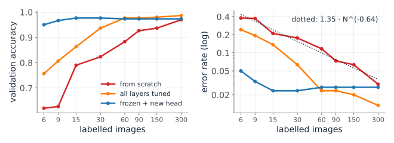
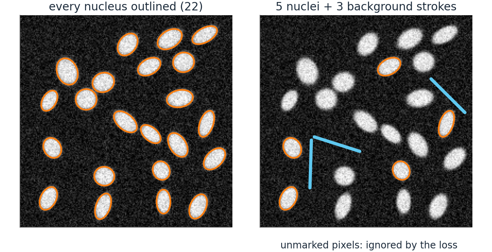
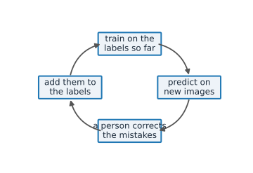
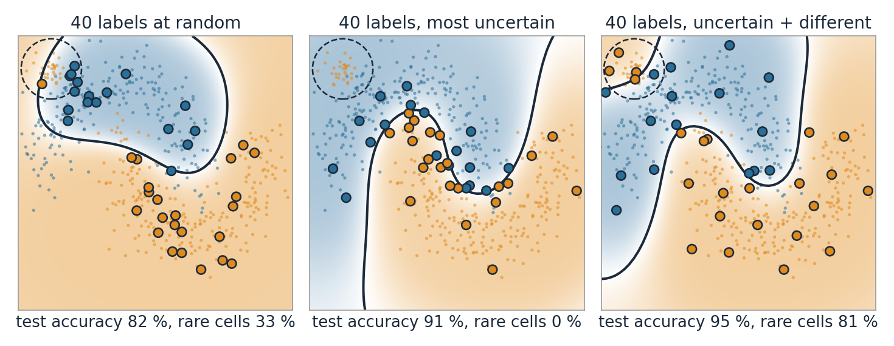
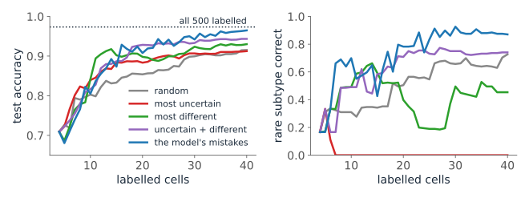

## About this lecture

Annotating is the expensive part: an expert outlining cells for days. This unit is about spending that time well.

- **Learning curves**: how accuracy grows with the number of labels, and what more labels would buy.
- **What** to annotate: objects rather than whole images; **sparse** annotation.
- The **human in the loop**: let the model predict, correct its mistakes, retrain, repeat.
- **Active learning**: let the model choose what to label next: the most **uncertain**, the most **different**, or both.

*Slides titled **The math** give the formulas and proofs; the ideas are complete without them.*

::: notes
Demo: activelearn (presets "random", "most uncertain", "uncertain misses the rare cells", "uncertain + different", "a person fixes mistakes"). Learning curves in the figures: the transfer toy (tools/figs/transfer/dump.ts) and the demo's own code (tools/figs/few-labels/dump.ts).
:::

## How does accuracy grow with labels?

{fig-alt="Left: validation accuracy of the transfer toy against the number of labelled images (6 to 300, log scale) for from scratch (62 to 97 %), all layers tuned (76 to 99 %) and frozen + new head (95 to 97 %). Right: the error rate on log-log axes; from scratch falls roughly along the dotted straight line 1.35 · N^(−0.64); the frozen probe flattens at about 3 %." width="88%" fig-align="center"}

- A **learning curve**: accuracy (or error) against the number of labels. Measure it with 10, 20, 40, … of your labels before annotating more.
- On log-log axes the error often falls along a **straight line**: each doubling of the labels removes the same **fraction** of the errors.
- It **flattens** where the model cannot do better: the frozen probe at about 3 % error. More labels do not help there; a better model does.

## The math: power-law learning curves {.math}

Empirically, over a wide range of $N$,

$$\text{error}(N) \approx a\,N^{-b} + c$$

with $c$ the floor (label noise, a model too weak). On log-log axes, without the floor, a line of slope $-b$.

- Toy, from scratch: $\text{error} \approx 1.35\,N^{-0.64}$ (dotted line).
- Halving the error needs $2^{1/b}$ times the labels: $2^{1/0.64} \approx 3$ times. Going from 10 % to 1 % error: $10^{1/0.64} \approx 36$ times.
- Fit $a, b$ on the labels you have, extrapolate (carefully), and decide whether more annotation or a better model is the cheaper way.

## What to annotate

:::: {.columns}
::: {.column width="52%"}
- Networks learn from **objects** and **pixels**, not from images: 20 images with 5 outlined nuclei each teach more than 2 images with 50 each (more variety: illumination, density, cell state).
- **Sparse annotation**: outline a few objects completely and paint a few **background** strokes; leave everything else unmarked. The loss is computed **only** on marked pixels.
- Annotate the **hard** cases: touching nuclei, dim cells, debris. Easy cases are learnt from few examples.
- Never let a sparse label mean "background" where it is unmarked: an unmarked nucleus counted as background teaches the network to miss nuclei.
:::
::: {.column width="48%"}
{fig-alt="Two copies of a synthetic image of 22 nuclei. Left: every nucleus outlined in orange. Right: only 5 nuclei outlined and three blue background strokes in empty areas; the unmarked pixels are ignored by the loss." width="100%"}
:::
::::

## The math: a loss on marked pixels only {.math}

Pixel $i$ has a label $y_i$ and a mask $m_i = 1$ if marked, 0 if not. The sparse loss is the mean over the **marked** pixels:

$$\mathcal L = \frac{\sum_i m_i\,\ell(\hat y_i, y_i)}{\sum_i m_i}$$

- Unmarked pixels get no gradient: the network is free to predict anything there.
- With class imbalance (few nucleus pixels, many background pixels in the strokes), weight the classes: $\ell \to w_{y_i}\,\ell$ with $w_c \propto 1/(\text{marked pixels of class } c)$.
- The [random-forest day](../pixelclass/lec.qmd)'s pixel classifier is trained exactly this way from painted strokes.

## The human in the loop

:::: {.columns}
::: {.column width="50%"}
1. Train on the labels so far (or start from a pretrained network).
2. **Predict** on new images.
3. A person **corrects** the predictions: delete false objects, fix outlines, add missed cells. Correcting is much faster than drawing from scratch.
4. Add the corrected images to the training set; repeat.

- Cellpose's training on a few of your own images and SAM's click-and-correct ([SAM unit](../sam/lec.qmd)) are this loop.
- Each round the person looks at the model's **mistakes**: the labels go where they are needed.
:::
::: {.column width="50%"}
{fig-alt="A cycle of four boxes with arrows: train on the labels so far, predict on new images, a person corrects the mistakes, add them to the labels, and back to training." width="90%"}
:::
::::

## Active learning: let the model choose

{fig-alt="Three panels of the same pool of 500 cells in a 2D feature space (blue class A, orange class B, a dashed circle around a small rare subtype of class B in the top-left corner), with the background coloured by the model's prediction and the 40 labelled cells as large dots. At random: labels spread everywhere, test accuracy 82 %, rare cells 33 %. Most uncertain: labels crowd along the boundary between the two moons, none in the rare cluster, which is predicted as class A: accuracy 91 %, rare cells 0 %. Uncertain + different: labels along the boundary and in far corners including the rare cluster: accuracy 95 %, rare cells 81 %." width="96%" fig-align="center"}

- **Most uncertain**: label the cell whose prediction is closest to 50 : 50. Labels go to the **boundary**, where they move it most.
- But a whole group the model is **confidently wrong** about (the rare subtype) is never uncertain: it is never asked about.
- **Most different**: the cell farthest from everything labelled. Combine both.

## The math: measuring uncertainty {.math}

For a prediction $\mathbf p = (p_1, \dots, p_K)$:

$$\text{margin: } 1 - (p_{(1)} - p_{(2)}), \qquad \text{entropy: } H = -\sum_k p_k\log_2 p_k, \qquad \text{least confidence: } 1 - p_{(1)}$$

($p_{(1)} \ge p_{(2)}$ the two largest). Two classes: all three rank the cells the same way; $p = 0.5$: margin 1, entropy 1 bit; $p = 0.9$: 0.2 and 0.47 bits.

- These measure the model's **own** uncertainty, which is only as good as its calibration (the [attention unit](../attention/lec.qmd)): far from the labels a model can be confidently wrong.
- **Disagreement** of several models (an ensemble, or dropout at prediction time) is a better guide: they agree where the data forced them, and disagree elsewhere.
- **Diversity**: "farthest-first" picks $\arg\max_j\min_{i \in \text{labelled}}\|\mathbf x_j - \mathbf x_i\|$; in practice in the network's feature space.

## Try it: which cell next?

```{=html}
<link rel="stylesheet" href="../demos/dist/demo.css">
<div data-demo="activelearn" data-preset="uncertain"></div>
<script src="../demos/dist/activelearn.js"></script>
```

::: notes
Pool of 500 cells (two moons + 30 rare cells of class B in the top-left corner), classifier: logistic regression on 7 × 7 Gaussian bumps, refitted after every label. Start: 4 labels. "random" (20 labels): 82.7 %. "most uncertain" (20): 88.2 %. "uncertain misses the rare cells" (40): 91.0 %, rare subtype 0 % correct, no rare cell labelled. "uncertain + different" (40): 95.0 %, rare 81 %, 4 rare cells labelled. "a person fixes mistakes" (20): 92.0 %, rare 86 %. Click any cell to label it yourself. The learning curves (mean of 6 starts) are computed in the background after the page opens.
:::

## Learning curves of the rules

{fig-alt="Mean of 6 runs. Left: test accuracy against labelled cells (4 to 40): random rises slowly to 91.5 %; most uncertain rises fastest at first (88 % at 15) but ends at 91.3 %; most different 93.0 %; uncertain + different 94.3 %; the model's mistakes 96.5 %; all 500 labelled: 97.3 %. Right: fraction of rare cells classified correctly: most uncertain falls to 0 and stays there; random reaches 73 %; uncertain + different 74 %; the model's mistakes 87 %." width="92%" fig-align="center"}

- **Most uncertain** wins early (15 labels: 88.4 % against 83.3 % at random), then stalls: it never finds the rare subtype.
- **Uncertain + different**: 94.3 % with 40 labels; random needs far more for that.
- **A person correcting the model's mistakes** is best (96.5 % with 40 of 500 labels; all 500 give 97.3 %), but needs a person who looks at every prediction.

## Active learning as pseudocode

```
labelled = a few cells of each class (chosen by a person)
repeat until the budget is spent:
    train the model on labelled
    for every unlabelled cell j:
        u[j] = uncertainty of the prediction for j          # e.g. 1 − |2p − 1|
        d[j] = distance from j to the nearest labelled cell
    pick the next cell(s): largest u, or largest d, or alternate
    a person labels them; add them to labelled
evaluate on a separate, randomly chosen test set
```

- In practice pick a **batch** (say 10 images) per round, spread out, because retraining is slow.
- The coding exercise implements both rules and compares the learning curves.

::: notes
The coding exercise (finetuning/src/few_labels/ in the course code download): uncertainty, the most uncertain and the most different cell, entropy; the program runs the four rules and prints the learning curves.
:::

## Rules for a labelling campaign

:::: {.columns}
::: {.column width="55%"}
- The **test set is chosen at random**, never by active learning: actively chosen cells are the hard ones and give a pessimistic, unrepresentative score (and they leak into training).
- Label **whole images** of the test set, or a random sample of objects, so that rare objects appear in their true proportion.
- Check **annotator agreement** first: two people on the same images (the [agreement unit](../agreement/lec.qmd)). A model cannot be expected to beat it, and more labels from one annotator will not fix a disagreement.
- Count the cost per **object**, not per image: correcting a prediction takes seconds, outlining minutes.
:::
::: {.column width="45%"}
{fig-alt="The learning curves of the five rules again." width="100%"}
:::
::::

## Summary

| Idea | In one line |
|---|---|
| Learning curve | measure accuracy at 10, 20, 40 labels; error ≈ $aN^{-b}$, flattening at a floor |
| Sparse annotation | a few complete objects + background strokes; the loss ignores unmarked pixels |
| Human in the loop | predict, correct, retrain: the person's time goes to the mistakes |
| Most uncertain | labels the boundary; fast early, blind to confident mistakes |
| Most different | covers the space; finds rare groups |
| Test set | always random, never chosen by the model |

Next: [domain shift](../domain-shift/lec.qmd): the same cells through another microscope.
