## About this lecture

Two proteins bind when their surfaces **fit**: a large area in contact, no overlap. Finding that fit from the two shapes alone is **docking**. Katchalski-Katzir and colleagues (1992) saw that the fit of every shift is one **correlation**, so the FFT of the [cross-correlation unit](../xcorr-fft/lec.qmd) scores them all at once.

- A **grid score**: a thin surface layer that rewards contact, a core that punishes overlap.
- **One FFT per angle**, and a loop over the angles.
- Choosing the core value, the layer, the grid and the angle step; what **rigid** docking gets wrong.
- **In 3D**: the same recipe with six unknowns and a far longer loop (pictures and counts only).

Everything we compute is **2D**: synthetic shapes stand in for the molecules.

*Slides titled **The math** give the formulas and proofs; the ideas are complete without them.*

::: notes
Third unit of the shape-matching day. Units 1 and 2 matched outlines and images under rotation; this unit matches two different shapes that must fit together. Recall from the FFT registration day: correlation for every shift = inverse FFT of A·conj(B), zero-padding against wrap-around. Angles: positive turns clockwise on screen (the course convention). The 2D receptor and ligand are invented shapes (an ellipse with a key-shaped pocket and a key), not slices of real proteins.
:::

## The problem: two pieces that fit

:::: {.columns}
::: {.column width="42%"}
- A **receptor** (the bigger molecule, kept fixed) and a **ligand** (moved).
- Find the **position and angle** of the ligand where the two surfaces touch over a large area **without overlapping**.
- In 2D: **three unknowns**, two shifts and one angle.
- Real proteins are 3D: the same problem with **six unknowns** (three shifts, three angles) and a far longer loop over the angles. The last slides come back to this.
:::
::: {.column width="58%"}
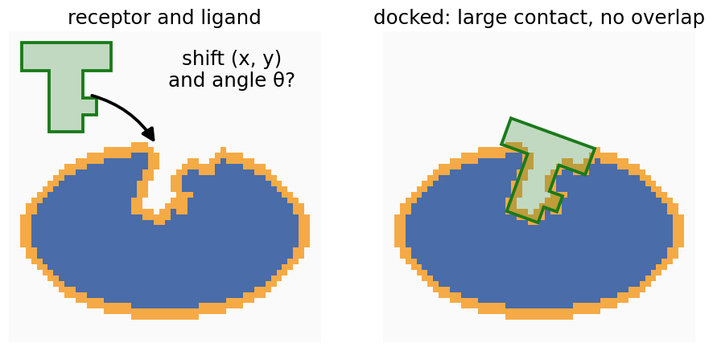{fig-alt="Left: a receptor drawn as a blue ellipse with an orange rim and a key-shaped pocket on top, and a green T-shaped ligand floating above it, with an arrow asking for shift and angle. Right: the ligand turned by 20 degrees and sitting in the pocket." width="100%"}
:::
::::

::: notes
The shapes are those of the demo (dock2d): an ellipse 48 × 28 units with the key's shape cut out at 20°, plus a clearance of half a unit. Blue = the receptor's own cells (core), orange = the surface layer around it (next slide).
:::

## Fit as a score on a grid

:::: {.columns}
::: {.column width="45%"}
Put both molecules on a grid (Katchalski-Katzir et al. 1992):

- **receptor**: a thin **surface layer** around it gets **1**; its own cells, the **core**, get a large **negative** value $\rho$ (e.g. −9); everything else 0;
- **ligand**: 1 on its own cells.

Lay the ligand on the receptor and **add up** the receptor's values under it: every ligand cell on the surface layer adds 1 (**contact**), every cell inside adds $\rho$ (**clash**).

The surface layer is the receptor **dilated** minus the receptor itself ([erosion and dilation](../morph-binary/lec.qmd)).
:::
::: {.column width="55%"}
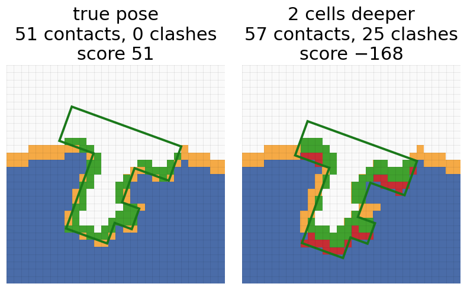{fig-alt="Two close-ups of the pocket on a grid. True pose: 51 ligand cells on the orange surface layer (green), none in the blue core, score 51. Two cells deeper: 57 contacts but 25 cells in the core (red), score minus 168." width="100%"}
:::
::::

::: notes
Surface layer 2 cells thick (a disk of radius 2), ρ = −9, grid spacing 1. Green cells: ligand on the surface layer; red: ligand in the core. 57 − 9·25 = −168. Another example from the demo: 3 cells right and 2 up, 26 contacts and 14 clashes, −100. A single clash costs as much as nine contacts: the score forbids overlap and then counts contact.
:::

## By hand: a receptor of eight cells

:::: {.columns}
::: {.column width="50%"}
Receptor $a = (\rho, \rho, \rho, 1, 0, 0, 0, 0)$ with $\rho = -9$: core in cells 0–2, surface layer in cell 3. A ligand of two cells, placed on $d$ and $d + 1$:

- $S(1) = \rho + \rho = -18$: deep inside;
- $S(2) = \rho + 1 = -8$: half inside;
- $S(3) = 1 + 0 = 1$: **touching**;
- $S(4) = 0$: in empty space.

The best pose touches the surface without entering it. The score for every $d$ is a sum of products, $\sum_x a(x)\,b(x - d)$: a **correlation**.
:::
::: {.column width="50%"}
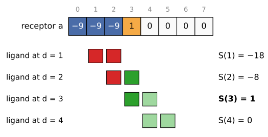{fig-alt="A row of eight cells: three blue cells with minus 9, an orange cell with 1, four empty cells with 0. Below, the two-cell ligand at d = 1 (both cells red, S = minus 18), d = 2 (one red, one green, S = minus 8), d = 3 (green and light green, S = 1, in bold) and d = 4 (light green, S = 0)." width="100%"}
:::
::::

## Every shift at once

:::: {.columns}
::: {.column width="45%"}
- The score of all shifts for **one** ligand angle is a correlation of two grids, so the FFT computes it in one go ([FFT correlation](../xcorr-fft/lec.qmd)): transform both, multiply one by the conjugate of the other, transform back.
- The result is a **score map**: one number per ligand position. Its highest point is the best shift **at that angle**.
- At the right angle the map has a clear peak in the pocket (51); at a wrong angle the best place is only a flat stretch of surface (20).
- It is template matching ([sliding and scoring](../matching/lec.qmd)) with a different score: not brightness agreement, but contact minus clash.
:::
::: {.column width="55%"}
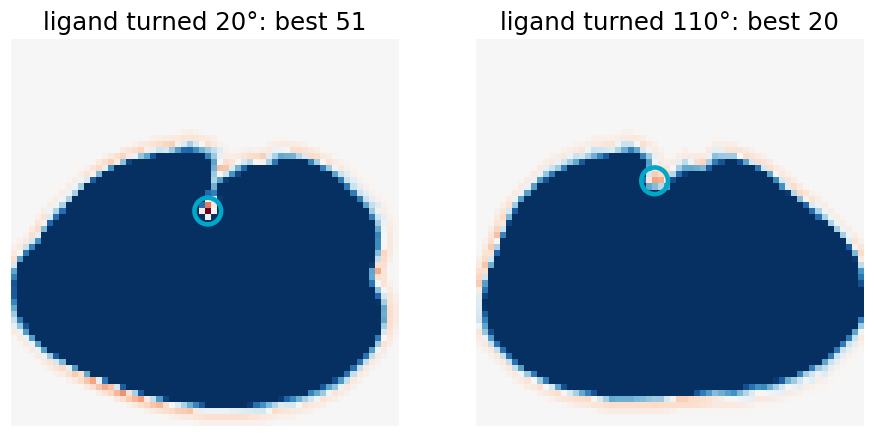{fig-alt="Two score maps over the 64 by 64 box. Inside the receptor the map is deep blue (clashes); a thin red rim around the receptor marks contact. At 20 degrees a bright spot in the pocket (circled) reaches 51; at 110 degrees the best value is 20, at the edge of the pocket." width="100%"}
:::
::::

::: notes
Colour: red positive (contact), blue negative (clash), clipped at ±51. The map value at a point = score with the ligand's centroid on that cell. Inside the receptor every shift clashes heavily (with the whole key inside, about 150 cells × (−9), over a thousand below zero).
:::

## The math: docking as correlation {.math}

With the receptor grid $a$ and the ligand grid $b_\theta$ (the ligand turned by $\theta$, its centre at cell 0), the score of the shift $\mathbf d$ is
$$S_\theta(\mathbf d) = \sum_{\mathbf x} a(\mathbf x)\, b_\theta(\mathbf x - \mathbf d).$$
This is the cross-correlation of the FFT registration day, so by the correlation theorem
$$\hat S_\theta(\mathbf k) = \hat a(\mathbf k)\,\overline{\hat b_\theta(\mathbf k)}, \qquad S_\theta = \text{inverse DFT of } \hat a\,\overline{\hat b_\theta}.$$

- $\hat a$ does not depend on $\theta$: computed **once**. Each angle costs the ligand's FFT and one inverse FFT.
- The DFT is circular: **zero-pad** both grids so that a ligand near one border never wraps onto the receptor at the other (the receptor sits in the middle of a grid twice its size).

## Docking as pseudocode

```
a = receptor grid: 1 on the surface layer, ρ in the core, 0 elsewhere   # zero-padded
A = FFT(a)                                       # once
for every angle θ = 0, Δθ, 2Δθ, … < 360°:
    b = ligand turned by θ, 1 on its cells, its centre at cell (0, 0)
    S = real part of the inverse FFT of  A · conj(FFT(b))
    keep the few highest local maxima of S, with θ
sort all kept poses by score; drop near-duplicates (close in position and angle)
report the top few poses
```

- Two FFTs per angle; the receptor's FFT is reused.
- The coding exercise writes this loop.

::: notes
Coding exercise: shapematch/src/fft_docking/ in the course code download (score_1d, receptor_grid, score_map, rotate_ligand, dock). The near-duplicate rule in the demo: two poses within 3 grid units and 20° are the same fit; the better one is kept.
:::

## Try it: key and lock

```{=html}
<link rel="stylesheet" href="../demos/dist/demo.css">
<div data-demo="dock2d" data-preset="key" data-presets="key,angle"></div>
<script src="../demos/dist/dock2d.js"></script>
```

::: notes
Left: the receptor (blue core, orange surface layer) and the ligand; drag it, turn it by its handle or the angle slider. Its cells light up green (contact) and red (clash); the readout adds them up. Middle: the score map at the current angle (recomputed with two FFTs on every turn) and, after "search", the best score per angle. Tour: drag the key into the pocket at angle 0: it clashes (43 contacts, 12 clashes: −65). Turn to 20°: 51 contacts, no clash. Press search: 72 angles, 145 FFTs; top pose 25° in the pocket with 54 (the pocket's clearance lets the key wobble by a few degrees), next 30 at the bottom of the receptor. Preset "the right angle, the wrong angle": at 110° the map's best is 20; turn to 20° and watch the peak appear.
:::

## The loop over angles

:::: {.columns}
::: {.column width="45%"}
- One score map per angle; the **best score per angle** shows where the fit is. Here a single sharp peak near 20°: the key fits one way only.
- The **angle step** sets what can be found. With 30° steps the search looks at 0° and 30°, not 20°: at 0° the key clashes in the pocket, at 30° it fits only half-way out (23), and the top pose is a flat contact on the underside (28).
- The step needed depends on how far the ligand reaches: a turn by 10° moves a point 20 Å from the centre by $20 \cdot 10 \cdot \pi/180 \approx 3.5$ Å, more than an atom's radius.
- The **grid spacing** plays the same role for shifts: at 3 units per cell the key's tooth disappears and the search misses the fit.
:::
::: {.column width="55%"}
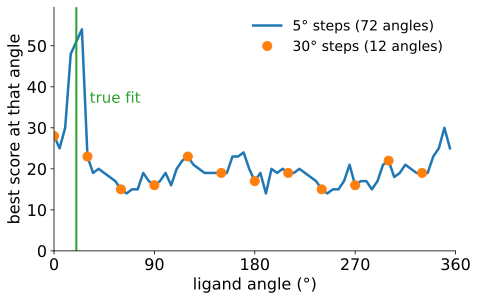{fig-alt="Best score against ligand angle from 0 to 360 degrees. The 5-degree curve stays between about 15 and 30 except for a sharp peak of 54 just after 20 degrees (green line: the true fit). The 30-degree samples (orange dots) miss the peak; their highest is 28 at 0 degrees." width="100%"}
:::
::::

::: notes
5° steps: peak 54 at 25°; 30° steps: highest 28 at 0° (the underside of the receptor); the pocket pose at 30° (shifted by a cell, 23) is third. Grid spacing 2: still found (30°, 28); spacing 3: the best pose is a wrong one (135°, 14). All from the demo's model.
:::

## The math: what it costs {.math}

$R$ angles, an $M$-cell grid (after padding), a ligand of $L$ cells. One complex FFT costs about $5M\log_2 M$ operations:

- **FFT route**: $(1 + 2R)\cdot 5M\log_2 M + 6RM$, i.e. $\mathcal O(R\,M\log M)$.
- **Brute force**, every cell of both grids for every shift: $2M^2$ per angle, $\mathcal O(R\,M^2)$.
- Brute force skipping the empty ligand cells: $M L$ additions per angle.

$128^2$ grid, 5° steps ($R = 72$): FFT route $1.7\cdot10^8$, dense brute force $3.9\cdot10^{10}$ (220 times more). Skipping empty cells, a 155-cell ligand needs $1.8\cdot10^8$: in 2D with a small ligand, the plain sum is competitive. In 3D the ligand has thousands of cells and $M\log_2 M$ grows much more slowly than $ML$: there the FFT wins by far.

## Choosing ρ and the surface layer

:::: {.columns}
::: {.column width="45%"}
- **ρ too mild** (−0.1): a clash costs almost nothing, the ligand **sinks in** where it can cover more surface: 67 contacts, 44 clashes, at a wrong angle. The true fit drops to second place.
- **No surface layer**: nothing rewards contact; every pose that does not clash scores 0, and the search has nothing to rank.
- A **thick layer** (3–4 cells) rewards poses that only come near the surface: a broader, less precise peak.
- Grid, layer and $\rho$ are knobs that trade **tolerance** against **precision**.
:::
::: {.column width="55%"}
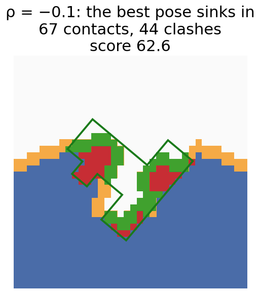{fig-alt="With core value minus 0.1 the best pose, at 130 degrees, lies half inside the receptor around the pocket: many red cells. 67 contacts, 44 clashes, score 62.6." width="80%" fig-align="center"}
:::
::::

::: notes
The demo's preset "ρ too mild": best pose 130° at (31.5, 30.5), 62.6; the true fit (20°, 59.3) is second.
:::

## Try it: ρ, layer and angle step

```{=html}
<link rel="stylesheet" href="../demos/dist/demo.css">
<div data-demo="dock2d" data-preset="mild" data-presets="key,mild,thin,coarse"></div>
<script src="../demos/dist/dock2d.js"></script>
```

::: notes
"ρ too mild": search; the top pose overlaps the core (red cells when you press #1). Move ρ back towards −9 and search again: at ρ = −0.2 the true fit is first again, barely (58.6 against 58.2), at −1 clearly (54 against 40). "surface too thin" (thickness 0): every score is 0 or negative. "coarse angle step" (30°): the fit is missed; set the step to 15° (found at 15°, score 48) or 5°.
:::

## Two scores in one FFT

:::: {.columns}
::: {.column width="52%"}
- A complex grid holds **two** real grids: real part and imaginary part.
- Give **both** molecules a surface layer $s$ and a core $c$: receptor $s + i\,c$, ligand $s - i\,c$. The real part of one complex correlation is then
  **surface · surface − core · core**: contact minus clash, in one FFT per angle.
- This idea, and the original real-valued score, are behind the classic programs (Gabb et al. 1997; ZDOCK, Chen et al. 2003).
- Other terms are **more correlations added to the score**: electrostatics (the receptor's potential on a grid times the ligand's charges), desolvation, contact preferences of residue types.
:::
::: {.column width="48%"}
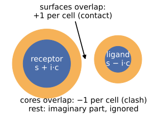{fig-alt="Two discs, each with an orange surface ring and a blue core: the receptor labelled s plus i c, the ligand labelled s minus i c. Where the rings overlap: plus one per cell, contact. Where the cores overlap: minus one per cell, clash. The rest goes to the imaginary part and is ignored." width="100%"}
:::
::::

## The math: the complex score {.math}

Receptor $a = s_R + i\,c_R$, ligand $b = s_L - i\,c_L$ (all four real). The usual correlation conjugates the ligand:
$$\sum_{\mathbf x} a(\mathbf x)\,\overline{b(\mathbf x - \mathbf d)} = \sum_{\mathbf x} (s_R + i\,c_R)(s_L + i\,c_L)(\mathbf x, \mathbf x - \mathbf d),$$
whose real part is
$$\sum_{\mathbf x} s_R(\mathbf x)\,s_L(\mathbf x - \mathbf d) \;-\; \sum_{\mathbf x} c_R(\mathbf x)\,c_L(\mathbf x - \mathbf d).$$
Scaling the cores by $\sqrt w$ weights a clash by $w$. With $\hat S = \hat a\,\overline{\hat b}$ as before: one forward FFT per angle for the ligand, one inverse, the same cost as the plain score, with two terms instead of one. (Exercise B7.)

## What rigid docking gets wrong

:::: {.columns}
::: {.column width="45%"}
- Proteins are **not rigid**: side chains turn, loops move when the partner binds. Docking two separately determined structures, the true pose often has a few **clashes**.
- A strict core rejects it. In the demo: a flexible **bump** on the key sticks into the pocket wall; at the true pose 5 clashes give 53 − 45 = 8, and the fit is not even in the top five.
- **Softer scores** (smaller $|\rho|$, thinner core, coarser grid) tolerate this, at the price of more false poses: with $\rho = -1$ the fit is first again (52), but ρ = −0.1 lets the ligand sink in.
- So real pipelines keep **thousands** of poses from the FFT search and **re-rank** them with finer models (clustering, energy refinement, flexible side chains).
:::
::: {.column width="55%"}
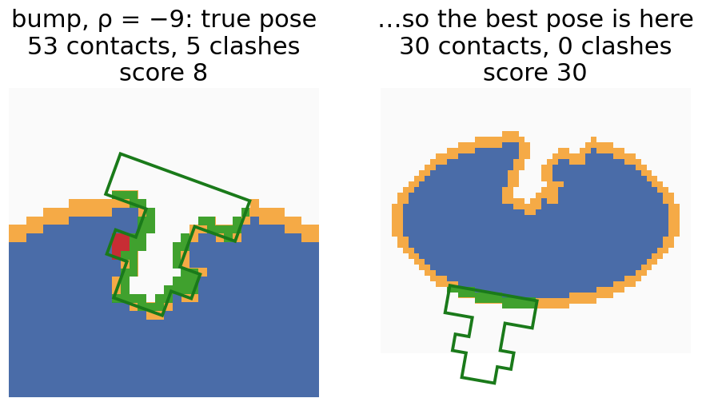{fig-alt="Left: the key with a flexible bump at the true pose, rho minus 9: the bump clashes in 5 cells (red), 53 contacts, score 8. Right: the best pose of the search is on the underside of the receptor, 30 contacts, no clash, score 30." width="100%"}
:::
::::

## Try it: a flexible bump

```{=html}
<link rel="stylesheet" href="../demos/dist/demo.css">
<div data-demo="dock2d" data-preset="bump" data-presets="key,bump"></div>
<script src="../demos/dist/dock2d.js"></script>
```

::: notes
The preset puts the bumped key at the true pose: 5 red cells, score 8. Search: the top five are elsewhere (best 30 on the underside); "true fit not in the top 5". Set ρ = −1 and search: the fit is first (52 at 20°). Then ρ = −0.1: the sinking-in poses come back. Untick the bump: the original key.
:::

## The same loop elsewhere in the course

- The **generalised Hough transform** ([GHT](../ght/lec.qmd)) also loops over angles; per angle it collects **votes** from edge points instead of correlating grids.
- **Template matching** with NCC ([sliding and scoring](../matching/lec.qmd)) is the same search with a brightness score.
- [Outlines](../fourier-descriptors/lec.qmd) and [Fourier–Mellin](../fourier-mellin/lec.qmd) (this day) turned the **rotation** into a shift too, so one FFT covers all angles. Docking cannot: the receptor is not centred on the ligand's turning point, so it still loops over angles in 2D, and in 3D the loop is the expensive part.

## In 3D: same recipe, bigger loop

:::: {.columns}
::: {.column width="50%"}
- Atoms instead of pixels: each molecule on a 3D grid of **voxels** (often about 1 Å apart), with a surface layer and a core.
- **Six unknowns**: three shifts, three angles.
- For each ligand **orientation**: one 3D FFT of the ligand, one inverse; the receptor's FFT once.
- Keep the best shifts of every orientation, then rank and re-rank, as in 2D.
:::
::: {.column width="50%"}
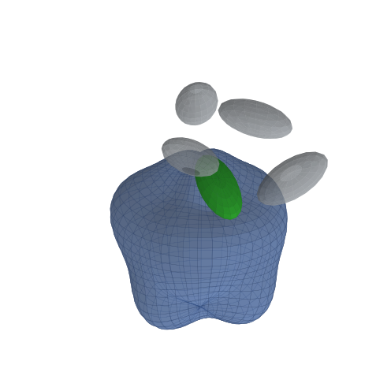{fig-alt="A lumpy blue receptor surface drawn as a mesh, with a green ellipsoid ligand in a pocket on top and four grey ligands in other positions and orientations around it." width="85%"}
:::
::::

::: notes
Schematic picture, not a real protein. 3D FFT correlation: the same formula with x, d, k in three dimensions (FFT registration in 3D works the same way).
:::

## How many orientations?

:::: {.columns}
::: {.column width="52%"}
- Three angles cannot be sampled on an even grid of Euler angles: the samples **crowd** near the poles. Even samplings spread **directions** over a sphere and add **turns** about each.
- About $8\pi^2/\Delta\theta^3$ orientations ($\Delta\theta$ in radians): **≈ 4400** at 15°, **≈ 69 000** at 6°.
- One FFT of a $128^3$ grid: $5M\log_2 M \approx 2\cdot10^8$ operations. Two per orientation at 6°: **≈ 3·10¹³**.
- That is **hours on one core**, minutes on a GPU, where the FFTs of many orientations run in parallel ([how GPUs work](../gpu-parallel/lec.qmd)).
:::
::: {.column width="48%"}
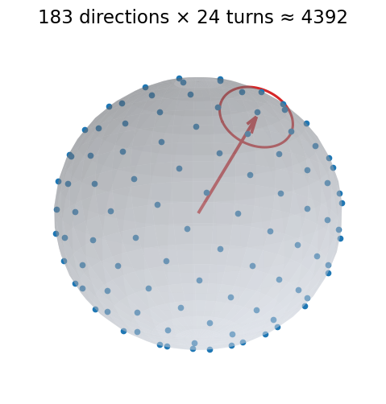{fig-alt="A sphere covered evenly with 183 blue points, the directions 15 degrees apart; a red arrow along one direction with a red circle around its tip for the turns about it. Title: 183 directions times 24 turns is about 4392." width="85%"}
:::
::::

::: notes
8π²/Δθ³: the volume of the rotation group (8π² in these units) divided by the volume one sample covers. 15°: 4401; 10°: 14 851; 6°: 68 755. 128³ = 2.1·10⁶ cells, log₂ = 21: 2.2·10⁸ per FFT. 68 755 × 2 × 2.2·10⁸ = 3.0·10¹³. The figure: 4π/Δθ² ≈ 183 directions, 24 turns each.
:::

## Turning the coefficients instead of the grid

:::: {.columns}
::: {.column width="40%"}
- In 2D, a rotation multiplies the angular wave $e^{im\theta}$ by a **phase** ([outlines](../fourier-descriptors/lec.qmd), [Fourier–Mellin](../fourier-mellin/lec.qmd)): turning costs nothing once the shape is written in such waves.
- In 3D the angular waves are **spherical harmonics**: patterns on a sphere, grouped by **degree**; degree $l$ has $2l + 1$ patterns.
- A rotation **mixes the few patterns of each degree** among themselves, instead of re-gridding the molecule. Docking programs built on this (Ritchie & Kemp 2000) scan rotations with fast transforms too.
:::
::: {.column width="60%"}
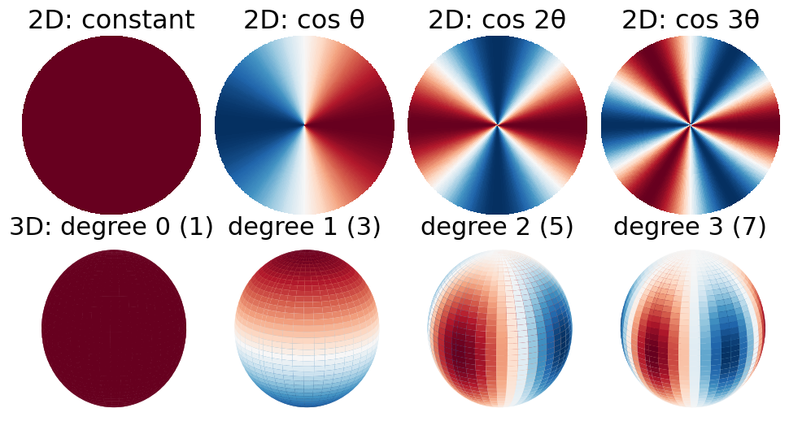{fig-alt="Top row: four discs coloured by cos of m theta for m = 0, 1, 2, 3, showing 0, 2, 4 and 6 alternating sectors. Bottom row: four spheres coloured by one spherical harmonic of degree 0, 1, 2 and 3; the numbers of patterns per degree are 1, 3, 5 and 7." width="100%"}
:::
::::

## The same machine elsewhere

- **Template matching in cryo-electron tomograms**: a known complex (a ribosome, a proteasome) is searched in a noisy 3D reconstruction of a cell, at every position and orientation, by exactly this loop: one 3D correlation per orientation.
- **Fitting atomic models into cryo-EM maps**: a model of one protein is placed in the density map of a larger assembly by correlating it at every shift and orientation.
- **Aligning particles** in cryo-EM: thousands of noisy views aligned in rotation and shift ([Fourier–Mellin](../fourier-mellin/lec.qmd) shows the 2D version).
- Same ingredients: a grid score, one FFT per orientation, a sampling of orientations, re-ranking of the best hits.

## Where the field went

- **Scoring and flexibility** remain the hard part: the FFT search is exhaustive, but only as good as its score.
- **Learned methods** now predict many complexes directly from the amino-acid sequences, often more accurately than rigid docking of separate structures.
- FFT docking stays as a **fast, exhaustive first pass**: every pose is looked at, nothing depends on a starting guess, and the cost is known in advance.
- The idea outlives the application: any search over shifts of a **fixed** score is a correlation, and the FFT does every shift at once.

## Summary

- **Docking** finds the shift and angle at which two shapes touch over a large area without overlapping.
- Grid score: receptor = **surface layer** (+1) around a **core** ($\rho \ll 0$); ligand = 1 on its cells. Contacts count, clashes cost.
- For one angle the score of every shift is a **correlation**: two FFTs, the receptor's FFT reused. A **loop over angles** does the rest; zero-pad against wrap-around.
- The angle step, grid spacing, layer thickness and $\rho$ set what is found. Too strict misses flexible fits, too soft lets the ligand sink in: keep many poses and **re-rank**.
- In 3D: six unknowns, tens of thousands of orientations, one 3D FFT each; the same loop finds complexes in cryo-EM maps and tomograms.
