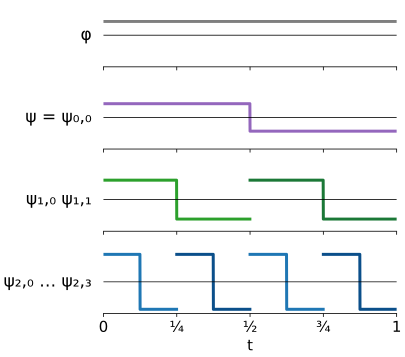
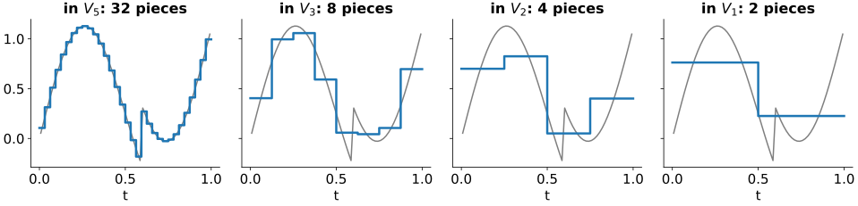
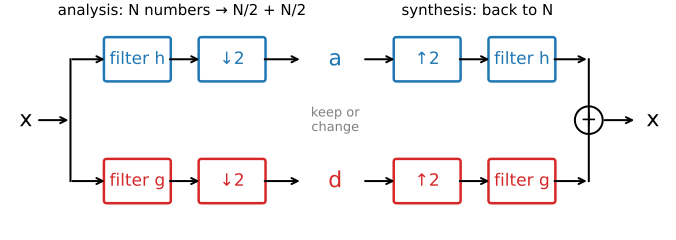
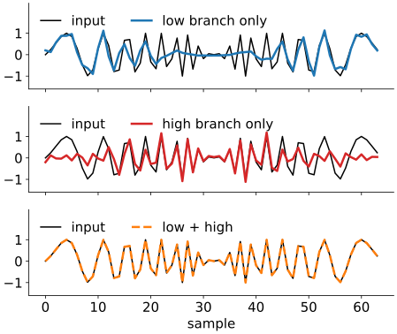
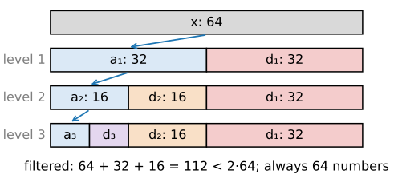
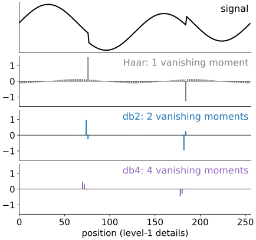
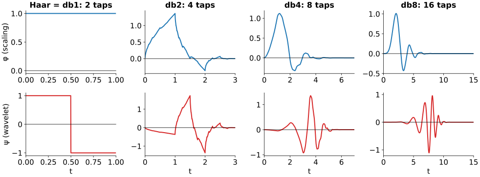
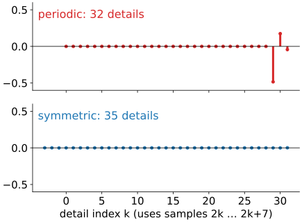

## About this lecture

Last unit: the Haar transform, pairwise averages and differences, repeated. Today: what is behind it, and how to build better wavelets with the same recipe.

- From vectors to functions: the **scaling function** $\varphi$ and the **wavelet** $\psi$.
- **Multiresolution**: a signal seen at resolution 1, 1/2, 1/4, ...: approximation + detail at each step.
- The discrete wavelet transform is a **filter bank**: two convolutions, keep every second sample. It costs $\mathcal O(N)$.
- **Vanishing moments**: why smooth signals give near-zero details, and the **Daubechies** wavelets that have them.
- What happens at the **borders** of a finite signal.

*Slides titled **The math** give the formulas and proofs; the ideas are complete without them.*

::: notes
Second unit of the wavelets elective. Needs the Haar unit, the kernels unit (convolution, border rules) and the Fourier unit's sampling and aliasing slide. The linear-algebra view (vectors and filters, Strang & Nguyen) comes first; the function view is two slides.
:::

## From vectors to functions

:::: {.columns}
::: {.column width="56%"}
The Haar patterns of the last unit are samples of two functions on $[0, 1)$:

- the **scaling function** $\varphi(t) = 1$ on $[0, 1)$: a box, "the average";
- the **wavelet** $\psi(t) = +1$ on $[0, \tfrac12)$, $-1$ on $[\tfrac12, 1)$: "the difference".

All other patterns are $\psi$ **squeezed** by $2^j$ and **shifted** by $k$:
$$\psi_{j,k}(t) = 2^{j/2}\,\psi(2^j t - k).$$

$j$ = scale (larger $j$: shorter, finer), $k$ = position. The factor $2^{j/2}$ gives every pattern the same energy. Any two of them are **orthogonal**: either they do not overlap, or the shorter one sits where the longer one is constant.
:::
::: {.column width="44%"}
{fig-alt="The box phi on [0,1), the Haar wavelet psi (+1 then -1), and below it psi squeezed by 2 and shifted to two positions, and squeezed by 4 at four positions; the shorter ones are taller so that all have the same energy." width="100%"}
:::
::::

## The math: orthonormality in $L^2$ {.math}

Inner product of functions (the integral version of the dot product): $\langle f, g\rangle = \int f(t)\,g(t)\,dt$, norm $\|f\|^2 = \langle f, f\rangle$.

- $\|\psi_{j,k}\|^2 = \int 2^j\,\psi(2^j t - k)^2\,dt = \int \psi(u)^2\,du = 1$ (substitute $u = 2^j t - k$).
- $\langle\psi_{1,0}, \psi_{1,1}\rangle = 0$: supports $[0, \tfrac12)$ and $[\tfrac12, 1)$ do not overlap.
- $\langle\psi_{0,0}, \psi_{1,0}\rangle = \int_0^{1/2} 1 \cdot \sqrt2\,\psi(2t)\,dt = \sqrt2 \cdot 0 = 0$: $\psi_{0,0}$ is constant on the support of $\psi_{1,0}$, which has mean 0.
- Together with $\varphi(\cdot - k)$ for $k \in \mathbb Z$, the $\psi_{j,k}$ for $j \ge 0$ form an orthonormal basis of $L^2(\mathbb R)$ (Haar, 1910).

## Multiresolution

:::: {.columns}
::: {.column width="100%"}
{width="100%"}
:::
::::

$V_j$ = all signals that are constant on pieces of length $2^{-j}$. The best approximation in $V_j$ takes the **average** over each piece.

- Nested: $V_0 \subset V_1 \subset V_2 \subset \dots$: a coarse staircase is also a fine one.
- Going one level coarser loses exactly the **detail** $W_j$: $\;V_{j+1} = V_j \oplus W_j$ (approximation + detail, perpendicular).
- The Haar transform peels off one $W_j$ after another until only the coarsest average is left. This is a **multiresolution analysis** (Mallat, 1989).

## The math: the two-scale relation {.math}

Because $V_0 \subset V_1$, the box $\varphi$ is a combination of half-width boxes, and so is $\psi \in W_0 \subset V_1$:
$$\varphi(t) = \sqrt2\sum_n h_n\,\varphi(2t - n), \qquad \psi(t) = \sqrt2\sum_n g_n\,\varphi(2t - n).$$

- Haar: $\varphi(t) = \varphi(2t) + \varphi(2t - 1)$, so $h = (1, 1)/\sqrt2$; $\psi(t) = \varphi(2t) - \varphi(2t-1)$, so $g = (1, -1)/\sqrt2$.
- If a signal is $f = \sum_k a^{(j+1)}_k\,\varphi_{j+1,k}$, projecting onto $\varphi_{j,k}$ and $\psi_{j,k}$ gives
$$a^{(j)}_k = \sum_n h_n\,a^{(j+1)}_{2k+n}, \qquad d^{(j)}_k = \sum_n g_n\,a^{(j+1)}_{2k+n}.$$
- The numbers $h_n$, $g_n$ are **all we ever compute with**. Any other wavelet is just another pair $(h, g)$; $\varphi$ and $\psi$ follow from them.

## The DWT is a filter bank

{width="92%"}

- **Analysis**: filter the signal with a **low-pass** $h$ and a **high-pass** $g$ (two convolutions, as in *Filtering & convolution*), then keep every second sample. $N$ numbers become $N/2$ approximations $a$ and $N/2$ details $d$.
- **Synthesis**: insert zeros between the samples (↑2), filter again, add: the original signal comes back **exactly**.
- Haar, $h = (1, 1)/\sqrt2$, $g = (1, -1)/\sqrt2$: the filters give $(x_n \pm x_{n+1})/\sqrt2$, and keeping every second one gives unit 1's pairs. The high-pass $g$ is a scaled finite difference, the derivative kernel of the kernels unit.

## Try it: the filter bank

```{=html}
<link rel="stylesheet" href="../demos/dist/demo.css">
<div data-demo="filterbank" data-preset="pr"></div>
<script src="../demos/dist/filterbank.js"></script>
```

::: notes
Length 64. Top: input (black) and output (orange dashed). Left column: each filtered signal (faint) and the kept samples (dots). Right column: each branch after upsampling and filtering; they add up to the output. Tour: "perfect reconstruction" (db4, HeaviSine): max |x − output| = 1.8e-15. "Haar = unit 1" (two steps): every detail is 0, because both jumps (at samples 20 and 40) fall between pairs; the low branch alone already gives the signal back. "remove one branch: aliasing" (db2, chirp): max error 1.18; the low branch alone has wiggles that were not in the signal. "wrong synthesis filters": error 1.97. Then the "cascade" view: 4 levels, 120 samples filtered < 2N = 128.
:::

## Why keeping every second sample is allowed

:::: {.columns}
::: {.column width="52%"}
Throwing away every second sample normally causes **aliasing** (*Images in frequency space*): frequencies above the new Nyquist limit fold back and pose as slow ones.

- Each branch alone **is** aliased: the low-pass half is not ideal, so some high frequencies leak through and fold down.
- But the high-pass branch carries the **same** folded-down part with the **opposite sign**. On synthesis the two cancel.
- This works only for matched pairs: the high-pass is the low-pass, reversed, with every second sign flipped (a **quadrature mirror** pair). Drop one branch, or use the wrong synthesis filters, and the folded copies remain (try it in the demo).
:::
::: {.column width="48%"}
{fig-alt="A chirp of 64 samples sent through the db2 filter bank. The low branch alone gives a curve with wiggles that are not in the input (largest error 1.18); the high branch alone gives the rest; their sum lies exactly on the input." width="100%"}
:::
::::

::: notes
Chirp, 64 samples, db2, periodic, as in the demo preset "remove one branch: aliasing". Low branch only: max error 1.18; low + high: 2e-16.
:::

## The math: perfect reconstruction {.math}

Orthogonal filter bank with low-pass $h_0, \dots, h_{L-1}$ ($L$ even):

- **Quadrature mirror** high-pass: $g_n = (-1)^n h_{L-1-n}$. Haar: $g = (h_1, -h_0)$; db2: $g = (h_3, -h_2, h_1, -h_0)$.
- **Orthogonality to even shifts**: $\sum_n h_n h_{n+2m} = \delta_m$ (so $\sum h_n^2 = 1$), and $\sum_n h_n = \sqrt2$ (the average is kept).
- Then the analysis matrix $A$ that stacks the rows "$h$ at positions $2k$" and "$g$ at positions $2k$" is **orthogonal** (with periodic wrap-around), and synthesis is $A^\top$: $\;A^\top A = I$, perfect reconstruction, $\sum a^2 + \sum d^2 = \sum x^2$.
- The aliasing cancellation is this identity seen in the frequency domain; we do not need the derivation (Strang & Nguyen 1996, ch. 4).

## The cascade: $\mathcal O(N)$

:::: {.columns}
::: {.column width="48%"}
Repeat the filter bank on the **low-pass** branch only: $a_1 \to (a_2, d_2) \to (a_3, d_3) \to \dots$

- Work: $N + N/2 + N/4 + \dots < 2N$ samples filtered, each with $L$ multiplications: $\mathcal O(LN)$, **less than an FFT** ($\mathcal O(N\log N)$).
- Coefficients: $N/2 + N/4 + \dots$ + the last approximation $= N$ exactly (periodic borders).
:::
::: {.column width="52%"}
{fig-alt="The coefficient vector of a 64-sample signal after 0 to 3 levels: x (64); a1 and d1 (32 each); a2, d2 (16 each) and d1; a3, d3 (8 each), d2 and d1. Only the approximation part is split again. 64 + 32 + 16 = 112 samples are filtered, fewer than 2 times 64." width="100%"}
:::
::::
- Compare the **Gaussian pyramid** (*Edges, blobs and ridges*: blur, keep every second pixel, repeat) and the **Laplacian pyramid** (Burt & Adelson 1983: store the difference between each level and the upsampled next one). Same coarse-to-fine idea, but the Laplacian pyramid stores **more** numbers than pixels and is not an orthogonal basis; the DWT stores exactly $N$.

## Vanishing moments

:::: {.columns}
::: {.column width="52%"}
A detail coefficient measures what is left after the low-pass has taken the "smooth part". When is it **zero**?

- Haar: when the signal is **constant** over the filter. A ramp leaves a detail everywhere (unit 1, B6).
- A wavelet with $p$ **vanishing moments** gives zero details for any polynomial of degree $< p$: constants and ramps ($p = 2$), parabolas ($p = 3$), ...
- A smooth signal looks like a polynomial over a short filter (Taylor), so its details are **tiny**. Only edges and other non-smooth places leave large details: **sparse** coefficients for piecewise-smooth signals.
:::
::: {.column width="48%"}
{fig-alt="The HeaviSine signal (a smooth wave with two jumps) and its level-1 detail coefficients for Haar, db2 and db4. Haar leaves small details all along the smooth wave; db2 and db4 leave visible details only at the two jumps." width="100%"}
:::
::::

::: notes
HeaviSine, 256 samples, periodic. Largest level-1 detail on the smooth stretches: Haar 0.14, db2 0.006, db4 0.00001. At the jumps all three are large (Haar 1.53, db2 0.96, db4 0.46: the longer filters spread a jump over more, smaller coefficients).
:::

## The math: vanishing moments {.math}

$\psi$ has $p$ vanishing moments if $\int t^m\psi(t)\,dt = 0$ for $m = 0, \dots, p-1$; for the filter: $\sum_n n^m g_n = 0$ for $m < p$.

- Detail of a polynomial $x_n = \sum_{q < p}\beta_q n^q$: $\;d_k = \sum_n g_n x_{2k+n} = \sum_q \beta_q \sum_n g_n (2k+n)^q$. Expanding $(2k+n)^q$ binomially gives only sums $\sum_n n^m g_n$ with $m \le q < p$: all zero.
- Smooth $x$: Taylor around $2k$ with remainder of order $p$: $d_k = \mathcal O\big(\max|x^{(p)}|\big)$ over the filter's support, small where $x$ is smooth.
- db2: $g = (h_3, -h_2, h_1, -h_0)$ with $h = (1+\sqrt3,\ 3+\sqrt3,\ 3-\sqrt3,\ 1-\sqrt3)/(4\sqrt2)$:
$\sum g_n \propto (1 - \sqrt3) - (3 - \sqrt3) + (3 + \sqrt3) - (1 + \sqrt3) = 0$, and
$\sum n g_n \propto -(3 - \sqrt3) + 2(3 + \sqrt3) - 3(1 + \sqrt3) = 0$.

## Daubechies wavelets

:::: {.columns}
::: {.column width="62%"}
{width="100%"}
:::
::: {.column width="38%"}
**db$p$**: the **shortest** orthogonal filters with $p$ vanishing moments, $2p$ taps (Daubechies 1988). db1 = Haar.

- More moments: **smoother**, sparser on smooth parts.
- But **longer**: each edge touches more coefficients.
- **Symlets** (sym4): nearly symmetric variants.
- Orthogonal **and** symmetric is impossible except Haar; JPEG 2000 uses **biorthogonal** wavelets (CDF 9/7, LeGall 5/3; the compression day).
:::
::::

::: notes
φ and ψ computed by the cascade algorithm: iterate the two-scale relation, starting from a single 1 (the demo's "basis functions" view does it one iteration at a time). db2 is continuous but has corners (it is Hölder ≈ 0.55); db8 is visibly smooth. Supports: [0, 2p − 1].
:::

## Try it: smoother wavelets, sparser coefficients

```{=html}
<link rel="stylesheet" href="../demos/dist/demo.css">
<div data-demo="wavesparse" data-wavelets="haar db2 db4 db8" data-preset="heavisine"></div>
<script src="../demos/dist/wavesparse.js"></script>
```

::: notes
HeaviSine: a smooth wave with two jumps. For 1 % error: Fourier 145, Haar 184, db2 54, db4 34, db8 40 coefficients. db8 is smoother than db4 but longer, so the two jumps spread over more coefficients. Step: Haar 11, db2 24, db4 39, db8 55: for a pure jump the short Haar filter wins. Doppler: Haar 196, db4 75, db8 69, Fourier 231.
:::

## Borders

:::: {.columns}
::: {.column width="54%"}
A finite signal ends; a filter of length $L$ near the end needs samples that do not exist. The same choices as for any convolution (*Filtering & convolution*, border rules):

- **Periodic** (wrap): simple, exactly orthogonal, $N$ coefficients. But the jump from the last sample to the first is a **false edge** and gives large details at the end.
- **Symmetric** (mirror): no jump, so far fewer border artefacts; the usual choice for images. Keeps a few extra coefficients, $(N + L - 2)/2$ per branch.
- **Zero padding**: a jump to 0 at both ends, also extra coefficients.

With all coefficients kept, every rule reconstructs exactly; they differ in how **sparse** the border is.
:::
::: {.column width="46%"}
{fig-alt="Level-1 db4 details of a ramp of 64 samples. Periodic border: 32 details, all zero except a few large ones (up to 0.48) at the end where the ramp wraps around. Symmetric border: 35 details, all nearly zero (largest 0.001)." width="100%"}
:::
::::

::: notes
Demo, filter-bank view, db4 on the ramp (64 samples): periodic: largest detail inside 1e-16, at the border 0.48; symmetric: 0.001; zero: 0.48. Coefficient counts: periodic 32 + 32, symmetric and zero 35 + 35.
:::

## Summary

- The Haar transform is a **multiresolution analysis**: $V_{j+1} = V_j \oplus W_j$, approximation + detail at each scale, with $\varphi$ and $\psi$ defined by two filters $h$, $g$.
- **DWT = filter bank**: low-pass and high-pass, keep every second sample; synthesis upsamples, filters and adds. Aliasing of the two branches **cancels**; reconstruction is exact.
- The **cascade** on the low-pass branch costs $\mathcal O(N)$ and gives exactly $N$ coefficients.
- **Vanishing moments**: polynomials of degree $< p$ give zero details, smooth signals tiny ones. **Daubechies** db$p$: shortest such filters; smoother but longer as $p$ grows.
- **Borders**: periodic, symmetric or zero extension; periodic adds a false edge.
