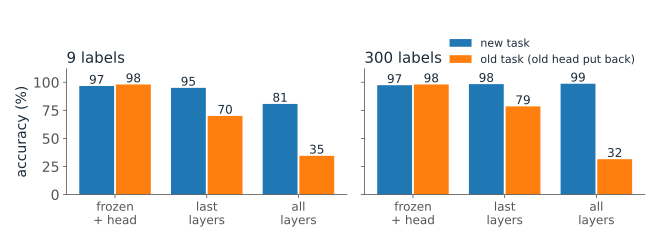
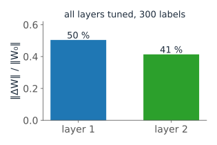
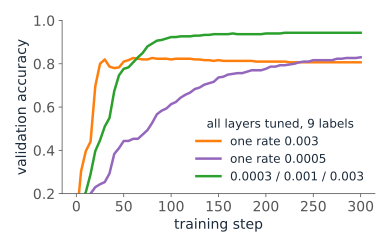
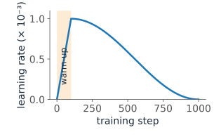
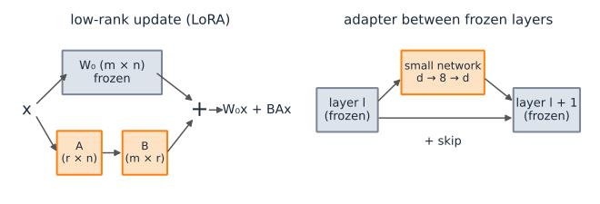
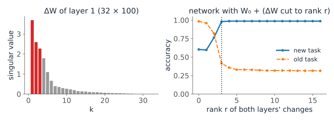

## About this lecture

The [last unit](../transfer/lec.qmd) compared frozen features with fine-tuning. Fine-tuning has its own knobs:

- **Which layers** to train, and **how fast** each one learns (layer-wise learning rates, warm-up).
- **Catastrophic forgetting**: the network loses the old task while it learns the new one.
- **Parameter-efficient** fine-tuning: adapters, and **low-rank updates** (LoRA: $\Delta W = BA$), or training only a small part such as SAM's mask decoder.
- Why a low-rank change is often enough, measured on the toy network.

*Slides titled **The math** give the formulas and proofs; the ideas are complete without them.*

::: notes
Demo: lowrank (presets "a rank-2 change", "rank 2 + noise", "a random (full-rank) change", then "real fine-tuning: layer 1" and "layer 2"). Figures from the transfer toy (tools/figs/transfer/dump.ts, tools/figs/finetune-strategies/figs.py).
:::

## What fine-tuning can break

{fig-alt="Bar charts of accuracy on the new task (blue) and on the old task with the old head put back (orange), for frozen + head, last layers and all layers tuned. 9 labels: new 97, 95, 81 %; old 98, 70, 35 %. 300 labels: new 97, 98, 99 %; old 98, 79, 32 %." width="80%" fig-align="center"}

- With **9 labels**, tuning all layers at the usual rate **overfits** (81 % against 97 % for the frozen probe).
- And whatever the number of labels, the tuned backbone **forgets** the old task: from 98 % to about a third.
- Forgetting matters when one network should do both, and as a warning sign: the general features are being overwritten.

## Freeze the early layers

:::: {.columns}
::: {.column width="58%"}
- The early layers are the most **general** (edges, blobs) and the most **expensive** (most weights in the toy: 3232 of 3811).
- Freezing them: fewer weights to fit, nothing to forget there, and their outputs can be computed **once**.
- When all layers are tuned (300 labels), layer 1 moves by 50 % of its size and layer 2 by 41 %: the change is not small, and with few labels much of it fits noise.
- In practice: tune the head first, then unfreeze from the top down while the validation score improves ("gradual unfreezing").
:::
::: {.column width="42%"}
{fig-alt="Bar chart of the relative change ‖ΔW‖/‖W₀‖ of each layer after tuning all layers on 300 labels: layer 1 50 %, layer 2 41 %." width="100%"}
:::
::::

## One learning rate per layer

:::: {.columns}
::: {.column width="55%"}
- A **new head** starts from random weights: it needs large steps. The **pretrained** layers are already good: they need small steps.
- One rate for all is a compromise that fails both ways (9 labels, all layers tuned):
  - 0.003 for all: **80.7 %**, old task 35 %;
  - 0.0005 for all: 83.0 %, but a frozen probe at this rate learns too slowly (59 %);
  - **0.0003 / 0.001 / 0.003** for layer 1 / 2 / head: **94.3 %**, old task 68 %.
- "Discriminative" or **layer-wise** learning rates: smaller towards the input.
:::
::: {.column width="45%"}
{fig-alt="Validation accuracy against the training step, all layers tuned on 9 labels: one rate 0.003 rises fast to 82 % and falls to 81 %; one rate 0.0005 rises slowly to 83 %; layer-wise rates 0.0003, 0.001, 0.003 rise to 94 %." width="100%"}
:::
::::

## Warm-up

:::: {.columns}
::: {.column width="55%"}
- At the start the new head is random, so the gradients that reach the pretrained layers are large and **meaningless**: big early steps can wreck the pretrained features before the head has learnt anything.
- **Warm-up**: start with a tiny learning rate and raise it over the first few hundred steps; then let it decay.
- A cheap variant of the same idea: train **only the head** first, then unfreeze.
- Optimisers with running averages (Adam) also need a few steps before their averages mean anything (the [training day](../optimisers/lec.qmd)).
:::
::: {.column width="45%"}
{fig-alt="A learning rate schedule: a linear rise from 0 to 0.001 over the first 100 steps (shaded, warm-up), then a cosine decay to 0 at step 1000." width="100%"}
:::
::::

## The math: per-layer rates and warm-up {.math}

Layer $l$ with weights $W_l$, gradient $G_l$, base rate $\eta$, a factor $\gamma < 1$ per layer below the head ($L$ = the head):

$$W_l \leftarrow W_l - \eta\,\gamma^{L - l}\,G_l, \qquad \text{toy: } \gamma \approx \tfrac13 \;\Rightarrow\; 0.003,\ 0.001,\ 0.0003$$

Warm-up over $T_w$ steps, then cosine decay to step $T$:

$$\eta_t = \eta\,\frac{t}{T_w}\ (t < T_w), \qquad \eta_t = \frac\eta2\Big(1 + \cos\frac{\pi(t - T_w)}{T - T_w}\Big)\ (t \ge T_w)$$

- With Adam each weight's step is roughly $\eta$ whatever the size of its gradient: **scaling the gradient does not slow a layer down**; the per-layer rate must be in the update.
- A frozen layer is the limit $\gamma^{L-l}\eta = 0$.

## Catastrophic forgetting

:::: {.columns}
::: {.column width="55%"}
Training on the new task moves every weight towards what the new task needs; nothing in the loss asks the old task to stay right.

- **Freeze** what must not change (or keep a frozen copy of the old network).
- **Small or layer-wise rates**: 35 % → 68 % of the old task kept in the toy.
- **Pull towards the start**: add $\lambda\|\mathbf w - \mathbf w_0\|^2$ to the loss (weight decay towards the pretrained weights instead of towards 0).
- **Rehearsal**: mix some old-task examples into every batch.
- **Leave the weights alone**: train small extra parts (adapters, low-rank updates); the original network stays intact and can be switched back.
:::
::: {.column width="45%"}
{fig-alt="New-task and old-task accuracy per strategy, as on the earlier slide." width="100%"}
:::
::::

## The math: pulling towards the pretrained weights {.math}

$$\mathcal L_\lambda(\mathbf w) = \mathcal L_\text{new}(\mathbf w) + \lambda\,\|\mathbf w_\text{backbone} - \mathbf w_0\|^2, \qquad \nabla\mathcal L_\lambda = \nabla\mathcal L_\text{new} + 2\lambda(\mathbf w - \mathbf w_0)$$

- The same as ordinary weight decay, centred on $\mathbf w_0$ instead of 0: a **Gaussian prior** around the pretrained weights (maximum a posteriori).
- Near $\mathbf w_0$ the old-task loss is a bowl, $\mathcal L_\text{old}(\mathbf w) \approx \mathcal L_\text{old}(\mathbf w_0) + \tfrac12(\mathbf w - \mathbf w_0)^\top H(\mathbf w - \mathbf w_0)$. Weighting each direction by its curvature $H$ (estimated by the Fisher information) protects the weights the old task needs most: "elastic weight consolidation".
- The head has no pretrained weights: it is not pulled.

## Changing a network with few new numbers

{fig-alt="Two diagrams. Low-rank update: the input x goes through the frozen W₀ (m × n) and, in parallel, through A (r × n) and B (m × r), both trained; the outputs are added: W₀x + BAx. Adapter: between two frozen layers a small trained network d → 8 → d is inserted, with a skip connection around it." width="88%" fig-align="center"}

- **Low-rank update (LoRA)**: keep $W_0$ frozen and learn $\Delta W = BA$, with $B$ $m \times r$ and $A$ $r \times n$, rank $r$ small (1 to 16).
- **Adapters**: small bottleneck networks inserted between frozen layers; start as "do nothing" (the skip connection).
- Both store a few **percent** of the weights per task; one base network serves many tasks.

## The math: counting the numbers {.math}

A weight matrix $W \in \mathbb R^{m \times n}$:

$$\text{full update: } mn, \qquad \Delta W = BA,\ B \in \mathbb R^{m \times r},\ A \in \mathbb R^{r \times n}: \ r(m + n)$$

- Toy layer 1: $32 \times 100 = 3200$; rank 3: $3 \cdot 132 = 396$ (12 %).
- A transformer layer $768 \times 768$: 589,824; rank 8: 12,288 (2 %).
- $BA$ has rank at most $r$: it can only change $W$ along $r$ input directions (the rows of $A$) and write into $r$ output directions (the columns of $B$).
- Start: $B = 0$ (so $\Delta W = 0$ and training starts at the pretrained network), $A$ random.

## Why a low rank is enough

{fig-alt="Left: singular values of the change ΔW that tuning all layers on 300 labels made to layer 1 of the toy network: 3.69, 2.59, 2.27, then 1.79, 1.10, 0.66 and a long tail near 0. Right: accuracy of the network with W₀ plus the change cut to rank r in both layers: 60 % at rank 0 and 1, 76 % at rank 2, 98 % from rank 3 on (the full change gives 98.7 %); old-task accuracy falls from 98 % to 42 % at rank 3 and 32 % at full rank." width="92%" fig-align="center"}

- The change of layer 1 has a few large **singular values** and a long small tail.
- Keeping only **3** directions per layer gives 98.0 % (the full change: 98.7 %). The rest of the change hardly matters for the new task.

## The math: the best rank-r change {.math}

Singular value decomposition $\Delta W = \sum_k \sigma_k \mathbf u_k\mathbf v_k^\top$, $\sigma_1 \ge \sigma_2 \ge \dots \ge 0$.

- **Eckart–Young**: the best rank-$r$ approximation (in $\|\cdot\|_F$) keeps the $r$ largest terms; its relative error is $\sqrt{\sum_{k > r}\sigma_k^2 / \sum_k \sigma_k^2}$. Toy layer 1, $r = 3$: 42 %.
- Why are fine-tuning changes low rank? One gradient of a layer is a sum of outer products, $G = \sum_n \boldsymbol\delta_n\mathbf a_n^\top$; when a few directions of $\boldsymbol\delta$ (here 3 classes) and of the inputs dominate, $G$ and their sum over steps have few large singular values.
- Training $B$ and $A$ by gradient descent on $\|BA - \Delta W\|^2$ reaches the Eckart–Young error (it has no bad local minima), but slowly in the directions with small $\sigma_k$.

## Try it: a change and its low-rank approximation

```{=html}
<link rel="stylesheet" href="../demos/dist/demo.css">
<div data-demo="lowrank" data-preset="rank2"></div>
<script src="../demos/dist/lowrank.js"></script>
```

::: notes
"a rank-2 change" (24 × 24, singular values 3 and 1.5): rank 1 leaves 44.7 %, rank 2 is exact (96 of 576 numbers). "rank 2 + noise": 53.5 % at rank 1, 30.0 % at rank 2, then a slow tail (20.9 % at 6): the knee at the true rank. "a random (full-rank) change": no knee: 72.7 % at rank 4, still 31.0 % at 12. "real fine-tuning: layer 1": 42.0 % error at rank 3, accuracy 98.0 % (full 98.7 %). "layer 2": 30.4 % at 2, 21.5 % at 3.
:::

## Tuning only a decoder, or a prompt

:::: {.columns}
::: {.column width="55%"}
- Promptable networks have a **heavy encoder** (run once per image) and a **light decoder** (run per prompt): SAM on the [cell-networks day](../sam/lec.qmd).
- Fine-tune **only the decoder** on your annotated cells: a few million weights instead of hundreds of millions; the image embeddings can even be computed once and stored, as for a frozen probe.
- **Prompt tuning**: freeze everything and learn a few extra input tokens (for a transformer: "virtual patches") that steer the network.
- Cellpose's human-in-the-loop training fine-tunes its whole (small) network on a few images you correct: the [next unit](../few-labels/lec.qmd).
:::
::: {.column width="45%"}
{fig-alt="The LoRA and adapter diagrams: frozen parts grey, trained parts orange." width="100%"}
:::
::::

## A low-rank update as pseudocode

```
given: W0 (m × n, frozen), rank r
A = small random numbers (r × n);  B = 0 (m × r)        # so B·A = 0 at the start
forward:  y = W0 · x + B · (A · x)                        # never form B·A
backward: with g = ∂loss/∂y:
          grad B = g · (A·x)ᵀ,   grad A = Bᵀ · g · xᵀ     # W0 gets no gradient
update B and A with the optimiser
after training: W = W0 + B·A  (one matrix again, no extra cost)
```

- Only $B$ and $A$ are stored per task; switching task = switching $B, A$.
- The coding exercise fits $BA$ to a real fine-tuning change by gradient descent and compares with the best possible error.

::: notes
The coding exercise (finetuning/src/finetune_strategies/ in the course code download): the pull towards the pretrained weights, parameter counts, and a rank-r fit of the toy's layer-1 change, with the network's accuracy when its change is replaced by B·A.
:::

## Choosing a strategy

| situation | strategy |
|---|---|
| tens of labels | frozen backbone + head; at most the last layers |
| hundreds of labels, similar images | gradual unfreezing, layer-wise rates, warm-up, early stopping |
| the old task must keep working | frozen copy, pull to the start, rehearsal, or adapters / LoRA |
| many tasks on one base network | adapters or LoRA: a few % of the weights per task |
| a promptable network | fine-tune the decoder only |
| very different images, many labels | all layers, a normal rate |

Whatever you choose: choose it on a validation set and report on a separate test set.

## Summary

| Idea | In one line |
|---|---|
| Freezing | early layers are general and expensive: keep them fixed, compute once |
| Layer-wise rates | small steps for pretrained layers, large for the new head (toy: 81 % → 94 %) |
| Warm-up | tiny steps while the new head is random, then decay |
| Catastrophic forgetting | the old task is lost; freeze, pull to $\mathbf w_0$, rehearse, or add parameters |
| LoRA | $\Delta W = BA$ of rank $r$: $r(m+n)$ numbers instead of $mn$ |
| Low rank suffices | fine-tuning changes have a few large singular values (toy: rank 3 gives 98.0 % of 98.7 %) |

Next: [few labels](../few-labels/lec.qmd): which images to annotate, and the human in the loop.
