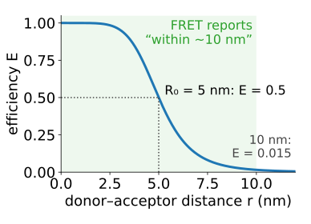
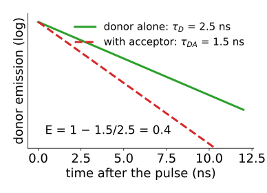
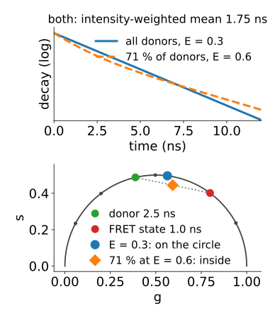
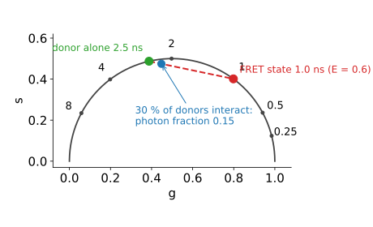
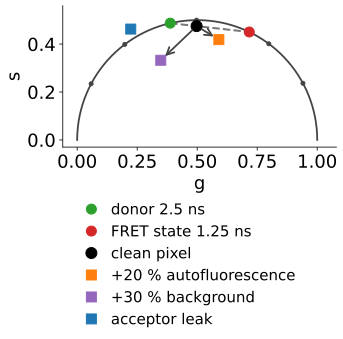
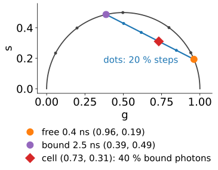
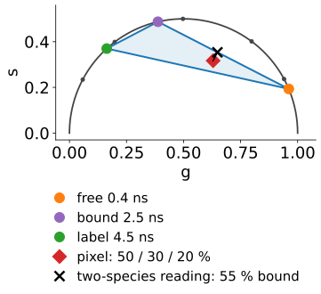

## About this lecture

Two applications that use everything of the day: lifetimes, fits with few photons, and phasors.

- **FRET by lifetime**: an acceptor nearby shortens the donor's lifetime; $E = 1 - \tau_{DA}/\tau_D$.
- **Efficiency vs fraction**: how strongly the molecules interact, and how many of them do. A single mean lifetime mixes the two; a bi-exponential fit or the phasor line separates them.
- **Pitfalls**: environment, autofluorescence, acceptor emission leaking into the donor channel, few photons.
- **Metabolic imaging**: NADH without labels, free vs protein-bound, on the phasor plot.
- From pixels to a per-cell result.

*Slides titled **The math** give the formulas and proofs; the ideas are complete without them.*

## Recall: FRET in one slide

From [the FRET day](../fret-physics/lec.qmd) (enough to follow if you did not take it):

:::: {.columns}
::: {.column width="57%"}
- An **acceptor** molecule within a few nanometres takes the energy of the excited **donor**, without light.
- The **efficiency** E (the fraction of excitations transferred) falls steeply with the distance r: $E = 1/(1 + (r/R_0)^6)$, half at the **Förster distance** $R_0 \approx 5$ nm.
- So FRET reports "within about 10 nm", far below the resolution of the microscope. Colocalisation ([coloc](../coloc/lec.qmd)) only says "in the same diffraction-limited pixel" (about 200 nm).
:::
::: {.column width="43%"}
{fig-alt="The FRET efficiency E against the donor–acceptor distance r for R0 = 5 nm: close to 1 below 3 nm, 0.5 at 5 nm, 0.015 at 10 nm. The range up to about 10 nm is shaded: what FRET reports." width="100%"}
:::
::::


For this day: transfer is **another way for the donor to leave the excited state**. So its lifetime **shortens**.

## FRET efficiency from lifetimes

$$E = 1 - \frac{\tau_{DA}}{\tau_D}$$

:::: {.columns}
::: {.column width="56%"}
$\tau_D$: the donor alone (a donor-only control, same cells, same conditions); $\tau_{DA}$: the donor with the acceptor.

- Example: $\tau_D = 2.5$ ns, $\tau_{DA} = 1.5$ ns: E = 0.4, and with $R_0 = 5$ nm, r ≈ 5.35 nm.
- Why lifetime beats intensity here: only the **donor** is recorded. No need to know concentrations, and acceptor bleed-through and cross-excitation (the corrections of intensity FRET, recalling [crosstalk](../crosstalk/lec.qmd)) do not enter.
:::
::: {.column width="44%"}
{fig-alt="Donor decays on a log axis: alone (2.5 ns, green) and with the acceptor (1.5 ns, red dashed, steeper). E = 1 − 1.5/2.5 = 0.4." width="100%"}
:::
::::


## The math: FRET rates {.math}

The donor leaves the excited state at rate $1/\tau_D$ alone, plus a transfer rate $k_T = \tau_D^{-1}(R_0/r)^6$ with the acceptor:

$$\tau_{DA} = \frac{1}{\tau_D^{-1} + k_T}, \qquad E = \frac{k_T}{\tau_D^{-1} + k_T} = 1 - \frac{\tau_{DA}}{\tau_D} = \frac{1}{1 + (r/R_0)^6}.$$

- Distance from efficiency: $r = R_0\,(1/E - 1)^{1/6}$.
- $R_0$ depends on the relative orientation of the two molecules (the factor κ², usually assumed 2/3 for freely rotating dyes): distances from E are estimates, ratios of E are more robust.

## Efficiency vs interacting fraction

:::: {.columns}
::: {.column width="55%"}
A pixel holds donors that interact (lifetime $\tau_{DA}$) and donors that do not ($\tau_D$): a mixture of **two** lifetimes.

- **E**: how strongly an interacting donor transfers (the distance in the complex).
- **α**: which fraction of donors interact (how much complex there is).
- A single mean lifetime mixes the two: all donors at E = 0.3, or 71 % of donors at E = 0.6, give the same intensity-weighted mean lifetime, 1.75 ns (with $\tau_D = 2.5$ ns).
- Separate them by a **bi-exponential fit with $\tau_D$ fixed** from the control (global analysis of [the decay unit](../decayfit/lec.qmd) makes it work at FLIM photon counts), or by the **phasor line** (next slide).
:::
::: {.column width="45%"}
{fig-alt="Top: decays on a log axis for all donors at E = 0.3 (a straight line, 1.75 ns) and for 71 % of donors at E = 0.6 (curved); both have the intensity-weighted mean lifetime 1.75 ns. Bottom: on the phasor plot the first lies on the semicircle, the second inside it, on the chord from the donor (2.5 ns) to the FRET state (1.0 ns)." width="100%"}
:::
::::


## The math: a mixed population {.math}

Amplitude (molecule) fraction α interacting, $1 - \alpha$ not:

$$I(t) \propto (1 - \alpha)\,e^{-t/\tau_D} + \alpha\,e^{-t/\tau_{DA}}.$$

- Photon fraction of the FRET state: $f = \dfrac{\alpha\tau_{DA}}{\alpha\tau_{DA} + (1 - \alpha)\tau_D}$ (quenched donors are dimmer).
- Phasor: $P = (1 - f)P_D + fP_{DA}$: on the chord from the donor point to the FRET-state point.
- Example: α = 0.3, $\tau_{DA} = 1.0$ ns, $\tau_D = 2.5$ ns: f = 0.3/2.05 = 0.15.
- The **FRET trajectory** is the curve $P(E)$ for E from 0 to 1 at a given α (and background, autofluorescence): for α = 1 it is the semicircle itself.

## On the phasor plot

{width="58%" fig-align="center"}

- The donor alone sits on the semicircle. The FRET state sits further right (shorter).
- Pixels lie on the **line** between them; the line, extended to the semicircle, gives $\tau_{DA}$ and so **E**; the position along it gives the **photon** fraction, hence **α**.
- 30 % of donors interacting puts the point only 15 % of the way along: closer to the donor than you think.

## Try it: FRET on the phasor plot

```{=html}
<link rel="stylesheet" href="../demos/dist/demo.css">
<div data-demo="fretphasor" data-preset="thirty"></div>
<script src="../demos/dist/fretphasor.js"></script>
```

::: notes
Left: the phasor plane with the donor point (green), the FRET-state point (red), the trajectory for the current α (purple, a dot every 0.1 in E) and 150 simulated pixels (calibrated). Right: E(r) with R0 = 5 nm (drag to change r) and the donor decay. Tour, numbers from the demo: "30 % interact" (τ_D = 2.5 ns, E = 0.6): photon fraction 0.15; cloud mean (0.448, 0.476), τ_φ 2.11 ns; the fit with τ_D fixed gives E = 0.58, α = 0.30, the phasor line E = 0.58, α = 0.30. "E vs fraction": blue all donors at E = 0.3 (on the semicircle, τ_φ = τ_m = 1.75), orange 71 % at E = 0.6 (inside, τ_φ = 1.48, τ_m = 1.79): same mean lifetime, different positions. "Autofluorescence" (20 % at 0.4 ns): E comes out 0.75 (fit) and 0.72 (line) instead of 0.5, α 0.71 instead of 0.5. "Acceptor leak" (70 %): the cloud mean lies outside the semicircle; the fit gives E = 0.01 and the line cannot be used. "Too few photons" (60 per pixel): E 0.64 and 0.61, α 0.24 and 0.22.
:::

## Pitfalls

:::: {.columns}
::: {.column width="57%"}
- **The donor's own lifetime** depends on its environment (pH, binding, refractive index): always a **donor-only control** in the same cells and conditions.
- **Autofluorescence** adds a third species: the cloud leaves the donor line, and a two-species analysis assigns the extra short lifetime to FRET (too high E and α).
- **Acceptor emission leaking into the donor channel**: it is excited **through** FRET, so it rises before it decays (a "negative amplitude"). Its phasor is the product $P_{DA}P_A$ and lies **outside** the semicircle; enough of it pulls pixels outside too. Use a tighter emission filter.
- **Background** pulls the cloud towards (0, 0): the line from the donor point tilts. Fit or subtract it.
- **Few photons**: noisy fractions, clipped at 0, are biased upwards. Bin, or use global analysis.
:::
::: {.column width="43%"}
{fig-alt="The phasor plot with the donor (2.5 ns) and FRET-state (1.25 ns) points joined by a dashed line, and a clean pixel on it. Adding 20 % autofluorescence of 0.4 ns moves it off the line towards the right; 30 % flat background moves it towards the origin; acceptor emission leaking into the donor channel (70 %) moves it outside the semicircle." width="100%"}
:::
::::


## Metabolic imaging: NADH

:::: {.columns}
::: {.column width="57%"}
NADH (and NADPH, indistinguishable optically) fluoresces **without any label**, under two-photon infrared or UV excitation.

- **Free** NADH: ≈ 0.4 ns. **Protein-bound** NADH: ≈ 2 to 3 ns.
- A cell's phasor cloud lies on the line between free and bound; its position = the **fraction bound**.
- More free NADH tends to go with glycolysis, more bound with oxidative phosphorylation: an indicator of metabolic state, a tendency, not a rule.
- FAD, the other autofluorescent coenzyme, behaves the other way round; the ratio of the two intensities is the "redox ratio".
- Example at 80 MHz: free (0.96, 0.19), bound (0.39, 0.49), a cell at (0.73, 0.31): 40 % of the **photons** come from bound NADH, but only 10 % of the **molecules** (if both forms are equally bright per unit lifetime).
:::
::: {.column width="43%"}
{fig-alt="The phasor plot at 80 MHz with free NADH (0.4 ns) at (0.96, 0.19) and bound NADH (2.5 ns) at (0.39, 0.49) joined by a line with ticks every 20 %. A cell at (0.73, 0.31) lies 40 % of the way towards the bound point." width="100%"}
:::
::::


## Three components: a triangle

:::: {.columns}
::: {.column width="55%"}
A pixel with free NADH, bound NADH and a label (or a second bound form) lies **inside the triangle** of the three phasors.

- The three fractions are its **barycentric coordinates**: the simplex of [endmembers](../endmembers/lec.qmd), in a fixed 2D projection.
- Ignoring the third species biases the two-species answer: pixels with the label are pulled towards its corner, and the lever rule misreads them.
- Four or more components need more equations: a second harmonic (2ω) or spectral channels as well.
:::
::: {.column width="45%"}
{fig-alt="The triangle of free NADH (0.4 ns), bound NADH (2.5 ns) and a label (4.5 ns) on the phasor plot. A pixel with 50 %, 30 % and 20 % of its photons from the three lies inside. Read with only the free–bound line, it projects to 55 % bound, far from the true 30 / 80 = 38 % of the NADH photons." width="100%"}
:::
::::


## The math: three fractions {.math}

Three known phasors $P_1, P_2, P_3$ and a pixel $P$; photon fractions $\mathbf f$:

$$\begin{pmatrix} g_1 & g_2 & g_3\\ s_1 & s_2 & s_3\\ 1 & 1 & 1\end{pmatrix}\mathbf f = \begin{pmatrix} g\\ s\\ 1\end{pmatrix}.$$

- Unique if the three points are not on one line. All $f_k \ge 0$ iff P is inside the triangle.
- Molecule fractions from photon fractions: $\alpha_k \propto f_k/\tau_k$, **assuming** all forms have the same radiative rate (photons per molecule ∝ lifetime).

## Try it: a FRET cell and a NADH cell

```{=html}
<link rel="stylesheet" href="../demos/dist/demo.css">
<div data-demo="flimcell" data-mode="fret" data-preset="fret"></div>
<script src="../demos/dist/flimcell.js"></script>
```

::: notes
"FRET compartment": a donor of 2.6 ns; in the mitochondria about 60 % of donors interact at E = 0.5 (1.3 ns), at the membrane fewer, in the nucleus none. The line from the donor point through the cloud meets the semicircle at 1.25 ns: E = 0.52; the map shows α per pixel; cell mean α 0.17 (true 0.15). "Too few photons" (40): E = 0.49, but the mean α rises to 0.26 (true 0.15): noisy fractions clipped at 0 are biased upwards; 3 × 3 binning gives 0.17 again. "Fraction-bound map" (NADH): mean molecule fraction bound 0.30 (true 0.27), because label pixels pull the two-species answer. "A third species": with the triangle (label at 4.5 ns) the mean is 0.27, the true value.
:::

## From pixels to a result

1. **Segment** the cells on the intensity image (thresholding, watershed).
2. Per cell: the mean lifetime **with its photon count**, or the interacting / bound fraction (global analysis or the phasor line), and which mean was used.
3. Show the **phasor histogram per condition**: shifts along a line are changes in fraction; shifts off the line are a new species or an artefact.
4. Compare cells and experiments with the statistics of [the evaluation day](../replicates/lec.qmd): cells are not independent replicates of an experiment.
5. Per-object values become columns of the [feature table](../intensity-features/lec.qmd).

## Summary

- FRET adds a way out of the excited state: the donor's lifetime shortens, $E = 1 - \tau_{DA}/\tau_D$, with a donor-only control.
- Lifetime FRET records only the donor: no concentrations, no bleed-through corrections.
- A mixture of interacting and free donors: **E** (how strongly) and **α** (how many) are separate questions; a mean lifetime confuses them. Bi-exponential fits with $\tau_D$ fixed, or the **phasor line** from the donor point, separate them.
- Photon fractions underweight the quenched state: 30 % interacting donors give only 15 % of the photons.
- Pitfalls: environment, autofluorescence (a third corner), acceptor leak (outside the semicircle), background, few photons.
- NADH: free (0.4 ns) and bound (2–3 ns) on a line; fraction bound as a metabolic indicator; three species fill a triangle.
