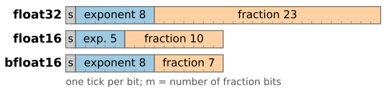
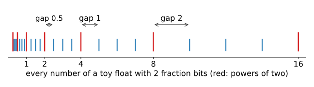
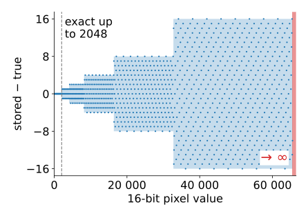
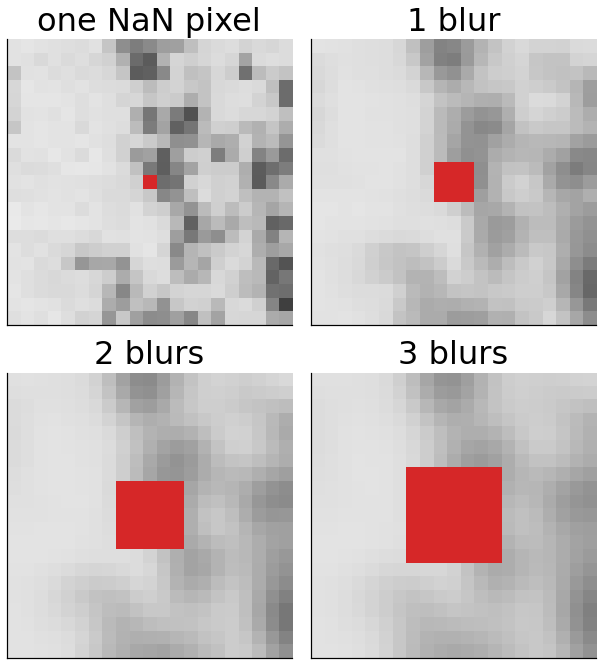
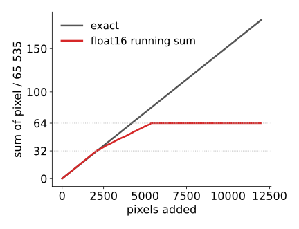

## About this lecture

- Analysis happens in **floating point**: what is stored, bit by bit, in float32, float16 (half) and bfloat16.
- Floats are spaced **unevenly**: the gap between neighbours grows with the number. What that means for 16-bit images in half floats.
- Special values: zero, infinity, NaN, tiny "subnormal" numbers.
- Where rounding hurts: **cancellation** (a negative variance!) and **summing millions of pixels**.

Slides titled **The math** give the formulas and proofs; the ideas are complete without them.

::: notes
The previous unit recommended converting to float before arithmetic. This unit says what that buys and where it still goes wrong. Everything is base-2 scientific notation; the demos let students click bits and see sums drift.
:::

## Scientific notation, in base 2

$6.02 \times 10^{23}$: a few significant digits and an exponent. Floats do the same in base 2:

$$x = \pm\, 1.f_1 f_2 \dots f_m \;(\text{binary}) \times 2^{E}.$$

{fig-alt="Three bars drawn to scale, one tick per bit: float32 is 1 sign bit, 8 exponent bits and 23 fraction bits (m = 23); float16 is 1, 5 and 10; bfloat16 is 1, 8 and 7, the first half of a float32." width="78%" fig-align="center"}

| format | bits | largest | relative precision |
|---|---|---|---|
| float32 | 32 | $3.4 \times 10^{38}$ | $2^{-23} \approx 1.2 \times 10^{-7}$ |
| float16 (half) | 16 | 65 504 | $2^{-10} \approx 0.001$ |
| bfloat16 | 16 | $3.4 \times 10^{38}$ | $2^{-7} \approx 0.008$ |

- About 7 significant decimal digits in float32, 3 in float16, 2 in bfloat16.
- bfloat16 keeps float32's exponent range but very few digits (used in machine learning).

## Try it: the bits of a float

```{=html}
<link rel="stylesheet" href="../demos/dist/demo.css">
<div data-demo="floatbits" data-format="float16" data-value="0.1"></div>
<script src="../demos/dist/floatbits.js"></script>
```

::: notes
0.1 in float16: 0x2E66, exactly 0.0999755859375. 0.1 has no finite binary expansion, like 1/3 in decimal. Click +1 ulp a few times and watch the value step. Then click the exponent bits: each one doubles or halves. Presets: 2049 becomes 2048 in half; 65535 becomes infinity; switch to float32: 2049 is exact. Smallest subnormal: 6e-8. The plot: the gap between neighbouring floats against the value, a staircase; where it crosses "spacing 1", integers stop being exact.
:::

## Floats are spaced unevenly {.nostretch}

Between two powers of two there are always the same number of floats ($2^m$), evenly spaced. The next interval is twice as long, so the gaps double:

| float16 near | 1 | 1000 | 3000 | 65 000 |
|---|---|---|---|---|
| gap to the next float | 0.000 98 | 0.5 | 2 | 32 |

- The **relative** gap is about the same everywhere: $2^{-10}$ to $2^{-11}$ for float16. This is **machine epsilon**, the gap above 1.
- Rounding to the nearest float makes a relative error of at most half that: about 0.05 % for float16, $6 \times 10^{-8}$ for float32.
- 0.1 is not exactly a float (like 1/3 in decimal). In float16 it is 0.099 975 585 937 5.

{fig-alt="A number line from 0 to 16 with a tick at every number of a toy float format with 2 fraction bits: four numbers between each pair of powers of two, so the ticks are dense near 0 and the gap doubles from 0.5 between 2 and 4 to 1 between 4 and 8 and 2 between 8 and 16." width="70%" fig-align="center"}

## Integers in floats

:::: {.columns}
::: {.column width="55%"}
Every integer is exact as long as the gap is at most 1:

| format | all integers exact up to | first one that is not |
|---|---|---|
| float32 | $2^{24} = 16\,777\,216$ | 16 777 217 |
| float16 | $2^{11} = 2048$ | 2049 (→ 2048) |
| bfloat16 | $2^{8} = 256$ | 257 (→ 256) |

A 16-bit image stored in **half floats**:

- values up to 2048 survive; 2049 → 2048, 3001 → 3000, 40 001 → 40 000 (gap 32);
- **65 535 → infinity**: the largest half float is 65 504.
- Normalised to $[0, 1]$ instead, the gap near 1 is $2^{-11}$: about 11 bits. Half float is fine for 8- or 10-bit data, not for 16-bit.
:::
::: {.column width="45%"}
{fig-alt="Stored minus true value for every integer 0 to 65 535 stored as float16: zero up to 2048, then a growing band of errors, up to plus or minus 16 above 32 768; values from 65 520 up become infinity." width="100%"}
:::
::::

## Special values

:::: {.columns}
::: {.column width="58%"}
- **±0**: two zeros (the sign is kept, e.g. for $1/(-0) = -\infty$).
- **±∞**: overflow (65 535 in half), or $1/0$.
- **NaN** ("not a number"): $0/0$, $\infty - \infty$, $\sqrt{-1}$. Any arithmetic with NaN gives NaN, and NaN ≠ NaN. One NaN pixel spreads through a blur to every pixel it touches; a mean over an image with one NaN is NaN.
- **Subnormals**: below the smallest normal number ($2^{-14} \approx 6 \times 10^{-5}$ in half) the spacing stops shrinking, so the floats run down evenly to 0. Tiny values lose relative precision gradually instead of dropping to 0 at once.
:::
::: {.column width="42%"}
{width="88%" fig-alt="A small patch of the cell micrograph with one NaN pixel, shown red, then after one, two and three 3 by 3 blurs: the red square grows to 3 by 3, 5 by 5 and 7 by 7 pixels."}

A 3 × 3 blur, repeated: the one NaN pixel becomes 9, 25, 49.
:::
::::

::: notes
The patch is cut from the micrograph used throughout the course: transmission electron micrograph of a mesenchymal stem cell, Robert M. Hunt, CC BY 3.0, via Wikimedia Commons.
:::

## The math: IEEE 754 numbers {.math}
With sign $s$, stored exponent field $E$ ($e$ bits), fraction field $F$ ($m$ bits) and **bias** $b = 2^{e-1} - 1$ (15 for half, 127 for float32):

$$x = \begin{cases}(-1)^s\, 2^{E - b}\,(1 + F/2^m) & 0 < E < 2^e - 1 \text{ (normal)}\\ (-1)^s\, 2^{1 - b}\,(F/2^m) & E = 0 \text{ (zero, subnormal)}\\ \pm\infty \text{ if } F = 0, \text{ NaN otherwise} & E = 2^e - 1.\end{cases}$$

- In $[2^k, 2^{k+1})$ the spacing is $2^{k - m}$; the relative spacing is between $2^{-m-1}$ and $2^{-m}$; $\varepsilon = 2^{-m}$.
- Round to nearest, ties to even: $\operatorname{fl}(x) = x(1 + \delta)$ with $|\delta| \le \varepsilon/2$.
- Integers are exact while the spacing is $\le 1$: up to $2^{m+1}$.

## Cancellation

Subtracting two nearly equal numbers keeps their **absolute** error but not their size: the **relative** error explodes.

- In half: $2049 - 2048$ gives **0**, because 2049 was already stored as 2048.
- Textbook variance, $\overline{x^2} - \bar x^2$: two large, nearly equal numbers. For pixels 10 000, 10 001, 10 002 in float32 it gives **0** (the true value is 2/3): the sum of squares, 300 060 005, is stored as 300 060 000 (gap 32 there).
- Fix: compute the mean first, then the squared **deviations** (two passes), or an update formula that does the same in one pass.

## Summing many pixels

:::: {.columns}
::: {.column width="57%"}
A running sum grows. Once the sum is large, the gap at the sum is larger than the pixel values: each addition rounds, and the small values lose their low bits.

- float32: adding 1 to $2^{24}$ gives $2^{24}$. A 2048 × 2048 image with mean 1000 sums to $4 \times 10^9$: the naive float32 mean is off by 1 %.
- float16: summing normalised pixel values (≈ 0.015 each) gets **stuck at 64**: from there, adding a pixel rounds back to the same sum.
- **Pairwise** summation (add in a tree: pairs, pairs of pairs, …) keeps partial sums of similar size: error grows like $\log n$ instead of $n$.
- **Kahan** summation carries the rounding error of each addition into the next one: nearly exact.
:::
::: {.column width="43%"}
{fig-alt="The running sum of normalised pixel values (about 0.015 each) against the number of pixels added: the exact sum is a straight line to about 180; the float16 running sum follows it, then bends at 32 and stops at exactly 64 after about 5500 pixels." width="100%"}
:::
::::

## Try it: summing 4 million pixels

```{=html}
<div data-demo="floatbits" data-view="sum" data-mean="1000" data-sd="50" data-n="22"></div>
```

::: notes
Relative error of the sum against the number of pixels. float32 naive is exact up to 2^14 pixels, then drifts to 1 % at 4 million. Pairwise and Kahan stay near 1e-9. float16 naive gets stuck immediately; float16 pairwise is not bad, until "bright and flat", where the sum of normalised values exceeds 65504 and becomes infinity. Variance: one pass gives a negative number; two passes with naive sums is still off because the mean is off; two passes with pairwise sums is right.
:::

## The math: how errors grow when summing {.math}
Each addition $s_k = \operatorname{fl}(s_{k-1} + x_k)$ makes a relative error $|\delta| \le u = \varepsilon/2$. For $n$ non-negative terms (to first order in $u$):

$$\text{naive: } |\hat s - s| \lesssim (n - 1)\,u \sum |x_i|, \qquad \text{pairwise: } \lesssim \lceil\log_2 n\rceil\, u \sum |x_i|, \qquad \text{Kahan: } \lesssim 2u \sum |x_i|.$$

The naive sum **stalls** when $x_k < \tfrac12\operatorname{gap}(s_{k-1})$: the addition rounds back to $s_{k-1}$. Kahan's trick: after $t = \operatorname{fl}(s + y)$, the quantity $c = \operatorname{fl}(\operatorname{fl}(t - s) - y)$ is exactly the part of $y$ that was lost (with the sign flipped); it is subtracted from the next term.

## Rules of thumb

- Do image arithmetic in **float32**; accumulate long sums (means, histograms of large stacks, integrals) in **float64**, or pairwise.
- Compute variances from **deviations from the mean**, not from $\overline{x^2} - \bar x^2$.
- Do not test two floats for exact equality; compare with a tolerance relative to their size.
- Half floats: fine for display and for values of similar size; not for 16-bit raw data or long sums.
- Check for NaN and ∞ after every step that can divide or overflow.

## Summary

- A float is $\pm 1.f \times 2^E$: a fixed number of significant bits, so precision is **relative**; the gap doubles at every power of two.
- float32: 24 significant bits, integers exact to $2^{24}$; float16: 11 bits, to 2048, max 65 504; bfloat16: 8 bits.
- Special values: ±0, ±∞, NaN (spreads), subnormals.
- Subtraction of near-equal values **cancels** significant bits; long sums **drift** or stall. Use two-pass variances and pairwise or compensated sums.
