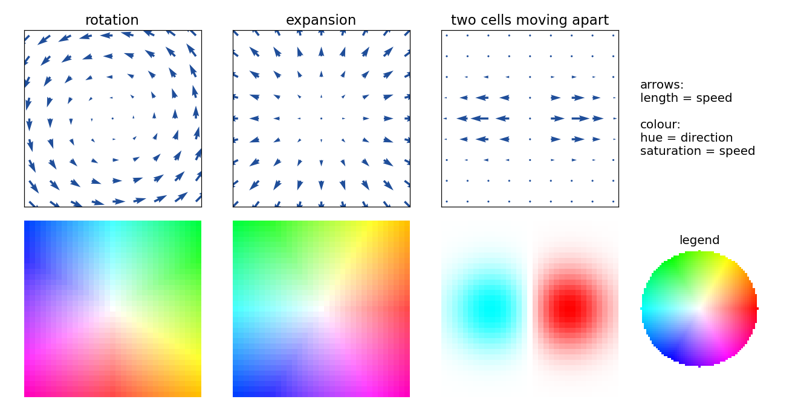
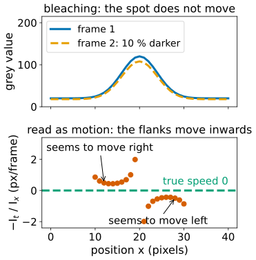
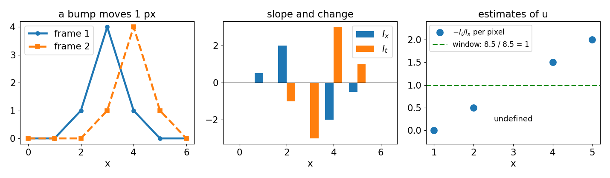
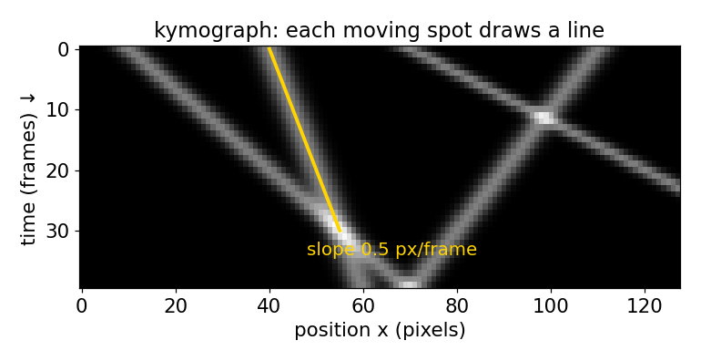
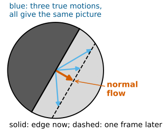
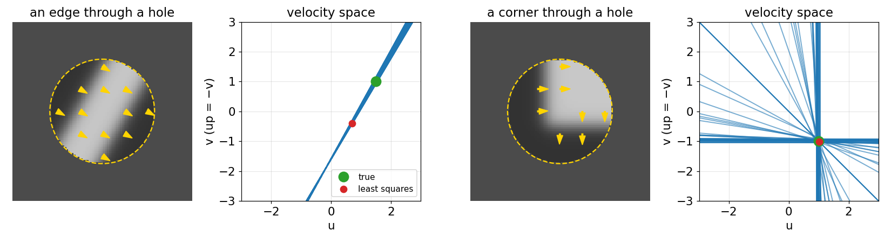

## About this lecture

FFT registration found **one** shift for a whole image. Cells crawl, tissues fold, cytoplasm streams: every part moves differently. Today: give **every pixel its own motion vector**.

- A **flow field** and how to read it (arrows, the colour wheel).
- **Brightness constancy**: a moving point keeps its grey value, and when biology breaks it.
- **1D first**: speed = −(change in time) / (slope), and why a window of pixels helps.
- **Kymographs**: motion as the slope of a line in an $x$–$t$ image.
- The **aperture problem**: along an edge only the motion **across** the edge can be seen.

*Slides titled **The math** give the formulas and proofs; the ideas are complete without them.*

::: notes
This unit owns brightness constancy, the optical flow constraint, the aperture problem, normal flow and the flow colour coding for the course. The next two units combine the constraints locally (Lucas–Kanade) and globally (Horn–Schunck). Convention: x to the right, y down, flow (u, v) in pixels per frame, angles counter-clockwise as seen on the screen (as on the edges day).
:::

## Recall: one shift for the whole image

[FFT registration](../phasecorr/lec.qmd) and [stitching](../stitching/lec.qmd) found the single translation that best aligns two images: one peak in the correlation surface.

That is the right model for **stage drift** or **tiles of a mosaic**. It is the wrong model when

- a cell migrates while its neighbours stay put,
- an embryo's tissue converges in one place and spreads in another,
- cytoplasm streams in a loop.

Now every pixel gets its own vector: **where did the content of this pixel go between frame 1 and frame 2?** That field of vectors is the **optical flow**.

## Showing a flow field

{width="80%" fig-align="center"}

- **Arrows** on a coarse grid: length = speed. Easy to read, but only a few hundred fit.
- **Colour wheel**: hue = direction (red = right, counter-clockwise round the wheel), saturation = speed, **white = still**. Every pixel shown.
- Saturation is relative to the largest speed shown: always state the scale ("edge of the wheel = 2 px/frame").

## Try it: reading flow fields

```{=html}
<link rel="stylesheet" href="../demos/dist/demo.css">
<div data-demo="flowviz" data-field="swirl"></div>
<script src="../demos/dist/flowviz.js"></script>
```

::: notes
Three views of the same field. Tour: rotation (the colour wheel itself appears, rotated a quarter turn: the colours run round the centre); expansion (the colours point outwards, the same picture as the legend); shear (two halves, two colours, white along the middle line); vortex (a coloured ring, white in the core and far away); "two cells moving apart" (a cyan and a red blob). Flip the strength slider through zero: the colours swap to the opposite side of the wheel. Then "which field is this?": the class reads the colour coding alone.
:::

## Brightness constancy

:::: {.columns}
::: {.column width="52%"}
The one assumption that links images to motion: **a moving point keeps its grey value.**

If the content at $(x, y)$ in frame 1 moves by $(u, v)$, then frame 2 at $(x + u, y + v)$ shows the same value.

It holds when illumination is fixed, the sample stays in focus and the frame interval is short. It fails when

- the dye **bleaches** (everything gets darker every frame),
- fluorophores **blink**, or objects **enter or leave the focal plane**,
- a 3D object **rotates** and its shading changes, or the illumination flickers.

Where it fails, every method of this day reports motion that is not there (or misses motion that is).
:::
::: {.column width="48%"}
{width="100%" fig-alt="Top: a bright spot in frame 1 and the same spot 10 percent darker in frame 2, not moved. Bottom: the per-pixel speed minus I_t over I_x is about +0.5 pixels per frame on the left flank and about -0.5 on the right flank, although the true speed is zero."}
:::
::::

## 1D first: a profile that moves

{width="95%" fig-align="center"}

A profile moves right by $u$ pixels per frame. At a pixel on a slope $I_x$, the value changes by $I_t \approx -I_x\,u$ from frame 1 to frame 2, so
$$u = -\,I_t / I_x .$$

- On the slope: works. On a **flat** stretch ($I_x = 0$): no information. At the **peak**: none either.
- Pixels disagree (0.5, undefined, 1.5 above). **Combine a window** by least squares: $u = -\sum I_x I_t / \sum I_x^2 = 8.5/8.5 = 1$, exactly right.

## The math: the optical flow constraint {.math}

Brightness constancy: $I(x + u\,\delta t,\; y + v\,\delta t,\; t + \delta t) = I(x, y, t)$.

First-order Taylor expansion of the left side:
$$I + I_x u\,\delta t + I_y v\,\delta t + I_t\,\delta t + O(\delta t^2) = I \quad\Rightarrow\quad I_x u + I_y v + I_t = 0,$$
i.e. $\nabla I \cdot (u, v) = -I_t$ (with $\delta t$ = one frame).

- Valid while the motion is **small** compared with the distance over which the gradient changes (the neglected term involves the second derivatives times $u^2$). Large motion: the next unit.
- In 1D: $u = -I_t / I_x$. Over a window, least squares minimises $\sum (I_x u + I_t)^2$; setting the derivative $2\sum I_x(I_x u + I_t)$ to zero gives $u = -\sum I_x I_t / \sum I_x^2$.

## Kymographs: motion as a slope

{width="60%" fig-align="center"}

Stack the profile of every frame under the previous one: an $x$–$t$ image. A moving feature draws a **line**; its **slope** (pixels per frame) is its speed.

- Steeper away from vertical = faster; vertical = still; crossing lines = features passing each other; a curved line = acceleration.
- Biology: vesicles moving along an axon, a cell edge protruding and retracting.
- 1D flow **is** the orientation of the lines in this image: the [structure tensor](../structure-tensor/lec.qmd) measures it, now in $x$–$t$ instead of $x$–$y$.

## Try it: speed from slope and change

```{=html}
<link rel="stylesheet" href="../demos/dist/demo.css">
<div data-demo="kymoflow" data-preset="bump"></div>
<script src="../demos/dist/kymoflow.js"></script>
```

::: notes
Top: frame 1 and frame 2; click a pixel to read Ix, It and −It/Ix. Middle: blue dots are the per-pixel estimates, the red line the window estimate, dashed green the truth. Right: the kymograph with a slope ruler. Tour: "by-hand bump": the numbers of the previous slide (window LS at x = 3 is 1.00). "a ramp": exact everywhere. "a bump": per-pixel estimates spread (1.07 at x = 33, 0.93 at x = 39), the window gives 1.00. "too fast" (6 px per frame on a bump of σ = 4): the window estimate at the centre drops to 2.96. "bleaching" (10 % per frame): at speed 1 the window estimate is 0.90 at the centre, 1.52 on the left flank and 0.28 on the right: the brightness change is read as motion. "transport": four vesicles with speeds 1.5, 0.5, 2.5 and −1: read them with the ruler.
:::

## The aperture problem

:::: {.columns}
::: {.column width="55%"}
In 2D, each pixel gives **one** equation for **two** unknowns $(u, v)$.

Look at a straight edge through a small hole: you see it move **across** itself, never **along** itself. The motion along the edge changes nothing you can see.

- What a single pixel (or a straight edge) can measure is the **normal flow**: the component of the motion along the gradient.
- The **barber pole**: stripes seen through a tall slit seem to move up, whatever their true motion.
- A **corner** or a **texture** has gradients in several directions: that resolves it.
:::
::: {.column width="45%"}
{width="100%" fig-alt="A circular hole showing a dark and a bright half separated by a straight edge, with the edge one frame later dashed. Three different true motion arrows all end on the dashed edge; the thick normal flow arrow is perpendicular to the edge."}
:::
::::

## Constraint lines in velocity space

{width="100%" fig-align="center"}

Draw velocity space, $u$ across and $v$ (down) up the page. Every velocity that would explain one pixel's change lies on a **line** in this space.

- An edge: all its pixels give the **same** line. The truth is somewhere on it; the point closest to the origin is the normal flow.
- A corner: two families of lines **cross** at the true velocity.
- A flat patch: **no line** at all.

## The math: the constraint line {.math}

For one pixel, $\{(u, v) : I_x u + I_y v = -I_t\}$ is a line with normal $\nabla I$.

- Its distance from the origin is $|I_t| / |\nabla I|$; its closest point is the **normal flow**
$$\mathbf u_\perp = -\,\frac{I_t}{|\nabla I|^2}\,\nabla I .$$
- Two pixels: the $2\times2$ system $\begin{pmatrix} I_{x,1} & I_{y,1}\\ I_{x,2} & I_{y,2}\end{pmatrix}\begin{pmatrix}u\\v\end{pmatrix} = -\begin{pmatrix}I_{t,1}\\I_{t,2}\end{pmatrix}$ has a unique solution iff the determinant is not zero: iff the two gradients are **not parallel**.
- Example: $(I_x, I_y, I_t) = (1, 0, -2)$ and $(0, 1, -1)$: the lines $u = 2$ and $v = 1$ meet at $(2, 1)$.
- The aperture problem is **rank deficiency**: all gradients parallel, rank 1.

## Try it: the aperture

```{=html}
<link rel="stylesheet" href="../demos/dist/demo.css">
<div data-demo="aperture" data-preset="bar"></div>
<script src="../demos/dist/aperture.js"></script>
```

::: notes
Left: the pattern moving inside the hole, with yellow arrows for what each pixel can see (normal flow). Right: velocity space with one line per pixel; drag the green dot to set the true velocity. Tour: "bar through a hole": all lines coincide; true (1.5, −1), least squares (0.70, 0.41): the normal part only. Drag the green dot along the line: nothing in the hole changes. Tick "remove the hole" to see the true motion. "Barber pole": a grating in a tall slit; the lines are all parallel again. "A corner": lines in two directions cross at the truth. "Texture": many directions, all through the truth. "Flat patch": no lines. "Noise": the lines scatter; the least-squares point still lands near the truth.
:::

## Where the next units go

One equation per pixel is not enough. Two ways to add information:

| | Lucas–Kanade (next unit) | Horn–Schunck (unit after) |
|---|---|---|
| assumption | flow is **constant in a small window** | flow is **smooth over the whole image** |
| method | least squares over the window's lines | data + λ·smoothness, solved iteratively |
| output | a vector where the window has texture, plus a confidence | a vector everywhere (fills in flat regions) |

Both rely on brightness constancy and on small motion.

## Summary

- A **flow field** gives each pixel a vector: where its content went. Show it with arrows or the **colour wheel** (hue = direction, saturation = speed, scale stated).
- **Brightness constancy**: a moving point keeps its grey value; bleaching, blinking, focus changes and shading break it.
- In 1D, speed = −(change in time)/(slope); single pixels are unreliable, a **window** combined by least squares is not.
- A **kymograph** turns motion into the slope of lines.
- The **aperture problem**: an edge shows only the motion across it. Each pixel's constraint is a **line** in velocity space; edges with different directions (corners, texture) make the lines cross at the true motion.
