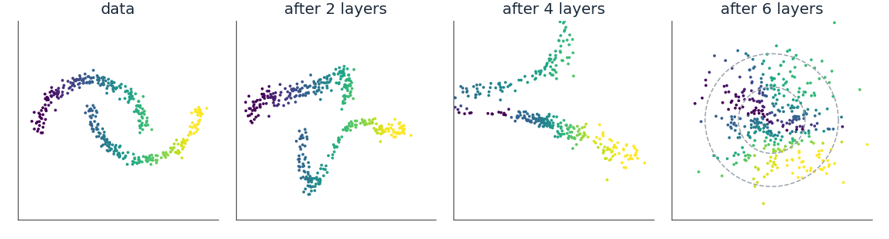
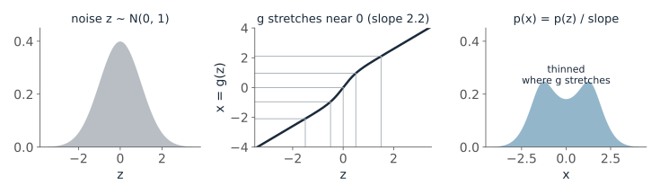
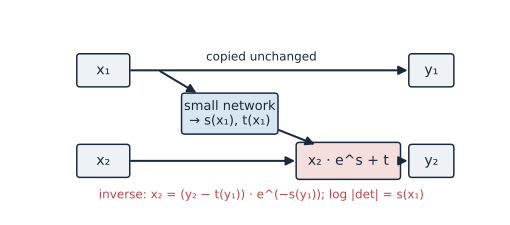
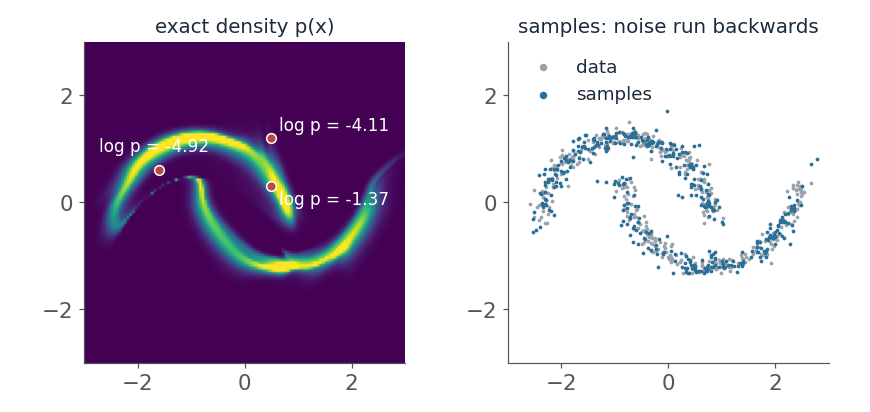

## About this lecture

*Can a generator also tell us how probable an image is, exactly?*

- An **invertible** network maps data to a simple Gaussian and back: forwards to evaluate, backwards to sample.
- The **change of variables**: the density of the data follows from the Gaussian's and from how much the map stretches.
- **Coupling layers** make the inverse and the stretch factor cheap.
- Uses: density estimation, anomaly detection, sampling; and the limits.

*Slides titled **The math** give the formulas and proofs; the ideas are complete without them.*

::: notes
Last unit of the day. Recalls the VAE ([vae/](../vae/lec.qmd): the ELBO is only a bound) and the GAN ([gan/](../gan/lec.qmd): no likelihood at all). Demo: flow2d, six affine coupling layers trained on two moons; the weights at 0, 300, 1 000 and 5 000 training steps were computed with the demo's own code (tools/figs/flows/train.ts), so the demo steps through them instead of training live. Presets: untrained, layer by layer, all six layers, sampling, a point off the moons, after 300 steps.
:::

## Generators and probabilities

- The **VAE** generates and gives a **lower bound** on $\log p(\text{image})$ (the ELBO).
- The **GAN** generates sharp images and gives **no** probability at all.
- Often we need the number itself: *how typical is this cell?* (anomaly detection), *which of two models fits the data better?*, a prior for an inverse problem.
- A **normalising flow** (Dinh et al., 2015; 2017) gives the **exact** $\log p(x)$ and samples, from one network that can be run in both directions.

## The idea: bend the data into a Gaussian

{fig-alt="Four scatter plots of the same 400 points of two moons, coloured by their original x position (purple on the left to yellow on the right). Data: two interleaving half circles. After 2 layers: the moons are sheared and bent. After 4 layers: they are stretched into a long band. After 6 layers: a round cloud inside the dashed circles of radius 1 and 2, like a standard Gaussian, with the colours still in order." width="95%" fig-align="center"}

- An invertible map $f$ takes each data point $x$ to $z = f(x)$; trained so that the $z$'s look like $\mathcal N(0, I)$.
- **Sampling**: draw $z \sim \mathcal N(0, I)$ and run the map backwards, $x = f^{-1}(z)$.
- **Density**: how probable is $x$? Look up $z = f(x)$ in the Gaussian, and correct for the stretching.

## Change of variables in 1D

:::: {.columns}
::: {.column width="40%"}
Push noise $z \sim \mathcal N(0, 1)$ through an increasing map $x = g(z)$.

- Where $g$ **stretches** (slope 2.2 at $z = 0$), the same probability is spread over a longer stretch of $x$: the density **drops** by that factor.
- $p(x) = \dfrac{p(z)}{\text{slope of } g}$ at $z = g^{-1}(x)$.
- Example: $x = 2z + 1$: $p(x) = \tfrac12\,\mathcal N\big(\tfrac{x - 1}2\big)$, the density of $\mathcal N(1, 2^2)$.
:::
::: {.column width="60%"}
{fig-alt="Left: the standard normal density of z. Middle: the increasing map x = g(z) = z + 0.6 tanh(2z), steep near z = 0 (slope 2.2) and with slope 1 far out; grid lines show equal steps in z mapped to unequal steps in x. Right: the resulting density of x, with two humps and a dip at 0, where g stretches." width="100%"}
:::
::::

## The math: change of variables {.math}

For an invertible, differentiable $f: \mathbb R^n \to \mathbb R^n$ with $z = f(x)$ and $z \sim p_Z$:

$$p_X(x) = p_Z(f(x))\,\Big|\det\frac{\partial f}{\partial x}\Big|, \qquad \log p_X(x) = \log p_Z(f(x)) + \log\Big|\det\frac{\partial f}{\partial x}\Big|.$$

- 1D: probability in a small interval is conserved, $p_X(x)\,|dx| = p_Z(z)\,|dz|$, so $p_X = p_Z\,|dz/dx|$.
- $n$D: a small box around $x$ maps to a parallelepiped around $z$ whose volume is scaled by $|\det J|$ (the [determinant as an area factor](../images/lec.qmd); the [Jacobian determinant](../nonrigid-reg/lec.qmd) of a deformation).
- For a stack $f = f_K \circ \dots \circ f_1$: $\log|\det J| = \sum_k \log|\det J_k|$ (chain rule, determinant of a product).
- Two costs: the inverse $f^{-1}$ (for sampling) and $\det J$ ($O(n^3)$ for a general $n \times n$ matrix; an image has $n = 10^6$).

## Coupling layers: invertible by design

:::: {.columns}
::: {.column width="48%"}
Split the numbers into two halves ($x_1$, $x_2$; for images: channels or a checkerboard).

- Keep $x_1$ unchanged.
- Shift and stretch $x_2$ by amounts computed **from $x_1$** by any network: $y_2 = x_2 \cdot e^{s(x_1)} + t(x_1)$.
- **Inverse**: $x_1 = y_1$ is known, so $s$ and $t$ can be recomputed: $x_2 = (y_2 - t)\,e^{-s}$. The network $s, t$ itself never has to be inverted.
- **Stretch factor**: $e^{s}$ per changed number; log-determinant $= \sum s$.
- Alternate which half changes from layer to layer.
:::
::: {.column width="52%"}
{fig-alt="Diagram of an affine coupling layer: x1 is copied unchanged to y1 and also fed into a small network that outputs s(x1) and t(x1); x2 is transformed to y2 = x2 times e to the s plus t. Below in red: the inverse x2 = (y2 - t(y1)) times e to the minus s(y1); log |det| = s(x1)." width="100%"}
:::
::::

## The math: the affine coupling layer {.math}

$y_1 = x_1$, $y_2 = x_2 \odot e^{s(x_1)} + t(x_1)$ (Dinh et al., 2017, "Real NVP"):

$$J = \frac{\partial y}{\partial x} = \begin{pmatrix} I & 0\\ \dfrac{\partial y_2}{\partial x_1} & \operatorname{diag}\big(e^{s(x_1)}\big)\end{pmatrix}, \qquad \log|\det J| = \sum_i s_i(x_1).$$

- The Jacobian is **triangular**: its determinant is the product of the diagonal. The complicated block $\partial y_2/\partial x_1$ never matters.
- Inverse: $x_1 = y_1$, $x_2 = (y_2 - t(y_1)) \odot e^{-s(y_1)}$: one forward pass of $s, t$.
- By hand: $s = \ln 2$, $t = 1$, $x = (0.5, 1)$: $y = (0.5, 3)$, $\log|\det J| = \ln 2$, so $p_X(0.5, 1) = 2\,\mathcal N((0.5, 3); 0, I) = 0.0031$.

## Training: maximum likelihood

The map is trained by making the training data **probable**: minimise the mean of

$$-\log p(x) = \tfrac12\|f(x)\|^2 + \log 2\pi - \sum_{\text{layers}} s.$$

- The first term pulls every point towards the centre of the Gaussian; the second ($-\sum s$) stops the map from simply shrinking everything to 0: shrinking costs log-determinant.
- One loss, going down, as for an ordinary network; no game.

```
for every batch of training points x:
    z = x;  logdet = 0
    for every layer k:                    # data → noise
        (s, t) = net_k(the kept half of z)
        changed half of z = changed half · exp(s) + t;   logdet += sum of s
    loss = mean(½ |z|² + log 2π − logdet)
    gradient step on all the nets' weights (backpropagation)
```

::: notes
The demo's flow: 6 layers, each net 1 → 24 → 24 → 2 with tanh, s limited to ±2, Adam with rate 0.003, batches of 128 points of two moons. Held-out −log p: 3.09 untrained, 1.82 after 300 steps, 1.73 after 1 000, 1.58 after 5 000. The coding exercise (gans/src/flows/) implements the coupling layer, its inverse, the density and sampling for a fixed (not trained) three-layer flow, and checks the density against a histogram of samples.
:::

## Try it: a flow layer by layer

```{=html}
<link rel="stylesheet" href="../demos/dist/demo.css">
<div data-demo="flow2d" data-preset="layers"></div>
<script src="../demos/dist/flow2d.js"></script>
```

::: notes
"untrained": the layers start close to the identity; the density is a Gaussian blob, held-out −log p 3.09. "layer by layer": slide k from 0 to 6; each layer moves only x (even layers) or only y (odd ones). "all six layers": the points fill the circles of a standard Gaussian; the density is concentrated on the moons. "sampling": Gaussian noise run backwards lands on the moons; 6 of 400 samples (figure on the next slide) lie more than 0.3 from every data point, some between the moons. "a point off the moons": (0.5, 1.2) maps to z = (0.44, 3.10), log N(z) = −6.73, Σ s = +2.62, log p = −4.11; a point on the moon, (0.5, 0.3): log p = −1.37.
:::

## Density and samples

:::: {.columns}
::: {.column width="58%"}
{fig-alt="Left: the exact density p(x) of the trained flow as a heat map: two bright crescents on the two moons, with thin faint bridges; probe points with log p = -1.37 near the upper moon, -4.11 above it and -4.92 just inside the upper arc. Right: 400 data points (grey) and 400 samples of the flow (blue), which lie on the moons." width="100%"}
:::
::: {.column width="42%"}
- Left: the **exact** density, computed point by point with the change of variables. It integrates to 1 (checked numerically: 0.9999 for the flow of the coding exercise).
- Right: samples, Gaussian noise run backwards.
- A point on a moon: $\log p = -1.37$. Off the moons: $-4.11$, $-4.92$. Far away, $(2.5, 2.5)$: $-220$.
:::
::::

## Uses

- **Density estimation**: the probability of a measurement vector (cell features, a spectrum, a trajectory), with no histogram binning.
- **Anomaly detection**: flag cells with low $\log p$ under a flow trained on normal cells.
- **Sampling**: realistic synthetic data in one backward pass.
- **Comparing models** by held-out likelihood; and as a **prior** in inverse problems (the [regularised estimate](../regularise/lec.qmd) with $-\log p$ as the penalty).
- As **parts** of other models: a flexible posterior inside a VAE, a learned prior over latent codes.

## Limits

- **Topology**: a flow is a smooth invertible map of a Gaussian, so it cannot tear one blob into two separate moons. It leaves **thin bridges** of low density between them (6 of the 400 samples of the figure lie more than 0.3 away from the data).
- **Same size in and out**: no compression; for images every layer works on all $10^6$ numbers.
- **Likelihood is not typicality**: flows trained on one image collection can give **higher** likelihood to images of another, simpler kind (Nalisnick et al., 2019). Smooth, low-detail images are "easy" to code. Test an anomaly score on known anomalies before trusting it.
- Image quality: behind GANs and diffusion models.

## Four ways to generate

| | VAE | GAN | Flow | Diffusion |
|---|---|---|---|---|
| Trained by | rebuilding + prior (ELBO) | a game against a discriminator | exact likelihood | removing noise |
| $\log p(x)$ | lower bound | none | **exact** | bound / estimate |
| Sampling | one decoder pass | one generator pass | one backward pass | many denoising steps |
| Samples | blurry | sharp, may lack variety | fair | sharp and varied |
| Main risk | blur | collapse, unstable training | topology, likelihood ≠ typicality | slow; hallucinated detail |

[Diffusion models](../diffusion/lec.qmd) are introduced on the modern deep learning day and treated [in depth](../score-matching/lec.qmd) later.

## Summary

| Idea | In one line |
|---|---|
| Normalising flow | an invertible network from data to $\mathcal N(0, I)$ |
| Change of variables | $\log p(x) = \log\mathcal N(f(x)) + \log|\det J|$ |
| Coupling layer | keep one half, shift and stretch the other by amounts computed from the first |
| Cheap | inverse = one pass of the small nets; $\log|\det J| = \sum s$ |
| Training | maximise the exact likelihood of the training data; one loss, no game |
| Limits | cannot change topology; full size everywhere; high likelihood ≠ typical |
