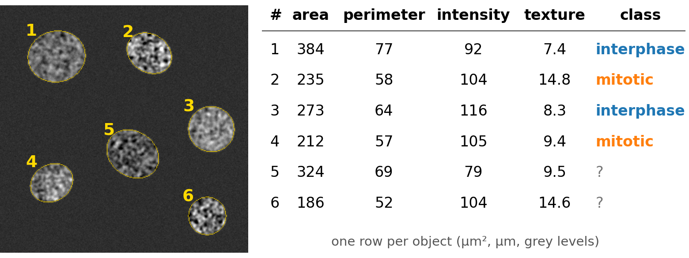
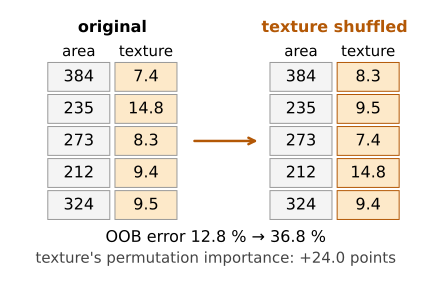
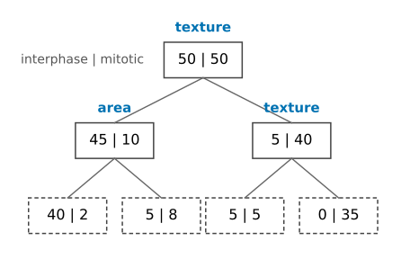
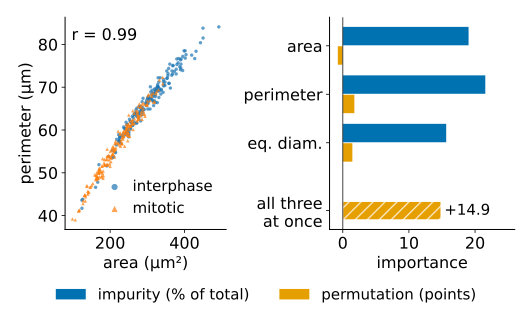
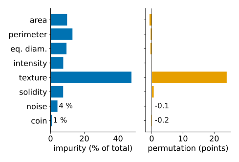

## About this lecture

Segment the cells, measure each one, classify the rows of the table: mitotic or not, cell or debris. A forest is the usual first choice for such tables. Then the question every biologist asks: **which measurements matter?**

- Why forests suit **tables of object measurements**.
- **Impurity importance**: how much each feature's splits purified the nodes.
- **Permutation importance**: how much worse the forest gets when a feature is shuffled.
- The trap: **correlated features** (area, perimeter, diameter).
- Importance describes **the model**, not the biology.

*Slides titled **The math** give the formulas and proofs; the ideas are complete without them.*

## From objects to a table

1. **Segment** the image (thresholding, watershed, …) and **label** the objects.
2. **Measure** each object: area, perimeter, mean intensity, texture, shape (the [measurements day](../intensity-features/lec.qmd)).
3. One **row per object**, one column per feature; a few rows get a class from an expert.
4. Train a forest on the labelled rows; it classifies all the others.

The table, not the image, is now the data. Everything from the last two units applies: trees, bagging, OOB error.

{fig-alt="Six segmented synthetic cells, outlined and numbered, next to their rows in a feature table: area, perimeter, mean intensity, texture and class. Four rows carry an expert class (interphase or mitotic), two a question mark: the forest will fill those in." width="68%"}

::: notes
[Measurements (day 16)](../intensity-features/lec.qmd) owns the feature catalogue; here we only use the table. Example in the demo: 400 cells, two phenotypes (interphase / mitotic), eight features.
:::

## Why forests for tables?

- **Mixed units, no scaling**: area in µm², intensity in counts, solidity between 0 and 1; a tree only compares each feature with its own thresholds.
- **Irrelevant features** are mostly ignored: a split on noise rarely wins.
- **Little tuning**: number of trees and $m$ are forgiving.
- **OOB error** for free, **fast** prediction.
- Some **interpretability**: which features did the forest use?

## Which features matter? Two answers


:::: {.columns}
::: {.column width="58%"}
**Impurity importance** (mean decrease in impurity):

- Every split purifies its node by some amount (the impurity decrease of the [decision-trees unit](../dtree/lec.qmd)), weighted by the share of the points that reach the node.
- Add these up per feature, over all splits and all trees.
- Free (comes out of training), but measured on the **training** data.

**Permutation importance**:

- **Shuffle** one column among the out-of-bag (or held-out) objects, so that it no longer belongs to its object.
- Predict again: how much does the **error rise**?
- Honest about prediction, but costs extra predictions.
:::
::: {.column width="42%"}
{fig-alt="Permutation importance as a picture: a table with columns area and texture, and the same table with the texture column shuffled among the objects. The OOB error of the forest rises from 12.8 % to 36.8 %: texture's permutation importance is 24.0 points." width="100%"}
:::
::::

## The math: the two importances {.math}

Impurity importance of feature $j$, for a forest of $B$ trees and $n$ training points:
$$\mathrm{MDI}_j = \frac1B\sum_{b=1}^B\;\sum_{\substack{\text{nodes } t \text{ of tree } b\\ \text{split on } j}} \frac{n_t}{n}\,\Delta I_t ,$$
often reported as shares of $\sum_j \mathrm{MDI}_j$. In each tree the sum over all features telescopes to the root impurity minus the weighted leaf impurities.

Permutation importance, with $\pi$ a random permutation of the (OOB) objects:
$$\mathrm{PI}_j = \operatorname{err}\big(\text{data with column } j \text{ replaced by } x_{\pi(i),j}\big) - \operatorname{err}(\text{data}),$$
averaged over several permutations. It can be slightly negative by chance.

## A small tree by hand

:::: {.columns}
::: {.column width="55%"}
100 cells (50 / 50). Root: texture, children (45, 10) and (5, 40). Left child: area, giving (40, 2) and (5, 8). Right child: texture again, giving (5, 5) and (0, 35).

Each box: interphase | mitotic cells; dashed boxes are leaves.
:::
::: {.column width="45%"}
{fig-alt="The tree: root 50 | 50 split on texture into 45 | 10 and 5 | 40; the left child split on area into 40 | 2 and 5 | 8; the right child split on texture again into 5 | 5 and 0 | 35." width="100%"}
:::
::::

| node | $n_t$ | Gini parent → children | $\Delta G$ | $\tfrac{n_t}{n}\Delta G$ |
|---|---|---|---|---|
| root (texture) | 100 | 0.500 → 0.298, 0.198 | 0.247 | 0.247 |
| left (area) | 55 | 0.298 → 0.091, 0.473 | 0.116 | 0.064 |
| right (texture) | 45 | 0.198 → 0.500, 0 | 0.086 | 0.039 |

Texture: $0.247 + 0.039 = 0.286$ (82 %); area: $0.064$ (18 %).

## Try it: importance on a cell table

```{=html}
<link rel="stylesheet" href="../demos/dist/demo.css">
<div data-demo="featimp" data-preset="texture"></div>
<script src="../demos/dist/featimp.js"></script>
```

::: notes
400 synthetic cells, 100 trees, m = 3. Bars: impurity importance (share of the total Gini decrease, blue) and permutation importance (rise of the OOB error in percentage points, orange). Tour: "texture decides": texture 48 % / +24.0 points; everything else small; the size features get 9–13 % each by impurity but slightly negative permutation importance. "duplicate area": area alone 42 %, with an exact copy 28 % + 23 %. "size block": without texture, the three size features share the credit by impurity (19, 22, 16 %) but each has permutation importance near zero (−0.7 to +1.8); "permute the block together" gives +14.9. "noise": the continuous noise feature gets 4 % by impurity, the yes/no "coin" 1 %; both ≈ 0 by permutation.
:::

## Correlated features: who gets the credit?


:::: {.columns}
::: {.column width="50%"}
Area, perimeter and equivalent diameter all measure **size** (correlations 0.99 in the demo's cells).

- **Impurity importance splits the credit**: whichever of them a split happens to use gets the decrease. An exact duplicate of a feature roughly **halves** its importance.
- **Permutation importance can hide all of them**: shuffle area, and perimeter still carries the size information, so the error hardly rises. Each looks unimportant; together they matter.
- Shuffling one of them also creates **impossible objects** (a huge area with a tiny perimeter), on which the forest was never trained.
:::
::: {.column width="50%"}
{fig-alt="Left: perimeter against area for 400 cells, almost on a line (r = 0.99). Right: importances in the demo without texture: area, perimeter and equivalent diameter each get 16 to 22 % of the impurity importance but permutation importance near zero (−0.7 to +1.8 points); shuffling all three together raises the error by 14.9 points." width="100%"}

Demo preset "size block" (texture left out).
:::
::::

## Remedies and the right question

- **Group** correlated features (look at their correlations first, e.g. the correlation blocks of the [measurements day](../texture-features/lec.qmd)) and permute each **group** together.
- Remove duplicates you do not need, and compare the OOB error with and without a group.
- Importance answers "**what does this forest use** to predict?" It does **not** say which measurement is biologically causal, nor that a feature with low importance carries no information (another feature may carry the same).
- Use it to choose which measurements to keep, not as proof.

## Biases of impurity importance


:::: {.columns}
::: {.column width="52%"}
- Computed on the **training** data: deep trees split on anything, even noise, to purify small nodes.
- Features with **many distinct values** (continuous noise) offer many thresholds and win more of these small splits than yes/no features. In the demo, a continuous noise feature gets 4–14 % of the impurity importance, a random yes/no feature 1–3 %.
- Permutation importance on OOB data does not have this bias: both noise features stay near 0.
:::
::: {.column width="48%"}
{fig-alt="Impurity and permutation importance of all eight features of the demo's cells. Texture dominates both (48 % and +24.0 points). The continuous noise feature gets 4 % of the impurity importance, the yes/no coin 1 %; their permutation importances are −0.1 and −0.2." width="100%"}
:::
::::

## The math: an exact copy halves the credit {.math}

Let feature $j'$ be an exact copy of $j$. Wherever a split on $j$ is best, the same split on $j'$ is equally good; with random candidate subsets (or random tie-breaking) each is chosen about equally often. The total decrease credited to the pair stays what $j$ alone would have got, so in expectation
$$\mathrm{MDI}_j \approx \mathrm{MDI}_{j'} \approx \tfrac12\,\mathrm{MDI}_j^{\text{(without copy)}} .$$
Permutation importance of $j$ with the copy present: the trees that split on $j'$ are unaffected by shuffling $j$, and many trees use both; the error rises much less than without the copy. In the limit where every split can use either, $\mathrm{PI}_j \to 0$.

## Summary

- Object classification: segment → measure → table → forest. Mixed units, no scaling, OOB error for free.
- **Impurity importance**: sum of the weighted impurity decreases per feature; free, but on training data and biased towards features with many values.
- **Permutation importance**: rise of the OOB (or held-out) error after shuffling a column; honest, slower.
- **Correlated features** share or hide their importance: group them and permute the group.
- Importance describes the model, not the biology.
