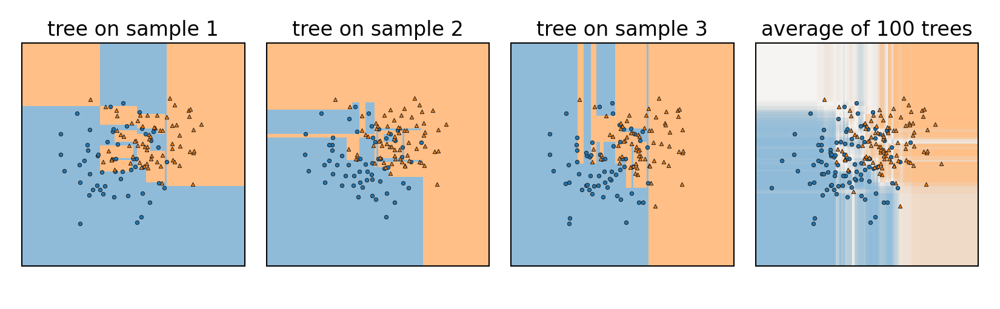
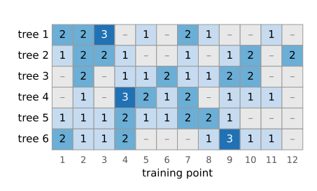
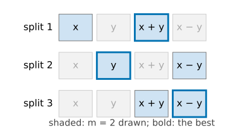
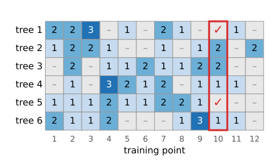
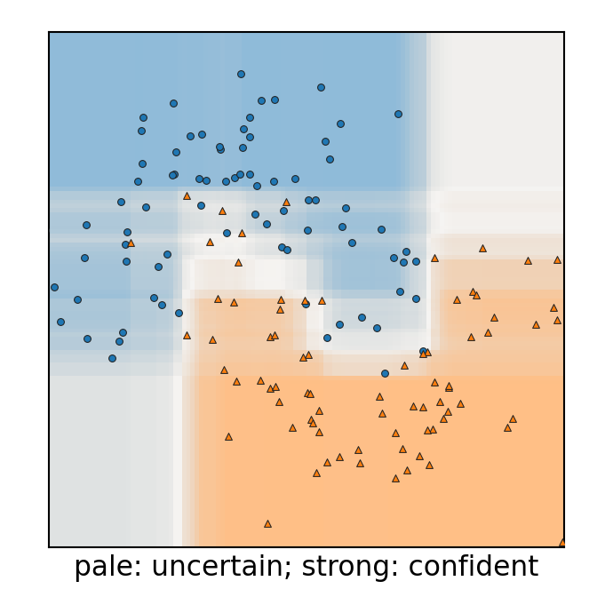
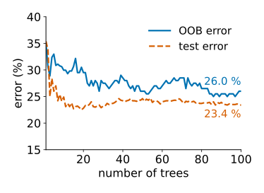

## About this lecture

[Last unit](../dtree/lec.qmd): one deep tree fits its training data perfectly but is **unstable**: change a few points and the whole tree changes. Today we turn that into a strength (Breiman, 1996 and 2001).

- Grow **many** trees, each on a **bootstrap** sample, and let them **vote**: bagging.
- Averaging helps only as far as the trees make **different** mistakes.
- **Random forest**: each split looks at a random subset of the features, so the trees differ more.
- **Out-of-bag error**: a validation estimate for free.
- **Vote fractions** as probabilities, and where they mislead.

*Slides titled **The math** give the formulas and proofs; the ideas are complete without them.*

## One tree: low bias, high variance

- A tree grown fully follows every training point: on average it is in the right place (**low bias**), but it moves a lot with the particular sample of data (**high variance**).
- Measurements have the same problem, and the same cure: **average** several of them.
- But we have only one training set. How do we get many trees?

{fig-alt="Three fully grown trees, each on its own bootstrap sample of the same 200 overlapping points (only its sample is drawn), give three very different patchworks of blue and orange rectangles. The average of 100 such trees is smoother, pale where the classes overlap." width="96%"}

Three deep trees on three bootstrap samples (next slide) of the same data, and the average of 100 of them.

::: notes
Recall from the [decision-trees unit](../dtree/lec.qmd): on the noisy-overlap data one full tree has 0 % training error and 28.8 % test error. A shallower tree (depth 4) has 21.0 %: less variance, more bias. Averaging tries to get the low bias of deep trees with less of their variance.
:::

## The bootstrap


:::: {.columns}
::: {.column width="48%"}
- Draw $n$ points from the $n$ training points **with replacement**.
- Some points are drawn twice or three times, about a **third** are not drawn at all.
- Each draw is a new, slightly different training set from the same data.
- **Bagging** (bootstrap aggregating): grow one tree per bootstrap sample, let all trees vote.
:::
::: {.column width="52%"}
{fig-alt="A table of six bootstrap samples (rows) of twelve training points (columns). Each cell shows how often the point was drawn: mostly 1, some 2 or 3; about a third of the cells are empty (not drawn)." width="100%"}

Six bootstrap samples of 12 points: how often each point was drawn; – = left out (24 of 72 cells).
:::
::::

## The math: one in three is left out {.math}

The chance that one particular point is **not** chosen in one draw is $1 - \tfrac1n$; the $n$ draws are independent:
$$P(\text{point not in the sample}) = \left(1 - \frac1n\right)^n \xrightarrow{n \to \infty} e^{-1} \approx 0.368 .$$
$n = 5$: $0.328$; $n = 20$: $0.358$; $n = 1000$: $0.368$. The expected number of **distinct** points in a bootstrap sample is $n\,(1 - (1 - 1/n)^n) \approx 0.632\, n$.

## Try it: bootstrap samples

```{=html}
<link rel="stylesheet" href="../demos/dist/demo.css">
<div data-demo="bootstrap" data-panel="bootstrap"></div>
<script src="../demos/dist/bootstrap.js"></script>
```

::: notes
With n = 20 the first sample (seed fixed) leaves out 6 points and draws 4 points more than once (two of them three times). "draw 1000": the out-of-bag fraction has mean 35.6 %, close to (1 − 1/20)^20 = 0.358; for large n it approaches 1/e = 0.368. With n = 5 the fraction jumps around a lot (standard deviation 13.9 percentage points over 1000 samples).
:::

## Averaging helps only if the trees differ

- Average $B$ predictions, each with the same spread.
- If they are **independent**, the spread of the average shrinks without limit as $B$ grows.
- If they are **correlated** (they make similar mistakes), it shrinks only down to a **floor** set by the correlation.
- Bagged trees on the same data are alike: the strongest feature is chosen at the root of almost every tree.

## The math: the variance of an average {.math}

$B$ predictors $f_1, \dots, f_B$, each with variance $\sigma^2$, every pair with correlation $\rho$:
$$\operatorname{Var}\Big(\frac1B\sum_b f_b\Big) = \frac{1}{B^2}\Big(\sum_b \operatorname{Var} f_b + \sum_{b \ne c}\operatorname{Cov}(f_b, f_c)\Big) = \frac{B\sigma^2 + B(B-1)\rho\sigma^2}{B^2} = \rho\sigma^2 + \frac{1-\rho}{B}\,\sigma^2 .$$

- $B \to \infty$ leaves $\rho\sigma^2$: more trees cannot beat the correlation.
- $\sigma^2 = 1$, $\rho = 0.3$: 1, 0.370, 0.307 for $B = 1, 10, 100$; floor 0.3.
- To lower the floor, lower $\rho$, even at some cost in each tree's own accuracy.
- Squared error = bias² + variance + noise. Averaging leaves the bias unchanged and lowers only the variance.

## Try it: averaging correlated predictors

```{=html}
<link rel="stylesheet" href="../demos/dist/demo.css">
<div data-demo="bootstrap" data-panel="variance"></div>
<script src="../demos/dist/bootstrap.js"></script>
```

::: notes
Dots: simulated variance of the average of B predictors (2000 runs, fixed seed); line: the formula; dashed: the floor ρσ². With σ² = 1, ρ = 0.3: 0.370 at B = 10, 0.307 at B = 100 (simulated 0.375 and 0.312). With ρ = 0 the line keeps falling (0.010 at B = 100); with ρ = 0.5 it stops at 0.5.
:::

## Random forests: decorrelate the trees


:::: {.columns}
::: {.column width="56%"}
- At **each split**, look only at a **random subset of $m$ features** (out of $d$) and choose the best split among those.
- A typical choice: $m \approx \sqrt d$ for classification.
- The strongest feature is not always available, so other features get their turn: the trees become less alike, and their average better.
- Everything else as in bagging: bootstrap samples, deep trees, vote.

$m = d$ is plain bagging; $m = 1$ makes every split's feature a coin toss.
:::
::: {.column width="44%"}
{fig-alt="Three splits of one tree with d = 4 features x, y, x + y, x − y. At each split a different random pair of features is shaded as candidates, and the best of the pair is outlined." width="100%"}
:::
::::

## Try it: a forest in the plane

```{=html}
<link rel="stylesheet" href="../demos/dist/demo.css">
<div data-demo="forestplay" data-preset="single"></div>
<script src="../demos/dist/forestplay.js"></script>
```

::: notes
Tour: "one deep tree overfits": 0 % training, 28.8 % test error, hard edges everywhere. "100 bagged trees": the map softens (colour strength = confidence), test 23.4 %, OOB 26.0 %; the error-vs-trees curve flattens after a few dozen trees. The six small maps are individual trees: each on its own bootstrap sample. "m = d: trees look alike" (two moons with the extra features x + y, x − y, d = 4): tree correlation 0.68, test 8.7 %. "m = 1": correlation 0.62, test 9.2 % — lower correlation, but each tree is weaker; here the trade does not pay. "noise features": 4 pure-noise features added; the forest's test error is 1.9 % (3.2 % without them) and a single tree 3.0 %. "confident far from the data": the corners are coloured with probability 1.00. "uncertainty on the boundary": pale colours along the boundary between the moons.
:::

## Out-of-bag (OOB) error


:::: {.columns}
::: {.column width="50%"}
- Each training point was left out by about a third of the trees.
- Let **only those trees** vote on it: that is a prediction for a point they never saw.
- The error rate of these votes is the **out-of-bag error**: a validation estimate **for free**, without setting data aside.
- It assumes the training points are independent. Pixels in a painted stroke are not: the [pixel-classification unit](../pixelclass/lec.qmd) shows how OOB then fools you.
:::
::: {.column width="50%"}
{fig-alt="The bootstrap table of six trees and twelve points again. The column of point 10 is outlined: two of the six trees did not draw it, and only those two vote on it." width="100%"}

Point 10 was left out by two of the six trees (✓): only they vote on it.
:::
::::

::: notes
In the demo the OOB error (solid curve) and the test error on 1000 fresh points (dashed) track each other: 26.0 % and 23.4 % for the bagged overlap data, 10.6 % and 8.7 % for the moons.
:::

## Probabilities from votes


:::: {.columns}
::: {.column width="58%"}
- 70 of 100 trees say "nucleus": $P(\text{nucleus}) \approx 0.7$. (Each tree votes with its leaf's class shares; fully grown leaves are pure, so this is a vote count.)
- The **probability map**: confident inside the classes, uncertain near the boundary. Useful for deciding where to look or where to label more.
- **Caveat**: far from all training data, every tree extends its outermost rectangles, so the forest can be **confident** where it has never seen anything. A vote fraction is not a calibrated certainty.
:::
::: {.column width="42%"}
{fig-alt="Probability map of a forest on the two-moons data: strong blue and orange inside the classes, pale along the boundary between the moons." width="100%"}
:::
::::

## The settings


:::: {.columns}
::: {.column width="56%"}
- **Number of trees $B$**: more never hurts accuracy, only time. The OOB error curve flattens; stop there.
- **Depth / leaf size**: forests usually grow deep trees; averaging takes care of the variance.
- **$m$**: the one that matters most, but often fine at the default.
- No feature scaling, little tuning: a reason forests are a common first choice for tables of measurements and for pixel classification.
:::
::: {.column width="44%"}
{fig-alt="OOB error and test error against the number of trees for 100 bagged trees on the overlapping data: both fall quickly over the first few dozen trees and flatten, ending at 26.0 % (OOB) and 23.4 % (test)." width="100%"}
:::
::::

## Bagging vs boosting

| | bagging / random forest | boosting |
|---|---|---|
| trees | deep, grown independently | shallow (often stumps), grown **in sequence** |
| each new tree | sees a bootstrap sample | focuses on the points the previous trees got **wrong** |
| combination | plain average / vote | weighted sum |
| reduces | **variance** | **bias** |

Boosting is the subject of the [integral-images day](../viola-jones/lec.qmd) (AdaBoost and the face-detector cascade).

## The math: a forest as adaptive neighbours {.math}

The forest's class probability at $\mathbf x$ is the average of the trees' leaf shares,
$$\hat p_k(\mathbf x) = \frac1B\sum_{b=1}^B \hat p_{k,b}(\mathbf x) .$$
Each leaf share is an average over the training points in the leaf of $\mathbf x$. So $\hat p_k(\mathbf x)$ is a **weighted vote of training points**, with weight high for points that often share a leaf with $\mathbf x$: a nearest-neighbour rule whose notion of "near" is learned from the labels (it ignores features that never help to split).

## Summary

- **Bootstrap**: $n$ draws with replacement; about $1/e \approx 37\,\%$ of the points are left out of each sample.
- **Bagging**: many deep trees on bootstrap samples, averaged: less variance, same bias.
- Averaging $B$ correlated predictors: variance $\rho\sigma^2 + (1-\rho)\sigma^2/B$; the **correlation** sets the floor.
- **Random forest**: a random subset of $m$ features at each split lowers the correlation.
- **OOB error** for free; **vote fractions** as probabilities, but confident far from the data.
- Boosting is the sequential, bias-reducing relative.
