## About this lecture

[FFT registration](../xcorr-fft/lec.qmd) finds a **shift** with one correlation. Today the question is *how do we match two shapes when the rotation is unknown too?* First answer: walk around the outline and treat it as a **periodic signal**.

- An outline as a complex signal $z_n = x_n + i\,y_n$; its **Fourier descriptors** $c_k$ (the [shape-features slide](../shape-features/lec.qmd), now in depth).
- What moving, scaling, turning, a new **starting point** and a **mirror image** do to the $c_k$.
- Each pair $c_{\pm k}$ is an **ellipse**: epicycles draw the outline.
- **Matching** two outlines with unknown rotation and starting point: one FFT gives every start at once.
- Elliptic Fourier descriptors, and the pitfalls.

Recall: $e^{i\alpha} = \cos\alpha + i\sin\alpha$; multiplying a point $z$ by $e^{i\alpha}$ **turns** it by $\alpha$ about 0 (clockwise on screen, where $y$ points down), multiplying by $s > 0$ **scales** it.

*Slides titled **The math** give the formulas and proofs; the ideas are complete without them.*

::: notes
Recalled, not re-taught: the boundary walk and the chain code (regionprops/), the Fourier series and the DFT (fourier/), the correlation theorem (xcorr-fft/), rotation invariance by magnitudes (zernike/, moment-invariants/). Positive angles turn clockwise on screen throughout (the course convention).
:::

## An outline is a periodic signal

:::: {.columns}
::: {.column width="38%"}
- Walk once around the outline and write down $N$ points $z_0, z_1, \dots, z_{N-1}$.
- Each point is one complex number $z_n = x_n + i\,y_n$.
- After $z_{N-1}$ comes $z_0$ again: the signal is **periodic** with period $N$, exactly what the DFT assumes ([the Fourier unit](../fourier/lec.qmd)).
- The DFT of this signal: the **Fourier descriptors** $c_k$, $k = -\frac N2 \dots \frac N2$. Negative $k$ count: $z$ is complex, so $c_k$ and $c_{-k}$ are unrelated.
:::
::: {.column width="62%"}
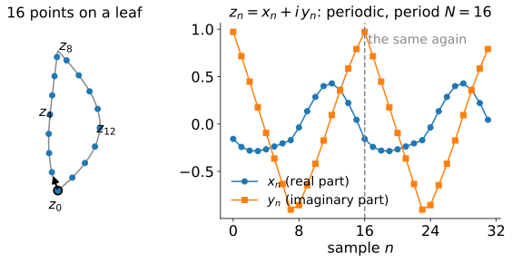{fig-alt="Left: a leaf outline with 16 points, z0 at the bottom with an arrow, z4, z8 and z12 labelled. Right: x_n and y_n plotted against n from 0 to 32: the same pattern repeats after n = 16." width="100%"}
:::
::::

## Recall: smoothing by truncation

From the [shape-features unit](../shape-features/lec.qmd):

- $c_0$ is the centroid of the points.
- Keep only $|k| \le K$ and transform back: a smooth version of the outline. Small $K$: the overall shape; large $K$: detail and pixel noise.
- $c_{\pm1}$ alone: the **best-fitting ellipse** (next slides).

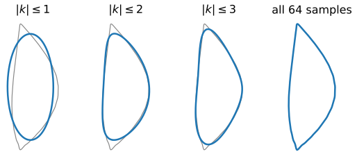{fig-alt="The leaf (grey) rebuilt from |k| at most 1 (an ellipse), 2, 3 and from all 64 samples (blue): each step adds detail; with all coefficients the blue curve lies on the outline." width="80%" fig-align="center"}

Today's additions: what each change does to the $c_k$, **matching** two outlines, and getting the samples right.

## Sampling the outline

:::: {.columns}
::: {.column width="50%"}
The boundary walk of the [region-properties unit](../regionprops/lec.qmd) gives the boundary **pixels**, one step at a time: straight steps of 1 pixel and diagonal steps of $\sqrt2$.

- Taking every $j$-th boundary pixel walks **faster along diagonals**: the speed changes with the direction of the edge. That uneven speed is in every $c_k$, and it is different for a turned copy.
- Instead: **resample to equal arc length**. Measure the length $L$ of the polygon through the pixel centres and put $N$ points every $L/N$ along it (linear interpolation between corners).
- $N$ a power of two, for the FFT. $N = 64$ or $128$ is plenty for a nucleus.
:::
::: {.column width="50%"}
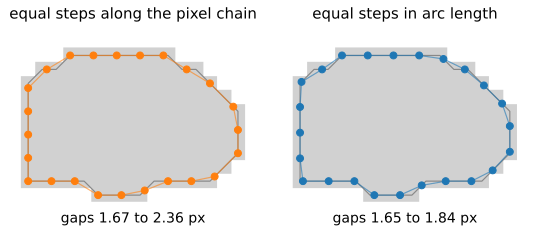{fig-alt="A small pixel mask of a nucleus (grey squares) with its boundary polygon. Left, 24 samples at equal steps along the pixel chain: gaps between neighbouring samples from 1.67 to 2.36 pixels. Right, 24 samples at equal arc length: gaps from 1.65 to 1.84 pixels." width="100%"}
:::
::::

::: notes
The mask: the demo's nucleus outline rasterised with radius 9 pixels and traced (8-connected, pixel centres). The gaps are straight-line distances between neighbouring samples; along the polygon the arc-length samples are exactly L/24 apart.
:::

## Each harmonic is an ellipse

:::: {.columns}
::: {.column width="55%"}
- One term $c_k e^{2\pi i k t}$ is a point going round a **circle** of radius $|c_k|$, $k$ times per walk ($k < 0$: the other way).
- Two terms $c_k$ and $c_{-k}$ together: an **ellipse**, traced $|k|$ times. Semi-axes $|c_k| + |c_{-k}|$ and $\big||c_k| - |c_{-k}|\big|$.
- $c_{\pm1}$: the ellipse that fits the outline best (least squares, with the same starting point and speed).
- **Epicycles**: chain the circles, arm after arm; the tip of the last arm draws the outline. Each added pair of circles adds one more ellipse of detail.
:::
::: {.column width="45%"}
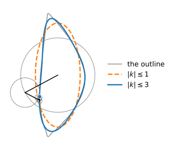{fig-alt="The same figure as before: the leaf, its |k| at most 1 ellipse and |k| at most 3 curve, and the chain of circles whose last tip draws the blue curve." width="100%"}
:::
::::

## Try it: descriptors and epicycles

```{=html}
<link rel="stylesheet" href="../demos/dist/demo.css">
<div data-demo="fdmatch" data-preset="leaf" data-presets="leaf,square,staircase" data-controls="K,angle,start,epicycles,arc-length"></div>
<script src="../demos/dist/fdmatch.js"></script>
```

::: notes
Top: outline A (blue) and B (red), each rebuilt from |k| ≤ K, with the epicycles turning; big dot = sample 0, arrow towards sample 1. Bottom: the sizes |c_k| of both (log scale), the phase of c_k(B) relative to c_k(A), and the match score over the starting point m. Tour: start with K = 1 (ellipses), go up to 10. "a square sampled at its corners is a circle": N = 4, then choose N = 8 and 16 in the list. "staircase noise without resampling": a nucleus rasterised at 14 px, B turned 30° and 1.3 times as large; tick arc-length resampling and watch the misfit drop from 7.3 % to 4.7 %.
:::

## What a change does to the coefficients (1)

The DFT is linear, so three rules come for free:

- **Move** the outline by $t$: only $c_0$ changes (by $t$). **Scale** by $s$: every $c_k$ is multiplied by $s$.
- **Turn** by $\alpha$: every $c_k$ is multiplied by $e^{i\alpha}$: every arrow $c_k$ turns by the **same** angle. The same trick as the complex moments and the Zernike moments ([moments day](../zernike/lec.qmd)).

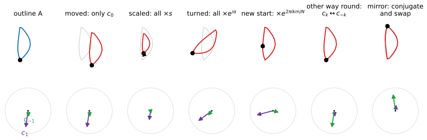{fig-alt="Seven small leaf outlines in a row (original, moved, scaled, turned by 45 degrees, started 3 samples later, walked the other way round, mirrored), each with its start point; under each, c_1 (purple) and c_-1 (green) as arrows from the origin. Moving leaves them unchanged, scaling shortens both, turning turns both by 45 degrees, the new start turns them in opposite directions, walking the other way swaps them, the mirror reflects and swaps them." width="100%"}

The last three columns: next slide.

## What a change does to the coefficients (2)

- **Start $m$ points later** ($z'_n = z_{n+m}$): $c_k$ is multiplied by $e^{2\pi i k m/N}$. A **phase ramp**: $c_1$ turns one way, $c_{-1}$ the other, $c_2$ twice as far: different for every $k$. This is the shift theorem of [the Fourier unit](../fourier/exercise.qmd).
- **Walk the other way round** ($z'_n = z_{-n}$): $c_k$ and $c_{-k}$ swap places. A boundary walk always goes one way (clockwise here), so this only matters for outlines from elsewhere.
- **Mirror image** ($y \to -y$, the conjugate $\overline{z}$): conjugate and swap, $c'_k = \overline{c_{-k}}$. Walked clockwise again, a mirror image has $c'_k = \overline{c_k}$.

So: a **rotation** turns all $c_k$ by the same angle, a **new start** turns $c_k$ by an angle **proportional to $k$**. Plotting the phase of $c_k(B)$ relative to $c_k(A)$ against $k$ tells them apart: a flat line or a ramp.

## The math: the five rules {.math}

$$c_k = \frac1N\sum_{n=0}^{N-1} z_n\, e^{-2\pi i k n/N}, \qquad z_n = \sum_k c_k\, e^{2\pi i k n/N}.$$

- **Linearity**: $z'_n = s e^{i\alpha} z_n + t$ gives $c'_k = s e^{i\alpha} c_k + t\,\delta_{k0}$, since $\frac1N\sum_n e^{-2\pi i k n/N} = \delta_{k0}$.
- **New start**: $c'_k = \frac1N\sum_n z_{n+m} e^{-2\pi i k n/N} = \frac1N\sum_j z_j e^{-2\pi i k (j - m)/N} = e^{2\pi i k m/N} c_k$ (substitute $j = n + m$, the sum runs over a whole period).
- **Other direction**: $c'_k = \frac1N\sum_n z_{-n} e^{-2\pi i k n/N} = \frac1N\sum_j z_j e^{2\pi i k j/N} = c_{-k}$.
- **Mirror**: $c'_k = \frac1N\sum_n \overline{z_n}\, e^{-2\pi i k n/N} = \overline{\tfrac1N\textstyle\sum_n z_n e^{2\pi i k n/N}} = \overline{c_{-k}}$; with the direction reversed as well, $\overline{c_k}$.
- **Continuous start**: a start shifted by a fraction $\tau$ of the length multiplies $c_k$ by $e^{2\pi i k \tau}$ (the series $z(t) = \sum_k c_k e^{2\pi i k t}$ at $t + \tau$).

## By hand: rotation or new start?

:::: {.columns}
::: {.column width="48%"}
$z = (2, i, -2, -i)$: an ellipse sampled at the ends of its axes.

- $c_1 = \tfrac14(2 + 1 + 2 + 1) = \tfrac32$
- $c_{-1} = \tfrac14(2 - 1 + 2 - 1) = \tfrac12$, the others 0. Semi-axes $2$ and $1$.
- **Turn by 90°** (times $i$): $c_1 \to \tfrac32 i$, $c_{-1} \to \tfrac12 i$.
- **Start one point later**: $c_1 \to \tfrac32 i$ too, but $c_{-1} \to -\tfrac12 i$.

$c_1$ alone cannot tell the two apart; $c_{-1}$ (or $c_2$, …) can.
:::
::: {.column width="52%"}
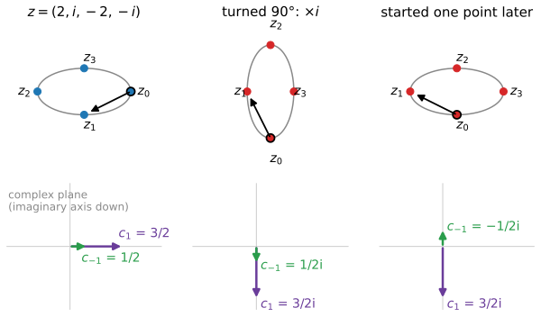{fig-alt="Top: the four points of z = (2, i, −2, −i) on an ellipse 4 wide and 2 high, the same turned by 90 degrees (now upright) and started one point later (the same ellipse, z0 at the bottom). Bottom: c_1 and c_-1 as arrows: 3/2 and 1/2 to the right; turned: both point down (3/2 i and 1/2 i); new start: c_1 down (3/2 i) and c_-1 up (−1/2 i)." width="100%"}
:::
::::

## Try it: rotation vs new starting point

```{=html}
<link rel="stylesheet" href="../demos/dist/demo.css">
<div data-demo="fdmatch" data-preset="rotstart" data-presets="rotstart,square,leaf" data-controls="K,angle,start,phase,epicycles"></div>
<script src="../demos/dist/fdmatch.js"></script>
```

::: notes
"rotation vs new starting point": A = (2, i, −2, −i) (N = 4), B = A started one point later. The readout shows c_1 and c_-1 of both: B has 1.500i and −0.500i; the phase plot shows +90° at k = 1 and −90° at k = −1. Set start m to 0 and the angle to 90°: now 1.500i and 0.500i, +90° at both. Then the leaf (N = 64, turned 40°, start 20): the phase plot is a ramp that wraps around; tick "phase: undo best start" and it becomes a flat line at 40°.
:::

## Sampling decides what you see

:::: {.columns}
::: {.column width="45%"}
A square sampled at its four corners, $z = (1, i, -1, -i)$:

- $c_1 = 1$, every other $c_k = 0$: exactly the coefficients of a **circle**. Four samples cannot tell a square from a circle (or from any curve through these points).
- Eight samples (corners and midpoints): $c_1 = 0.854$ and $c_{-3} = 0.146$ appear: the square needs $k = 1, -3, 5, -7, \dots$ (4-fold symmetry).
- Rule of thumb: the samples must be much closer than the smallest detail you want in the $c_k$; the DFT only knows the samples.
:::
::: {.column width="55%"}
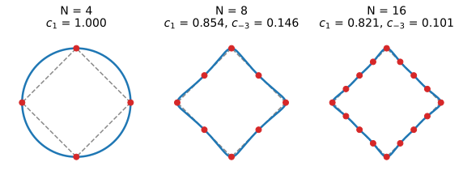{fig-alt="Three panels: a square (dashed) with 4, 8 and 16 red sample points and the blue curve of the Fourier series through them. With 4 samples at the corners the curve is the circle through the corners (c_1 = 1.000); with 8 it is close to the square (c_1 = 0.854, c_-3 = 0.146); with 16 closer still (c_1 = 0.821, c_-3 = 0.101)." width="100%"}
:::
::::

## Magnitudes: invariant, and what they lose

- Divide by $|c_1|$ and take sizes: $|c_k| / |c_1|$ does not change with position, scale, rotation or starting point. A handy **signature** for a quick comparison.
- It loses the **relative phases**, and the phases carry the arrangement of the parts. Two different shapes can have exactly the same $|c_k|$ for every $k$: here $c_3 = +0.12$ against $-0.12$ (demo: magnitude distance 0.000, the full match leaves a misfit of 23 %).
- A mirror image (walked clockwise again) has $c_k \to \overline{c_k}$: the same sizes. Magnitudes cannot tell b from d.

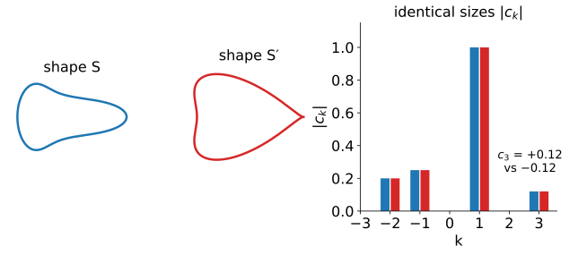{fig-alt="Two outlines: shape S, a teardrop with a bulge to the left, and shape S', a heart-like shape. Bar chart of |c_k| for k = −2, −1, 1, 3: the blue and red bars are identical; the only difference, c_3 = +0.12 against −0.12, is a phase." width="72%" fig-align="center"}

## The math: invariants {.math}

From the rules ($c'_k = s e^{i\alpha} e^{2\pi i k m/N} c_k$ for $k \ne 0$):

- $|c'_k| / |c'_1| = |c_k| / |c_1|$: invariant to translation, scale, rotation and start.
- $c'_k\,c'_{-k} = s^2 e^{2i\alpha}\, c_k c_{-k}$: the start cancels ($e^{2\pi i k m/N} e^{-2\pi i k m/N} = 1$), the rotation does not. So
$$\frac{c_k\,c_{-k}}{c_1\,c_{-1}}$$
is invariant to translation, scale, rotation **and** start, and keeps a relative phase between $c_k$ and $c_{-k}$. Products whose rotations and ramps cancel are the Fourier-descriptor version of the moment invariants ([invariants unit](../moment-invariants/lec.qmd)).
- Relating **different** $|k|$: a product $\prod_j c_{k_j}\prod_l \overline{c_{k'_l}}$ survives rotation and start when it has as many plain as conjugated factors and $\sum k_j = \sum k'_l$, e.g. $c_3\,c_{-1}\,\overline{c_1}^{\,2}/|c_1|^4$: $+0.03$ for S, $-0.03$ for S′.
- No invariant is needed for **matching**: estimate the rotation, scale and start instead (next slides). That keeps every phase.

## Matching with unknown rotation and start

Compare outline B with **every** rotation, scale and starting point of outline A.

- For one fixed start $m$, the best rotation and scale are **one complex number** $\lambda = s e^{i\alpha}$: a least-squares fit, like a line fit.
- The fit quality for **all** starts at once: slide A's samples along B's, a **circular correlation** of the two complex outlines, computed with one FFT ([cross-correlation with the FFT](../xcorr-fft/lec.qmd)).
- The **peak** says where A must start; the **phase** of the peak value says the angle, its size the scale.

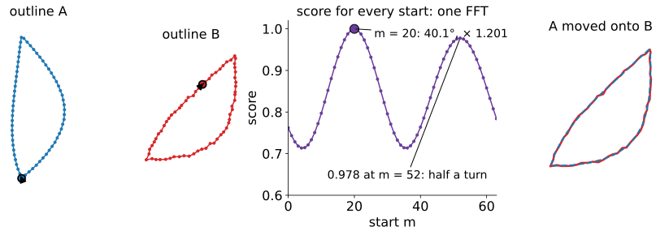{fig-alt="Outline A (a leaf, 64 samples) and outline B (the leaf turned 40 degrees, 1.2 times as large, started 20 samples later, with noise). The score over the start m peaks at m = 20 with 40.1 degrees and scale 1.201; a second peak of 0.978 near m = 52 belongs to the leaf turned by about 180 degrees. Right: A moved onto B lies on top of it." width="100%"}

## Matching as pseudocode

```
cA = DFT(A) / N,  cB = DFT(B) / N               # both outlines: N samples, arc length
for every k ≠ 0:
    P(k) = conj(cA(k)) · cB(k)                    # k = 0 (the position) does not count
q = DFT(P)                                        # q(m) for every start m, one FFT
m* = the m with the largest |q(m)|
λ  = q(m*) / Σ_k |cA(k)|²                         # scale |λ|, angle arg λ
score = |q(m*)| / sqrt(Σ|cA(k)|² · Σ|cB(k)|²)      # 1: a perfect fit
mirror allowed: repeat with conj(cA(k)), keep the better
```

- The score is a **normalised correlation**: 1 when B is exactly a turned, scaled, moved and re-started copy of A.
- $\sqrt{1 - \text{score}^2}$ is the **misfit**: the rms distance left after the best fit, as a fraction of the size of B.

::: notes
The coding exercise (shapematch/src/fourier_descriptors/ in the course code download) implements this as match_outlines, with descriptors, reconstruct, resample_arc_length and the magnitude signature.
:::

## The math: complex Procrustes over cyclic shifts {.math}

Fit B by A started $m$ later, turned, scaled and moved: minimise over $\lambda \in \mathbb C$ (and $m$)
$$E(\lambda, m) = \sum_{k \ne 0}\big|c'_k - \lambda\, e^{2\pi i k m/N} c_k\big|^2 \qquad (c = c^A,\ c' = c^B;\ k = 0 \text{ is fitted by the translation}).$$
For fixed $m$ this is linear least squares in one complex unknown:
$$\lambda^* = \frac{\sum_k \overline{c_k}\, e^{-2\pi i k m/N}\, c'_k}{\sum_k |c_k|^2} = \frac{q(m)}{\sum_k |c_k|^2}, \qquad q(m) = \sum_{k\ne0} \overline{c_k}\,c'_k\, e^{-2\pi i k m/N},$$
$$E(\lambda^*, m) = \sum_k |c'_k|^2 - \frac{|q(m)|^2}{\sum_k |c_k|^2}.$$
So the best start maximises $|q(m)|$, and $q$ for all $m$ is one DFT of $\overline{c_k}\,c'_k$: the correlation theorem again. By Parseval, $q(m) = \frac1N\sum_n \overline{(z^A_{n+m} - c_0)}\,(z^B_n - c'_0)$: the circular cross-correlation of the two centred outlines. Normalised, $\rho(m) = |q(m)|/\sqrt{\sum|c_k|^2\sum|c'_k|^2}$ and $E/\sum|c'_k|^2 = 1 - \rho^2$. **Mirror images**: repeat with the conjugated, reversed outline ($c_k \to \overline{c_k}$).

## Try it: matching outlines

```{=html}
<link rel="stylesheet" href="../demos/dist/demo.css">
<div data-demo="fdmatch" data-preset="leaf" data-presets="leaf,samemag,mirror,nuclei" data-controls="angle,start,noise,allow mirror,magnitudes,phase,nucleus"></div>
<script src="../demos/dist/fdmatch.js"></script>
```

::: notes
"leaf: turned, scaled, new start" (N = 64, 40°, × 1.2, start 20, 1 % noise): best start m = 20, angle 40.1°, scale 1.201, misfit 1.9 %; without noise exactly 40.0° and 1.200. The second peak (0.978 near m = 52) is the leaf turned by about 180°: a nearly 2-fold symmetric shape. "same magnitudes, different shape": magnitude distance 0.000, but the complex match leaves 22.6 % misfit. "mirror image": the hand mirrored and turned 25°: without the mirror the best fit has 31.7 % misfit; tick "allow mirror": perfect fit, 25.0°, start 7, flagged as mirrored. "nuclei": the readout lists the misfit of every pair; the smallest is 2.8 % (nuclei 2 and 5, the same shape at a different size and angle); the next ones are 5.7 %.
:::

## Mirror images

- A rotation can never produce a mirror image: the best fit of A itself to a mirrored hand leaves a misfit of 32 % (demo).
- Allowed mirror: also match the mirror image of A (conjugate the $c_k$); keep the better and **report** which it was. In the demo: score 1.000, angle 25.0°, start 7.
- Whether a mirror image counts as "the same shape" is a decision about the biology, not the math: a left and a right hand, a cell and its mirror image in a flipped slide.

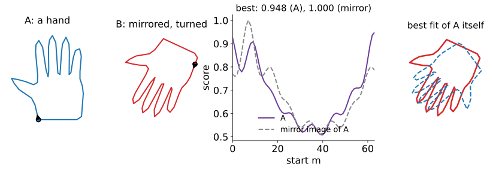{fig-alt="A: a hand outline. B: its mirror image, turned 25 degrees. Score over the start m: matching A itself peaks at 0.948; matching the mirror image of A reaches 1.000 at m = 7. Right: the best fit of A itself onto B misses the fingers." width="95%" fig-align="center"}

## Relatives: radius, Procrustes, ICP

:::: {.columns}
::: {.column width="58%"}
- **Radius $r(\theta)$** around the centre ([DP in polar coordinates](../polar-boundary/lec.qmd), later): one number per angle, simpler, but only for **star-shaped** objects. A ray from the centre of a hand crosses the outline several times; $z(t)$ works for any closed outline.
- **Procrustes** ([shape models](../shape-models/lec.qmd), later): the same complex least-squares fit, but with known landmarks. Here the correspondence is unknown up to a cyclic shift, and the FFT tries every shift.
- **ICP** ([aligning point sets](../icp/lec.qmd)): no order along an outline at all, but it needs a starting guess; descriptor matching searches every start and every angle at once.
:::
::: {.column width="42%"}
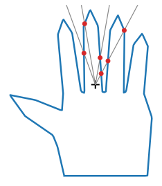{fig-alt="A hand outline with four rays from its centre (cross) towards the fingers; red dots mark where each ray crosses the outline: two, three or four times, so the radius is not one number per angle." width="90%"}
:::
::::

## Elliptic Fourier descriptors

:::: {.columns}
::: {.column width="55%"}
The standard in **morphometrics** (leaves, shells, teeth, nuclei and cell outlines; Kuhl & Giardina, 1982): $x(t)$ and $y(t)$ as two real Fourier series,

$$x = \sum_n a_n \cos n\theta + b_n \sin n\theta, \quad y = \sum_n c_n \cos n\theta + d_n \sin n\theta.$$

- Four real numbers per harmonic $n$, the same information as the complex pair $c_{\pm n}$. Same information, different bookkeeping.
- **Normalised by the first ellipse**: start at the end of its major axis, turn the major axis to $x$, divide by its length. Then $a_1 = 1$, $b_1 = c_1 = 0$, $d_1$ = minor/major axis (0.709 for this nucleus), and the rest are comparable between outlines. The end of the axis is ambiguous by 180°.
:::
::: {.column width="45%"}
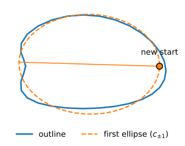{fig-alt="A nucleus outline (blue) with its first ellipse (dashed orange), the major axis as a line and an orange dot at one end of the major axis, labelled new start." width="100%"}
:::
::::

::: notes
In complex form: a_n = Re(c_n + c_−n), b_n = −Im(c_n − c_−n), c_n = Im(c_n + c_−n), d_n = Re(c_n − c_−n). The normalisation multiplies c_k by e^{ikθ0} (new start) and e^{−iψ} (turn), with θ0 = (arg c_−1 − arg c_1)/2 and ψ = (arg c_1 + arg c_−1)/2, and divides by the semi-major axis |c_1| + |c_−1|. Kuhl & Giardina compute the coefficients directly from the chain code.
:::

## Pitfalls

:::: {.columns}
::: {.column width="50%"}
- **One closed outline per object.** Holes give a second outline; touching objects give one outline around both: separate them first (watershed).
- **High $k$ is pixel noise.** The staircase of the pixel boundary adds a floor of small $|c_k|$ that a smooth outline does not have; compare with $|k| \le K$ only, or smooth first. Uneven sampling (equal steps along the pixel chain) raises it further.
- **Spiky or very concave shapes** need many coefficients; a few $c_k$ describe a blob well and a neuron badly.
- The descriptors of a **segmentation** inherit its errors: a nucleus cut in half by a bad threshold is a different shape.
:::
::: {.column width="50%"}
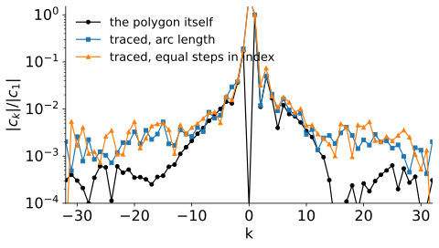{fig-alt="|c_k| / |c_1| on a log scale for k from −32 to 32: the smooth nucleus polygon (black) falls below 0.001 at high k; the same nucleus rasterised at 14 pixels and traced stays at about 0.001 to 0.005, with arc-length samples (blue) a little lower than with equal steps along the pixel chain (orange)." width="100%"}

Demo, nucleus at 14 px turned by 30°: equal steps along the chain give 32.5° and a misfit of 7.3 %; arc length 28.5° and 4.7 %.
:::
::::

## Summary

- An outline is a **periodic complex signal** $z_n = x_n + i\,y_n$; its DFT gives the **Fourier descriptors** $c_k$. Resample to equal **arc length** first.
- Move: $c_0$. Scale: all $\times s$. Turn: all $\times e^{i\alpha}$. New start: $\times e^{2\pi i k m/N}$, a **ramp**. Other direction: $c_k \leftrightarrow c_{-k}$. Mirror: conjugate (and swap).
- Each pair $c_{\pm k}$ is an **ellipse**; epicycles draw the outline; $c_{\pm1}$ is the best ellipse.
- $|c_k|/|c_1|$: a quick invariant signature, blind to mirror images and to rearranged phases.
- **Matching**: the score for every starting point is one FFT of $\overline{c^A_k}\,c^B_k$; the peak gives the start, its phase the angle, its size the scale. Allow the mirror if it should count.
- Next: the same trick on a whole image, where a rotation becomes a shift in **polar** coordinates ([Fourier–Mellin](../fourier-mellin/lec.qmd)).
