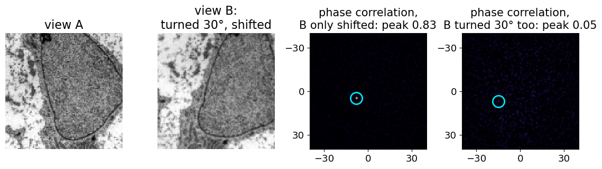
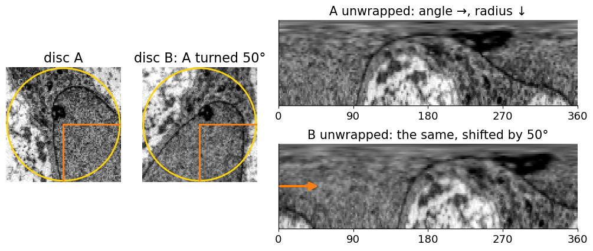
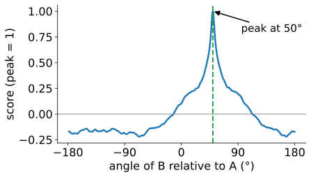
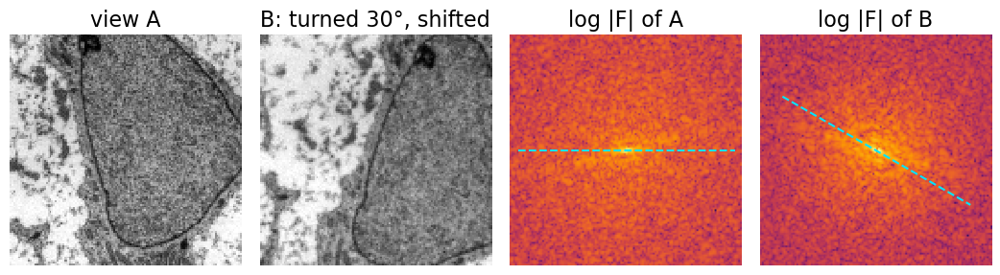
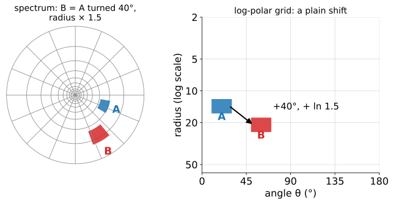
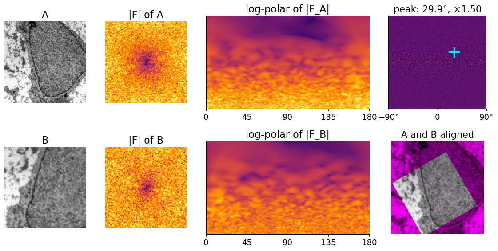
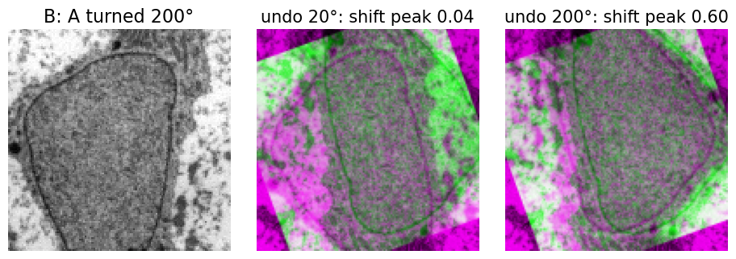
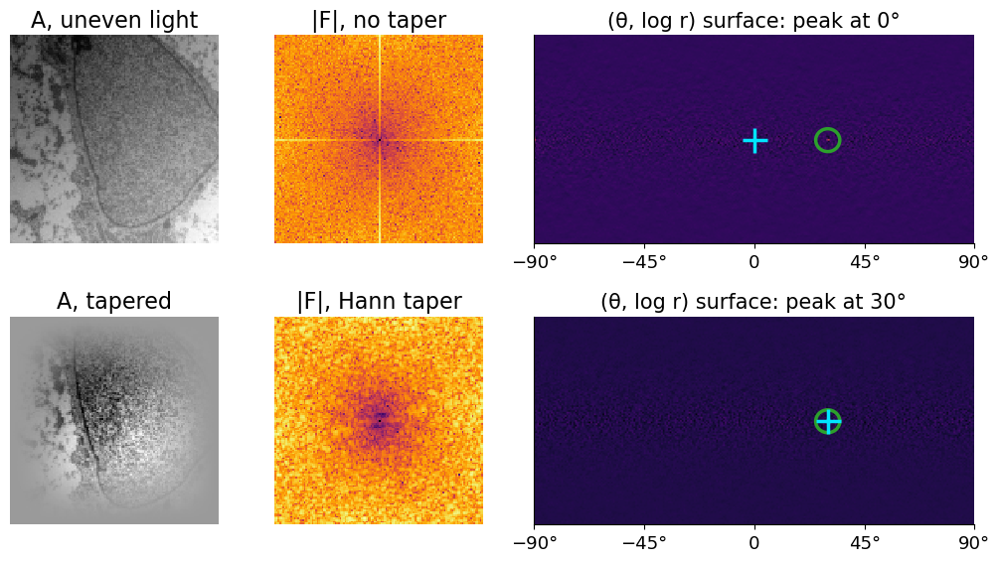
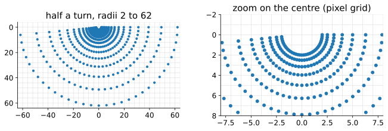
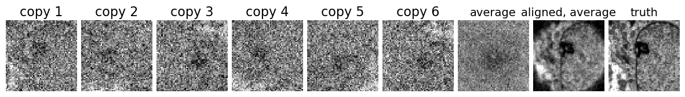

## About this lecture

[Phase correlation](../phasecorr/lec.qmd) finds a **shift** with one FFT. Turn one image a little, and the spike is gone. Today: a change of coordinates in which a rotation, and even a change of scale, **is** a shift, so that the same tool finds it.

- **Known centre**: on a polar grid around the centre, a rotation shifts the angle. One FFT per ring gives every angle at once.
- **Unknown centre**: the magnitude spectrum ignores the shift but turns with the image; on a **log-polar** grid, rotation and scale are both shifts (**Fourier–Mellin**).
- The practical issues: the 180° ambiguity, taper, high-pass, interpolation, the usable range.
- Where it is used: tiles and slide scans, averaging thousands of particle images.

Recall: $e^{i\alpha}$ turns a complex number by $\alpha$; a shift changes the phases of the Fourier coefficients, never their sizes.

*Slides titled **The math** give the formulas and proofs; the ideas are complete without them.*

::: notes
Convention as on the FFT registration day: B(x) ≈ A(x + t) for a shift t; positive angles turn clockwise on screen (x right, y down). "B is A turned by α" means the content of A appears turned by α clockwise in B. All numbers on these slides come from the demo of this unit (128 × 128 views of the course micrograph, noise SD 5 unless stated).
:::

## The problem: a turned view

:::: {.columns}
::: {.column width="40%"}
Two views of the same cell: B is shifted **and turned by 30°**.

- Shifted only: phase correlation gives a clean spike, height 0.83, peak ratio 41.
- Turned 30° too: the highest value is 0.05, at a wrong shift, ratio 1.04. Nothing is found.
- A shift compares the same pixels side by side. After a turn, the edges point in other directions: no shift lines them up.

Slides, scans and tiles taken by hand are often turned; zoom settings change the scale.
:::
::: {.column width="60%"}
{fig-alt="Four panels: view A of the cell nucleus; view B, the same field turned by 30 degrees and shifted; the phase-correlation surface of A and a merely shifted B with one bright spike of height 0.83; the surface of A and the turned B, an even noise floor with a highest value of 0.05." width="100%"}
:::
::::

::: notes
Views 128 × 128 around (128, 128) of the micrograph, B shifted by (8, −5) px. Phase correlation with a Hann taper; the circle marks the highest value. Micrograph: transmission electron micrograph of a mesenchymal stem cell, Robert M. Hunt, CC BY 3.0, via Wikimedia Commons.
:::

## A rotation is a shift of the angle

:::: {.columns}
::: {.column width="42%"}
Suppose we **know the centre** of the turn (a cell's centroid, a particle centred by the microscope software).

- Read the image along circles around the centre: one row per radius, one column per angle (**polar unwrap**, the trick of [closed boundaries by DP](../polar-boundary/lec.qmd), day 33).
- Turning the image by 50° about that centre moves every circle along itself by 50°: in the unwrapped picture, **every row shifts by the same number of columns**, wrapping around.
- Rotation has become a circular shift, the problem phase correlation solves.
:::
::: {.column width="58%"}
{fig-alt="Left: disc A, a part of the nucleus edge with a dark spot inside a yellow circle, and disc B, the same disc turned by 50 degrees. Right: both discs unwrapped into strips, angle from 0 to 360 degrees across and radius downwards; B's strip is A's strip moved 50 degrees to the right, wrapping around." width="100%"}
:::
::::

::: notes
Disc of radius 48 around (112, 80) of the micrograph; the unwrap has 256 columns (1.4° each) and 48 rings, bilinear interpolation (inverse mapping, as in the images unit). The orange lines mark the angles 0° and 90° of the grid.
:::

## Every angle at once

:::: {.columns}
::: {.column width="52%"}
For each candidate angle, compare the two unwrapped pictures ring by ring and add up.

- Each ring is a **periodic 1D signal** (the angle wraps around). Comparing all its shifts is a circular cross-correlation: one FFT ([cross-correlation with the FFT](../xcorr-fft/lec.qmd)).
- Do it for every ring and **add the products of the spectra** before the one inverse FFT: one score per angle.
- Here: the peak is at 50.0°; the next-best angle scores 65 % of the peak (a broad hill: this is plain correlation, not phase correlation).

Cost: one FFT per ring per image and one inverse FFT, instead of re-sampling the image for every angle.
:::
::: {.column width="48%"}
{fig-alt="The rotational correlation score against the angle of B relative to A, from −180 to 180 degrees: a flat curve with one clear peak at 50 degrees, marked by a dashed green line at the true angle." width="100%"}
:::
::::

## The math: rotational correlation {.math}

Write each ring as a Fourier series in the angle: $f(r, \theta) = \sum_m f_m(r)\,e^{im\theta}$, $g(r, \theta) = \sum_m g_m(r)\,e^{im\theta}$ (real images: $f_{-m} = \overline{f_m}$). For a turn by $\alpha$,

$$\int_0^{2\pi} f(r, \theta)\, g(r, \theta + \alpha)\,d\theta = 2\pi\sum_m \overline{f_m(r)}\; g_m(r)\; e^{im\alpha},$$

because $\int_0^{2\pi} e^{i(m' - m)\theta}d\theta = 2\pi\,\delta_{mm'}$. Summed over rings (weight $r\,dr$ for the area),

$$S(\alpha) = 2\pi\sum_m \Big(\int \overline{f_m(r)}\,g_m(r)\,r\,dr\Big) e^{im\alpha}:$$

a Fourier series in $\alpha$, so **one inverse FFT** gives $S$ at every sampled angle. The same fact as for [Zernike moments](../zernike/lec.qmd): under a turn, the angular harmonic $e^{im\theta}$ only picks up a phase $e^{im\alpha}$.

## Rotational correlation as pseudocode

```
PA = polar unwrap of A around the centre      # rows = rings, columns = angles
PB = polar unwrap of B
S = zeros(n_theta)                             # summed cross-power
for every ring i:
    a = FFT(PA[i] − mean of PA[i]),  b = FFT(PB[i] − mean of PB[i])
    S = S + weight(i) · conj(a) · b
score = real part of inverse FFT(S)            # one value per angle
angle = 360° · (position of the highest score) / n_theta
```

- `weight(i)` = the radius, so that every pixel counts about equally.
- Dividing `S` by its size before the inverse FFT turns it into a phase correlation along the angle: a sharper peak.

::: notes
The coding exercise (shapematch/src/fourier_mellin/ in the course code download) writes the polar unwrap (C1) and this rotational correlation (C2), then the log-polar spectrum and the whole Fourier–Mellin registration (C3–C5).
:::

## Try it: a known centre

```{=html}
<link rel="stylesheet" href="../demos/dist/demo.css">
<div data-demo="fmellin" data-mode="known" data-presets="known,rot30"></div>
<script src="../demos/dist/fmellin.js"></script>
```

::: notes
Known-centre tab: a disc of radius 48 around (112, 80), B turned by "turn B" about the same centre, noise. The two unwraps (256 angles, 48 rings) and the rotational correlation; dashed green: the truth, cyan: the highest score. Tour: 50° is found as 50.0°. Move "turn B": the peak follows; −180° to 180° all work. Raise the noise to 80: still 49.8°. Then switch to "unknown centre" to motivate the rest of the lecture.
:::

## Unknown centre: the magnitude spectrum

:::: {.columns}
::: {.column width="42%"}
Usually B is turned **and** shifted, and we do not know about which point it turned. Remove the shift first:

- The magnitude spectrum $|F|$ **ignores shifts** (a shift changes only the phases: [the Fourier unit](../fourier/exercise.qmd), B4).
- It **turns with the image**: a stripe pattern at 30° gives a spectrum line at 30°.
- It **shrinks when the image grows**: coarser detail means lower frequencies.
- So $|F_B|$ is $|F_A|$ turned by the same angle and scaled by $1/s$, **about the centre of the spectrum**, which is always known.
:::
::: {.column width="58%"}
{fig-alt="View A, view B turned by 30 degrees and shifted by (15, 10) pixels, and the logarithm of the magnitude spectrum of each: the two spectra look alike, B's turned by 30 degrees about the centre; dashed cyan guide lines at 0 and 30 degrees." width="100%"}
:::
::::

::: notes
Both views tapered (Hann) before the FFT, mean removed, log(1 + |F|) shown with frequency 0 in the middle.
:::

## Log-polar: scale becomes a shift too

:::: {.columns}
::: {.column width="45%"}
Now unwrap $|F|$ around its centre, with one twist: space the rings **logarithmically** (radii 2, 2.2, 2.4, …, each a fixed factor apart).

- A turn by $\alpha$ moves everything along the angle: a shift of $\alpha$ in columns.
- Scaling by $s$ multiplies every radius by $s$; on a log scale that **adds** $\ln s$: a shift of $\ln s$ in rows.
- Rotation and scale are now one **2D shift** of the log-polar picture: **phase correlation** finds both at once.
- $|F|$ is point-symmetric, so half a turn (180°) is enough.

Reddy & Chatterji (1996); for rotation alone, De Castro & Morandi (1987).
:::
::: {.column width="55%"}
{fig-alt="Left: a spectrum plane with logarithmically spaced circles and rays; a blue patch A at radius 14 and 20 degrees and a red patch B at radius 21 and 60 degrees, that is A turned by 40 degrees and 1.5 times farther out. Right: the log-polar grid, angle across and radius on a log scale downwards; B is A moved 40 degrees right and ln 1.5 down, a plain shift." width="100%"}
:::
::::

## The math: Fourier–Mellin {.math}

Let B be A turned by $\alpha$ and enlarged by $s$ about the centre, then shifted by $\mathbf t$: $\;b(\mathbf x) = a\big(R_{-\alpha}(\mathbf x - \mathbf t)/s\big)$. Substituting $\mathbf u = R_{-\alpha}(\mathbf x - \mathbf t)/s$ (so $d\mathbf x = s^2 d\mathbf u$) in the continuous Fourier transform:

$$B(\mathbf k) = s^2\, e^{-2\pi i\,\mathbf k\cdot\mathbf t}\, A\big(s\,R_{-\alpha}\mathbf k\big) \quad\Longrightarrow\quad |B(\mathbf k)| = s^2\,|A(s\,R_{-\alpha}\mathbf k)|.$$

The shift is only a phase; it is gone from $|B|$. In log-polar coordinates $\rho = \ln|\mathbf k|$, $\theta = \arg\mathbf k$:

$$|B|(\rho, \theta) = s^2\, |A|(\rho + \ln s,\; \theta - \alpha):$$

a **shift** by $(\alpha, -\ln s)$, found by phase correlation (the factor $s^2$ is removed by the normalisation). The **Mellin transform** $\int_0^\infty f(r)\,r^{i\omega - 1}dr$ is the Fourier transform in $\ln r$; its magnitude ignores scaling, as $|F|$ ignores shifts: hence the name.

## Fourier–Mellin as pseudocode

```
MA = |FFT(taper · (A − mean))| · highpass      # the shift drops out
MB = |FFT(taper · (B − mean))| · highpass
LA = log-polar(MA),  LB = log-polar(MB)         # θ over 180°, log-spaced radii
(u, v) = highest peak of phase correlation(LB, LA)
angle = 180° · u / n_theta,   scale = exp(−v · log step)
for θ in {angle, angle + 180°}:
    B' = B turned back by θ and shrunk by scale
    (p, height) = highest peak of phase correlation(A, B')
keep the θ with the higher peak; the shift follows from its p
```

- The last loop is the ordinary phase correlation of the [previous day](../phasecorr/lec.qmd), run twice.
- Cost: about a dozen 2D FFTs and four resamplings; 0.1–0.2 s for $128 \times 128$ in the browser.

## All the steps

{fig-alt="The pipeline on views A and B, B turned by 30 degrees, enlarged 1.5 times and shifted by (12, −8): their magnitude spectra, the log-polar resamplings of both (angle 0 to 180 degrees across, log radius down; B's pattern is A's moved right and up), the phase-correlation surface in angle and log radius with a single peak giving 29.9 degrees and scale 1.50, and the overlay of A (magenta) and B after undoing the angle, the scale and the shift: grey where they agree." width="94%" fig-align="center"}

::: notes
The demo's model with angle 30°, scale 1.5, shift (12, −8): log-polar peak at (42.6, −15.0) bins, i.e. 29.9° and scale 1.500; the shift step gives (11.9, −8.3). The magenta corners of the overlay: B, enlarged 1.5 times, covers only the middle of A, so after undoing the scale the corners of B' are empty. Grid: 256 angles over 180°, 128 log-spaced radii from 2 to 62.
:::

## Try it: Fourier–Mellin

```{=html}
<link rel="stylesheet" href="../demos/dist/demo.css">
<div data-demo="fmellin" data-preset="rot30" data-presets="rot30,scale,known" data-controls="angle,scale,shift"></div>
<script src="../demos/dist/fmellin.js"></script>
```

::: notes
Top row: views A and B, their magnitude spectra (log). Middle: the log-polar resamplings (angle across 0–180°, log radius down). Bottom: the phase-correlation surface in (θ, log r) with the peak (cyan) and where the truth should put it (green), the overlay of A (magenta) and B after undoing everything (grey = agreement), and the final shift surface. Tour: "pure rotation 30°": peak at (42.7, 0.0) bins, height 0.29, ratio 7.6 → 30.0°, scale 1.000; candidates 30° (shift peak 0.70) and −150° (0.05). "scale 1.5 + shift": (0.2, −15.0) bins → scale 1.499, shift (12.0, −7.7). Drag the angle and scale sliders: the peak moves across and down.
:::

## The 180° ambiguity

:::: {.columns}
::: {.column width="45%"}
- The image is real, so its spectrum is **point-symmetric**: $|F|$ looks the same turned by 180°. A turn by 200° and a turn by 20° give the same $|F_B|$.
- The log-polar step only says the angle **modulo 180°**.
- Resolve it with the final step: undo **both** candidates and phase-correlate each with A. The right one has a clear shift peak.
- Here: undo 20°, shift peak 0.04 (nothing); undo 200°, 0.60. Kept: 200°, shift (10.0, 4.9).
:::
::: {.column width="55%"}
{fig-alt="View B, A turned by 200 degrees; overlay of A (magenta) and B turned back by 20 degrees: colours everywhere, no agreement, shift peak 0.04; overlay with B turned back by 200 degrees: grey where they agree, shift peak 0.60." width="100%"}
:::
::::

::: notes
Demo preset "180° ambiguity" (angle 200°, shift (10, 5)), first with only one candidate (wrong: 20°), then with "test θ and θ + 180°" ticked. The overlays show B after undoing the candidate angle only, before the shift, so they are offset by the shift; the colours mix where the structures overlap.
:::

## The math: symmetry and the final shift {.math}

**Point symmetry.** For a real image $a$, $A(-\mathbf k) = \overline{A(\mathbf k)}$, so $|A(-\mathbf k)| = |A(\mathbf k)|$: in polar coordinates $|A|(\rho, \theta + \pi) = |A|(\rho, \theta)$. Turning B by $\alpha$ or by $\alpha + \pi$ gives the same $|B|$: the log-polar peak determines $\alpha$ only modulo $\pi$, and half a turn of columns holds all the information.

**The shift after the turn.** Undo the angle and scale on B about the centre $\mathbf c$: $b'(\mathbf x) = b\big(\mathbf c + s R_\alpha(\mathbf x - \mathbf c)\big)$. With $\mathbf c = 0$, $b'(\mathbf x) = a\big(\mathbf x - R_{-\alpha}\mathbf t/s\big)$: a pure shift of A by $\mathbf t' = R_{-\alpha}\mathbf t / s$, which phase correlation finds; then $\mathbf t = s\,R_\alpha\,\mathbf t'$. For the wrong candidate $\alpha + \pi$, $b'$ is A turned by 180°, and no shift matches it.

## Taper and high-pass

:::: {.columns}
::: {.column width="45%"}
- **Taper**: without it, the jumps at the image border give $|F|$ a bright **cross** along the axes. The cross belongs to the frame, not the sample: it does **not turn** with B. Both spectra have it at 0° and 90°: the log-polar peak says "turned 0°, scale 1" ([tapering](../phasecorr/lec.qmd)). With uneven light (400 grey levels across): wrong without the taper, right with it.
- **High-pass weight** on $|F|$: the strongest values sit near the centre, at the smallest radii, which carry little about the direction. Reddy & Chatterji damp them by $(1 - X)(2 - X)$, $X = \cos\pi f_x \cos\pi f_y$. Here it raises the peak from 0.23 to 0.29 (though the peak ratio drops from 9.0 to 7.6).
- But it also lifts the **noise**, which lives at high frequencies: with noise SD 25 the high-pass version fails, the plain one finds 30.0°.
:::
::: {.column width="55%"}
{fig-alt="Top row, no taper: view A with uneven light, its spectrum with a bright horizontal and vertical cross, and the (theta, log r) surface whose highest peak is at 0 degrees, far from the true 30 degrees (green circle). Bottom row, Hann taper: the tapered view, its spectrum without the cross, and the surface with the peak on the green circle at 30 degrees." width="100%"}
:::
::::

## Interpolation, small radii, range

:::: {.columns}
::: {.column width="45%"}
- Log-polar samples fall **between pixels**: bilinear interpolation ([inverse mapping](../images/lec.qmd)).
- Near the centre, many samples share the same few pixels (oversampled, repeated values); far out, samples are sparse and miss detail. The innermost rings (radius below 2) are left out.
- The rows only reach $r_{\max}$: a scale $s$ moves the content by $\ln s$ rows and pushes part of it **off the grid**. And an enlarged view shares less content with A (scale 2: a quarter of its area).
- Usable range here: scales **0.65 to 1.9** right, 0.6 and 2 wrong. The literature quotes about 0.5–2.
:::
::: {.column width="55%"}
{fig-alt="Sample points of a log-polar grid (32 angles over half a turn, 16 log-spaced radii from 2 to 62) over the pixel grid of the spectrum: sparse at large radius; in the zoom on the centre, many points crowd into the few pixels around frequency 0." width="100%"}
:::
::::

::: notes
The range was measured with the demo at angle 20°, noise SD 5, 128 × 128 views: right for 0.65, 0.7, 1.5, 1.7, 1.8 and 1.9; wrong for 0.5, 0.55, 0.6, 2, 2.2, 2.5, 3. The figure uses a coarse grid so the points are visible; the demo uses 256 angles and 128 radii.
:::

## Try it: where it breaks

```{=html}
<link rel="stylesheet" href="../demos/dist/demo.css">
<div data-demo="fmellin" data-preset="amb" data-presets="amb,notaper,scale3,noise" data-controls="scale,noise,uneven,hann,high,test"></div>
<script src="../demos/dist/fmellin.js"></script>
```

::: notes
"180° ambiguity" (200°, one candidate): found 20.0°, shift peak 0.04, ✗; tick "test θ and θ + 180°": −160.0° (= 200°), shift peak 0.60. "no taper: the cross dominates": the log-polar peak sits at (0, 0) → 0°, scale 1; tick "Hann taper": 30.0°. "scale 3: out of range": wrong; lower the scale until it works (1.9). "noise: the high-pass hurts" (σ = 25): wrong (38.6°, × 0.949); untick "high-pass on |F|": 30.0°, ratio 1.66.
:::

## Where it is used

:::: {.columns}
::: {.column width="45%"}
- **Turned tiles and slide scans**: sections placed on the slide by hand, serial sections of tissue, a sample re-mounted between sessions. One Fourier–Mellin step gives a starting alignment.
- **Cryo-EM 2D classification**: thousands of very noisy images of the same particle, each at an unknown angle in the image plane. Aligning them in rotation (and shift) to class averages with **polar correlations** like these, then averaging, makes the structure visible.
- **Cells before averaging**: orient cells or nuclei (centroid as the known centre) to build an average shape or an average stain pattern.
:::
::: {.column width="55%"}
{fig-alt="Six of sixteen copies of a small disc of the micrograph, each turned by a random angle and buried in strong noise; their plain average, a grey smear; the average after turning each copy back by its angle from the rotational correlation, which shows the nucleus edge and the dark spot; and the noise-free truth." width="100%"}
:::
::::

::: notes
16 copies of a disc of radius 28 around (110, 75), random angles, noise SD 70 grey levels; each copy aligned to copy 1 by the rotational correlation (128 angles, radius-weighted rings). Angle errors: mean 0.8°, at most 2.2°. Real cryo-EM also aligns the shift and works with far lower signal-to-noise and many more images.
:::

## Summary

- Around a **known centre**, a polar unwrap turns a rotation into a circular shift of the angle; summing one FFT correlation per ring scores **every angle at once**.
- With an **unknown centre**, take the **magnitude spectrum**: the shift drops out, the turn and the scale remain, about the spectrum's centre.
- On a **log-polar** grid of $|F|$, rotation and scale are one 2D **shift**: phase correlation finds both (**Fourier–Mellin**). Then undo them and phase-correlate once more for the shift.
- $|F|$ is point-symmetric: test **θ and θ + 180°** by the final peak. **Taper** the images (the border cross does not turn); the **high-pass** sharpens the peak but lifts noise.
- Usable for scales of roughly 0.5–2 and images that share most of their content; beyond that, match features instead ([keypoints](../keypoints/lec.qmd), day 25).
