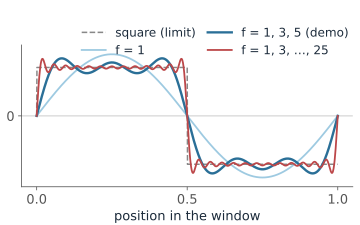
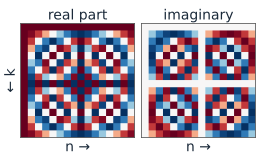
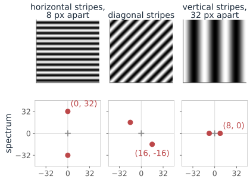
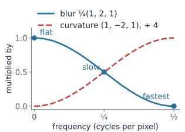
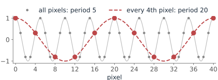

## About this lecture

- Every signal, and every image, is a **sum of waves**.
- The discrete Fourier transform (DFT) is a **change of basis** to those waves.
- In 2D, each coefficient is a **plane wave** with a direction and a frequency.
- **Convolution theorem:** filtering = multiplying the spectrum. Low-pass, high-pass, notch.
- Sampling: what a pixel grid can and cannot represent (**aliasing**).

Slides titled **The math** give the formulas and proofs; the ideas are complete without them.

## Try it: build a wave

```{=html}
<link rel="stylesheet" href="../demos/dist/demo.css">
<div data-demo="fourierwave" data-a="1 0 0 0 0"></div>
<script src="../demos/dist/fourierwave.js"></script>
```

::: notes
Five waves sin(2π·f·t), f = 1 to 5 cycles per window; each slider sets one amplitude. The bold black line is the sum; the bars are the amplitude spectrum |a_f|. Start from a single slow wave, then add f = 3 at a third of the height and f = 5 at a fifth (or press "square"): plateaus with steep edges appear. Sharper edges would need still higher frequencies. "Sawtooth" uses all five with alternating signs. Point out that a negative amplitude flips the wave, a phase change, and the bars do not change: the amplitude spectrum throws away phase.
:::

## Everything is a sum of waves

:::: {.columns}
::: {.column width="58%"}
- Any signal on a window can be built by adding up waves: **slow** ones (a few cycles per window) and **fast** ones (many cycles).
- Slow waves carry the **broad shape**; fast waves carry **sharp edges** and fine detail. A square wave needs ever faster waves to get its corners right.
- The **spectrum** says how much of each wave there is.
- To find how much of one wave a signal contains, multiply the signal by that wave and average: the waves are **perpendicular** to each other (orthogonal), so every other wave averages out. It is a **projection**, as onto the axes of a coordinate system.
:::
::: {.column width="42%"}
{fig-alt="Partial sums of sine waves with amplitudes 1, 1/3, 1/5 and so on: one wave is a smooth hump, waves 1, 3 and 5 (the demo's square preset) give plateaus with ripples, waves up to 25 come close to the dashed square wave with steep edges." width="100%"}
:::
::::

::: notes
The figure: sin(2πft)/f summed over odd f; f = 1, 3, 5 is the demo's "square" preset. The limit is a square wave of height π/4. The overshoot next to each jump does not go away as more waves are added (Gibbs), it only gets narrower.
:::

## The math: Fourier series {.math}

A signal on $0 \le t < 1$ can be written as

$$f(t) = \sum_{k} c_k\, e^{2\pi i k t}, \qquad c_k = \int_0^1 f(t)\, e^{-2\pi i k t}\, dt.$$

- The waves are orthogonal: $\displaystyle\int_0^1 e^{2\pi i k t}\, \overline{e^{2\pi i l t}}\, dt = \begin{cases} 1 & k = l,\\ 0 & k \neq l,\end{cases}$ so the integral against $e^{-2\pi i k t}$ picks out $c_k$ alone.
- $|c_k|$ is the amplitude of frequency $k$, $\arg c_k$ its phase.

## The DFT is a change of basis

A signal of $N$ numbers can be rewritten as the amounts of $N$ waves: **the same vector in two coordinate systems**. Nothing is lost, and you can go back exactly.

| signal $x$ | DFT $X$ (frequency 0, 1, 2, 3) | |
|---|---|---|
| 1, 1, 1, 1 | 4, 0, 0, 0 | flat: only frequency 0 (= $N$ × the mean) |
| 1, 0, −1, 0 | 0, 2, 0, 2 | one cosine cycle: frequencies $+1$ and $-1$ |
| 0, 1, 0, −1 | 0, $-2i$, 0, $2i$ | the same wave, shifted: same sizes, other phases |

- A real wave always shows up as a **mirror pair** of frequencies, $+k$ and $-k$ (index $N - k$).
- The **FFT** computes the DFT fast: for a 1024 × 1024 image, about $2 \cdot 10^7$ operations instead of $10^{12}$ for the plain matrix product.

## The math: the DFT {.math}

:::: {.columns}
::: {.column width="70%"}
For a signal of length $N$, $x = (x_0, \dots, x_{N-1})$:

$$X_k = \sum_{n=0}^{N-1} x_n\, e^{-2\pi i kn/N}, \qquad x_n = \frac1N \sum_{k=0}^{N-1} X_k\, e^{2\pi i kn/N}.$$

- In matrix form, $X = Fx$ with $F_{kn} = e^{-2\pi i kn/N}$. The columns of $F^*$ are **orthogonal**: $F^*F = N\,I$.
- So $x$ and $X$ are the **same vector in two bases**. Nothing is lost; $F^{-1} = \tfrac1N F^*$.
- Parseval: $\sum |x_n|^2 = \tfrac1N \sum |X_k|^2$. Energy is shared out over the frequencies.
- For real $x$: $X_{N-k} = \overline{X_k}$. Frequencies come in **mirror pairs** $\pm k$.
- The **FFT** computes $X$ in $\mathcal{O}(N\log N)$ instead of $\mathcal{O}(N^2)$.
:::
::: {.column width="30%"}
{fig-alt="The 16 × 16 DFT matrix drawn as two images, real part and imaginary part, red for +1 and blue for −1: row k is a cosine (real) or minus a sine (imaginary) with k cycles across the row; rows k and 16 − k mirror each other." width="100%"}

Row $k$ of $F$: a wave with $k$ cycles. Rows $k$ and $N-k$ are mirror pairs.
:::
::::

::: notes
This is the slide that should click for students with a linear algebra background: the Fourier transform is just an orthogonal (unitary, up to scale) change of basis. Index k = N − k is the same as frequency −k, which is why spectra are usually drawn with frequency 0 in the middle.
:::

## From 1D to 2D: plane waves

:::: {.columns}
::: {.column width="52%"}
In 2D, each coefficient is a **stripe pattern**: a wave with a **direction** and a **frequency** (how many stripes fit across the image).

- We show the spectrum with frequency $(0, 0)$ in the **centre**, on a log scale (the centre is huge compared to the rest).
- Distance from the centre = **frequency** (fine vs coarse). Angle = **orientation** of the wave.
- A pattern of stripes gives a **pair of bright dots**, on the line perpendicular to the stripes.
- Example: horizontal stripes 8 pixels apart in a 256 × 256 image: $256 / 8 = 32$ cycles from top to bottom, so dots at 32 above and 32 below the centre.
:::
::: {.column width="48%"}
{fig-alt="Three 256 × 256 stripe images (a corner shown) and the positions of the bright dots in their spectra: horizontal stripes 8 pixels apart give dots at (0, 32) and (0, −32); diagonal stripes give a pair on the opposite diagonal at (16, −16) and (−16, 16); vertical stripes 32 pixels apart give dots at (8, 0) and (−8, 0)." width="100%"}
:::
::::

## The math: the 2D DFT {.math}

For an $N\times N$ image, the basis functions are

$$e^{2\pi i (ux + vy)/N}: \text{ a wave along the direction } (u, v), \text{ with } \sqrt{u^2+v^2} \text{ cycles across the image,}$$

$$X_{u,v} = \sum_{x=0}^{N-1}\sum_{y=0}^{N-1} I(x, y)\, e^{-2\pi i (ux + vy)/N}.$$

- The 2D DFT is the 1D DFT on every row, then on every column (it is **separable**): $e^{-2\pi i (ux + vy)/N} = e^{-2\pi i ux/N}\, e^{-2\pi i vy/N}$.
- We show the spectrum as $\log(1 + |X_{u,v}|)$, with the indices shifted so that $(0, 0)$ is in the centre.

## Filtering = turning frequencies up and down

:::: {.columns}
::: {.column width="62%"}
Sliding a kernel over an image does something simple to every wave: it **multiplies it by a number**, its **frequency response**. Waves come out as the same waves, only stronger or weaker.

Check with the 1D blur $\tfrac14\,(1, 2, 1)$ (wrapping around at the ends):

| input | output | multiplied by |
|---|---|---|
| flat: 1, 1, 1, 1, … | 1, 1, 1, 1, … | 1 |
| slow wave: 1, 0, −1, 0, … | 0.5, 0, −0.5, 0, … | 0.5 |
| fastest wave: 1, −1, 1, −1, … | 0, 0, 0, 0, … | 0 |
:::
::: {.column width="38%"}
{fig-alt="Frequency response from 0 to half a cycle per pixel: the blur (1, 2, 1)/4 falls from 1 at frequency 0 through 0.5 at a quarter to 0 at a half (the three rows of the table); the curvature kernel (1, −2, 1), scaled by 1/4, rises from 0 to 1." width="100%"}
:::
::::

- Blurs keep slow waves and remove fast ones: **low-pass**. The Laplacian removes the flat part and boosts fast waves: **high-pass**.
- The **sum of the weights** is the response to a flat image: frequency 0.
- Large kernels are cheaper in frequency space: transform, multiply, transform back.

::: notes
The FFT assumes the image repeats periodically, so filtering via FFT wraps around at the border: the "wrap" border rule from last time. Padding avoids it.
:::

## The math: the convolution theorem {.math}

$$\mathcal{F}\{I * w\} = \mathcal{F}\{I\} \cdot \mathcal{F}\{w\}.$$

Waves are the eigenvectors of convolution: for $x_n = e^{i\omega n}$,

$$(w * x)_n = \sum_k w_k\, e^{i\omega(n - k)} = \hat w(\omega)\, e^{i\omega n}, \qquad \hat w(\omega) = \sum_k w_k\, e^{-i\omega k}.$$

- Gaussian blur: $\hat w$ is (close to) a Gaussian too, largest at 0: a **low-pass** filter.
- Laplacian: $\hat w \propto -(u^2 + v^2)$ near 0, zero at frequency 0: a **high-pass** filter.
- Sum of weights $= \hat w(0, 0)$: the response to the average brightness.
- Cost via the FFT: two FFTs and a product, $\mathcal{O}(N^2\log N)$ for an $N\times N$ image.

## Try it: filter an image in frequency space

```{=html}
<link rel="stylesheet" href="../demos/dist/demo.css">
<div data-demo="fourier2d" data-mode="low" data-max="30"></div>
<script src="../demos/dist/fourier2d.js"></script>
```

::: notes
Left: the image; middle: its spectrum (log magnitude, frequency 0 in the centre); right: the image rebuilt from the kept coefficients. Removed coefficients are dark red. Start with low-pass at max radius 30 and drag down to about 5: a blur, but the shape survives. Switch to high-pass: only edges and texture remain. Then "keep largest" at 3%: most of the variation is in very few coefficients, which is why JPEG works. Finally tick "add stripe artefact", choose "no filter", and erase the two bright dots (yellow rings): the stripe disappears. That is a notch filter.
:::

## Sampling and aliasing

A pixel grid needs at least **two samples per cycle** to represent a wave: the finest pattern it can hold has a period of 2 pixels.

- Finer detail is not lost silently: it **folds back** and appears as a false, coarser pattern (**aliasing**, moiré).
- Example: a pattern that repeats every 5 pixels; keep every 4th pixel. The new grid can only hold periods of 8 original pixels or more, and the pattern shows up with a false period of **20** pixels.
- So before **downsampling** an image, blur it first (low-pass), to remove what the coarser grid cannot hold.
- Same reason the optics of a microscope should match the pixel size of its camera.

{fig-alt="A cosine with period 5 pixels sampled at every pixel (grey dots); the red dots keep every 4th pixel and lie exactly on a slower dashed cosine with period 20 pixels." width="68%" fig-align="center" .nostretch}

## The math: the Nyquist frequency {.math}

A grid with spacing $\Delta$ can represent frequencies up to the **Nyquist frequency** $\tfrac{1}{2\Delta}$.

On the grid, a wave of frequency $f$ and one of frequency $f - \tfrac{m}{\Delta}$ (any integer $m$) give **identical samples**:

$$e^{2\pi i f n\Delta} = e^{2\pi i (f - m/\Delta)\, n\Delta}\, e^{2\pi i m n} = e^{2\pi i (f - m/\Delta)\, n\Delta}.$$

- So $f$ is seen as the frequency $f - m/\Delta$ that lies in $\left[-\tfrac{1}{2\Delta}, \tfrac{1}{2\Delta}\right]$.
- Example: $f = \tfrac15$ per pixel, $\Delta = 4$: Nyquist is $\tfrac18$; $\tfrac15 - \tfrac14 = -\tfrac1{20}$, a false period of 20 pixels.

## Summary

- The DFT is an orthogonal **change of basis** to waves; nothing is lost.
- Low frequencies = broad shapes; high frequencies = edges, texture and noise.
- **Convolution theorem:** filtering is multiplication in frequency space. Kernels have a frequency response.
- Isolated peaks in the spectrum = periodic structure (or artefacts): remove them with a **notch**.
- Sample at least twice per cycle, and low-pass before downsampling (image pyramids: [scale space](../scale-space/lec.qmd) on the edges day; sampling in a microscope: [resolution](../resolution/lec.qmd)).
