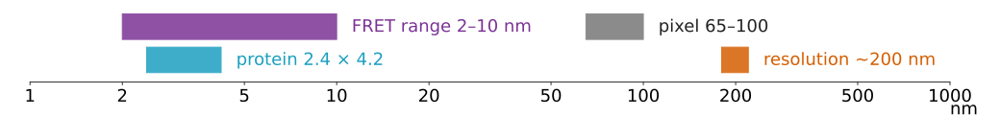
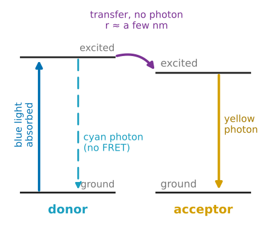
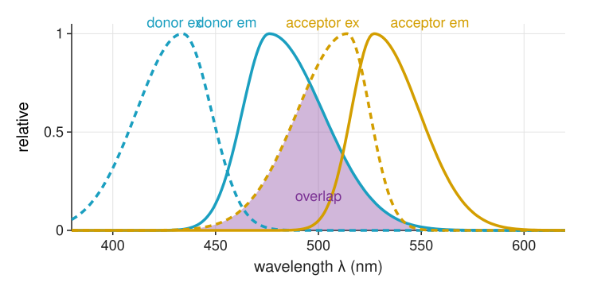
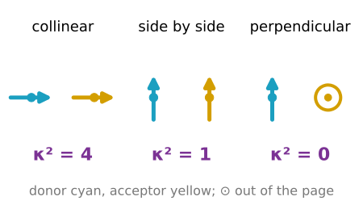
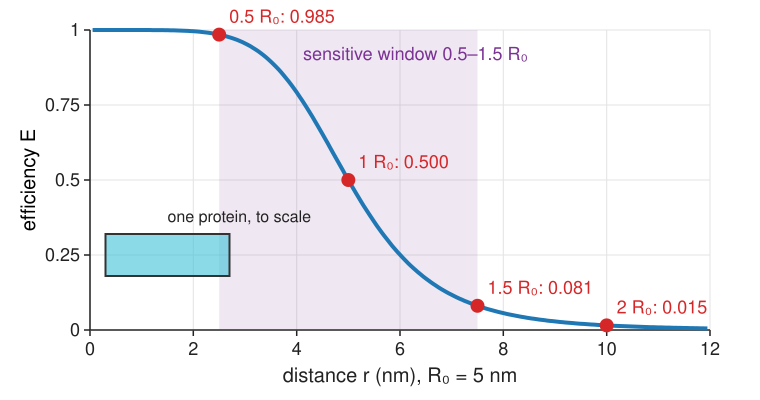
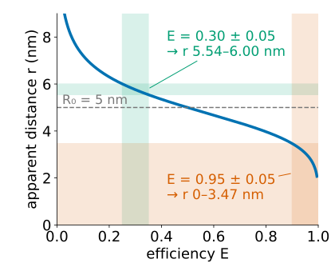
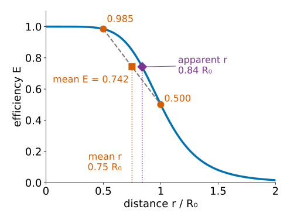

## About this lecture

Two proteins that overlap in a two-colour image may touch, or may be 200 nm apart: the microscope cannot tell. **FRET** (Förster resonance energy transfer) gives a signal that switches on only when two molecules are a few **nanometres** apart.

- The cartoon: an excited **donor** hands its energy to a nearby **acceptor**, without a photon.
- What it needs: **spectral overlap**, **distance**, **orientation**.
- The **efficiency curve** $E(r)$, the **Förster radius** $R_0$ and the **sensitive window**.
- From an efficiency back to an **apparent distance**, and why a population average misleads.
- What FRET is used for, and the three ways to measure it (the rest of the day).

*Slides titled **The math** give the formulas and proofs; the ideas are complete without them.*

::: notes
This unit owns the physics of FRET for the course: E(r), R0, κ², the rate picture. The FLIM day (lifetimes, phasors, FLIM-FRET) builds on the rate slide here and does not repeat E(r). Units 2 to 4 measure E with intensities: sensitised emission, acceptor photobleaching, ratio imaging.
:::

## Recall: "in the same spot" is 200 nm

:::: {.columns}
::: {.column width="55%"}
- Two dyes inside one diffraction-limited spot look like one: the resolution limit is about **200 nm** laterally ([resolution](../resolution/lec.qmd)).
- A protein is about **4 nm** across. Two "colocalised" proteins can be fifty protein diameters apart.
- **Colocalisation** ([coloc](../coloc/lec.qmd)) asks: same spot? **FRET** asks: touching?
- Both are faked by **bleed-through** of one dye into the other's channel ([unit 2](../sensitised-emission/lec.qmd)).
:::
::: {.column width="45%"}
| | distance scale |
|---|---|
| a pixel (typical) | 65–100 nm |
| resolution limit | ~200 nm |
| FRET range | 2–10 nm |
| one fluorescent protein | 2.4 × 4.2 nm |
:::
::::

{fig-alt="A logarithmic length axis from 1 to 1000 nm. A protein (2.4 to 4.2 nm) and the FRET range (2 to 10 nm) sit at the left end; a pixel (65 to 100 nm) and the resolution limit (about 200 nm) sit two orders of magnitude further right." width="100%"}

## The cartoon: energy without a photon

:::: {.columns}
::: {.column width="56%"}
- The **donor** absorbs blue light and is excited. Normally it emits a **cyan** photon a few nanoseconds later.
- If an **acceptor** sits within a few nm, the energy can jump across directly: the two molecules' oscillating charges couple through their **near field**, no photon travels.
- The acceptor then emits its own colour (**yellow**), although we never excited it.

Two things we can see in the microscope:

1. **Donor quenching**: the donor gets **dimmer** (and its excited state shorter-lived).
2. **Sensitised emission**: acceptor light under **donor** excitation.

Every FRET measurement watches one or both.
:::
::: {.column width="44%"}
{fig-alt="Energy levels of donor and acceptor. A blue arrow lifts the donor from ground to excited state. From there either a dashed cyan arrow back down (a cyan photon, no FRET), or a curved purple arrow across to the acceptor's excited state (transfer without a photon, a few nm). The acceptor then drops to its ground state with a yellow photon." width="100%"}
:::
::::

## Absorption and emission spectra

{width="66%" fig-align="center"}

- Each dye has an **excitation (absorption) spectrum** (dashed): how well each wavelength excites it; and an **emission spectrum** (solid), shifted to the red.
- The **quantum yield** $Q$: the fraction of excited molecules that emit a photon (the rest lose the energy as heat).
- FRET needs the donor's **emission** to overlap the acceptor's **absorption** (shaded): the donor "emits into" the acceptor.

::: notes
The unmixing day used emission spectra only (crosstalk unit); excitation spectra are new here. Spectra are parametric (split Gaussians) and only resemble a cyan and a yellow fluorescent protein: donor excitation peak 434 nm, emission 476 nm, quantum yield 0.40; acceptor excitation 514 nm, emission 527 nm, peak extinction 83 000 M⁻¹cm⁻¹.
:::

## What FRET needs

:::: {.columns}
::: {.column width="56%"}
1. **Overlap** of donor emission and acceptor absorption (a donor–acceptor **pair**).
2. **Distance** of a few nanometres: below about 10 nm.
3. **Orientation**: the two transition dipoles must not be perpendicular.

And it competes with the donor's own emission: whichever happens first wins. So the outcome is a **probability**, the FRET **efficiency** $E$: the fraction of donor excitations that are handed to the acceptor.
:::
::: {.column width="44%"}
{fig-alt="Three donor and acceptor dipole pairs with their orientation factor. Collinear, both arrows along the line joining them: kappa squared 4. Parallel side by side: 1. Donor in the page, acceptor pointing out of the page: 0." width="100%"}
:::
::::

## The efficiency curve

{width="62%" fig-align="center"}

$$E = \frac{1}{1 + (r/R_0)^6}$$

- **Förster radius** $R_0$: the distance at which $E = 0.5$; 4–7 nm for fluorescent-protein pairs.
- Steep: $0.5R_0$ gives 0.985, $2R_0$ gives 0.015. Outside the **sensitive window** $0.5R_0$–$1.5R_0$, $E$ says only "close" or "far".
- Why the sixth power: the coupling of two dipoles falls as $1/r^3$; the transfer rate goes as the coupling **squared**.

## The math: rates and the efficiency {.math}

The excited donor decays with rate $k_D = 1/\tau_D$ (all its own paths together, lifetime $\tau_D$). Transfer adds a parallel path with rate

$$k_T = k_D\left(\frac{R_0}{r}\right)^6 .$$

- The efficiency is the share of the transfer path: $E = \dfrac{k_T}{k_T + k_D} = \dfrac{1}{1 + (r/R_0)^6}$. At $r = R_0$ the two rates are equal.
- The donor's lifetime with acceptor: $\tau_{DA} = \dfrac{1}{k_D + k_T}$, so $\dfrac{\tau_{DA}}{\tau_D} = \dfrac{k_D}{k_D + k_T} = 1 - E$:

$$E = 1 - \frac{\tau_{DA}}{\tau_D} = 1 - \frac{F_{DA}}{F_D}.$$

- At fixed excitation the donor's brightness is proportional to its lifetime, so the same ratio holds for donor intensities $F$ ([unit 3](../acceptor-bleach/lec.qmd)). Lifetimes themselves are measured on the [FLIM day](../lifetime/lec.qmd) (day 46).

## Try it: the ruler

```{=html}
<link rel="stylesheet" href="../demos/dist/demo.css">
<div data-demo="fretruler" data-preset="half" data-presets="half twice halfR0 window overlap perp k4" data-compact></div>
<script src="../demos/dist/fretruler.js"></script>
```

::: notes
Left: donor and acceptor to scale on a 1 nm grid (circles of 2.4 nm, the width of a fluorescent-protein barrel); purple circle R0, dashed circle 1.5 R0. Middle: spectra with the overlap; E(r) with the window. Right: the bars show donor and acceptor emission under donor excitation, relative to the donor alone. Tour: "r = R0: half": R0 = 4.95 nm, E = 0.500. "twice R0": E = 0.015. "half R0": 0.985. "the sensitive window": r = 1.25 R0, E = 0.208; drag the acceptor along the axis and watch how fast E changes inside the window and how little outside. "poor overlap": acceptor spectra 60 nm to the red, R0 = 3.05 nm, E = 0.052 at 4.95 nm. "perpendicular dipoles": κ² = 0, no FRET at any distance. "κ² = 4": r = 6.44 nm, R0 = 6.68 nm, E = 0.554, whereas κ² = 2/3 would give 0.172; the apparent distance assuming 2/3 is 4.78 nm.
:::

## The math: how sensitive is $E$ to $r$? {.math}

Differentiate $E = (1 + (r/R_0)^6)^{-1}$:

$$\frac{dE}{dr} = -\frac{6}{r}\,E\,(1 - E), \qquad \frac{dr}{dE} = -\frac{r}{6\,E\,(1 - E)} .$$

- At $r = R_0$: $dE/dr = -1.5/R_0$ (for $R_0 = 5$ nm, $-0.3$ per nm). The steepest point is slightly closer, at $(5/7)^{1/6}R_0 \approx 0.945R_0$, slope $-0.308$ per nm.
- The inverse $dr/dE$ is smallest in the middle and **explodes** near $E = 0$ and $E = 1$, where $E(1 - E) \to 0$: an error in $E$ there is a huge error in $r$. That is the sensitive window, as a formula.

## What sets $R_0$

- **Overlap**: more donor emission where the acceptor absorbs → larger $R_0$. Red overlap counts more (the integral weights wavelength to the fourth power).
- **Donor quantum yield**: a brighter donor competes better.
- **Orientation factor** $\kappa^2$: from 0 (perpendicular) to 4 (collinear); **2/3** if both dyes tumble freely during the excited state.
- **Refractive index** of the medium (about 1.4 in cells).

Only the **sixth root** of these enters $R_0$:

| change | $R_0$ changes by |
|---|---|
| overlap × 2 | × 1.12 (+12 %) |
| $\kappa^2$: 2/3 → 4 | × 1.35 (+35 %) |
| $\kappa^2$: 2/3 → 0.1 | × 0.73 (−27 %) |

$\kappa^2$ is usually **unknown**: absolute distances are soft, **changes** in $E$ are hard.

## The math: the Förster radius and $\kappa^2$ {.math}

$$R_0^6 = \frac{9\ln 10\;\kappa^2\,Q_D\,J}{128\,\pi^5\,n^4\,N_A}, \qquad J = \int F_D(\lambda)\,\varepsilon_A(\lambda)\,\lambda^4\,d\lambda$$

with $F_D$ the donor emission normalised to unit area, $\varepsilon_A$ the acceptor's extinction coefficient, $n$ the refractive index, $N_A$ Avogadro's number. In practical units ($J$ in M⁻¹cm⁻¹nm⁴): $R_0 = 0.0211\,(\kappa^2 n^{-4} Q_D J)^{1/6}$ nm.

Orientation, with unit dipole vectors $\hat{\boldsymbol\mu}_D, \hat{\boldsymbol\mu}_A$ and the unit vector $\hat{\mathbf r}$ from donor to acceptor:

$$\kappa^2 = \big(\hat{\boldsymbol\mu}_D\cdot\hat{\boldsymbol\mu}_A - 3(\hat{\boldsymbol\mu}_D\cdot\hat{\mathbf r})(\hat{\boldsymbol\mu}_A\cdot\hat{\mathbf r})\big)^2$$

- collinear along $\hat{\mathbf r}$: $(1 - 3)^2 = 4$; parallel, side by side: $1$; perpendicular to each other and to $\hat{\mathbf r}$: $0$. Averaged over random directions: $2/3$.
- The demo's pair: $J = 2.41\times10^{15}$, $Q_D = 0.40$, $n = 1.4$, $\kappa^2 = 2/3$ → $R_0 = 4.95$ nm.

## From efficiency to apparent distance

Invert the curve: $r = R_0\,(1/E - 1)^{1/6}$.

:::: {.columns}
::: {.column width="50%"}
Worked example, $R_0 = 5$ nm:

| $E$ | $r$ (nm) |
|---|---|
| 0.25 | 6.00 |
| **0.30** | **5.76** |
| 0.35 | 5.54 |
| 0.90 | 3.47 |
| 0.95 | 3.06 |
:::
::: {.column width="50%"}
{fig-alt="Apparent distance against efficiency for R0 = 5 nm, falling steeply at both ends. A green band E = 0.25 to 0.35 maps onto a narrow distance band 5.54 to 6.00 nm; an orange band E = 0.90 to 1.00 maps onto 0 to 3.47 nm." width="78%"}
:::
::::

- Inside the window, $E = 0.30 \pm 0.05$ pins $r$ to 5.54–6.00 nm.
- Near the top, $E = 0.95 \pm 0.05$ allows anything from 0 to 3.47 nm.
- "Apparent", because it assumes one distance, $\kappa^2 = 2/3$, and that every donor has an acceptor ([unit 3](../acceptor-bleach/lec.qmd)).

## A mixture of distances

:::: {.columns}
::: {.column width="52%"}
Half the molecules at $0.5R_0$, half at $R_0$:

- mean distance $0.75R_0$;
- mean efficiency $(0.985 + 0.5)/2 = 0.742$;
- apparent distance from the mean efficiency: $0.84R_0$, **not** $0.75R_0$.

The curve is non-linear, so **the average of $E$ is not $E$ of the average distance**. Close molecules saturate near 1; far ones contribute almost nothing. The same trap appears whenever a non-linear function is applied to an average.
:::
::: {.column width="48%"}
{fig-alt="The efficiency curve against distance in units of R0. Two molecules at 0.5 R0 (E 0.985) and R0 (E 0.500); their mean efficiency 0.742 lies on the straight chord at mean distance 0.75 R0, but the curve reaches 0.742 only at 0.84 R0, the apparent distance." width="100%"}
:::
::::

## Try it: a population

```{=html}
<link rel="stylesheet" href="../demos/dist/demo.css">
<div data-demo="fretruler" data-preset="mixture" data-presets="mixture spread" data-compact></div>
<script src="../demos/dist/fretruler.js"></script>
```

::: notes
200 seeded molecules. Preset "two distances": 2.48 nm and 4.95 nm (mean 3.71 nm); mean E = 0.743, apparent distance 4.15 nm (0.84 R0), E of the mean distance 0.850. Grey bars: histogram of r; red dots: each molecule's E; green line: mean r; red dashed: apparent r and the mean E. "A spread of distances": mean R0, width 1.2 nm. Tick "random static orientations": each molecule gets its own κ² (frozen dipoles); the mean E changes although no distance changed, the reason κ² = 2/3 is an assumption.
:::

## What FRET is used for, and how we measure it

**Uses**

- **Binding** of two proteins (intermolecular): donor on one, acceptor on the other.
- **Conformational change** of one protein (intramolecular): both dyes on one chain; a **biosensor** ([unit 4](../ratiometric/lec.qmd)).
- **Cleavage**: a protease cuts the link, FRET is lost.

**Three ways to measure** (the rest of the day)

| method | watches | unit |
|---|---|---|
| sensitised emission | acceptor light under donor excitation | [2](../sensitised-emission/lec.qmd) |
| acceptor photobleaching | donor gets brighter when the acceptor is destroyed | [3](../acceptor-bleach/lec.qmd) |
| donor lifetime | donor's excited state gets shorter | [FLIM day](../flim-fret/lec.qmd) |

## Summary

- FRET hands the donor's energy to an acceptor a few nm away, without a photon: the donor **dims**, the acceptor **lights up**.
- It needs spectral **overlap**, **distance** below about 10 nm and dipoles that are not perpendicular.
- $E = 1/(1 + (r/R_0)^6)$: half at $R_0$ (4–7 nm), steep; informative only in the **window** $0.5R_0$–$1.5R_0$.
- $R_0$ depends on overlap, donor quantum yield, refractive index and the orientation factor $\kappa^2$, all through a sixth root; $\kappa^2$ makes absolute distances uncertain.
- An efficiency gives an **apparent** distance; an average efficiency is not the efficiency of the average distance.
- Identical donor and acceptor can also transfer (**homo-FRET**); it changes no colour and is seen only in polarisation.
