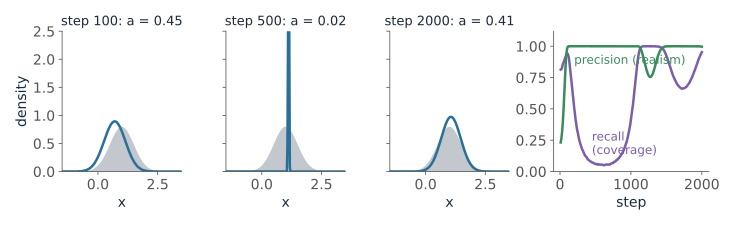
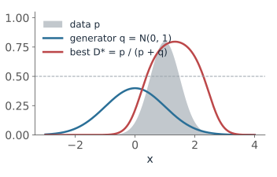
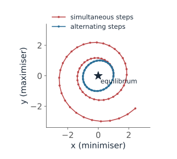
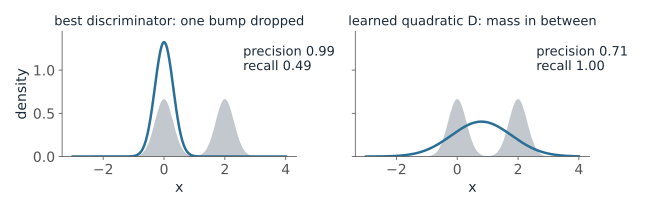
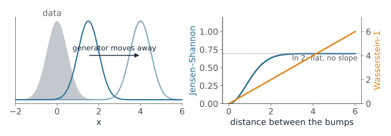
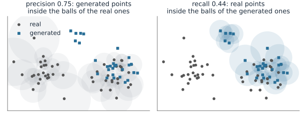

## About this lecture

*The theory says the GAN game ends with generated data distributed like the real data. Why does it so often end somewhere else, and how would you notice?*

- **Mode collapse**: all samples become (nearly) the same. **Oscillation**: the two players circle instead of settling.
- **Mode dropping** and **vanishing gradients**; the **Wasserstein** idea in one picture.
- Judging generated samples: **precision** (are they realistic?) and **recall** (is all the variety there?).

*Slides titled **The math** give the formulas and proofs; the ideas are complete without them.*

::: notes
Second unit of the day. Uses the line GAN of [gan/](../gan/lec.qmd) and its demo (gan1d, data-mode="training": presets "discriminator too slow: collapse", "generator too fast: overshoot", "two bumps, best discriminator: one dropped", "two bumps, learned discriminator: in between", "balanced: it settles", with precision and recall bars). Precision and recall of samples are introduced here; the diffusion-models day ([diffusion-sampling/](../diffusion-sampling/lec.qmd)) uses them again with the Fréchet distance and a memorisation check.
:::

## Mode collapse in its simplest form

{fig-alt="The line GAN with a discriminator that learns too slowly (learning rate 0.05, one step per generator step). Step 100: the generator (blue) is close to the data (grey), a = 0.45. Step 500: the generator is a narrow spike at x = 1.12, a = 0.02. Step 2000: it has widened again, a = 0.41. Right: precision stays near 1 throughout after step 100, while recall falls to about 0.06 around step 500 and recovers after step 1000." width="95%" fig-align="center"}

- The discriminator learns too slowly (learning rate 0.05, one step). The generator overshoots and then **squeezes all its samples onto one point**: $a = 0.02$ at step 500.
- Every sample looks real (precision 1.00), but the variety is gone (recall 0.06).

## Try it: collapse and overshoot

```{=html}
<link rel="stylesheet" href="../demos/dist/demo.css">
<div data-demo="gan1d" data-mode="training" data-preset="slow"></div>
<script src="../demos/dist/gan1d.js"></script>
```

::: notes
"discriminator too slow: collapse": a = 0.45 at step 100, 0.15 at 200, 0.02 at 500 (recall 0.06), then it slowly widens: 0.11 at 1000, 0.41 at 2000 (recall 0.95). "generator too fast: overshoot": learning rate 0.3 for G, one D step: a = 0.02 at step 50 (recall 0.06), recovered by step 200, a = 0.66 at step 300. "balanced: it settles" for comparison: precision and recall about 0.99 from step 100 on.
:::

## Why the generator collapses

:::: {.columns}
::: {.column width="55%"}
Each generator step answers the **current** discriminator.

- If $D$ were frozen, the best generator would put **every** sample at the single $x$ where $D(x)$ is highest. Nothing in the generator's loss rewards variety.
- A good discriminator notices the pile-up (too many fakes at one $x$: $D$ drops there) and pushes the samples apart again. A slow or weak one does not.
- On images: the generator makes the same few faces, cells or textures, whatever the noise.
:::
::: {.column width="45%"}
{fig-alt="The best discriminator p/(p+q) for data N(1, 0.5^2) and a generator N(0, 1): it is highest around the data's peak and falls where generated samples outnumber the real ones." width="100%"}
:::
::::

## The math: a frozen discriminator invites collapse {.math}

The generator minimises $\mathbb E_z[-\log D(G(z))]$ for the current $D$.

- For each $z$ separately, the best $G(z)$ is any maximiser $x^\star$ of $D$. So the best generator **for a fixed $D$** is the point mass at $x^\star$: zero variety.
- Variety only comes from the game: once $q$ piles up at $x^\star$, the best discriminator $D^* = p/(p + q)$ falls there.
- With alternating gradient steps the generator follows $D$'s slope **before** $D$ has adapted. Discriminator learning rate and number of steps decide whether $D$ keeps up (demo: $D$ rate 0.05 with one step collapses; 0.5 with five steps does not).

## The game rotates

:::: {.columns}
::: {.column width="55%"}
Gradient descent finds minima. A game is different: one player wants down, the other up.

- The simplest game: $x$ minimises $x\cdot y$, $y$ maximises it. The equilibrium is $(0, 0)$.
- **Simultaneous** gradient steps spiral **outwards** (radius × 3.2 after 60 steps with step 0.2); **alternating** steps circle for ever.
- GAN training has the same rotation near its equilibrium: the generator overshoots ($a = 0.66$ in the demo's "generator too fast"), the discriminator follows, and so on.
:::
::: {.column width="45%"}
{fig-alt="Paths of gradient steps for the game min over x, max over y of x times y, from (1, 0) with step 0.2. Simultaneous steps (red) spiral outwards to radius about 3; alternating steps (blue) stay on a circle of radius about 1 around the equilibrium at the origin." width="100%"}
:::
::::

## The math: why the steps spiral {.math}

For $f(x, y) = xy$, the gradients are $\partial f/\partial x = y$ and $\partial f/\partial y = x$.

- Simultaneous steps: $x \leftarrow x - \eta y$, $y \leftarrow y + \eta x$, i.e. multiplication by $\begin{pmatrix}1 & -\eta\\ \eta & 1\end{pmatrix}$, a rotation scaled by $\sqrt{1 + \eta^2} > 1$: an outward spiral, for every $\eta$.
- Alternating steps: the matrix $\begin{pmatrix}1 & -\eta\\ \eta & 1 - \eta^2\end{pmatrix}$ has determinant 1 and eigenvalues on the unit circle (for $\eta < 2$): the iterates circle, neither converging nor diverging.
- The "gradient field" of a game has a **rotational** part. Remedies damp it: smaller steps, averaging the weights over time, or extra terms (e.g. penalising the discriminator's gradient).

## Too simple a generator: dropping or blurring modes

{fig-alt="Two bumps of data at 0 and 2 (grey) and the line generator after 2000 steps (blue). Left, with the best discriminator: the generator sits exactly on the left bump, N(0, 0.3^2); precision 0.99, recall 0.49. Right, with the learned quadratic discriminator: one wide Gaussian N(0.8, 1) over both bumps; precision 0.71, recall 1.00." width="88%" fig-align="center"}

- A line generator can only make one bump. With the **best** discriminator (left) it chooses **one** of the two data bumps: realistic, half the variety missing (**mode dropping**).
- With the learned quadratic discriminator (right) it spreads over both, with samples **between** the bumps that no real data have.

## Vanishing gradients

:::: {.columns}
::: {.column width="46%"}
At the start, real and generated images barely overlap.

- Then the Jensen–Shannon divergence, which the game minimises, is stuck at its maximum $\ln 2$: moving the generator closer **does not change it** (right, blue). No slope, nothing to follow.
- A discriminator that is too good gives the generator saturated, uninformative gradients.
- The non-saturating loss of the [last unit](../gan/lec.qmd) helps; the Wasserstein idea goes further.
:::
::: {.column width="54%"}
{fig-alt="Left: the data density at 0 (grey) and a generator density moving away to 1.5 and 4. Right: Jensen-Shannon divergence (blue) and Wasserstein-1 distance (orange) against the distance between the two bumps of sd 0.5: JS rises to ln 2 by a distance of about 3 and is flat after; Wasserstein grows in a straight line, equal to the distance." width="100%"}
:::
::::

## The Wasserstein idea

- **Earth mover's distance**: how much mass must be moved how far to turn the generated distribution into the data. Two bumps 4 apart: distance 4; 6 apart: 6. It **keeps growing** (right, orange), so it always has a slope.
- The **critic** replaces the discriminator: a score $f(x)$, high on real and low on generated data, whose slope is limited ($|\text{slope}| \le 1$). The difference of mean scores is then the earth mover's distance (Arjovsky et al., 2017).
- In practice the slope limit is a penalty on $(\|\nabla_x f\| - 1)^2$ at points between real and generated samples (Gulrajani et al., 2017), or a normalisation of the critic's weights (**spectral normalisation**).
- Much steadier training; the critic's estimate of the distance also falls as the samples improve, unlike GAN losses.

## The math: Wasserstein-1 and its critic {.math}

$$W_1(p, q) = \inf_{\gamma\in\Pi(p, q)}\ \mathbb E_{(x, y)\sim\gamma}\,|x - y| = \sup_{\|f\|_L \le 1}\ \mathbb E_{x\sim p}f(x) - \mathbb E_{x\sim q}f(x)$$

- Left: the cheapest **transport plan** $\gamma$ (a joint distribution with marginals $p$ and $q$). In 1D: sort both samples and pair them by rank: $W_1 = \text{mean}|x_{(i)} - y_{(i)}|$ (the coding exercise).
- Right (Kantorovich–Rubinstein duality): the best **1-Lipschitz critic** $f$. A WGAN trains $f$ to maximise the difference and the generator to minimise it.
- For $p = \mathcal N(\mu, \sigma^2)$, $q = \mathcal N(\mu + d, \sigma^2)$: $W_1 = |d|$, while $\mathrm{JS} \to \ln 2$ as $|d|$ grows.

## Judging generated samples: realism and variety

:::: {.columns}
::: {.column width="45%"}
The GAN losses are no progress bar. Judge the **samples**, against held-out real images (in a feature space for images):

- **Precision**: the share of generated samples that lie where real data lie (**realism**).
- **Recall**: the share of real data that have generated samples nearby (**variety, coverage**).
- "Nearby": inside a ball reaching each point's $k$-th nearest neighbour of its own set.
:::
::: {.column width="55%"}
{fig-alt="A 2D sketch: real points (grey) in two clusters, generated points (blue squares) covering only the right cluster plus a small group above. Left: balls around the real points; 75 % of the generated points fall inside them (precision 0.75; the group above is outside). Right: balls around the generated points; only 44 % of the real points fall inside (recall 0.44; the left cluster is missed)." width="100%"}
:::
::::

## The math: precision and recall of samples {.math}

Real samples $R$, generated samples $G$; $r_k(\mathbf u)$ = distance from $\mathbf u$ to its $k$-th nearest neighbour in its own set (Kynkäänniemi et al., 2019):

$$\text{precision} = \frac1{|G|}\sum_{\mathbf g\in G}\big[\exists\,\mathbf r\in R: \|\mathbf g - \mathbf r\| \le r_k(\mathbf r)\big], \qquad \text{recall} = \frac1{|R|}\sum_{\mathbf r\in R}\big[\exists\,\mathbf g\in G: \|\mathbf r - \mathbf g\| \le r_k(\mathbf g)\big].$$

- The union of balls is an estimate of the **support** (where a distribution has mass); precision measures $q$'s mass inside $p$'s support, recall the reverse.
- Collapse: precision high, recall low. Samples between modes: precision lower, recall high.
- For images the points are **features** of a pretrained network, not pixels; small $k$ (3–5).

## Precision and recall as pseudocode

```
for every real point r:       rad_R[r] = distance to its k-th nearest other real point
for every generated point g:  rad_G[g] = distance to its k-th nearest other generated point
precision = share of generated g with  |g − r| ≤ rad_R[r]  for some real r
recall    = share of real r      with  |r − g| ≤ rad_G[g]  for some generated g
```

| run of the line GAN (step) | precision | recall |
|---|---|---|
| balanced (2000) | 0.98 | 0.99 |
| discriminator too slow (500): collapsed | 0.99 | 0.09 |
| two bumps, best discriminator: one dropped | 0.99 | 0.47 |
| two bumps, learned discriminator: in between | 0.90 | 1.00 |

::: notes
The table is the output of the coding exercise (gans/src/gan_training/: 500 real and 500 generated points, k = 3), which also computes the JS divergence and the Wasserstein distance of the figure two slides back. The demo uses a smooth version computed from the densities (share of mass where the other density is above 5 % of its peak), so its numbers differ slightly (collapse at step 500: recall 0.06; between: precision 0.71).
:::

## What helps in practice

- **Non-saturating** generator loss ([last unit](../gan/lec.qmd)).
- **Balance the players**: a faster discriminator (more steps, or a larger learning rate than the generator's), Adam with small momentum.
- **Limit the discriminator's slope**: a Wasserstein critic with a gradient penalty, or spectral normalisation. Smooth critics give useful gradients far from the data.
- **Let the discriminator see variety**: features computed over the whole batch (e.g. the spread of the samples), so a collapsed batch is easy to spot.
- **Average the generator's weights** over the last steps (damps the rotation).
- And always: look at many samples, compute precision and recall on held-out data, and check for **memorised** training images (the distance to the nearest training image; see the [diffusion-models day](../diffusion-sampling/lec.qmd)).

## Summary

| Problem | What you see | Why | Help |
|---|---|---|---|
| Mode collapse | same output for every $z$; recall drops | $G$ answers a frozen $D$ with a point | faster or smoother $D$, batch features |
| Oscillation | samples keep changing, no convergence | games rotate around the equilibrium | smaller steps, weight averaging |
| Mode dropping | realistic but parts of the data missing | the game prefers realism to coverage | stronger generator, check recall |
| Vanishing gradients | generator does not move | JS is flat when distributions do not overlap | non-saturating loss, Wasserstein critic |

Judge samples by **precision** (realism) and **recall** (variety), never by the GAN losses. Next: [translating images](../image-translation/lec.qmd), where a realistic sample can be the wrong answer.
