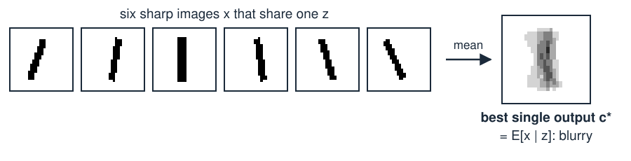
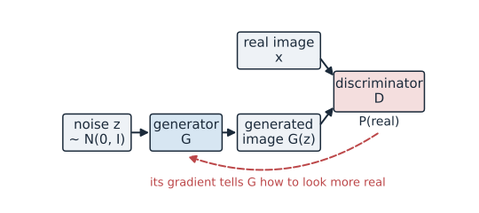
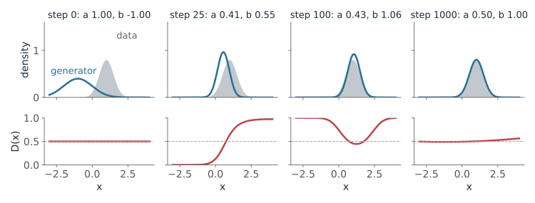
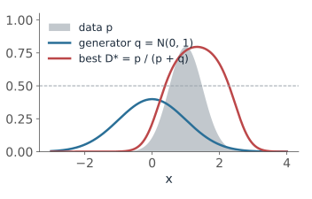
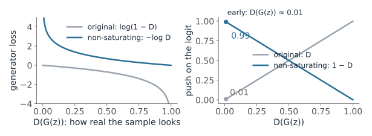
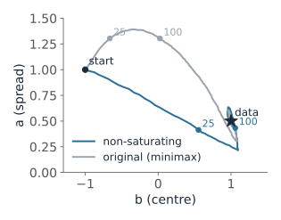

## About this lecture

*How can a network learn to make images that look real, when nobody can write down what "looking real" means?*

- A **generator** turns random numbers into images; a **discriminator** tries to tell them from real ones. The two are trained against each other.
- The smallest GAN: a line against a quadratic, in one dimension, trained live.
- The **best discriminator** and what the game converges to: generated data distributed like the real data.
- The **non-saturating loss**: why the textbook objective barely moves at the start.

*Slides titled **The math** give the formulas and proofs; the ideas are complete without them.*

::: notes
First unit of the day "GANs and normalising flows". Recalls the VAE ([vae-gen/](../vae-gen/lec.qmd)) and backpropagation ([backprop/](../backprop/lec.qmd)). Demo: gan1d (one-dimensional line GAN; presets "the game settles", "always the best discriminator", "original loss: a slow start", "generator too fast"). The next unit (gan-training) uses the same demo for what goes wrong.
:::

## Recall: the VAE generates, but blurrily

:::: {.columns}
::: {.column width="55%"}
The [VAE](../vae-gen/lec.qmd) draws a code $z \sim \mathcal N(0, I)$ and decodes it.

- Trained to **rebuild** each training image (squared error), its decoder outputs the **average** of all images that fit a code: sharp strokes become a blurry fan (right).
- What we want instead: a map from random numbers to images whose outputs **look like** real images, each one sharp.
- But "looks real" has no formula. Idea (Goodfellow et al., 2014): **learn** the judge too.
:::
::: {.column width="45%"}
{fig-alt="Six sharp synthetic strokes at slightly different angles and positions, and their pixel-wise mean, a blurry fan-shaped stroke." width="100%"}
:::
::::

## The game

{fig-alt="Diagram: noise z goes into the generator G, which outputs a generated image; the discriminator D receives generated and real images and outputs the probability that its input is real. A dashed red arrow from D back to G: its gradient tells G how to look more real." width="72%" fig-align="center"}

- **Discriminator** $D$: a classifier, real (1) or generated (0), trained with cross-entropy as on the [backprop day](../backprop/lec.qmd).
- **Generator** $G$: never sees a real image. It only gets the gradient of $D$'s verdict: "change your output this way to look more real".
- Like a forger and an inspector who both improve. The game ends when $D$ can do no better than guessing.

## A GAN in one dimension

:::: {.columns}
::: {.column width="40%"}
To watch the game, shrink it:

- **Data**: numbers from $\mathcal N(1, 0.5^2)$ (grey).
- **Generator**: a line, $x = a\,z + b$ with $z \sim \mathcal N(0, 1)$: its samples are $\mathcal N(b, a^2)$ (blue). Start: $a = 1$, $b = -1$.
- **Discriminator**: $D(x) = \sigma(c_0 + c_1x + c_2x^2)$ (red), a logistic curve of a quadratic.
- Five discriminator steps, then one generator step; repeat.
:::
::: {.column width="60%"}
{fig-alt="Four snapshots of training. Top: the data density (grey, centred at 1) and the generator density (blue). Bottom: the discriminator D(x). Step 0: generator N(-1, 1), D = 0.5 everywhere. Step 25: a = 0.41, b = 0.55, D rises from 0 on the left to 1 on the right. Step 100: a = 0.43, b = 1.06, D dips below 0.5 in the middle and is near 1 in the tails. Step 1000: a = 0.50, b = 1.00, the two densities coincide and D is about 0.5 everywhere." width="100%"}
:::
::::

- $D$ says "real" where data outnumber generated samples. The generator moves its samples **up the slope** of $D$.

## Try it: the game in one dimension

```{=html}
<link rel="stylesheet" href="../demos/dist/demo.css">
<div data-demo="gan1d" data-preset="converge"></div>
<script src="../demos/dist/gan1d.js"></script>
```

::: notes
Press run. "the game settles": at step 25 a = 0.41, b = 0.55 (the generator overshoots to too narrow), step 100 a = 0.43, b = 1.06, from step 500 a = 0.50, b = 1.00 and the discriminator loss sits at 1.39 = 2 ln 2: D cannot do better than guessing. "always the best discriminator": D is replaced by p/(p + q); the path goes straight to (1, 0.5) by step 100. "original loss: a slow start": b is still at 0.02 after 100 steps (non-saturating: 1.06). "generator too fast": learning rate 0.3 and one D step: a collapses to 0.02 at step 50 (every sample at the same place), then recovers by step 200; the next unit is about this.
:::

## The best discriminator

:::: {.columns}
::: {.column width="52%"}
For a fixed generator, which $D$ is best? At each $x$, $D$ sees real points with density $p(x)$ and generated ones with density $q(x)$. The best guess is the share of real ones:

$$D^*(x) = \frac{p(x)}{p(x) + q(x)}$$

- $p = 0.4$, $q = 0.1$: $D^* = 0.8$. Where only real data lie: 1. Only generated: 0.
- When the generator is perfect, $q = p$ and $D^* = \tfrac12$ **everywhere**: nothing left to learn from.
- Our quadratic $D$ can express $D^*$ exactly here: the log of a ratio of two Gaussians is a quadratic.
:::
::: {.column width="48%"}
{fig-alt="The data density N(1, 0.5^2) in grey, a generator density N(0, 1) in blue, and the best discriminator p/(p+q) in red: near 0 on the far left, rising through 0.5 near x = 0.4, close to 1 around the data peak, and falling back below 0.5 beyond x = 2.3 where the wide generator has more mass than the data." width="100%"}
:::
::::

## The math: the objective and the best discriminator {.math}

The two players share one value function (Goodfellow et al., 2014):

$$V(G, D) = \mathbb E_{x\sim p}\big[\log D(x)\big] + \mathbb E_{z}\big[\log\big(1 - D(G(z))\big)\big], \qquad \min_G\max_D V.$$

- $D$ maximises $V$: that is minimising its cross-entropy on real (label 1) and generated (label 0) samples.
- Write the second term over $x$ with the generator's density $q$: $V = \int p\log D + q\log(1 - D)\,dx$. For each $x$, $a\log y + b\log(1 - y)$ is largest at $y = a/(a + b)$, so
$$D^*(x) = \frac{p(x)}{p(x) + q(x)}.$$

## The math: what the generator minimises {.math}

Insert $D^*$ into $V$:

$$V(G, D^*) = \int p\log\frac{p}{p + q} + q\log\frac{q}{p + q}\,dx = -\log 4 + 2\,\mathrm{JS}(p\,\|\,q),$$

with the **Jensen–Shannon divergence** $\mathrm{JS}(p\,\|\,q) = \tfrac12\mathrm{KL}(p\,\|\,m) + \tfrac12\mathrm{KL}(q\,\|\,m)$, $m = \tfrac12(p + q)$.

- $\mathrm{JS} \ge 0$, and $= 0$ only for $q = p$: with a perfect discriminator, the generator's best move is to **match the data distribution**.
- At the optimum $V = -\log 4$, i.e. the discriminator's loss is $2\ln 2 = 1.386$ (the demo's dashed line).
- In practice $D$ is never optimal and both are trained by alternating gradient steps: the theory says where the game can end, not that it gets there ([next unit](../gan-training/lec.qmd)).

## The original loss stalls at the start

:::: {.columns}
::: {.column width="48%"}
Early on, $D$ easily spots the fakes: $D(G(z)) \approx 0.01$.

- The original generator loss $\log(1 - D)$ is **flat** there (left, grey): the push on the generator is $D = 0.01$.
- **Non-saturating** loss: minimise $-\log D(G(z))$ instead ("make D say real"). Same goal, but the push is $1 - D = 0.99$: 99 times stronger exactly when the generator is bad.
- Everyone uses the non-saturating version.
:::
::: {.column width="52%"}
{fig-alt="Left: generator loss against D(G(z)): the original log(1 - D) is nearly flat near 0 and drops steeply near 1; the non-saturating -log D is steep near 0 and flat near 1. Right: the push on the discriminator's logit: D for the original loss (0.01 at D = 0.01), 1 - D for the non-saturating loss (0.99 at D = 0.01)." width="100%"}
:::
::::

## The math: the generator's gradient {.math}

Let $s(x) = c_0 + c_1x + c_2x^2$ be the discriminator's logit, $D = \sigma(s)$, and $x = az + b$. Per sample:

$$\frac{\partial}{\partial s}\big[-\log\sigma(s)\big] = -(1 - D), \qquad \frac{\partial}{\partial s}\big[\log(1 - \sigma(s))\big] = -D,$$

$$\frac{\partial \ell}{\partial b} = \frac{\partial \ell}{\partial s}\,s'(x), \qquad \frac{\partial \ell}{\partial a} = \frac{\partial \ell}{\partial s}\,s'(x)\,z, \qquad s'(x) = c_1 + 2c_2x.$$

- The generator's gradient goes **through** the discriminator: backpropagation with $D$'s weights held fixed.
- Both losses push in the same direction ($-s'(x)$); they differ only in the factor, $1 - D$ or $D$.
- For a network generator, $\partial x/\partial(\text{weights})$ comes from backpropagation through $G$; nothing else changes.

## Two routes to the same end

:::: {.columns}
::: {.column width="55%"}
The path of the generator's $(b, a)$ in the demo, from the start $(-1, 1)$ to the data's $(1, 0.5)$:

- **Non-saturating** (blue): moves right at once; overshoots to a too narrow generator ($a = 0.22$ at step 50), then widens.
- **Original** (grey): first **widens** ($a$ up to 1.38) while barely moving; $b$ is 0.02 after 100 steps (non-saturating: 1.06).
- Both end at $a = 0.50$, $b = 1.00$.
:::
::: {.column width="45%"}
{fig-alt="Paths in the plane of b (centre) and a (spread). From the start at (-1, 1), the blue non-saturating path runs down and right to a = 0.22 near b = 1, then curls up to the star at (1, 0.5); dots mark steps 25 and 100. The grey original-loss path first climbs to a = 1.38 while moving slowly right, then descends steeply onto the star." width="100%"}
:::
::::

## GAN training as pseudocode

```
repeat:
    for k steps:                                        # the discriminator
        real = a batch of training images
        fake = G(z) for a batch of noise z
        loss_D = mean(−log D(real)) + mean(−log(1 − D(fake)))
        step D's weights down the gradient of loss_D
    fake = G(z) for a fresh batch of noise z            # the generator
    loss_G = mean(−log D(fake))                         # non-saturating
    step G's weights down the gradient of loss_G        # backprop through D, then G
```

- Two networks, two optimisers, one alternating loop. Only $G$ is kept at the end.

::: notes
The coding exercise (gans/src/gan/ in the course code download) writes D, its loss and gradient, the generator's gradient by the chain rule and this loop for the one-dimensional GAN, checked against the by-hand exercises B3 and B4.
:::

## GANs for images

- $G$: a convolutional network that **upsamples** a noise vector (say 128 numbers) into an image; $D$: a convolutional classifier ([convolutional networks](../cnn/lec.qmd)).
- Within a few years (2014–2019) GANs went from blurry 32 × 32 digits to photographic faces at 1024 × 1024 that people cannot tell from photos.
- Strengths: **sharp** images, **one forward pass** per sample (fast).
- Weaknesses: no likelihood (you cannot ask "how probable is this image?"), no encoder, and **training is fragile** ([next unit](../gan-training/lec.qmd)).
- In microscopy they are mostly used as **translators** from one kind of image to another ([image-to-image translation](../image-translation/lec.qmd)), with the risks that come with it.

## VAE and GAN side by side

| | VAE | GAN |
|---|---|---|
| Trained by | rebuilding training images (+ a prior term) | a game against a discriminator |
| Samples | blurry: the average of what fits a code | sharp: "looks real" is learned |
| Encoder (image → code) | yes | no |
| Likelihood | a lower bound (ELBO) | none |
| Training | stable, one loss going down | two losses, no single number that must go down |
| Failure | blur | missing variety, oscillation ([next unit](../gan-training/lec.qmd)) |

## Summary

| Idea | In one line |
|---|---|
| The game | $G$ makes samples, $D$ tells real from fake, each trained against the other |
| Best discriminator | $D^* = p/(p + q)$; $\tfrac12$ everywhere when the generator matches the data |
| What $G$ minimises | with the best $D$: the Jensen–Shannon divergence between data and samples |
| Non-saturating loss | $-\log D(G(z))$: a strong push exactly when the generator is bad |
| Generator gradient | backpropagation through $D$ into $G$ |
| Trade-off | sharp and fast samples; no likelihood, fragile training |

Next: [what goes wrong in training](../gan-training/lec.qmd), and how to see it.
