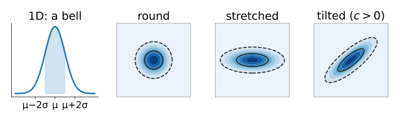
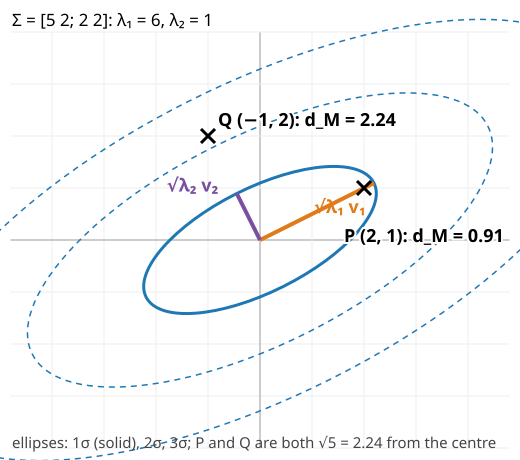
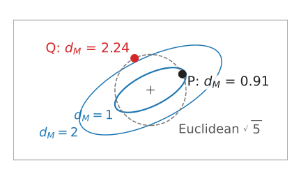
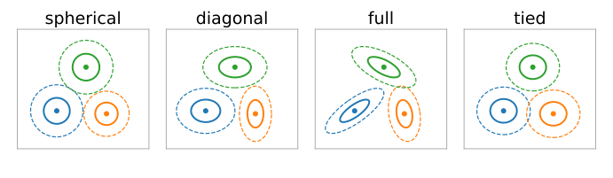
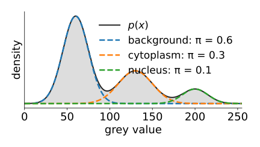
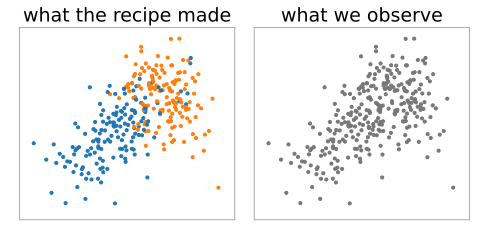
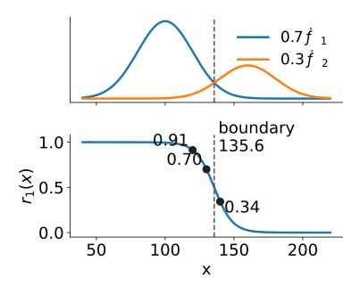
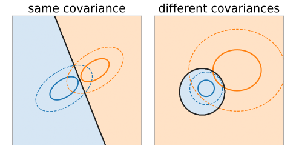
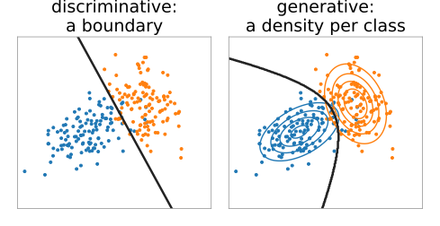

## About this lecture

k-means describes a group by one point and cuts the space with straight lines. Now each group gets a **shape**, a **size** and a **weight**: a Gaussian.

- One **Gaussian in 2D**: a hill whose contour lines are **ellipses**, set by the **covariance matrix** $\Sigma$.
- **Mahalanobis distance**: "how many standard deviations away", in the direction you are going.
- **Covariance types**: spherical, diagonal, full, tied.
- The **mixture** as a recipe for making data; the **hidden** component of each point; **responsibilities** (soft labels) by Bayes' rule.
- The **likelihood** of a data set, and why one Gaussian is easy to fit and a mixture is not.

Slides titled **The math** give the formulas and proofs; the ideas are complete without them.

## From one dimension to two

In 1D the normal density is a bell: centre $\mu$, width $\sigma$. What matters is **how many standard deviations** $x$ is from $\mu$: $(x - \mu)/\sigma$.

In 2D (two features per pixel) the density is a **hill** over the plane.

- Its **contour lines** (points of equal density) are **ellipses** around the centre $\boldsymbol\mu$.
- Round hill: both features vary equally and independently. Stretched hill: one direction varies more. Tilted hill: the features are **correlated** (bright in one channel, bright in the other).
- All of this is in one $2 \times 2$ matrix, the **covariance** $\Sigma = \begin{pmatrix} \sigma_1^2 & c \\ c & \sigma_2^2 \end{pmatrix}$: variances on the diagonal, covariance $c$ off it.

{width="60%" fig-alt="A 1D normal bell with the band from μ − σ to μ + σ shaded, then three 2D Gaussians seen from above as shaded hills with their 1σ (solid) and 2σ (dashed) ellipses: round circles, an ellipse stretched along x, and an ellipse tilted up to the right because the two features are positively correlated"}

Notation: $\Sigma$ for the covariance of a model component, $S$ for a covariance computed from data.

## Recall: covariance and principal axes

The PCA unit (day 1) showed that the eigenvectors of a covariance matrix are the **principal axes** of a point cloud, and each eigenvalue $\lambda_i$ is the variance along its axis. The labelling day's "equivalent ellipse" of an object is the same picture.

For a Gaussian:

- the ellipse axes point along the **eigenvectors** $\mathbf v_1, \mathbf v_2$ of $\Sigma$;
- the half-lengths of the **1σ ellipse** are $\sqrt{\lambda_1}$ and $\sqrt{\lambda_2}$ (the 2σ ellipse is twice as large);
- the off-diagonal entry **tilts** the ellipse; with $c = 0$ the axes are the coordinate axes.

## Reading an ellipse: an example {.smaller}

:::: {.columns}
::: {.column width="48%"}
{width="100%"}
:::
::: {.column width="52%"}
$\Sigma = \begin{pmatrix} 5 & 2 \\ 2 & 2 \end{pmatrix}$, centred at $\mathbf 0$.

- Eigenvalues $\lambda_1 = 6$, $\lambda_2 = 1$; eigenvectors $\mathbf v_1 = (2, 1)/\sqrt5$, $\mathbf v_2 = (-1, 2)/\sqrt5$.
- The 1σ ellipse: half-axis $\sqrt6 = 2.45$ along $(2, 1)$, half-axis $1$ across it. Tilted by $26.6°$.
- Check: $\lambda_1 + \lambda_2 = 7 = 5 + 2$ (the trace), $\lambda_1\lambda_2 = 6 = 5 \cdot 2 - 2^2$ (the determinant).

The points $P = (2, 1)$ and $Q = (-1, 2)$ are both $\sqrt5 = 2.24$ from the centre. Is either of them unusual?
:::
::::

## Mahalanobis distance

:::: {.columns}
::: {.column width="58%"}
Euclidean distance ignores the shape of the cloud. The **Mahalanobis distance** measures in standard deviations **along the direction you are going**:

$$d_M(\mathbf x)^2 = (\mathbf x - \boldsymbol\mu)^\top\Sigma^{-1}(\mathbf x - \boldsymbol\mu).$$

- In 1D: $d_M = |x - \mu|/\sigma$, the familiar "how many sigmas".
- The 1σ ellipse is exactly $d_M = 1$; the 2σ ellipse $d_M = 2$.
- In the example: $P$ lies along the long axis, $d_M(P) = \sqrt{5/6} = 0.91$, **inside** the 1σ ellipse. $Q$ lies along the short axis, $d_M(Q) = \sqrt5 = 2.24$: more than 2σ out. Same Euclidean distance, very different.
:::
::: {.column width="42%"}
{width="100%" fig-alt="The 1σ and 2σ ellipses of the covariance [5 2; 2 2], long axis tilted up to the right, and a dashed Euclidean circle of radius √5. P = (2, 1) lies on the circle along the long axis, inside the 1σ ellipse: d_M = 0.91. Q = (−1, 2) lies on the same circle across the short axis, beyond the 2σ ellipse: d_M = 2.24"}
:::
::::

Use: "is this pixel (or object) unusual for this class?" (unit 4: anomalies).

## The math: the density and its ellipses {.math .smaller}

$$\mathcal N(\mathbf x \mid \boldsymbol\mu, \Sigma) = \frac{1}{(2\pi)^{d/2}\,|\Sigma|^{1/2}}\exp\!\left(-\tfrac12 (\mathbf x - \boldsymbol\mu)^\top\Sigma^{-1}(\mathbf x - \boldsymbol\mu)\right)$$

In 1D the exponent is $-\tfrac12 (x - \mu)^2/\sigma^2$; $\Sigma^{-1}$ replaces $1/\sigma^2$.

- $\Sigma$ is symmetric positive definite: $\Sigma = Q\Lambda Q^\top$ with orthonormal eigenvectors in $Q$ and $\Lambda = \operatorname{diag}(\lambda_1, \dots, \lambda_d)$. In the rotated coordinates $\mathbf y = Q^\top(\mathbf x - \boldsymbol\mu)$: $d_M^2 = \sum_i y_i^2/\lambda_i$.
- So the density **factorises** into independent 1D normals with variances $\lambda_i$ along the eigenvectors, and $d_M = 1$ is the ellipse with half-axes $\sqrt{\lambda_i}$. $|\Sigma| = \prod_i\lambda_i$.
- **Sampling**: with $\mathbf z$ standard normal ($d$ independent $\mathcal N(0, 1)$), $\mathbf x = \boldsymbol\mu + Q\Lambda^{1/2}\mathbf z$ has covariance $Q\Lambda^{1/2}\Lambda^{1/2}Q^\top = \Sigma$. (Any $L$ with $LL^\top = \Sigma$, e.g. the Cholesky factor, works too.)
- Example: $\Sigma^{-1} = \frac16\begin{pmatrix} 2 & -2 \\ -2 & 5\end{pmatrix}$; $d_M(P)^2 = \frac16(8 - 8 + 5) = \frac56$; $d_M(Q)^2 = \frac16(2 + 8 + 20) = 5$.

## Try it: one Gaussian

```{=html}
<link rel="stylesheet" href="../demos/dist/demo.css">
<div data-demo="gauss2d" data-preset="maha"></div>
<script src="../demos/dist/gauss2d.js"></script>
```

::: notes
Preset "same Euclidean distance, different Mahalanobis": Σ = [5 2; 2 2]. The readout gives λ1 = 6, λ2 = 1, the angle 26.6°, and for P = (2, 1): Euclidean 2.24, Mahalanobis 0.91, density 0.043; for Q = (−1, 2): Euclidean 2.24, Mahalanobis 2.24, density 0.005. Drag the square handles: the ellipse turns and stretches; the samples (300, fixed seed) follow. Switch Σ to "spherical": circles, Mahalanobis = Euclidean / σ. "diagonal": axis-aligned ellipses only.
:::

## Covariance types

How much freedom each group's shape gets. For $K$ components in $d$ dimensions, numbers per component:

| type | $\Sigma_k$ | picture | numbers per component |
|---|---|---|---|
| spherical | $\sigma_k^2 I$ | circles, own size | $1$ |
| diagonal | $\operatorname{diag}(\sigma_{k1}^2, \dots)$ | axis-aligned ellipses | $d$ |
| full | any | any ellipse | $d(d+1)/2$ |
| tied | one $\Sigma$ for all $k$ | same ellipse everywhere | $d(d+1)/2$ in total |

Total parameters = $K - 1$ weights + $Kd$ means + covariance numbers. Colour pixels ($d = 3$), $K = 3$: spherical $2 + 9 + 3 = 14$, diagonal $20$, full $29$, tied $17$.

{width="55%" fig-alt="The same three components drawn as 1σ and 2σ ellipses under each covariance type: spherical gives circles of different sizes, diagonal gives axis-aligned ellipses, full gives ellipses of any tilt, tied gives three copies of one ellipse"}

More freedom fits better, but needs more data and can overfit (unit 3).

## A mixture is a recipe for data

:::: {.columns}
::: {.column width="55%"}
A **Gaussian mixture** with $K$ components makes one data point like this:

1. pick a component $k$ at random, with probability $\pi_k$ (the **weights**, summing to 1);
2. draw $\mathbf x$ from that component's Gaussian $\mathcal N(\boldsymbol\mu_k, \Sigma_k)$.

The density of the result is a weighted sum of hills:

$$p(\mathbf x) = \sum_{k=1}^K \pi_k\,\mathcal N(\mathbf x \mid \boldsymbol\mu_k, \Sigma_k).$$

Image example: a pixel is background (weight 0.6, dark), cytoplasm (0.3, grey) or nucleus (0.1, bright), and its value scatters around the class mean.
:::
::: {.column width="45%"}
{width="100%" fig-alt="A 1D mixture density over grey values: three weighted Gaussian bumps, background (weight 0.6, mean 60), cytoplasm (0.3, mean 130) and nucleus (0.1, mean 200), and their sum p(x) as a shaded curve with three peaks of decreasing height"}

Means 60, 130, 200; σ = 15, 20, 15.
:::
::::

## The labels are hidden

:::: {.columns}
::: {.column width="55%"}
We see the points, **not** which component made each one: the component is a **hidden** (latent) variable.

- With colours (labels), fitting is easy: each class's mean and covariance separately (this is supervised learning).
- Without them, the clouds overlap and we must recover the recipe from the uncoloured points: **unsupervised**.
- Fitting a mixture = finding $\pi_k$, $\boldsymbol\mu_k$, $\Sigma_k$ that could have produced the data (unit 3).

In the demo: tick **hide colours**: this is what an algorithm gets.
:::
::: {.column width="45%"}
{width="100%" fig-alt="300 points from a two-component mixture with weights 0.6 and 0.4. Left: coloured by the component that made each point, two overlapping clouds. Right: the same points all in grey, as an algorithm sees them"}
:::
::::

## Responsibilities: soft labels

:::: {.columns}
::: {.column width="58%"}
Given the parameters, which component made $\mathbf x$? Bayes' rule, as on the thresholding day:

$$r_k(\mathbf x) = P(k \mid \mathbf x) = \frac{\pi_k\,\mathcal N(\mathbf x \mid \boldsymbol\mu_k, \Sigma_k)}{p(\mathbf x)}.$$

- A **soft label**: "70 % component 1, 30 % component 2". The $r_k$ sum to 1.
- The **hard label** is the component with the largest $r_k$.
- 1D example: $\pi = (0.7, 0.3)$, $\mu = (100, 160)$, $\sigma = 20$ for both. At $x = 130$ (halfway) the two densities are equal, so $r_1 = 0.7$: the weights decide. At $x = 120$: $r_1 = 0.91$; at $x = 140$: $r_1 = 0.34$.
- The boundary ($r_1 = r_2$) is at $135.6$, not at the midpoint 130: the more frequent class gets more room.
:::
::: {.column width="42%"}
{width="100%" fig-alt="Top: the weighted densities 0.7 N(100, 20²) and 0.3 N(160, 20²). Bottom: the responsibility r1(x) falls smoothly from 1 to 0; it is 0.91 at 120, 0.70 at 130 and 0.34 at 140, and crosses 0.5 at the boundary 135.6, marked by a dashed line"}
:::
::::

## Bayes boundaries: straight or curved

:::: {.columns}
::: {.column width="55%"}
Where two components are equally probable, $\pi_1\mathcal N_1(\mathbf x) = \pi_2\mathcal N_2(\mathbf x)$:

- **same covariance** (tied): the boundary is a **straight line** (a plane), shifted by the weights. k-means' bisector is the special case of equal weights and round, equal components.
- **different covariances**: a **curved** boundary (a conic: ellipse, parabola or hyperbola). The wider component wins far away on **both** sides.
- 1D: $\mathcal N(0, 1)$ and $\mathcal N(3, 2^2)$, equal weights: the narrow component wins only for $-3.42 < x < 1.42$. Far to the left the wide one wins again.
:::
::: {.column width="45%"}
{width="100%" fig-alt="Two 2D examples with the plane shaded by the most probable of two equally weighted components. With the same covariance the boundary is a straight line. With a narrow round component and a wide one the boundary is a closed curve around the narrow component: the wide one wins on every side"}
:::
::::

## The math: tied covariances give straight boundaries {.math}

Take logs of $\pi_1\mathcal N_1(\mathbf x) = \pi_2\mathcal N_2(\mathbf x)$ with $\Sigma_1 = \Sigma_2 = \Sigma$:

$$\log\pi_1 - \tfrac12(\mathbf x - \boldsymbol\mu_1)^\top\Sigma^{-1}(\mathbf x - \boldsymbol\mu_1) = \log\pi_2 - \tfrac12(\mathbf x - \boldsymbol\mu_2)^\top\Sigma^{-1}(\mathbf x - \boldsymbol\mu_2).$$

The normalising constants are equal and cancel; so does $\mathbf x^\top\Sigma^{-1}\mathbf x$:

$$\mathbf x^\top\Sigma^{-1}(\boldsymbol\mu_1 - \boldsymbol\mu_2) = \tfrac12\left(\boldsymbol\mu_1^\top\Sigma^{-1}\boldsymbol\mu_1 - \boldsymbol\mu_2^\top\Sigma^{-1}\boldsymbol\mu_2\right) + \log\frac{\pi_2}{\pi_1}:$$

linear in $\mathbf x$. With $\Sigma_1 \ne \Sigma_2$ the term $\tfrac12\mathbf x^\top(\Sigma_2^{-1} - \Sigma_1^{-1})\mathbf x$ survives: a quadratic boundary. In 1D with equal variances: $x = \frac{\mu_1 + \mu_2}{2} + \frac{\sigma^2}{\mu_2 - \mu_1}\log\frac{\pi_1}{\pi_2}$, the thresholding day's equal-variance threshold. Example: $130 + \frac{400}{60}\log\frac{0.7}{0.3} = 135.6$.

## Try it: a mixture

```{=html}
<link rel="stylesheet" href="../demos/dist/demo.css">
<div data-demo="gauss2d" data-mode="mixture" data-preset="hidden"></div>
<script src="../demos/dist/gauss2d.js"></script>
```

::: notes
Preset "two overlapping components": weights 0.6 and 0.4. The samples are coloured by the component that produced them; tick "hide colours": that is what an algorithm sees. P at (0.3, 0.3): responsibilities 75 % / 25 %. Move the weight sliders: the bar changes although nothing moved. "same covariance: straight boundary" with the background "most probable component": a straight line; change one weight and it shifts parallel. "different covariances: curved boundary": the narrow component's region is an island; the wide one wins on both sides.
:::

## The likelihood of a data set

How well do parameters $\theta$ explain the data? The **likelihood**: the probability density of the observed points, treated as a function of $\theta$:

$$p(\mathcal D \mid \theta) = \prod_i p(\mathbf x_i \mid \theta), \qquad \log p(\mathcal D \mid \theta) = \sum_i \log p(\mathbf x_i \mid \theta).$$

- **Maximum likelihood**: choose the parameters that make the observed data most probable.
- For **one** Gaussian the answer is in closed form: $\boldsymbol\mu$ = the sample mean, $\Sigma$ = the sample covariance $S$ (divided by $n$).
- For a **mixture**, $\log p(\mathcal D) = \sum_i \log \sum_k \pi_k\mathcal N_k(\mathbf x_i)$: a log of a **sum**, and no closed form. If we knew the hidden labels, each component would be fitted by its own mean and covariance. That chicken-and-egg problem is unit 3.

## The math: maximum likelihood for one Gaussian {.math .smaller}

$$\log p(\mathcal D) = -\frac{nd}{2}\log 2\pi - \frac n2\log|\Sigma| - \frac12\sum_i(\mathbf x_i - \boldsymbol\mu)^\top\Sigma^{-1}(\mathbf x_i - \boldsymbol\mu).$$

- Gradient in $\boldsymbol\mu$: $\Sigma^{-1}\sum_i(\mathbf x_i - \boldsymbol\mu) = 0 \Rightarrow \hat{\boldsymbol\mu} = \frac1n\sum_i\mathbf x_i$.
- In $\Sigma^{-1} =: P$ (using $\partial\log|P|/\partial P = P^{-1}$ and $\partial\,\mathbf a^\top P\mathbf a/\partial P = \mathbf a\mathbf a^\top$): $\frac n2 P^{-1} - \frac12\sum_i(\mathbf x_i - \hat{\boldsymbol\mu})(\mathbf x_i - \hat{\boldsymbol\mu})^\top = 0 \Rightarrow \hat\Sigma = \frac1n\sum_i(\mathbf x_i - \hat{\boldsymbol\mu})(\mathbf x_i - \hat{\boldsymbol\mu})^\top = S.$
- With **known labels** the mixture splits into $K$ such problems, plus $\hat\pi_k = n_k/n$. With hidden labels the $\log\sum_k$ couples everything.

## Generative and discriminative

:::: {.columns}
::: {.column width="55%"}
The same 2D point cloud, two ways of learning from it:

- **With labels** (random-forests day, SVM elective): learn a **boundary** between the classes directly. Discriminative: says nothing about where points come from.
- **Without labels** (this day): learn a **model of how the points were made**, a mixture. Generative: it gives a density $p(\mathbf x)$, can draw new points, can say "this point is unlikely under every class", and its Bayes boundaries come for free.

Generative models need more assumptions (here: Gaussian groups). When the assumptions hold, few data suffice; when they do not, a discriminative boundary is usually more accurate.
:::
::: {.column width="45%"}
{width="100%" fig-alt="The same two labelled point clouds twice. Left, discriminative: only a straight line separating them. Right, generative: contour lines of a Gaussian density fitted to each class, and the curved Bayes boundary where the two densities are equal"}
:::
::::

## Summary

- A 2D **Gaussian** is a hill with **elliptical** contours: axes = eigenvectors of $\Sigma$, half-lengths $\sqrt{\lambda_i}$ (1σ).
- **Mahalanobis distance** $d_M^2 = (\mathbf x - \boldsymbol\mu)^\top\Sigma^{-1}(\mathbf x - \boldsymbol\mu)$: standard deviations in the direction of $\mathbf x$.
- **Covariance types**: spherical, diagonal, full, tied: more freedom, more parameters.
- A **mixture**: pick a component with probability $\pi_k$, then draw from its Gaussian; the component is **hidden**.
- **Responsibilities** $r_k(\mathbf x) = \pi_k\mathcal N_k(\mathbf x)/p(\mathbf x)$: soft labels; boundaries straight for tied covariances, curved otherwise.
- **Likelihood** $\sum_i\log p(\mathbf x_i)$: one Gaussian has a closed-form fit; a mixture does not (next unit).
