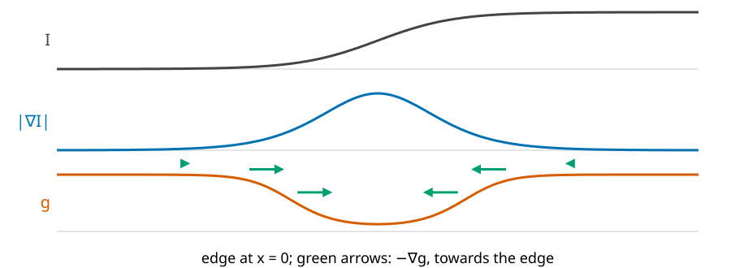
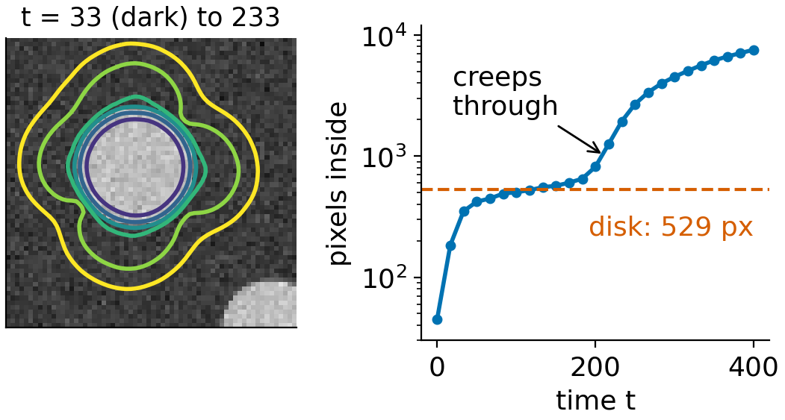
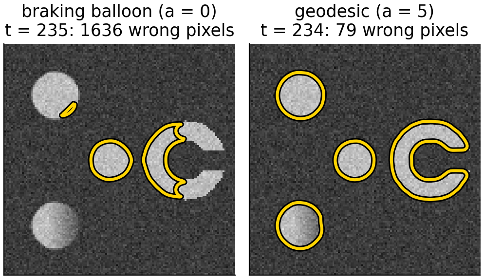
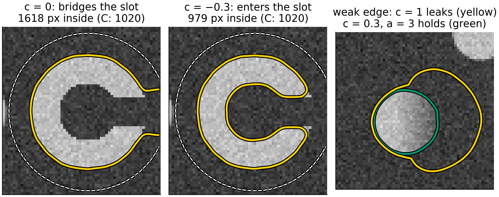
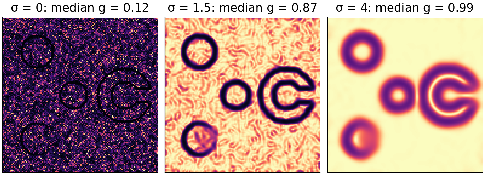
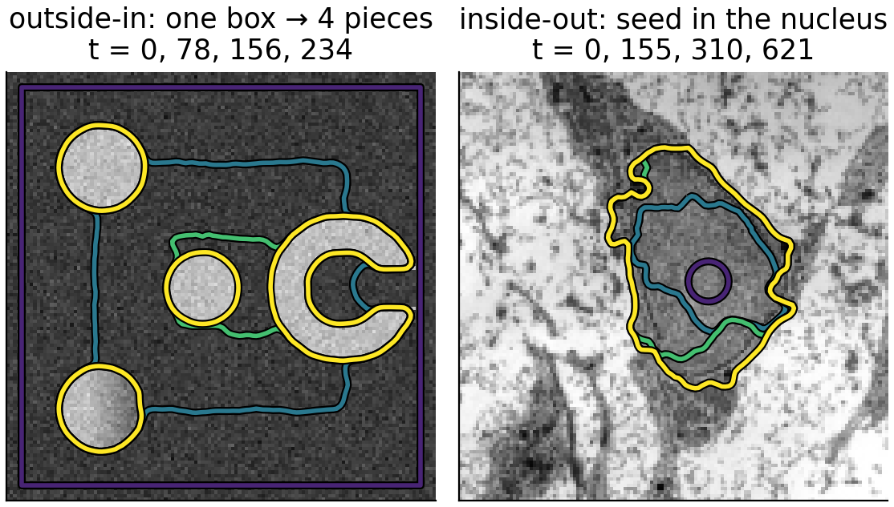

## About this lecture

We can now move a curve with any speed $F$. To **segment** an image, let the image decide the speed: fast where nothing happens, almost zero on edges. The front then stops on object boundaries, and it can split around several objects on its own.

- Recall: snakes, and what they could not do.
- The **edge-stopping function** $g$: the image turned into a speed.
- Stage 1: a **balloon that brakes** at edges.
- Stage 2: **geodesic active contours**: the shortest curve in an image-weighted metric, with a pull into the edge.
- What the knobs do, and the typical failures: **leaking** through weak edges, getting **stuck** in concavities and noise.

*Slides titled **The math** give the formulas and proofs; the ideas are complete without them.*

::: notes
Prerequisites: the previous two units (implicit curves, the level set equation with upwind differences), Gaussian smoothing and the image gradient (Filtering & convolution, Edges day). The snakes day (previous in this chain of days) is recalled on one slide only.
:::

## Recall: snakes (snakes day)

A [snake](../snakes/lec.qmd) is an **explicit** closed curve that moves downhill on an energy: internal (elasticity $\alpha$, rigidity $\beta$: short and smooth) plus image (large edge strength $|\nabla I|^2$ is attractive).

- It works, given a good start: it refines a curve you place near the object.
- **Fixed topology**: one snake, one curve. Two objects need two snakes; it cannot split or merge.
- Points bunch up or spread out and must be **re-sampled**; nothing prevents self-intersection.
- A **balloon** force helps it reach far edges, and leaks through weak ones.

Level sets keep the idea (an energy, a pull towards edges, a balloon) and drop the points.

## The image as a speed

Make a function that is about **1 in flat regions** and about **0 on edges**:
$$g = \frac{1}{1 + |\nabla I_\sigma|^2 / k^2}, \qquad I_\sigma = \text{the image smoothed with a Gaussian of width } \sigma.$$

- $|\nabla I_\sigma|$: the edge strength, from Gaussian smoothing and differences of neighbours ([*Filtering & convolution*](../kernels/lec.qmd), the [edges day](../canny/lec.qmd)).
- $k$ sets what counts as an edge: where $|\nabla I_\sigma| = k$, $g = 0.5$; at $3k$, $g = 0.1$.
- $\sigma$ suppresses noise: without smoothing every noisy pixel looks like a small edge.

{width="70%"}

## A 1D edge by hand

The step $0, 0, 0, 10, 10, 10$, smoothed with $[1\ 2\ 1]/4$ (border pixels repeated): $0, 0, 2.5, 7.5, 10, 10$.

| pixel | 1 | 2 | 3 | 4 | 5 | 6 |
|---|---|---|---|---|---|---|
| $\lvert\nabla I\rvert$ (central) | 0 | 1.25 | 3.75 | 3.75 | 1.25 | 0 |
| $g$, $k = 2$ | 1 | 0.72 | 0.22 | 0.22 | 0.72 | 1 |

- A front moving with speed $g$ slows to 22% at the edge, but does **not** stop: with $k = 2$ this edge is not strong enough to fall below 0.1. That needs $|\nabla I| > 3k$, i.e. $k < 1.25$.
- A balloon alone never stops exactly: $g > 0$ everywhere. Something must pull it back into the edge.

## Stage 1: a balloon that brakes

:::: {.columns}
::: {.column width="55%"}
Use $g$ as a brake on the motion of unit 2:
$$F = g\,(c - \varepsilon\kappa)$$
(Caselles et al., 1993; Malladi, Sethian & Vemuri, 1995).

- $c$: the **balloon**, a constant push; $c > 0$ inflates a curve placed inside an object, $c < 0$ shrinks one placed around it.
- $\varepsilon\kappa$: smooths the curve, as in curvature flow.
- In flat regions $g \approx 1$: the front moves at speed $c$. On an edge $g \approx 0$: it nearly stops.
- Nearly: where $g$ is 0.06 (a strong edge in the demo) the front still creeps at 6% of its speed, and on a weak edge ($g = 0.44$) it hardly slows at all.
:::
::: {.column width="45%"}
{width="100%" fig-alt="A small circle grows inside a bright disk of the noisy test image with c = 0.3, ε = 0.3 and no advection. Left: fronts from t = 33 to 233; the early ones pile up on the disk's edge, the last two have crept out. Right: pixels inside against time, log scale: fast growth to the disk's 529 pixels, a plateau from about t = 70 to 180, then growth through the edge."}
:::
::::

## The math: the braking balloon {.math}

The level set form, with $\phi < 0$ inside:
$$\phi_t = -g\,(c - \varepsilon\kappa)\,|\nabla\phi| = -g\,c\,|\nabla\phi| + \varepsilon\,g\,\kappa\,|\nabla\phi|.$$

- The first term is a wave with speed $g c$: upwind differences, time step $\Delta t \le \Delta x/(\sqrt2\max|gc|)$.
- The second is a weighted curvature flow: central differences, $\Delta t \le \Delta x^2/(4\varepsilon\max g)$.
- A front is in equilibrium only where $g(c - \varepsilon\kappa) = 0$: on the edge only if $g = 0$ exactly, or where curvature balances the balloon, $\kappa = c/\varepsilon$, which is a property of the shape, not of the image.

## Stage 2: geodesic active contours

:::: {.columns}
::: {.column width="58%"}
Caselles, Kimmel & Sapiro (1997): look for the curve with the smallest **edge-weighted length**
$$L_g(C) = \oint_C g\,ds.$$

- Ordinary length counts every bit of curve as 1. Here a bit of curve **on an edge** costs almost nothing ($g \approx 0$) and in a flat region costs 1. The cheapest closed curve runs along the edges: a **geodesic** (shortest path) in this image-made distance.
- Moving downhill on $L_g$ gives the braking curvature term plus a new term: an **advection** along $-\nabla g$, which points from both sides **into the valley** of $g$ (green arrows in the figure on the previous slide).
- The advection pulls a front that has overshot an edge back into it, and holds it there.
:::
::: {.column width="42%"}
{width="100%" fig-alt="The shrink-wrap preset at t ≈ 235, a box shrinking with c = −0.3. Left, braking balloon (no advection): the front has passed through the top-left disk and eaten into the C; 1636 wrong pixels. Right, with advection a = 5: four contours sit on the edges of the three disks and the C; 79 wrong pixels."}
:::
::::

## The math: the geodesic active contour flow {.math}

Moving the curve outward by $\delta$ changes the weighted length by $\oint(g\kappa + \nabla g\cdot\mathbf n)\,\delta\,ds$ (first variation; not derived here). Gradient descent therefore moves it with outward normal speed $F = -(g\kappa + \nabla g\cdot\mathbf n)$. With the balloon and $\phi < 0$ inside:
$$\phi_t = -g\,c\,|\nabla\phi| + \varepsilon\,g\,\kappa\,|\nabla\phi| + a\,\nabla g\cdot\nabla\phi .$$

- The last term is transport with velocity $\mathbf v = -a\nabla g$: $\phi_t + \mathbf v\cdot\nabla\phi = 0$. It moves the curve along $-\nabla g$, into the edge; upwind differences per component, $\Delta t\,(|v_x| + |v_y|) \le \Delta x$.
- The geodesic flow itself has $a = \varepsilon$; the demo lets you set $a$ separately (0 = stage 1).
- At a perfect edge, $\nabla g\cdot\mathbf n$ changes sign across the valley: the curve is pushed in from both sides and stays.

## Try it: shrink-wrap

```{=html}
<link rel="stylesheet" href="../demos/dist/demo.css">
<div data-demo="gac" data-preset="wrap"></div>
<script src="../demos/dist/gac.js"></script>
```

::: notes
Synthetic 128 × 128 image: three disks (the lower-left one fades on its right side: a weak edge) and a C shape, noise 12. Start: a box near the border. "shrink-wrap" (c = −0.3, ε = 0.3, a = 5, σ = 1.5, k = 8): the box shrinks, wraps the objects and splits into 3 pieces around step 800, 4 pieces by step 1200 (t ≈ 235), 79 wrong pixels. Show the g view and the −∇g arrows. Then set a = 0 (stage 1): the front no longer stays on the edges; by t ≈ 530 everything has been eaten. Click the image to add start circles instead.
:::

## The balloon: needed, and dangerous

- **Flat regions**: away from edges $\nabla g \approx 0$ and $\kappa$ of a large curve is small: without $c$ the front barely moves. The balloon carries it across.
- **Concavities**: a front shrinking onto a C shape bridges the opening with a straight segment ($\kappa = 0$, $g \approx 1$, no edge nearby). Only the balloon pushes it into the slot.
- **Leaking**: a large $|c|$ pushes through a weak part of an edge, where $g$ is not small and $\nabla g$ is shallow. Once through, the front floods everything behind it.
- Choose $c$ just large enough: the demo's weak edge holds with $c = 0.3$ and strong advection, and leaks with $c = 1$.

{width="78%" fig-align="center" fig-alt="Three crops of the test image. Left: from a circle around the C (dashed) without balloon, the front wraps the C but bridges its opening: 1618 pixels inside, the C has 1020. Middle: with c = −0.3 it enters the slot: 979 pixels. Right: a seed in the disk with the weak right edge; with c = 1 the yellow front has escaped through the weak side after 100 steps, with c = 0.3 and a = 3 the green front stays on the disk."}

## Try it: leaks and concavities

```{=html}
<link rel="stylesheet" href="../demos/dist/demo.css">
<div data-demo="gac" data-preset="leak"></div>
<script src="../demos/dist/gac.js"></script>
```

::: notes
"leak through the weak edge": a small circle inside the lower-left disk (531 pixels), c = 1, a = 1: by step 100 the front has escaped (1315 pixels inside) and floods the background. Lower c to 0.3 and raise a to 3, reset: the front stops at 527 pixels. "C shape: no balloon" (c = 0, ε = 1, a = 2) from a circle around the C: the front wraps the C but bridges the opening; it settles at about 1600 inside pixels (the C itself has 1020). Set c = −0.3: it enters the slot. "noise, no smoothing" (σ = 0, noise 25): g is small almost everywhere (median 0.12), the box hardly moves. Set σ = 2: four pieces again. "micrograph: nucleus" (σ = 1.5, k = 4, c = 0.3): grows from the nucleolus region to the nuclear envelope, about 2570 pixels.
:::

## Choosing σ and k

- $\sigma$ (smoothing): too small, noise makes $g$ small everywhere and the front sticks in the noise; too large, nearby edges blur together and weak edges vanish.
- $k$ (edge scale): about the edge strength you want to stop at. Too large: $g$ stays near 1 on real edges and the front passes; too small: noise and texture inside the object count as edges.
- $c$, $\varepsilon$, $a$: balloon to travel, curvature to stay smooth and ignore single noisy pixels, advection to lock onto the edge.
- The parameters depend on the image's contrast and noise: an edge-based method sees only **local differences**, never the intensity of a whole region.

{width="72%" fig-align="center" fig-alt="The edge-stopping function g (dark = 0, light = 1) of the test image with noise 25 and k = 8. σ = 0: dark almost everywhere, median g = 0.12. σ = 1.5: light background with dark rings on the object edges, median 0.87. σ = 4: wide blurred rings, the C's slot and inner edge merge, median 0.99."}

## Inside-out or outside-in

:::: {.columns}
::: {.column width="52%"}
- **Outside-in**: start with one large curve around everything, $c < 0$. It shrinks onto the objects and **splits** into one curve per object; nobody has to say how many objects there are.
- **Inside-out**: start with small seeds inside objects, $c > 0$. Each grows to its boundary; seeds in the same object **merge**.
- Either way, the topology is decided by the image, not by the initial curve: the main advantage over snakes.
- Pointer: if the front only ever grows ($c > 0$, no curvature), its arrival time can be computed in one sweep instead of many time steps: [fast marching](../fastmarching/lec.qmd), on the dynamic programming day.
:::
::: {.column width="48%"}
{width="100%" fig-alt="Left: outside-in on the test image; a box shrinks (fronts at t = 0, 78, 156 and 234) and ends as four curves, one per object. Right: inside-out on the electron micrograph; a small circle in the nucleus grows (t = 0, 155, 310, 621) to the nuclear envelope, about 2570 pixels."}

[Micrograph: transmission electron micrograph of a mesenchymal stem cell, Robert M. Hunt, CC BY 3.0, via Wikimedia Commons.]{style="font-size: 0.5em; color: #666;"}
:::
::::

## Summary

- Edge-stopping function $g = 1/(1 + |\nabla I_\sigma|^2/k^2)$: about 1 in flat regions, about 0 on edges.
- **Braking balloon**: $F = g(c - \varepsilon\kappa)$: a front that slows down at edges, but never stops exactly.
- **Geodesic active contours**: minimise $\oint g\,ds$; an extra advection along $-\nabla g$ pulls the front into the edge and holds it.
- The **balloon** crosses flat regions and enters concavities; too strong, it **leaks** through weak edges.
- **σ** and **k** decide what counts as an edge; noise without smoothing stops the front everywhere.
- One curve splits around many objects; seeds merge: topology for free.
