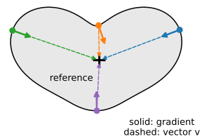
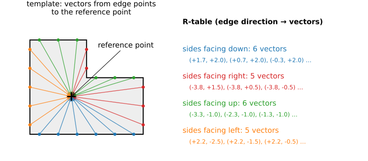
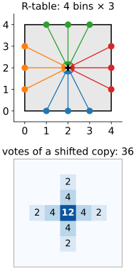
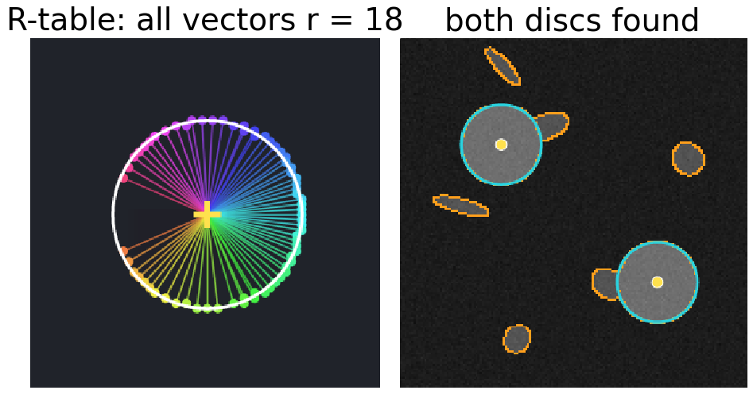
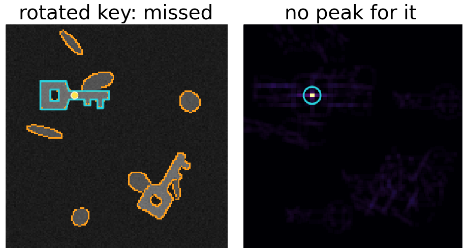
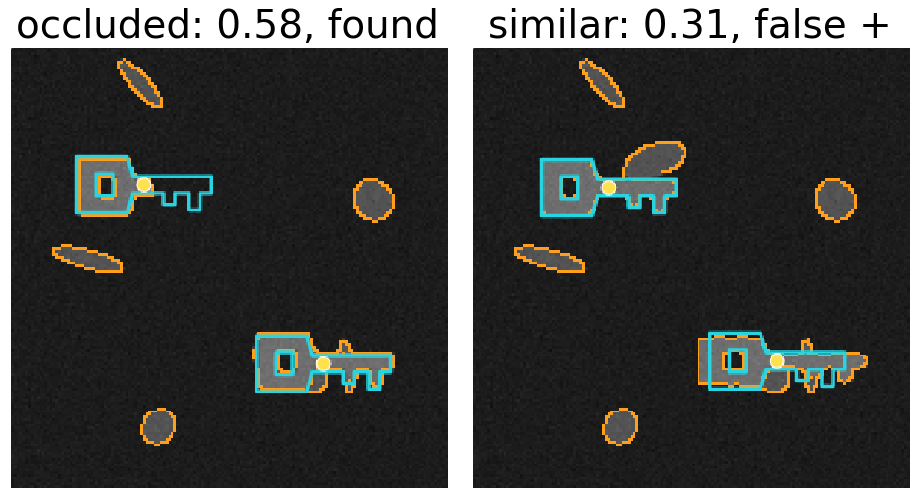

## About this lecture

Lines and circles have formulas. A key, a leaf, a letter, a cell of a particular shape do not. The generalised Hough transform (Ballard, 1981) stores the shape as a **table** instead, and keeps the voting.

- The **R-table**: for each edge direction, the vectors from the edge to a reference point.
- **Voting** with the table: every edge point votes for where the reference point would be.
- The circle with gradient voting **is** a generalised Hough transform.
- **Rotation and scale** as extra dimensions, and what they cost.
- Occlusion, clutter, and how this compares with other ways to find a shape.

*Slides titled **The math** give the formulas and proofs; the ideas are complete without them.*

::: notes
Third unit of the Hough day. Builds on the circle unit (gradient voting: the gradient tells the edge point where the centre is). Pixel coordinates, y down; angles on the screen counter-clockwise, as for the gradient direction on the edges day.
:::

## A shape without a formula

:::: {.columns}
::: {.column width="58%"}
Gradient voting for circles worked because an edge point **knew where the centre was**: at distance $r$ along its gradient.

For any fixed shape the same holds, just without a formula:

- Choose a **reference point** inside the shape (any point; the centroid is a natural choice).
- From an edge point of the shape, the reference point is at some **vector** $\mathbf v$: a direction and a distance.
- Which vector depends on **where on the boundary** the point is. The only local clue we have is the **edge direction**.

So: remember, for each edge direction, which vectors lead to the reference point.
:::
::: {.column width="42%"}
{width="100%" fig-alt="A heart-shaped outline with a reference point marked by a cross inside it. At four points of the boundary a solid arrow shows the gradient direction and a dashed arrow the vector from that point to the reference point; the vectors differ in direction and length from point to point."}
:::
::::


## The R-table

{width="88%" fig-align="center"}

Built once from a **template** image: for every edge point, store the vector to the reference point under its gradient direction (in bins, e.g. 36 bins of 10°). A direction can hold **several** vectors: all sides facing the same way share one entry.

## Voting with the R-table

:::: {.columns}
::: {.column width="70%"}
In a new image, for every edge point $\mathbf p$ with gradient direction $\theta$:

1. Look up the bin of $\theta$ in the R-table.
2. For every vector $\mathbf v$ in it, add one vote at $\mathbf p + \mathbf v$.

Where the shape is present, the votes of all its edge points land on the **same** reference point: a peak. Each vote that belongs to a "wrong" vector of the same direction lands elsewhere and spreads out.

**Small example**: a 4 × 4 square, reference at its centre, 4 direction bins. Each side has 3 edge points, so each bin holds 3 vectors. A translated copy: each of its 12 edge points casts 3 votes (36 in total); the centre gets 12, no other position more than 4.
:::
::: {.column width="27%"}
{width="100%" fig-alt="Left: a 4 by 4 square with three edge points on each side, coloured by side (one direction bin per side), and arrows from each edge point to the centre: 3 vectors per bin. Right: the votes of a shifted copy of the square: 36 votes in total, 12 at the centre, 4 at the four neighbouring positions and 2 two steps away along the same row and column, zero elsewhere."}
:::
::::


## Try it: the R-table and its votes

```{=html}
<link rel="stylesheet" href="../demos/dist/demo.css">
<div data-demo="ght" data-preset="square"></div>
<script src="../demos/dist/ght.js"></script>
```

::: notes
Left: the template with its edge points (from the same Canny settings as the scene) and the R-table as arrows to the reference point (+), coloured by direction bin; below, the table itself. Middle: scene, edges, detections drawn as the template outline at the found pose. Right: accumulator. Tour: "square, 4 bins": 120 table entries, about 30 per side; the accumulator shows a cross through each square (each side's 30 vectors spread its votes along a line), with the peak at the centre: scores 1.00 and 0.99 (fraction of the template's edge points). Then "translation only" with the key (36 bins): 0.90 and 0.74. Drag the reference point: the detections stay, the peaks move with it. Drag a vertex of the template: the match gets worse. Click a scene edge point: its votes (magenta), one per vector in its bin.
:::

## The circle is a special case

:::: {.columns}
::: {.column width="58%"}
Take a disc of radius $r$ as the template, with its centre as the reference point. Every edge direction occurs exactly once on the boundary, and the vector from that point to the centre has length $r$ and points along the gradient.

- The R-table holds **one vector per direction**: length $r$, along the gradient.
- Voting with it is **exactly** gradient voting for circles with a known radius and known polarity.

The general method contains the special case. In the demo ("circle template"), the table has 136 entries spread over 36 bins (2 to 5 per bin, from the digital edge), all of length 18.
:::
::: {.column width="42%"}
{width="100%" fig-alt="Demo still. Left: a disc template with its R-table drawn as arrows from the boundary to the centre, coloured by direction bin; all arrows have the same length, 18. Right: a scene with two discs among other blobs; both discs are detected."}
:::
::::


## Rotation and scale

:::: {.columns}
::: {.column width="60%"}
A rotated copy of the shape has rotated gradient directions **and** rotated vectors: the unrotated table looks up the wrong bins and votes in the wrong places. It is missed.

- Search over rotations $\phi$ and scales $s$: for each $(\phi, s)$, rotate and scale the table (shift the direction index by $\phi$, rotate and scale every vector), vote into its own accumulator slice.
- The accumulator becomes **4D**: $(x, y, \phi, s)$. A detection gives position, angle and size.
- Cost: every edge point does one lookup per $(\phi, s)$. 36 angles × 5 scales = 180 times the work and memory of translation only.
- Remedy: **coarse to fine**. Search all poses in a downsampled image (a Gaussian pyramid, the edges day), then refine only near the candidates at full resolution.
:::
::: {.column width="40%"}
{width="100%" fig-alt="Demo still. Left: a scene with an upright key, detected and outlined, and a second key rotated by 60 degrees that is not detected. Right: the accumulator without a rotation search: one sharp peak for the upright key and nothing at the rotated one."}
:::
::::


## The math: the GHT with rotation and scale {.math}

A copy of the template rotated by $\phi$ and scaled by $s$ maps each template vector $\mathbf v$ to $s R(\phi)\mathbf v$ and each gradient direction $\theta$ to $\theta + \phi$. An edge point $\mathbf x$ with direction $\theta$ therefore votes, for each $(\phi, s)$, for the reference points

$$\mathbf c = \mathbf x + s\,R(\phi)\,\mathbf v \qquad \text{for all } \mathbf v \in T\big[\theta - \phi\big],$$

where $T[\cdot]$ is the R-table bin. (In the course's pixel convention, $y$ down and angles counter-clockwise on the screen, $R(\phi) = \begin{pmatrix} \cos\phi & \sin\phi \\ -\sin\phi & \cos\phi \end{pmatrix}$.) Cost: $N_\text{edge} \cdot N_\phi \cdot N_s$ lookups and on average $|T|/N_\text{bins}$ votes per lookup; memory $N_x N_y N_\phi N_s$ cells. A similarity transform (shift, rotation, scale) is the same one that aligns shapes in Procrustes analysis (the snakes and shape-model elective).

## Occlusion and clutter

:::: {.columns}
::: {.column width="60%"}
- **Occlusion**: votes from the visible part still meet at the reference point. Half the boundary hidden gives roughly half the peak. The threshold is then a **minimum visible fraction** of the boundary.
- **Clutter**: random edges vote randomly and raise the floor, as for lines.
- **Similar shapes** are the real danger: a shape that shares long pieces of boundary with the template collects many votes at a nearby point. With a low threshold it becomes a false positive.

In the demo the score is the number of edge points that vote within a pixel of a cell, divided by the number of template edge points: about 1 for a perfect, fully visible copy.
:::
::: {.column width="40%"}
{width="100%" fig-alt="Two demo stills. Left: a key partly hidden by a disc is still detected with score 0.58. Right: a stretched key that only resembles the template gets score 0.31 and, with the threshold at 0.3, is reported as a detection: a false positive."}
:::
::::


## Try it: rotation search

```{=html}
<link rel="stylesheet" href="../demos/dist/demo.css">
<div data-demo="ght" data-preset="rotsearch"></div>
<script src="../demos/dist/ght.js"></script>
```

::: notes
"rotated: missed": the second key is rotated by 60°; without a rotation search only the upright key is found (0.90). "rotation search: found": 36 rotations; both keys found, the rotated one at 60° with 0.91; the work goes from 721 lookups to 25,956 (36 times) and from 4,682 votes to 129,925. Other poses of the same keys give weak peaks (0.31 to 0.40). "scale search": copies at 0.8 and 1.2; 5 scales find both (0.54 and 0.93). "occluded copy still found": a disc hides part of the first key; its score drops from 0.90 to 0.58, still above 0.5. "similar shape": a stretched key gives 0.31; with the threshold at 0.3 it is reported: a false positive.
:::

## The math: the GHT as matched filtering {.math}

Merge all direction bins into one: every edge point now votes with **every** template vector. The vote count at $\mathbf c$ becomes

$$H(\mathbf c) = \sum_{\mathbf x} E(\mathbf x) \sum_{\mathbf v \in T} [\mathbf x + \mathbf v = \mathbf c] = \sum_{\mathbf q} E(\mathbf c + \mathbf q)\, E_T(\mathbf q),$$

with $\mathbf q = -\mathbf v$ running over the template's edge points relative to the reference point. That is the **correlation** of the scene's edge map $E$ with the template's edge map $E_T$: template matching on edge maps (the FFT registration day uses the same correlation on intensities, normalised). The direction bins make it **selective**: only edge points with the right direction may vote with a given vector, so far fewer accidental matches.

## Finding a shape: the options

| | finds | needs | tolerates |
|---|---|---|---|
| **GHT** | all copies, anywhere | a fixed shape (+ pose search) | occlusion, gaps, clutter |
| Active shape models (snakes elective) | one shape, refined | a starting pose | shape variation |
| Moment invariants (moments elective) | a matching segmented object | a segmentation | noise, not occlusion |
| Polar dynamic programming (DP elective) | a free-form closed boundary | a centre | any star-shaped outline |
| Template matching by correlation (FFT registration day) | intensity pattern, all copies | a fixed appearance | noise, not rotation |

The GHT is a **global detector**; it can supply the starting pose that the local methods need.

## Where this leads

- **Hough forests** (Gall & Lempitsky, 2009): instead of a fixed R-table, a **random forest** (the random forests day) learns which local image patches vote for which offset to the object centre. The same voting, learned from examples.
- **Centre-voting detectors** in deep learning (the modern deep learning day): a network predicts, for every pixel, a heat map of object centres and an offset; peaks of the heat map are the detections.
- Matching detections to ground truth and scoring them (precision, recall, average precision) belongs to the evaluation day.

## Summary

- An arbitrary shape is stored as an **R-table**: for each edge direction, the vectors to a reference point.
- Each edge point **looks up** its direction and votes for $\mathbf p + \mathbf v$; the shape is a **peak**.
- A disc's R-table has one vector per direction: **circle Hough is a special case**.
- **Rotation and scale** add dimensions: 36 × 5 poses = 180 times the work; search coarse to fine.
- Robust to **occlusion** (threshold = visible fraction); fooled by **similar shapes**.
- With all directions merged it is **correlation of edge maps**; the direction bins make it selective.
