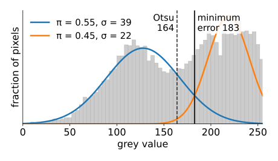
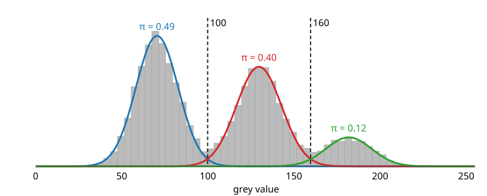
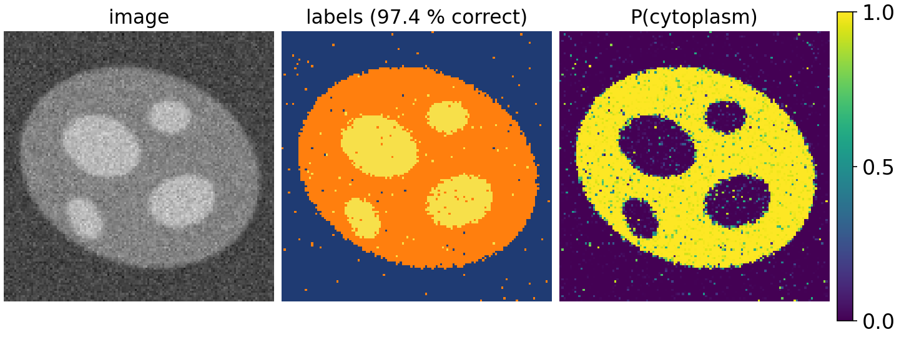
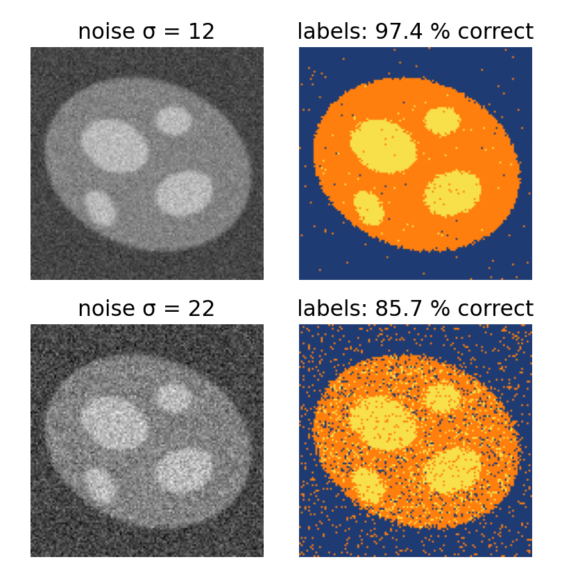
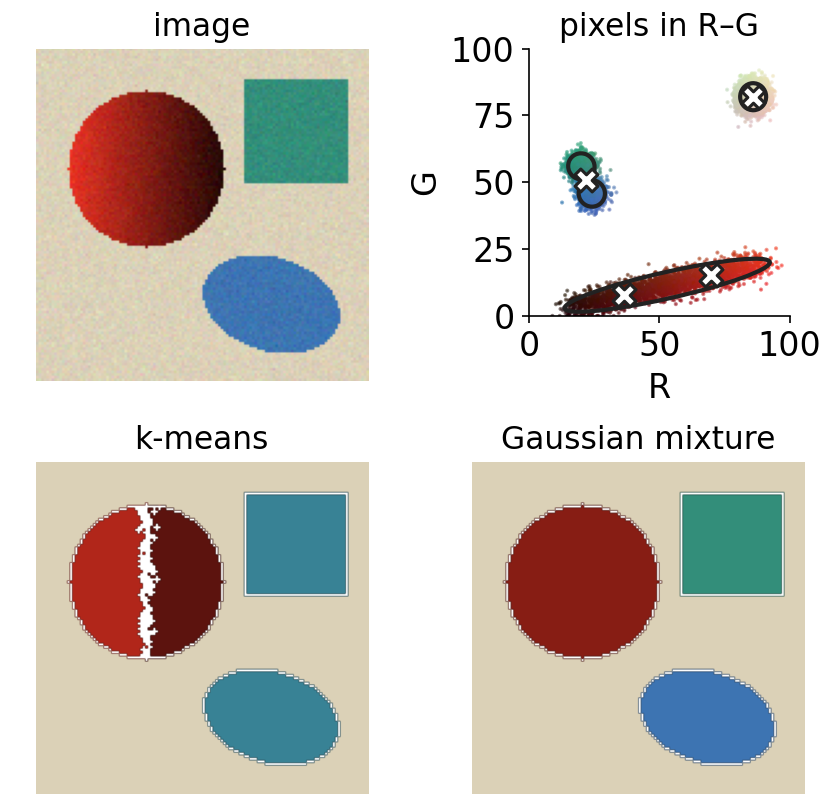
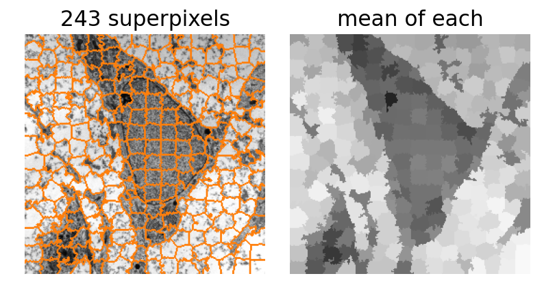
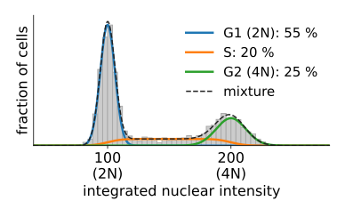
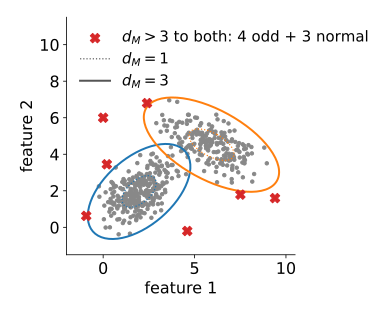

## About this lecture

We can fit a mixture of Gaussians to any cloud of points with EM. Now the points are **pixels** and **objects**.

- **Grey-level mixtures**: $K$ classes from the histogram; labels and **probability maps**.
- **Colour and feature-space** segmentation: why a full covariance keeps a shadowed object whole.
- **Populations**: fractions of cells or spots from the component weights.
- **Anomalies**: pixels or objects that no component explains.
- Mixtures as the **data term** of a graph cut (GrabCut).

Slides titled **The math** give the formulas and proofs; the ideas are complete without them.

## Recall: two Gaussians and a threshold

:::: {.columns}
::: {.column width="50%"}
The thresholding day modelled the histogram as **two Gaussians** (object and background) and put the threshold where the two weighted densities cross: the **minimum-error threshold** (Kittler–Illingworth). It found the two Gaussians by **trying every threshold** $t$ and fitting each side separately.

Today, the same model:

- with **$K$ classes** instead of two;
- fitted by **EM**: soft assignments instead of a hard split at $t$;
- giving every pixel a **probability** of each class, not only a label.
:::
::: {.column width="50%"}
{width="100%" fig-alt="Histogram of the course micrograph with two fitted Gaussians: a wide dark class (weight 0.55, σ 39) and a narrow bright class (weight 0.45, σ 22); the minimum-error boundary at 183 lies to the right of the Otsu threshold at 164"}

The course micrograph, $K = 2$: the dark class is much wider, so the minimum-error boundary (183) moves towards the narrow bright class; Otsu (164) assumes equal widths. Image: Robert M. Hunt, CC BY 3.0, via Wikimedia Commons.
:::
::::

## A mixture of grey levels {.smaller}

{width="70%"}

- Every pixel's grey value is a point in 1D. Fit $K$ Gaussians with EM: each class gets a mean, a width and a **weight** (its share of the pixels).
- **EM on the histogram**: pixels with the same grey value have the same responsibilities, so each of the 256 bins is one point with **weight = its count**. One iteration costs $256 \times K$ evaluations, whatever the image size.
- Synthetic image above: three classes (background, cytoplasm, organelles; 49 %, 39 %, 12 % of the pixels). EM finds weights 0.49, 0.40, 0.12 and the Bayes boundaries at grey values 100 and 160.

## The math: EM on a weighted histogram {.math}

Grey values $g_j$ (bin centres) with counts $h_j$, $n = \sum_j h_j$. All pixels in bin $j$ have the same responsibilities $r_{jk}$, so every sum over pixels becomes a sum over bins with weight $h_j$:

$$N_k = \sum_j h_j r_{jk}, \qquad \pi_k = \frac{N_k}{n}, \qquad \mu_k = \frac{1}{N_k}\sum_j h_j r_{jk}\,g_j, \qquad \sigma_k^2 = \frac{1}{N_k}\sum_j h_j r_{jk}\,(g_j - \mu_k)^2,$$

$$\log p(\mathcal D) = \sum_j h_j \log\sum_k \pi_k\mathcal N(g_j \mid \mu_k, \sigma_k^2).$$

The result is identical to EM on all pixels (exactly, for integer grey values). For numerical safety compute $\log\sum_k e^{a_k}$ as $a_{\max} + \log\sum_k e^{a_k - a_{\max}}$ (**log-sum-exp**): a pixel far from every mean would otherwise give $\log 0$.

## Labels, probability maps, boundaries {.smaller}

- **Label image**: every pixel gets its most probable class. Because the label depends only on the grey value, it is a **multi-level threshold** at the Bayes boundaries.
- **Probability map**: the responsibility of one class at every pixel, a **soft segmentation**. Values near 0.5 mark pixels the model cannot decide on (edges, overlapping classes).
- $K = 2$ with free variances: the **minimum-error threshold** again, now found by EM.
- **Equal variances** (tied): the boundaries are halfway between neighbouring means, shifted by the weights. Close to **multi-level Otsu** (thresholding day), which also assumes equally wide classes.
- The **weights** matter: a rare class gets a smaller region; its boundary moves towards its own mean.

{width="72%" fig-alt="The synthetic three-class image, its label image from a three-component mixture (97.4 % of pixels correct) and the probability map of the cytoplasm class, which is near 1 inside the cell, near 0 elsewhere and intermediate at the edges and at isolated noisy pixels"}

## The math: the two-class boundary {.math}

Two classes with $\sigma_1 = \sigma_2 = \sigma$: the boundary $\pi_1\mathcal N_1(x) = \pi_2\mathcal N_2(x)$ is

$$x^* = \frac{\mu_1 + \mu_2}{2} + \frac{\sigma^2}{\mu_2 - \mu_1}\ln\frac{\pi_1}{\pi_2},$$

the thresholding day's equal-variance formula. With $\sigma_1 \ne \sigma_2$, taking logs gives a quadratic equation in $x$,

$$\frac{(x - \mu_1)^2}{\sigma_1^2} - \frac{(x - \mu_2)^2}{\sigma_2^2} = 2\ln\frac{\pi_1\sigma_2}{\pi_2\sigma_1},$$

with two roots: the narrower class wins only between them (unit 2). Example: the synthetic image's small bright class has $\pi_3 = 0.04$ against $\pi_2 = 0.48$: $x^* = 155 + \frac{13^2}{51.5}\ln 12 \approx 163$ instead of the midpoint 155.

## Try it: a histogram mixture

```{=html}
<link rel="stylesheet" href="../demos/dist/demo.css">
<div data-demo="histgmm" data-preset="k3cell"></div>
<script src="../demos/dist/histgmm.js"></script>
```

::: notes
Course micrograph, 128 × 128. "K = 3 on the micrograph": weights 0.50, 0.34, 0.16; means 122, 204, 240; Bayes boundaries 173 and 229. "K = 2": boundary 183, multi-level Otsu 164: the dark class is much wider (σ 39 against 22), so the minimum-error boundary moves towards the narrow bright class. Synthetic image "equal variances: Otsu-like": boundaries 101 and 160, Otsu 100 and 155; 97.4 % of pixels as in the truth. "K too large": K = 6 splits the background peak into three; press BIC: smallest at K = 3. "noise": noise 22, 85.7 % correct, salt-and-pepper labels. "small bright class": π3 = 0.04, posterior view; the boundary is at 163.
:::

## The histogram forgets where pixels are

:::: {.columns}
::: {.column width="58%"}
A label that depends only on the grey value cannot use the **neighbours**:

- with noise, the classes overlap in the histogram and the label image is **speckled** (single wrong pixels everywhere);
- a smooth intensity gradient (uneven illumination) shifts the classes and no single mixture fits the whole image.

Fixes that keep the mixture as the **data term** and add the neighbours:

- graph cuts with a smoothness term (graph-cut day);
- a hidden Markov random field (a Potts prior on the labels), with the mixture re-estimated by EM: the Ising elective.
:::
::: {.column width="42%"}
{width="100%" fig-alt="The synthetic image with noise 12 and with noise 22, each with its mixture label image: 97.4 % and 85.7 % of the pixels correct; the noisier label image is covered in isolated wrong pixels"}
:::
::::

## Colour: a feature space with shape

:::: {.columns}
::: {.column width="55%"}
A colour pixel is a point in 3D (RGB or L\*a\*b\*). The colour day segmented colours with thresholds and distances (and one slide of k-means); a mixture adds **shape**.

- A **shadowed** object is not a ball of colours: its pixels lie along a **line** from bright to dark (in RGB, towards black; in Lab mostly along L\*).
- k-means describes every group by a round blob: to cover the long shadow line it **splits** the object, and to make room it merges two other colours.
- A **full-covariance** component is a long ellipse along the shadow line: the object stays **whole**.
- More features: colour + local mean (texture), or colour + position $(x, y)$ with a weight: groups become spatially **compact** regions.
:::
::: {.column width="45%"}
{width="100%" fig-alt="A synthetic scene with a shadowed red ball, a green block and a blue ellipse; its pixels in the R–G plane, where the ball forms a long line towards black; k-means with four groups cuts the ball in two and merges block and ellipse, a full-covariance mixture covers the line with one long ellipse and finds all four objects"}
:::
::::

## Try it: colour segmentation

```{=html}
<link rel="stylesheet" href="../demos/dist/demo.css">
<div data-demo="colourgmm" data-preset="shadow"></div>
<script src="../demos/dist/colourgmm.js"></script>
```

::: notes
Synthetic scene: a red ball lit from the left, a green block, a blue ellipse on a beige table; features RGB, K = 4. "shadowed ball": k-means (start 5) splits the ball into two clusters and merges the green block with the blue ellipse (Dice green 0.68, blue 0.00; J = 1.086 × 10⁶). "best of 6 starts": k-means' best J is this split (1.086 × 10⁶, against 1.462 × 10⁶ for the correct grouping): the split is what k-means wants. Switch to "Gaussian mixture" (full): from start 5 it keeps the ball whole and finds all four objects (Dice 1.00), log p = −137 740; best of 6 starts: the same. Spherical covariances split the ball again. "RGB vs Lab": in Lab, k-means is already right (the shadow mostly changes L*). "add position": Lab + xy, K = 6: the table breaks into compact patches.
:::

## Relatives: mean shift and superpixels

:::: {.columns}
::: {.column width="55%"}
- **Mean shift**: put a small Gaussian on every point (a kernel density estimate); move every point uphill to the nearest peak of the density. Points that reach the same peak form a group. $K$ is not chosen; the kernel width is.
- **SLIC superpixels**: k-means on (colour, $x$, $y$) with many small groups ($K$ in the hundreds), each centre searching only a local window. The result is an over-segmentation into compact, colour-coherent patches.
- Superpixels make later steps cheaper: a graph cut on 500 superpixels instead of 250 000 pixels.
:::
::: {.column width="45%"}
{width="100%" fig-alt="SLIC superpixels on the course micrograph: about 240 compact patches whose borders follow the edges of the cell, and the same image with every patch replaced by its mean grey value"}

SLIC on the 256 × 256 micrograph: 243 superpixels. Image: Robert M. Hunt, CC BY 3.0, via Wikimedia Commons.
:::
::::

## Populations: counting by mixture weights

:::: {.columns}
::: {.column width="55%"}
The points are **objects** now (one point per nucleus or spot), with features from the measurements day.

- **DNA content** (integrated nuclear intensity): cells in G1 have one copy (2N), in G2 two copies (4N), in S phase something in between. The histogram is a mixture of a G1 peak, a G2 peak at twice the intensity, and an S-phase plateau. The fitted **weights** are the fractions of cells in each phase.
- **Spot brightness**: a spot holds 1, 2 or 3 fluorophores, so its intensity is a mixture of peaks at 1×, 2×, 3× the single-molecule brightness. The weights count the molecules.
- Constraints help: tie the G2 mean to twice the G1 mean, or the spot means to multiples of one brightness. EM still works (the M-step changes).
:::
::: {.column width="45%"}
{width="100%" fig-alt="Histogram of the integrated nuclear intensity of 3000 synthetic cells with the three model components: a narrow G1 peak at 100 (55 % of the cells), a flat S-phase plateau between 100 and 200 (20 %) and a wider G2 peak at 200 (25 %)"}

Synthetic cells; the weights of the components are the phase fractions.
:::
::::

## Anomalies: what no component explains

:::: {.columns}
::: {.column width="57%"}
Fit a mixture to "normal" pixels or objects. A new point is an **anomaly** when

- its density $p(\mathbf x)$ is below a threshold $\tau$, or
- its **Mahalanobis distance** is above (say) 3 to **every** component.

Examples: dust or debris in a field of cells, an out-of-focus object, a rare cell type, a stain artefact.

- Unlike a classifier, this needs no examples of the anomalies: it only knows what normal looks like.
- The threshold is a trade-off: for a Gaussian in 3D, 1 normal point in 150 lies beyond $d_M = 3.5$ anyway (1 in 34 beyond 3, 1 in 6600 beyond 4.5).
- The VAE day uses the reconstruction error of an autoencoder for the same purpose.
:::
::: {.column width="43%"}
{width="100%" fig-alt="Two Gaussian components in a 2D feature space drawn as their d_M = 1 and d_M = 3 ellipses; seven points lie outside the 3 ellipse of both components and are flagged: the four odd points added to the data and three ordinary points from the tails"}

Synthetic 2D data: the four odd points are flagged, and so are 3 of the 500 normal points (in 2D, 1.1 % of a Gaussian lies beyond $d_M = 3$).
:::
::::

## Try it: an odd object

```{=html}
<link rel="stylesheet" href="../demos/dist/demo.css">
<div data-demo="colourgmm" data-preset="odd"></div>
<script src="../demos/dist/colourgmm.js"></script>
```

::: notes
The scene with a small yellow object; Lab, K = 4, full covariances, start 2. The four mixture components describe the table, ball, block and ellipse (Dice 0.99–1.00). View "d_M > t to all" with t = 4.5: 119 pixels are flagged, the 113 pixels of the odd object and 6 noise pixels. Lower t to 3.5: many more noise pixels on the table. Other starts may give a component to the yellow object: then it is no longer an anomaly, but a class.
:::

## Mixtures as data terms: GrabCut

The graph-cut day's energy needs a **data term** $D_p(\ell) = -\log P(I_p \mid \ell)$: how well pixel $p$'s value fits label $\ell$. A fitted mixture per label provides it.

**GrabCut** (Rother, Kolmogorov & Blake, 2004), for colour images:

1. The user draws a **box**: outside = background, inside = unknown.
2. Fit a colour **mixture** (about 5 components) to the background pixels and one to the current object pixels.
3. **Graph cut** with these data terms and contrast-sensitive smoothness.
4. Refit the mixtures to the new labels; cut again; repeat until it settles.

The same loop as EM: a labelling step and a model-fitting step, alternating.

## Summary

- **Histogram mixtures**: EM on the bins, weighted by their counts; $K$ classes, labels = multi-level thresholds at the Bayes boundaries; responsibilities = **probability maps**.
- $K = 2$: the minimum-error threshold; equal variances: close to multi-level Otsu; weights move the boundaries.
- The histogram ignores neighbours: noise gives **speckle** (fix: graph cuts, hidden MRF).
- In **colour**, a full covariance follows a shadow; k-means splits it.
- **Weights** count populations; **low likelihood** or large Mahalanobis distance flags **anomalies**.
- Fitted mixtures are the **data terms** of graph cuts: GrabCut alternates fitting and cutting.
