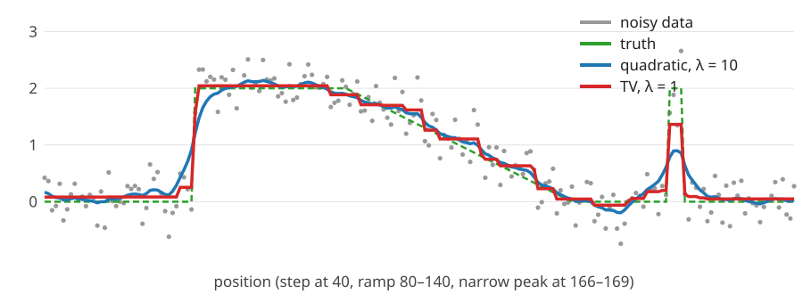

## About this lecture

So far the pixels were binary. Now they are **grey values**, and the prior says "neighbours have similar values". How we measure "similar" decides whether edges survive.

- **Quadratic prior** (a Gaussian MRF): one **linear system** with the graph Laplacian; a low-pass filter; it blurs edges.
- **Total variation** (TV): absolute differences; keeps edges, but makes staircases and shrinks small features.
- **Huber**: in between.
- What samples from these priors look like, and where TV comes back in the course.

*Slides titled **The math** give the formulas and proofs; the ideas are complete without them.*

::: notes
Demo: mrf1d (1D profiles, so everything can be seen and solved exactly). The forward model here is the identity (denoising only); deblurring with the same priors is on the deconvolution day.
:::

## From labels to grey values

Observed $y_p = x_p + \text{noise}$, Gaussian with standard deviation $\sigma_n$ (the camera-noise model of `cameranoise/`, day 3). We want $\mathbf x$.

$$E(\mathbf x) = \underbrace{\tfrac12\sum_p (x_p - y_p)^2}_{\text{stay close to the data}} \;+\; \lambda\underbrace{\sum_{(p,q)}\rho(x_p - x_q)}_{\text{neighbours similar}}$$

- $\rho$ is the **penalty** on a difference between neighbours: $\rho(d) = d^2/2$ (quadratic), $|d|$ (TV), or Huber.
- $\lambda$ weighs the prior against the data, as before; $\lambda = 0$ returns $\mathbf y$.
- The noise level is absorbed in $\lambda$ (math slide): more noise, larger $\lambda$.
- Same structure as the binary energy: data term + $\lambda\cdot$(neighbour penalty). The binary $[L_p \ne L_q]$ is now a function of the size of the difference.

## Quadratic smoothing, by hand

$\mathbf y = (0, 3, 0)$, quadratic penalty, $\lambda = 1$:

$$E = \tfrac12\big(x_1^2 + (x_2 - 3)^2 + x_3^2\big) + \tfrac12\big((x_1 - x_2)^2 + (x_2 - x_3)^2\big).$$

Setting each partial derivative to zero gives one **linear** equation per pixel: each $x_p$ is pulled towards its data **and** towards its neighbours:

$$2x_1 - x_2 = 0, \qquad -x_1 + 3x_2 - x_3 = 3, \qquad -x_2 + 2x_3 = 0.$$

Solution: $\hat{\mathbf x} = (0.75, 1.5, 0.75)$. The peak is halved and spread to its neighbours; the total $0.75 + 1.5 + 0.75 = 3$ is preserved.

## The math: one sparse linear system {.math .smaller}

With $\rho(d) = d^2/2$ the smoothness term is $\frac\lambda2\sum_{(p,q)}(x_p - x_q)^2 = \frac\lambda2\mathbf x^\top L\mathbf x$, with the **graph Laplacian** $L = D - W$ (from `ncut/`, graph-cut day; on a path: 1, 2, …, 2, 1 on the diagonal, $-1$ beside it). The gradient of $E$ is $(\mathbf x - \mathbf y) + \lambda L\mathbf x$, so the minimum solves

$$(I + \lambda L)\,\mathbf x = \mathbf y, \qquad \text{on a path: } \begin{bmatrix} 1 + \lambda & -\lambda & & \\ -\lambda & 1 + 2\lambda & -\lambda & \\ & \ddots & \ddots & \ddots \\ & & -\lambda & 1 + \lambda\end{bmatrix}\mathbf x = \mathbf y.$$

- **Tridiagonal** in 1D (solved in $O(n)$ by elimination); in 2D a sparse system with 5 non-zeros per row. $I + \lambda L$ is symmetric positive definite: one unique minimum.
- **Probabilistically**: the posterior $\propto \exp\big(-\frac1{2\sigma_n^2}\|\mathbf x - \mathbf y\|^2 - \frac{\lambda'}2\mathbf x^\top L\mathbf x\big)$ is **Gaussian** (a Gaussian MRF). Multiply by $\sigma_n^2$: our $\lambda = \lambda'\sigma_n^2$. Its MAP, its mean and its MPM coincide.
- $L$ is the matrix form of the image Laplacian $\nabla^2$ of `kernels/` (with a minus sign).

## Quadratic smoothing is a low-pass filter

On a long signal (or a ring) the same weighted averaging happens everywhere: the solution is a **convolution** of $\mathbf y$ with a fixed kernel. In frequency space each frequency is multiplied by a **gain**:

$$\text{gain}(\omega) = \frac{1}{1 + \lambda\,(2 - 2\cos\omega)}$$

- Constant signals ($\omega = 0$) pass unchanged; the fastest oscillation ($\omega = \pi$, $+1, -1, +1, \dots$) is divided by $1 + 4\lambda$: by 5 at $\lambda = 1$, by 41 at $\lambda = 10$.
- At $\lambda = 10$ the gain is $\tfrac12$ at 0.05 cycles per sample: details shorter than about 20 samples are halved.
- An edge contains **all** frequencies: removing the high ones **blurs** it. A quadratic prior cannot tell an edge from noise.

## The math: the DFT diagonalises $I + \lambda L$ {.math}

On a ring of $n$ samples, $L$ is **circulant**: $(L\mathbf x)_p = 2x_p - x_{p-1} - x_{p+1}$, a convolution with $(-1, 2, -1)$. Every circulant matrix has the Fourier vectors $f_p = e^{i\omega p}$, $\omega = 2\pi k/n$, as eigenvectors (`fourier/`: the DFT is a change of basis):

$$(L\mathbf f)_p = (2 - e^{-i\omega} - e^{i\omega})\,e^{i\omega p} = (2 - 2\cos\omega)\,f_p.$$

So in the Fourier basis $(I + \lambda L)$ is diagonal with entries $1 + \lambda(2 - 2\cos\omega)$, and solving the system divides each Fourier coefficient by it. For small $\omega$, $2 - 2\cos\omega \approx \omega^2$: gain $\approx 1/(1 + \lambda\omega^2)$, a smooth low-pass.

## Why squares blur edges

How expensive is a step of height 3 for each prior?

| | one jump of 3 | three steps of 1 | thirty steps of 0.1 |
|---|---|---|---|
| quadratic $\sum d^2/2$ | 4.5 | 1.5 | 0.15 |
| absolute $\sum \lvert d\rvert$ (TV) | 3 | 3 | 3 |

- The quadratic prior **prefers ramps**: spreading a jump over many small steps makes it almost free. Edges get smeared.
- With absolute values, a monotone transition costs its **height**, however it is spread. The data term then decides, and the data say "sharp".
- (Prior samples: a quadratic prior is a random walk with normal steps; it has no notion of an edge.)

## Total variation

$$E(\mathbf x) = \tfrac12\sum_p(x_p - y_p)^2 + \lambda\sum_{(p,q)}|x_p - x_q| \qquad\text{(Rudin, Osher \& Fatemi, 1992)}$$

By hand: $\mathbf y = (0, 0, 3, 3)$, $\lambda = 1$:

- Moving the left plateau up by $\delta$ and the right one down by $\delta$ costs $2 \cdot 2 \cdot \tfrac12\delta^2 = 2\delta^2$ in data and saves $2\delta$ in TV ($3 - 2\delta$ instead of 3). Best: $\delta = 0.5$.
- $\hat{\mathbf x} = (0.5, 0.5, 2.5, 2.5)$: the **step stays sharp**, the two plateaus move towards each other by $\lambda/\text{width} = 0.5$. Energy $0.5 + 2 = 2.5$, against 3 for $\mathbf y$ itself.
- The quadratic prior on the same data: $(0.43, 0.86, 2.14, 2.57)$: a ramp.

## The math: what the TV solution looks like {.math .smaller}

$\rho(d) = |d|$ is convex but has a kink at 0. At the minimum, for every sample the **subgradient** contains 0:

$$x_p - y_p + \lambda\,(g_{p-1} - g_p) = 0, \qquad g_p \in \operatorname{sign}(x_{p+1} - x_p), \; g_p \in [-1, 1] \text{ where } x_{p+1} = x_p.$$

Sum this over a **plateau** (a run of equal values $c$ from $a$ to $b$): the inner $g$'s cancel and

$$\sum_{p=a}^b(y_p - c) = \lambda(g_{a-1} - g_b) \quad\Longrightarrow\quad c = \bar y_{[a,b]} - \frac{\lambda\,(g_{a-1} - g_b)}{b - a + 1}.$$

- Each plateau sits at the **mean of its data**, shifted by $\lambda/\text{width}$ for each neighbouring plateau that is higher or lower: up from a local minimum, down from a local maximum, $2\lambda/\text{width}$ for a peak with two lower neighbours; no net shift between a lower and a higher neighbour.
- Plateaus merge when the shift would overshoot their neighbour. Exact 1D algorithms find all plateaus directly (Condat, 2013: linear time in practice).
- $\mathbf y = (0, 3, 0)$: the peak would drop by $2\lambda$ and the sides rise by $\lambda$: $(\lambda, 3 - 2\lambda, \lambda)$ for $\lambda \le 1$, then all equal to the mean 1.

## The price of TV: staircases and lost contrast

- **Staircasing**: a ramp has no single cheapest shape under TV; with noise, the minimum breaks it into flat steps. (The demo's ramp at $\lambda = 3$: about a dozen steps.)
- **Small features lose contrast**: a plateau of width $w$ that sticks out on both sides is lowered by about $2\lambda/w$. Narrow peaks shrink first, then vanish. $\mathbf y = (0, 3, 0)$ at $\lambda = 0.5$: $(0.5, 2, 0.5)$; at $\lambda = 1$: flat $(1, 1, 1)$.
- **Huber** penalty: quadratic for small differences $|d| \le \delta$ (smooth ramps, no stairs), linear for large ones (edges stay): a compromise.

## Quadratic versus TV on a noisy profile

{width="100%"}

- Quadratic ($\lambda = 10$): noise gone, but the step is spread over about 15 samples and the narrow peak drops from 2 to 0.9.
- TV ($\lambda = 1$): the step stays sharp, the flat parts are flat, the ramp becomes a staircase, the peak drops to 1.4.
- Error against the truth (RMSE): noisy data 0.29, quadratic 0.24, TV 0.14.

## Try it: quadratic, Huber and TV

```{=html}
<link rel="stylesheet" href="../demos/dist/demo.css">
<div data-demo="mrf1d" data-preset="quad"></div>
<script src="../demos/dist/mrf1d.js"></script>
```

::: notes
200 samples: a step at 40 (0 → 2), a ramp from 2 to 0 over 80–140, a 4-sample peak of height 2 at 166–169; Gaussian noise σn = 0.3 (seed 1); noisy data RMSE 0.291. Tour: "quadratic blurs the step" (λ = 10): noise gone, but the step spreads over about 15 samples and the peak drops to 0.90; RMSE 0.240. Lower λ to 1.2 (its best, 0.190): the noise comes back. "TV keeps the step" (λ = 1): the step stays within two samples, RMSE 0.137; the peak is lowered to 1.36. "TV staircases the ramp" (λ = 3): steps on the ramp. "TV shrinks the narrow peak" (λ = 2): peak 0.86, at λ = 3 0.36. "Huber in between" (λ = 5, δ = 0.1): smooth ramp, sharp step, peak 1.72, RMSE 0.128. Tabs: "prior samples" and "the matrix" (I + λL and the gain curve).
:::

## What do the priors believe?

Draw samples from the priors themselves (no data): $p(\mathbf x) \propto e^{-\lambda\sum\rho(x_{p+1} - x_p)}$ makes each step $x_{p+1} - x_p$ independent: a **random walk**.

- Quadratic: normal steps. TV: **Laplace** steps $\propto e^{-\lambda|d|}$: more very small steps **and** more large jumps than a normal distribution with the same spread.
- But TV samples do **not** look piecewise constant: they are rough random walks too. The flat plateaus of the TV **estimate** come from taking the **minimum** (the MAP), not from what the prior's typical samples look like.
- Lesson (as with the exact MAP of the binary model): an estimate can have properties that typical images of the model do not have.

## TV elsewhere in the course

- **Level sets** (elective): the Chan–Vese length term is the total variation of an indicator function (a 0/1 image); the binary Ising energy counts the same boundary length on the pixel grid.
- **Relaxing labels**: TV of a soft (0…1) labelling is a convex relaxation of graph-cut segmentation: pointer only.
- **Deconvolution** (day 5): the same quadratic (Tikhonov) and TV priors with a blurring forward model. Here the forward model is the identity.
- **Radon** (algebraic reconstruction) and **wavelets** (shrinkage) recall TV from here as a regulariser.

## Summary

- Grey-value denoising: $E = \frac12\sum(x_p - y_p)^2 + \lambda\sum\rho(x_p - x_q)$.
- **Quadratic** $\rho$ (Gaussian MRF): one sparse linear system $(I + \lambda L)\mathbf x = \mathbf y$; a low-pass filter with gain $1/(1 + \lambda(2 - 2\cos\omega))$; **blurs edges** because ramps are cheaper than jumps.
- **Total variation** $\rho = |d|$: a monotone transition costs its height, so **edges stay sharp**; plateaus move by $\lambda/\text{width}$; ramps become **staircases**, small features **lose contrast**.
- **Huber**: quadratic for small differences, linear for large ones.
- Prior samples are random walks; the piecewise-constant look of TV is a property of the **minimum**, not of the prior.
