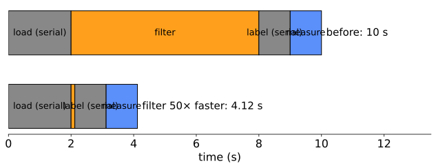

## About this lecture

"Would a GPU help?" Today: a method to answer it for any image analysis method.

- **Four questions** that decide the fit.
- **Good**: element-wise steps, filters, the FFT, neural networks, ray marching.
- **Bad**: priority-queue flooding, union–find labelling, max-flow, dynamic programming, raster-scan recursions, small problems; and the usual parallel workarounds.
- **Amdahl's law**: the part that stays sequential limits everything.
- **Precision** on GPUs: float32, float16, bfloat16, matrix units, mixed precision.

Slides titled **The math** give the formulas and proofs; the ideas are complete without them.

::: notes
Several examples come from later days (watershed, labelling, graph cuts, neural networks, dynamic programming). Each is introduced here as one self-contained picture with a pointer; nothing depends on having taken those days.
:::

## Four questions

A method suits a GPU when the answers are yes:

1. Are there **many independent outputs**, at least $10^5$–$10^6$? (unit 1: occupancy)
2. Do neighbouring threads **do the same thing**? (unit 1: divergence)
3. Is memory access **regular**: coalesced, with reuse? (unit 2)
4. Is there **no global order**: no output waits for an unknown other output? (unit 3: depth)

And (5): does the work justify the **transfer** to the GPU and back, or does the data stay there? (unit 2)

## Good: maps, filters and the FFT

- **Element-wise steps** and short fused pipelines (map): trivially parallel, bandwidth-bound; fuse them.
- **Filters and morphology** with small kernels (stencil): tiles and halos; **separable** filters; very large kernels through the FFT.
- **FFT** (regular butterflies, $\log_2 n$ passes): registration, deconvolution, large convolutions.
- **Per-pixel statistics**: local means and variances, local thresholds (stencils of box filters).
- **Distance transforms done separably**: the exact Euclidean distance transform runs row by row, then column by column ([morphology](../morph-openclose/lec.qmd)); each row is independent.

All are maps or stencils, with coherent warps and coalesced reads.

## Good: neural networks

A convolutional layer applies a bank of kernels to all pixels and all channels ([convolutional networks](../cnn/lec.qmd)): it can be written as one large **matrix product**.

- A 3 × 3 layer with $C = 64$ input and output channels on a 256 × 256 image: $4.8 \cdot 10^9$ operations on $34$ MB: intensity $\approx 9C/4 = 143$. Far right of the ridge: **compute-bound**, the one common image workload that uses the GPU's full arithmetic.
- Training uses **batches** of images: more columns in the matrix product, more reuse of the weights.
- This is why deep learning and GPUs grew up together: from 2012 on, networks trained on GPUs started winning image recognition contests.

## Good: ray marching and volume rendering

One ray per output pixel through the volume ([volume rendering](../volrender/lec.qmd)): independent, identical, coherent between neighbouring pixels.

- The texture cache gives trilinear interpolation for free ([GPU textures](../gpuformats/lec.qmd)).
- But **early ray termination** stops rays at different steps: a warp marches until its slowest ray is done (divergence, unit 1). Renderers march in compact tiles and skip empty space in bricks.
- Hardware ray tracing adds units that walk acceleration structures (trees of bounding boxes); the ray-tracing elective covers them.

## Bad: priority-queue flooding

Watershed by flooding ([watershed](../ws-flooding/lec.qmd)): a queue always serves the **lowest** unlabelled pixel next, and each pixel's label comes from its already-labelled neighbours.

- The queue imposes a **global order**: one pixel at a time, depth = number of pixels.
- Workaround: **level-synchronous** flooding: process all pixels of one grey level together, in rounds (parallel within a level, many passes).
- Price: the labels can differ from the sequential result on plateaus and ties.

Demo below: 576 pixels, 573 queue steps against 22 level-synchronous steps, the same label for 569 of 576 pixels.

## Bad: union–find labelling

Two-pass labelling with union–find ([labelling](../label-connectivity/lec.qmd)) scans the image in raster order and follows parent pointers: sequential, with random memory access.

- **Label propagation**: every foreground pixel takes the smallest label among itself and its neighbours; repeat until nothing changes. Each pass is a stencil, fully parallel.
- Price: the number of **passes** = the longest path inside an object from its smallest label. A blob: a dozen passes. A spiral or a long snake: hundreds or thousands, each a full pass over the image.
- **Pointer jumping**: after each pass, every pixel replaces its label by its label's label (a jump along the chain). Chains shrink much faster.
- Real GPU labelling codes are hybrids: label tiles in fast memory, then merge across tile borders.

## Try it: labelling in parallel

```{=html}
<link rel="stylesheet" href="../demos/dist/demo.css">
<div data-demo="parlabel" data-mode="label" data-preset="spiral"></div>
<script src="../demos/dist/parlabel.js"></script>
```

::: notes
24 × 24 binary image, labels start as pixel numbers in raster order; each pass every foreground pixel takes the smallest label of its 4-neighbourhood (all at once, from the previous pass); changed pixels outlined in red. Tour: "spiral": 262 passes for 264 pixels: the smallest label crawls along the spiral one pixel per pass. Model time: 2.6 ms on the GPU (a 10 µs launch per pass) against 5.8 µs for the sequential two-pass scan. Scaled to 1024², about 11 000 passes, 113 ms against 10.5 ms. "pointer jumping": 41 passes. "blobs: 12 passes": 5 components, 130 µs (still slower than the CPU at this size; at 1024² 5.2 ms against 10.5 ms). Click pixels to cut the spiral and watch the passes drop.
:::

## The math: passes of label propagation {.math}

One pass moves the minimum label one pixel further (to every neighbour at once). Let $p_0$ be the pixel with the smallest label of a component $K$ and $d_K(p_0, p)$ the **geodesic distance** inside $K$ (shortest path through the component). Then

$$\text{passes} = \max_{p \in K} d_K(p_0, p) \;\le\; \operatorname{diam}_K.$$

- A straight bar of length $\ell$, minimum at one end: $\ell - 1$ passes; minimum in the middle: $\lceil(\ell-1)/2\rceil$.
- A spiral filling an $n\times n$ image has a path length of order $n^2/2$: $O(n^2)$ passes of $O(n^2)$ work each.
- **Pointer jumping** on a chain: each jump replaces "my parent" by "my parent's parent", halving the distance to the root: $\lceil\log_2 \ell\rceil$ jumps for a chain of length $\ell$.

## Bad: max-flow and dynamic programming

- **Max-flow** ([graph cuts](../maxflow/lec.qmd)): augmenting paths are found one after another, each depending on the flows left by the previous ones. **Push–relabel** is local (each node pushes excess flow to its neighbours) and parallel per node, but irregular and needs many global passes.
- **Dynamic programming** ([DP paths](../dp-paths/lec.qmd)): cell $(i, j)$ needs $(i-1, j)$, $(i, j-1)$ and $(i-1, j-1)$. Only cells on one **anti-diagonal** are independent: a **wavefront** of $n + m - 1$ steps that starts with one cell, grows to $\min(n, m)$, and shrinks to one again.

Both have work to spare but a long chain of dependent steps: depth, not work, is the limit.

## Try it: the DP wavefront

```{=html}
<link rel="stylesheet" href="../demos/dist/demo.css">
<div data-demo="parlabel" data-mode="wavefront" data-preset="wavefront"></div>
<script src="../demos/dist/parlabel.js"></script>
```

::: notes
A 10 × 16 DP table. Press "step": anti-diagonal 0 has one cell, the busy-lane bars grow to 10 (the number of rows) and shrink back to 1: 25 steps for 160 cells, 6.4 cells per step on average. A GPU with 10 000 lanes would use at most 10 of them. The "flood" mode of the same demo (exercise) shows the watershed queue: 573 one-pixel steps against 22 level-synchronous steps.
:::

## The math: the DP wavefront {.math}

Cells with $i + j = d$ depend only on cells with $i + j = d - 1$ or $d - 2$. So the table can be filled in $n + m - 1$ parallel steps (depth), one anti-diagonal per step.

- Step $d$ has $\min(d + 1,\ n,\ m,\ n + m - 1 - d)$ cells.
- Average parallelism: $\dfrac{nm}{n + m - 1}$; for a square table $\dfrac{n^2}{2n - 1} \approx \dfrac{n}{2}$.
- A $1000 \times 1000$ table: 1999 steps of on average 500 cells: a GPU with 10 000 lanes is never more than a tenth busy, and pays a barrier per step.

## Bad: recursions and small problems

- **Raster-scan recursions**: the chamfer distance transform (each pixel from its already-updated neighbours), recursive (IIR) filters, **error-diffusion dithering** ([quantisation](../quantisation/lec.qmd): each pixel's rounding error is pushed to the next pixels). Each output needs the previous one: depth = number of pixels per row or image.
- **Small problems**: a 256 × 256 image has 65 536 pixels, too few to fill the GPU, too cheap to pay for transfer and launches. Many small images: **batch** them into one launch.
- **Sorting- and tree-heavy** steps (k-d trees, region adjacency graphs, merging regions one by one): irregular memory, variable work per element.

"A GPU makes a parallel algorithm fast; it does not make a sequential algorithm parallel." Making it parallel is an **algorithm change**, with its own trade-offs.

## Amdahl's law

{width="80%" fig-align="center"}

A pipeline: load 2 s (sequential), filter 6 s, label 1 s (sequential union–find), measure 1 s. Make the filter 50 times faster on a GPU: 10 s → 4.12 s, 2.4 times faster. Even an infinitely fast GPU for everything except loading leaves 2 s: **at most 5 times**.

If a fraction $s$ of the time stays sequential, the whole can never be more than $1/s$ times faster. **Measure where the time goes** before moving anything.

## The math: Amdahl's law {.math}

Serial fraction $s$, the rest sped up $k$ times:
$$S(k) = \frac{1}{s + (1-s)/k} \;\le\; \frac{1}{s}, \qquad \lim_{k\to\infty} S = \frac{1}{s}.$$

- $s = 0.1$: $S(50) = 8.5$, never more than 10.
- Transfers count as serial time: they add to $s$.
- **Gustafson's** view: with a faster machine people process **bigger** images; the parallel part grows with the problem and the serial part often does not, so the achievable speed-up grows with the problem size.

## Precision on GPUs

Recall the [floating-point formats](../floatingpoint/lec.qmd): float32 (24 significant bits), float16 (11 bits, largest 65 504), bfloat16 (8 bits, the range of float32).

- **float32** is the default. **float64** runs on many desktop GPUs at only 1/32–1/64 of the float32 rate (data-centre GPUs: 1/2). Fix cancellation and summation problems with better algorithms first (shift by the mean, pairwise sums).
- **float16 / bfloat16** halve the bytes: the roofline point moves right, memory-bound steps run twice as fast.
- **Matrix units** ("tensor cores" in one vendor's words) multiply small blocks of low-precision matrices at 8–16 times the float32 rate. **Mixed precision**: multiply in 16 bits, **accumulate in float32** (a float16 sum of small values gets stuck).
- **8-bit integers** with a scale per channel for running trained networks (the course's own network weights are stored this way).
- Images: a 12–16-bit raw image in float16 loses its low bits, and 65 535 overflows. Keep raw data in uint16 or float32; float16 is fine for normalised intermediate images and network activations.

## The math: mixed-precision dot products {.math}

A dot product of length $K$ (one output of a matrix product), unit roundoff $u$ ($u_{16} = 2^{-11}$, $u_{32} = 2^{-24}$):

- Products and sums in float16: error up to about $K\,u_{16}\sum|a_ib_i|$; and once the sum $s$ is large, adding a term smaller than half the spacing of $s$ changes nothing: the sum **stalls** (bit-depth day: 0.015-sized pixel values stall at 64 in float16).
- Products rounded to float16 (or exact in the matrix unit), sums in float32: the summation error drops to $K\,u_{32}$, and stalling happens only $2^{13}$ times later.
- Example: 10 000 terms of 0.01: float16 throughout gives **32**; float16 values with float32 accumulation give **100.02** (0.01 is stored as 0.010002).

## Try it: a network layer under three roofs

```{=html}
<link rel="stylesheet" href="../demos/dist/demo.css">
<div data-demo="roofline" data-tab="roofline" data-preset="cnn"></div>
<script src="../demos/dist/roofline.js"></script>
```

::: notes
A 3 × 3 layer with C = 64 channels on 256 × 256 on the desktop preset. float32 on the ordinary lanes: I = 143, compute-bound, 161 µs. float16 on the lanes: half the bytes (I = 287) and twice the rate: 81 µs. float16 on the matrix units (240·10¹² op/s): 20 µs, 8 times float32. Lower C to 8: the layer moves left and the matrix-unit point hits the bandwidth slope: precision helps only when the bytes allow it.
:::

## Summary

- Four questions: many independent outputs? the same work in neighbouring threads? regular memory access? no global order? (and: worth the transfer?)
- **Good**: element-wise steps, filters, separable transforms, the FFT, neural networks (compute-bound matrix products), ray marching.
- **Bad**: methods with a global order or long dependency chains: priority-queue flooding, union–find, max-flow, dynamic programming, raster-scan recursions; and small problems. Parallel versions exist, at the price of more passes or different results.
- **Amdahl**: a serial fraction $s$ caps the speed-up at $1/s$.
- **Precision**: float32 by default; float16/bfloat16 and matrix units for networks, with float32 accumulation; keep raw high-bit-depth data out of float16.
