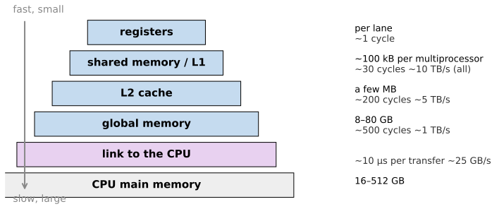
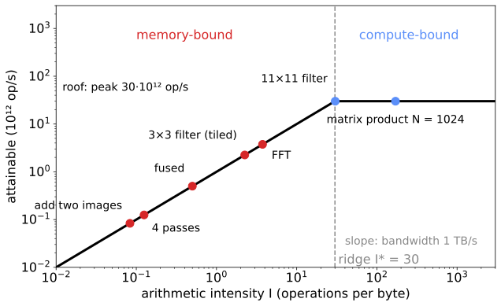

## About this lecture

Last unit: a GPU has arithmetic to spare and hides waiting with many warps. Today: for most image operations, **moving bytes** is the real limit.

- The **memory hierarchy**: registers, shared memory, caches, global memory, the link to the CPU.
- **Coalescing**: a warp should read neighbouring addresses.
- **Tiling** with a halo: read each input pixel once for a stencil.
- **Arithmetic intensity** and the **roofline**: memory-bound or compute-bound?
- **Transfers** and launch overhead: keep the data on the GPU.

Slides titled **The math** give the formulas and proofs; the ideas are complete without them.

::: notes
Numbers are order of magnitude for a generic "desktop GPU" (30·10¹² float32 operations per second, 1 TB/s memory, 25 GB/s link, 10 µs per launch); the demos use the same table (laptop CPU, desktop GPU, data-centre GPU). Real devices differ by factors of 2–5; the shape of the argument does not.
:::

## Recall: an image is a row of bytes

From [how GPUs store images](../gpuformats/lec.qmd): memory is one long row of bytes.

- A row-major $W \times H$ float32 image: pixel $(x, y)$ is at byte $4(yW + x)$ (plus row padding: the **stride**).
- **Interleaved** RGB stores RGBRGB…; **planar** stores all R, then all G, then all B.
- Neighbours along a row are neighbours in memory; neighbours along a column are $4W$ bytes apart.

Today this layout decides how fast a GPU can read the image.

## The memory hierarchy

{width="78%" fig-align="center"}

Fast memory is small and near the lanes; big memory is far and slow. The link to the CPU is **40 times slower** than the GPU's own memory.

## Most image code is memory-bound

Add two float32 images: per pixel, read 8 bytes, write 4, do **one** addition.

- At 1 TB/s: $10^{12}/12 = 8.3 \cdot 10^{10}$ additions per second.
- The lanes could do $3 \cdot 10^{13}$: the addition uses **0.28 %** of the arithmetic.
- The GPU spends almost all its time **waiting for bytes**. Arithmetic is nearly free; moving data is not.

Element-wise operations, thresholds, colour conversions, small filters: all limited by **bandwidth**. The questions become: how many bytes does an operation move, and does it move them efficiently?

## Coalescing: a warp reads in lines

Memory delivers whole **lines** of 128 bytes (32 floats), in four 32-byte **sectors**.

- The 32 lanes read 32 **consecutive** floats (a row): one line, all of it used. **Coalesced**: 100 %.
- They read a **column** of a 1024-wide image: 32 different lines, one sector each, 4 of 32 bytes used: **12.5 %**.
- Interleaved RGB, reading only R: every third float, 3 lines for 128 useful bytes: **33 %**. Planar R: 100 %.

So: map neighbouring threads to neighbouring pixels **along rows**; prefer **planar** channels; do transposes through fast shared memory in tiles.

## Try it: coalescing

```{=html}
<link rel="stylesheet" href="../demos/dist/demo.css">
<div data-demo="coalesce" data-tab="access" data-preset="columns"></div>
<script src="../demos/dist/coalesce.js"></script>
```

::: notes
Simulated: the 32 lanes on top, the touched 128-byte lines below (thick separators between the four 32-byte sectors); dark blue = the floats the lanes asked for, light blue = moved but not used. Tour: "columns": 32 lines, 32 sectors = 1024 bytes moved for 128 used: 12.5 %. "rows": 1 line, 100 %. "interleaved RGB": 3 lines, 12 sectors, 33 %. Stride s: s = 2 gives 50 %, s = 4 25 %, from s = 8 on every lane has its own sector: 12.5 %. Random addresses: 12.5 %. "transpose via tile": both the reads and the writes look like rows.
:::

## Tiling a stencil with a halo

A 3 × 3 filter reads 9 inputs per output. Read them all from global memory and each input pixel is fetched 9 times.

- **Tiles**: a block computing a 16 × 16 output tile first loads the **18 × 18** input tile (the tile plus a **halo** of 1 pixel) into **shared memory**, once. Every thread then reads its 9 neighbours from there.
- Global reads per output pixel: $18^2/16^2 = 1.27$ instead of 9.
- A $k \times k$ kernel needs a halo of $(k-1)/2$: a 31 × 31 kernel with 8 × 8 tiles loads $38^2/8^2 = 22.6$ pixels per output: the halo dominates small tiles; with 32 × 32 tiles 3.75.

(The texture cache of [GPU textures](../gpuformats/lec.qmd) does part of this automatically, and gives bilinear interpolation for free.)

## Try it: tiles and halos

```{=html}
<link rel="stylesheet" href="../demos/dist/demo.css">
<div data-demo="coalesce" data-tab="tile" data-preset="tile16"></div>
<script src="../demos/dist/coalesce.js"></script>
```

::: notes
Heat map: how often each input pixel (32 × 32 outputs, plus the halo, dashed white line = the image) is read from global memory. "tile 16 with a 3×3 halo": interior pixels once, the seams between tiles twice, the centre corner four times; 1.266 reads per output, 7.1 times fewer than direct. Choose "none (direct)": 9 per output. "31×31 kernel": 8 × 8 tiles give 22.6 reads per output (still 43 times fewer than 961); try 16 (8.3) and 32 (3.75).
:::

## Arithmetic intensity

**Intensity** $I$ = operations per byte moved to and from global memory (float32, 4 bytes per value).

| operation (per pixel) | operations | bytes | $I$ |
|---|---|---|---|
| add two images | 1 | 12 | 0.083 |
| multiply by a constant, in place | 1 | 8 | 0.125 |
| 3 × 3 filter, every tap from memory | 18 | 40 | 0.45 |
| 3 × 3 filter, ideal reuse (tiles) | 18 | 8 | 2.25 |
| $k \times k$ filter, ideal reuse | $2k^2$ | 8 | $k^2/4$ |
| matrix product of $N \times N$ matrices (total) | $2N^3$ | $12N^2$ | $N/6$ |

A 2D FFT of $n$ points does about $5n\log_2 n$ operations; with two passes through memory (rows, then columns) $I \approx 0.16\log_2 n$: about 4 for a 4096 × 4096 image. Memory-bound too.

## The math: intensity of a $k \times k$ stencil {.math}

- Work per output pixel: $k^2$ multiplications and $k^2$ additions: $W = 2k^2$.
- Traffic without reuse: $k^2$ reads and one write of 4 bytes: $Q = 4(k^2 + 1)$, so $I \to 1/2$ for large $k$.
- With $T \times T$ output tiles and a halo: $(T + k - 1)^2$ reads per tile, $T^2$ writes:
$$Q = 4\left(\frac{(T+k-1)^2}{T^2} + 1\right) \xrightarrow{T\to\infty} 8, \qquad I = \frac{2k^2}{8} = \frac{k^2}{4}.$$
- Separable: two 1D passes of $2k$ operations each, each pass reading and writing 8 bytes: $I = 4k/16 = k/4$. Fewer operations, lower intensity: faster as long as it is memory-bound.
- Matrix product: $2N^3$ operations on three $N \times N$ float32 matrices, $12N^2$ bytes: $I = N/6$.

## The roofline

{width="58%" fig-align="center"}

Attainable rate = the lower of two lines: **bandwidth × intensity** (slanted) and the **peak** (flat). They meet at the **ridge** $I^* = \text{peak}/\text{bandwidth} = 30$ for the desktop preset.

- Left of the ridge: **memory-bound**. Speed up by moving fewer bytes: **fuse** steps, use **float16**, reuse tiles.
- Right of the ridge: **compute-bound**. Speed up by doing less arithmetic (separable filters, the FFT for big kernels).
- A $k \times k$ filter reaches the ridge at $k^2/4 = 30$: $k \approx 11$.

## The math: the roofline {.math}

Peak arithmetic $\pi$ (operations/s), bandwidth $\beta$ (bytes/s). A kernel with work $W$ and traffic $Q$ needs at least $W/\pi$ for the arithmetic and $Q/\beta$ for the bytes; with both overlapped,
$$t = \max\!\Big(\frac{W}{\pi}, \frac{Q}{\beta}\Big), \qquad P = \frac{W}{t} = \min(\pi,\ \beta I), \qquad I = \frac{W}{Q}.$$

- Ridge: $\pi = \beta I^*$, so $I^* = \pi/\beta$.
- Desktop preset: $\pi = 3\cdot10^{13}$, $\beta = 10^{12}$: $I^* = 30$. Add two 4096 × 4096 images: $Q = 12 \cdot 4096^2 = 201$ MB, $t = 201\ \mu$s; the arithmetic alone would take $0.56\ \mu$s.

## Fusing: move the image once

A pipeline "scale, subtract a constant background, clip, threshold" as four separate passes reads and writes the whole image **four** times. Fused into **one** kernel (each thread does all four steps on its pixel), it moves the image once.

- Same arithmetic, a quarter of the bytes: **4 times faster** ($I$: 0.125 → 0.5).
- The same idea is why the intermediate images of a pipeline should stay in registers or fast memory whenever the next step needs only the same pixel (or a small neighbourhood).

## Try it: the roofline

```{=html}
<link rel="stylesheet" href="../demos/dist/demo.css">
<div data-demo="roofline" data-tab="roofline" data-preset="ridge"></div>
<script src="../demos/dist/roofline.js"></script>
```

::: notes
Generic devices with order-of-magnitude numbers; points are operations on a 4096 × 4096 float32 image (matrix product: N × N). Tour: "k = 11 hits the ridge": I = 30.25, the k×k point sits at the corner. Move k down to 3: I = 2.25, 7.5 % of peak. "adding images": far left, 0.28 % of peak, 201 µs. Click "4 passes" and "fused": 537 µs vs 134 µs. "matrix products live under the roof": N = 1024, I = 171, compute-bound, 72 µs. "float16 moves the point right": the 5×5 filter goes from I = 6.25 to 12.5 and twice as fast. Switch device to "laptop CPU": its ridge is at 8; the same points, everything a hundred times slower in absolute terms.
:::

## Transfers and launch overhead

The image must cross the **link** (about 25 GB/s) to the GPU and back, and every program launch costs about **10 µs**.

- 4096 × 4096 float32 = 67 MB: upload 2.7 ms, download 2.7 ms. One element-wise kernel on the GPU: 0.13 ms. The transfer is **37 times** the work.
- The CPU does that element-wise operation in a few ms itself: for **one** cheap step the GPU cannot win.
- **Keep data on the GPU** for a whole pipeline; move only inputs and final results.
- Small images (≲ 256 × 256) are dominated by the fixed costs: launches, transfers, too few threads.

The opening demo: at 2048², 9 × 9, the download (106 ms) took far longer than the filter (14 ms). At 128² the fixed costs were all there was.

## The math: end to end {.math}

$m$ kernels on an image of $B$ bytes, link bandwidth $\beta_\text{link}$, launch cost $t_\ell$:
$$t_\text{GPU} = \frac{2B}{\beta_\text{link}} + m\,t_\ell + \sum_{j=1}^m \max\!\Big(\frac{W_j}{\pi}, \frac{Q_j}{\beta}\Big).$$

Against a CPU that needs $c$ seconds per pixel for the whole pipeline, with $B = 4n$ for $n$ pixels and $g$ the GPU's kernel time per pixel:
$$c\,n = m\,t_\ell + n\Big(\frac{8}{\beta_\text{link}} + g\Big) \quad\Rightarrow\quad n^* = \frac{m\,t_\ell}{c - 8/\beta_\text{link} - g}.$$

If $c < 8/\beta_\text{link}$ (the CPU is faster than the transfer alone), the GPU never wins.

## Try it: end to end

```{=html}
<link rel="stylesheet" href="../demos/dist/demo.css">
<div data-demo="roofline" data-tab="e2e" data-preset="pipeline"></div>
<script src="../demos/dist/roofline.js"></script>
```

::: notes
Model, desktop GPU against laptop CPU. "a 10-step pipeline that stays on the GPU": ten 9 × 9 filters on 2048²: GPU 1.78 ms (upload 0.67, launches 0.1, kernels 0.34, download 0.67) against 17 ms on the CPU; the GPU wins from n ≈ 167. Untick "data stays on the GPU": every step pays upload and download, 13.9 ms, and the crossover moves to n ≈ 362. "one filter on a small image": 3 × 3 at 128²: transfer and launch are everything; with a 3 × 3 filter the GPU never wins in this model, because the CPU filters faster than the link can move the image.
:::

## Summary

- Memory is a hierarchy: registers, shared memory, caches, global memory (~1 TB/s), the link to the CPU (~25 GB/s).
- Most image operations do little arithmetic per byte: they are **memory-bound**.
- **Coalescing**: neighbouring threads read neighbouring addresses (rows, planar channels); columns and strides waste most of each line.
- **Tiles with a halo** let a stencil read each input pixel about once.
- **Roofline**: attainable rate $= \min(\text{peak}, \text{bandwidth} \times I)$; left of the ridge, move fewer bytes (fuse, float16, reuse); right, do less arithmetic.
- **Transfers** and launches are fixed costs: keep the data on the GPU and give it big jobs.
