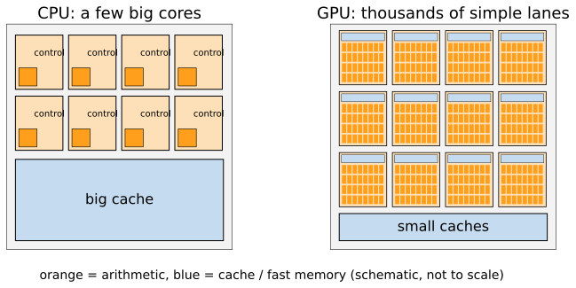
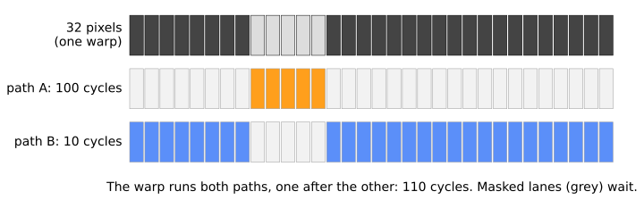

## About this lecture

The same filter can run tens of times faster on a graphics processor (GPU), or slower. This day explains when and why. Today: how a GPU executes a program.

- A processor in three numbers: clock, memory distance, caches.
- **Latency** (a CPU: make one task fast) vs **throughput** (a GPU: many tasks at once).
- **SIMT**: threads run in **warps** of 32 that share one instruction stream.
- **Branch divergence**: when the 32 disagree, both paths are run.
- **Latency hiding**: many warps in flight cover the slow memory (**occupancy**).

Slides titled **The math** give the formulas and proofs; the ideas are complete without them.

::: notes
This day owns throughput vs latency, SIMT and divergence, occupancy, the memory hierarchy, the roofline, the data-parallel patterns and the "good and bad on a GPU" judgement. No programming is needed: the GPU is shown as pictures, simulations and counts. Vendor and product names are left out on purpose; "warp" is the most common word (some vendors say "wavefront").
:::

## Try it: the same filter on the CPU and the GPU

```{=html}
<link rel="stylesheet" href="../demos/dist/demo.css">
<div data-demo="gpufilter" data-tab="race" data-preset="big"></div>
<script src="../demos/dist/gpufilter.js"></script>
```

::: notes
A direct 9 × 9 box filter on a 2048 × 2048 float image: on the CPU in plain TypeScript (one thread), and on the GPU as a small program run once per output pixel, the result read back. Press "run both". On the author's computer: CPU 1230 ms, GPU 145 ms in total, of which only 14 ms is the computation; 106 ms is reading the result back. Then the preset "128², 3×3": both take about 2 ms, no gain. The numbers vary from machine to machine; the pattern does not. The rest of the day explains both results. (The CPU side is deliberately simple: a tuned multi-core CPU code would be 10–50 times faster. The comparison is honest about what is being compared.)
:::

## A processor in three numbers

- A processor executes **instructions** (add, multiply, compare, load, store) at a **clock rate** of about $3 \cdot 10^9$ cycles per second: one simple instruction takes about 0.3 ns.
- Data lives in **main memory**, physically far away: one read takes about **100 ns**, i.e. **300 cycles** of doing nothing.
- **Caches**: small, fast memories next to the processor that keep recently used data. A hit costs a few cycles; a miss costs the full trip.

An image is far bigger than any cache: a 2048 × 2048 float32 image is 16 MB. Most of the art of fast image code is about **not waiting for memory**.

## Latency: what a CPU core is built for

A CPU core spends most of its chip area on making **one** stream of instructions fast:

- big caches, so most reads are hits;
- **out-of-order** execution: while one instruction waits, later independent ones run;
- **branch prediction**: guess which way an `if` goes and start on it before the answer is known.

The goal is short **latency**: the time from the start to the end of **one** task. A laptop CPU has about 8 such cores; each does 16 floating-point operations per cycle with its vector units: $8 \cdot 3\cdot10^9 \cdot 16 = 3.8 \cdot 10^{11}$ operations per second.

## Throughput instead

{width="80%" fig-align="center"}

A GPU spends its area on **thousands of simple arithmetic lanes** and accepts that each single operation is slow. The goal is **throughput**: tasks finished per second. 10 000 lanes at $1.5 \cdot 10^9$ cycles per second, 2 operations per cycle (a fused multiply–add): $3 \cdot 10^{13}$ per second, 78 times the CPU.

A sports car (2 people, 200 km/h) vs a bus (50 people, 80 km/h): the bus moves 10 times more people per hour, but only if there are 50 people **going the same way**.

## The math: latency and throughput {.math}

Time for $n$ items with a start-up cost $t_0$ and a rate $R$:
$$t(n) = t_0 + \frac{n}{R}.$$

- CPU: small $t_0$, small $R$. GPU: large $t_0$ (moving the data, starting the program), large $R$.
- The GPU is faster when $t_0^\text{GPU} + n/R_\text{GPU} < t_0^\text{CPU} + n/R_\text{CPU}$, i.e. above the **break-even** size
$$n^* = \frac{t_0^\text{GPU} - t_0^\text{CPU}}{1/R_\text{CPU} - 1/R_\text{GPU}}.$$
- Example: CPU $t_0 = 0.01$ ms, $R = 2\cdot10^8$ pixels/s; GPU $t_0 = 0.5$ ms, $R = 10^{10}$ pixels/s: $n^* = 0.49\text{ ms} / 4.9\text{ ns} = 100\,000$ pixels, an image of about $316 \times 316$.

## Where GPUs come from

Drawing one frame of a 3D scene (recall [the rasteriser](../rasterise/lec.qmd)): for every pixel a triangle covers, run the same small program (shading) with different data. Millions of independent pixels, the same instructions.

- The **fragment stage** of the graphics pipeline is a **map** over pixels.
- Around 2006 the hardware became programmable enough to run *any* such program: general-purpose GPU computing.
- Image processing has exactly this shape: a filter, a threshold, a colour conversion compute every output pixel by the same rule from nearby input pixels.

You write the program for **one pixel**; the GPU runs it for all of them.

## SIMT: warps of 32 threads

- One **thread** per pixel (or per output value). A 2048 × 2048 image: 4 194 304 threads.
- Threads are grouped in **warps** of 32 that execute **the same instruction at the same time**, each on its own data: single instruction, multiple threads (**SIMT**). (Some vendors call a warp a *wavefront*, of 32 or 64.) 2048² pixels = 131 072 warps.
- Warps are grouped in **blocks**; a block runs on one **multiprocessor**, whose threads share a small fast memory (next unit). A GPU has tens of multiprocessors.
- One instruction fetch and decode serves 32 lanes: that is where the saved chip area comes from.

The catch: 32 lanes, **one** instruction stream. What if the lanes want different instructions?

## Branch divergence

`if pixel > t: A (100 cycles) else: B (10 cycles)`

{width="88%" fig-align="center"}

- All 32 lanes take A, or all take B: the warp runs one path.
- **Mixed**: the warp runs A with the B-lanes masked off, then B with the A-lanes masked off. Cost = $100 + 10$, not the average.
- 5 of 32 pixels inside: the warp spends 110 cycles; useful work $5\cdot100 + 27\cdot10 = 770$ lane-cycles of $32\cdot110 = 3520$ issued: **22 % efficiency**.

Divergence is a property of **warps**, not of pixels: a uniform region costs nothing, an object boundary through a warp does.

## Try it: warps and divergence

```{=html}
<link rel="stylesheet" href="../demos/dist/demo.css">
<div data-demo="warpsim" data-tab="divergence" data-preset="rows"></div>
<script src="../demos/dist/warpsim.js"></script>
```

::: notes
A model of a GPU with the rules of a real one, not a measurement. 64 × 32 synthetic nuclei, warps as rows of 32 pixels. Orange outline: all lanes inside (path A, 100 cycles); blue: all outside (10 cycles); red: mixed, runs both (110). Tour: "nuclei, warps = rows": 29 of 64 warps diverge, 48.6 % lane efficiency, 3540 cycles against 1720 without divergence. "nuclei, warps = 8×4 tiles": 24 warps diverge, 52.0 %, 3310 cycles: compact tiles are cut by fewer boundaries. Image "blocks" (8 × 8 squares): rows of 32 all diverge, 8 × 4 tiles none, 100 %. "noise": every warp diverges (p = 0.5 per pixel). "uniform": none. Then "one slow lane holds 31 hostage": every pixel needs 1 iteration except a few with 32; each of the 16 row-warps that contains one takes 32 iterations, and the lane efficiency drops to 17 %. Click any warp to see its lane masks.
:::

## The math: how often does a warp diverge? {.math}

Each lane takes branch A independently with probability $p$. The warp is uniform only if all 32 agree:
$$P(\text{mixed}) = 1 - p^{32} - (1-p)^{32}.$$

Expected time with costs $c_A$, $c_B$:
$$E[T] = p^{32}c_A + (1-p)^{32}c_B + P(\text{mixed})\,(c_A + c_B).$$

| $p$ | 0.01 | 0.1 | 0.5 |
|---|---|---|---|
| $P(\text{mixed})$ | 0.275 | 0.966 | ≈ 1 |
| $E[T]$ ($c_A = 100$, $c_B = 10$) | 37.5 | 106.6 | 110 |
| average per pixel $pc_A + (1-p)c_B$ | 10.9 | 19 | 55 |

Random pixels are the worst case. Real images are **coherent**: a warp of 32 neighbouring pixels is mixed only where an object boundary crosses it, so the mixed fraction scales like perimeter / area.

## Loops wait for the slowest lane

- A loop with a data-dependent number of iterations ("iterate until converged", "march along a ray until it is opaque", [volume rendering](../volrender/lec.qmd)): the warp runs until its **slowest** lane is done.
- 8 lanes needing 3, 1, 1, 12, 2, 1, 4, 1 iterations: the warp takes 12, the average is 3.1: 26 % efficiency.

Remedies:

- make branches **uniform per warp**: map warps to compact tiles, sort or compact the work first (unit 3);
- replace a short branch by arithmetic: compute both values and **select** one;
- **split** the job: a cheap pass over everything, then an expensive pass over the few pixels that need it.

## Hiding memory latency

A load from global memory takes about 500 cycles. A warp that waits is **parked**, and the multiprocessor issues instructions from **another** resident warp in the meantime.

- With enough warps in flight, some warp is always ready: the waiting is **hidden**.
- **Occupancy**: how many warps are resident, out of the maximum. It is limited by registers and fast memory per thread: a big per-thread program means fewer warps.
- A warp doing $k$ cycles of work per load of latency $L$ needs about $(k + L)/k$ companions: $k = 8$, $L = 200$: **26 warps**.

So a GPU needs **tens of thousands of threads** to be busy. A 256 × 256 image (65 536 threads) barely fills it; a 64 × 64 image cannot.

## The math: how much must be in flight (Little's law) {.math}

Little's law (queueing theory): items in a system = arrival rate × time each one spends there. For memory:
$$\text{bytes in flight} = \text{bandwidth} \times \text{latency}.$$

- Bandwidth $\beta = 1$ TB/s, latency $L = 500$ ns: $\beta L = 500$ kB must be requested and not yet arrived **at every moment**.
- At 4 bytes per thread: $125\,000$ threads waiting at once.
- One multiprocessor, one instruction per cycle: $N$ warps with $k$ compute cycles per load are busy a fraction
$$U \approx \min\!\Big(1, \frac{N k}{k + L}\Big).$$

## Try it: latency hiding

```{=html}
<link rel="stylesheet" href="../demos/dist/demo.css">
<div data-demo="warpsim" data-tab="latency" data-preset="one"></div>
<script src="../demos/dist/warpsim.js"></script>
```

::: notes
One multiprocessor that issues one instruction per cycle. Each warp: k compute instructions, then a load that takes L cycles (grey), 6 times. Tour: "one warp cannot hide memory": k = 4, L = 200: the green busy strip is almost empty, utilisation about 2 % (Little's law: 4/204 = 2 %). Drag N up: 8 warps, 16 warps; the busy strip fills. "enough warps hide it": 32 warps with k = 8: 100 %. "too many registers": 255 registers per thread leave room for only 8 warps (occupancy 25 %): 35 %. The point: arithmetic is cheap, waiting is expensive, and the cure is more independent work in flight.
:::

## Summary

- A CPU minimises **latency** (one task fast); a GPU maximises **throughput** (many tasks per second) with thousands of simple lanes.
- Work is written per pixel; threads run in **warps** of 32 that share one instruction stream (**SIMT**).
- **Divergence**: a warp whose lanes disagree runs every path taken; loops wait for the slowest lane. Coherent images diverge only along boundaries.
- Memory is hundreds of cycles away; the GPU **hides** it by switching between many resident warps (**occupancy**). It needs tens of thousands of independent threads.
- GPUs are fast for **many independent, identical, simple** tasks; slow when tasks depend on each other, disagree, or are few.
