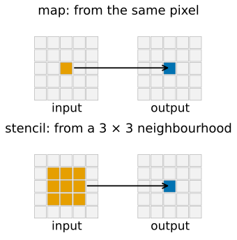
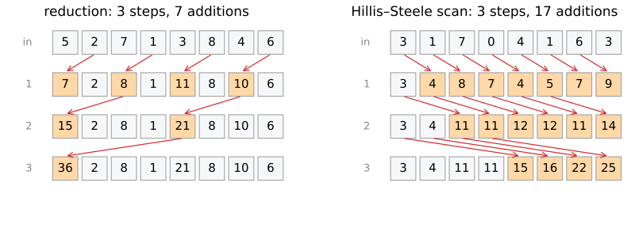
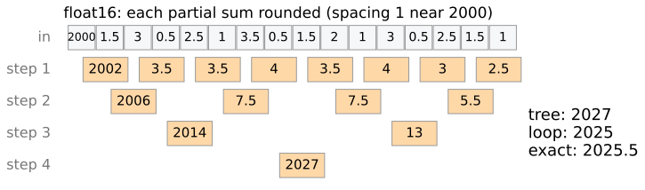
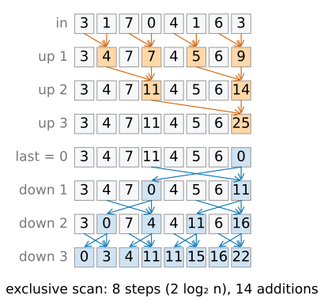
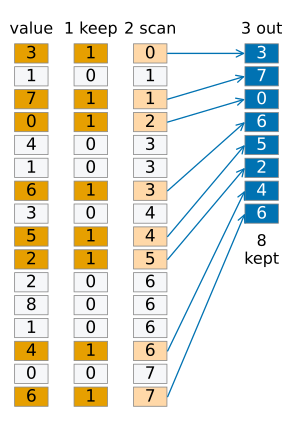
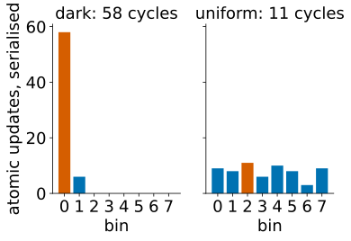
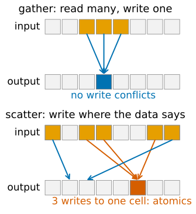

## About this lecture

A GPU needs many independent pieces of work. Many image operations obviously have them; some look sequential but are not. Five **patterns** cover most of image processing.

- **Map** and **stencil**: one output per pixel.
- **Reduction**: many numbers to one (sum, mean, maximum), as a tree.
- **Scan** (prefix sum): every running total in $\log_2 n$ steps; **stream compaction**.
- **Histogram**: many threads add to few bins: **atomic** additions and **contention**.
- **Work** and **depth**: how much is done, and how long the longest chain of dependent steps is.

Slides titled **The math** give the formulas and proofs; the ideas are complete without them.

::: notes
This day owns the parallel scan; the integral-image unit owns the sequential running total and recalls this unit for the parallel version. All demos here are simulations of what a GPU would do, step by step, with counters.
:::

## Map and stencil: one output per pixel

Think in patterns instead of loops: if every output can be computed **without the other outputs**, all of them can run at once.

:::: {.columns}
::: {.column width="58%"}
- **Map**: each output from the input at the same pixel. Gain and offset, gamma, thresholding, colour conversion, adding images. Perfectly parallel; memory-bound (last unit).
- **Stencil**: each output from a fixed neighbourhood of the input. Convolution ([kernels](../kernels/lec.qmd)), morphology with a small structuring element, finite differences, one step of a diffusion. Parallel per output pixel; tiles and halos (last unit).
- An **iterated** stencil (100 diffusion steps) needs 100 passes: step $t+1$ needs **all** of step $t$, a global barrier between passes.
:::
::: {.column width="42%"}
{fig-alt="Two 5 by 5 input grids each with an arrow to a 5 by 5 output grid. Map: one orange input pixel gives the blue output pixel at the same place. Stencil: the orange 3 by 3 neighbourhood of the input gives the one blue output pixel at its centre." width="100%"}
:::
::::

The interesting cases are the ones where outputs depend on **many** inputs.

## Reduction: a tree

Sum, mean, maximum, count of an image: many inputs, one output. A loop adds one number at a time: $n - 1$ steps, each waiting for the previous one.

{width="92%" fig-align="center"}

A **tree**: add pairs, then pairs of pairs. 8 numbers in 3 steps, $n$ numbers in $\lceil\log_2 n\rceil$ steps, still $n - 1$ additions. On a GPU each block reduces its part in fast memory, then a second pass combines the block results. A 2048² image: 22 steps instead of 4 million.

## Reductions and rounding

Recall [summing many pixels](../floatingpoint/lec.qmd): adding small numbers to a large running sum loses digits.

- The tree **is pairwise summation**: partial sums of similar size are added. The GPU's mean of an image is more accurate than the naive loop.
- But floating-point addition is **not associative**: $(a + b) + c$ can differ from $a + (b + c)$ in the last digit.
- How the work is split over blocks changes the grouping: two runs, or two GPUs, can give **different last digits** for the same sum.
- Reproducible sums need a fixed order (fixed tree), or integer / compensated arithmetic.

{fig-alt="The demo preset: 2000 and fifteen small values (1.5, 3, 0.5, ...) summed by a tree in float16, every partial sum rounded. Step 1 gives 2002, 3.5, 3.5, 4, 3.5, 4, 3, 2.5; step 2 gives 2006, 7.5, 7.5, 5.5; step 3 gives 2014 and 13; step 4 gives 2027. The sequential loop gives 2025; the exact sum is 2025.5." width="96%" fig-align="center"}

## Try it: reduction and the order of additions

```{=html}
<link rel="stylesheet" href="../demos/dist/demo.css">
<div data-demo="parscan" data-mode="reduce" data-preset="order"></div>
<script src="../demos/dist/parscan.js"></script>
```

::: notes
Every row is one parallel step; red arrows are the additions of the current step. Preset "the sum changes with the order": 2000 and fifteen small values in float16 (every sum rounded to float16; spacing 1 between 1024 and 2048). Exact sum 2025.5; the sequential loop gives 2025, the tree 2027. Press "shuffle the split" (the same numbers given to the lanes in a different order): 2026, 2026, 2026, 2026, 2025… The last digit depends on the grouping. Then "16 numbers in 4 steps": 4 steps, 15 additions against 15 steps of the loop; click values to change them (upper half +1, lower half −1).
:::

## The math: work, depth and Brent's bound {.math}

- **Work** $W$: total number of operations. **Depth** $D$: the longest chain of operations that each need the previous one.
- Sequential sum: $W = n - 1$, $D = n - 1$. Tree reduction: $W = n - 1$, $D = \lceil\log_2 n\rceil$.
- **Brent's bound**: with $p$ lanes,
$$\max\!\Big(\frac{W}{p},\ D\Big) \le t_p \le \frac{W}{p} + D.$$
- Reduction of $n = 2^{20}$ numbers on $p = 10^4$ lanes: $t_p \le 105 + 20 = 125$ steps, against $10^6$ sequentially.
- A loop where each step needs the previous one has $D = W$: no number of lanes helps. **Depth is what a GPU cannot buy.**

## The math: why a tree needs associativity {.math}

A tree regroups the sum: $((a + b) + c) + d = (a + b) + (c + d)$. That is allowed for an **associative** operation: $+$ and $\times$ on real numbers, max, min, logical and/or, matrix products. (Mean: as a sum and a count.)

In floating point, $\mathrm{fl}(\mathrm{fl}(a + b) + c) \ne \mathrm{fl}(a + \mathrm{fl}(b + c))$ in general. Example in float32 (spacing 8 near $10^8$):
$$(10^8 + 1) - 10^8 = 0, \qquad (10^8 - 10^8) + 1 = 1.$$

Error bounds (unit roundoff $u$, from the bit-depth day): naive summation $|\text{error}| \lesssim (n-1)\,u\sum|x_i|$; pairwise (tree) $\lesssim \lceil\log_2 n\rceil\,u\sum|x_i|$.

## Scan: every running total

The **prefix sum** or **scan**: output $i$ = the sum of inputs $0..i$ (inclusive), or $0..i-1$ (exclusive). It builds the [integral image](../integral-image/lec.qmd), the cumulative histogram, and much more.

Each running total seems to need the previous one, yet it runs in $\log_2 n$ steps.

**Hillis–Steele**: in step $d$, every element adds the one $2^d$ places to its left (all at once, from the previous row; right panel of the figure above).

- 8 numbers: 3 steps; after step $d$ each element holds the sum of the last $2^{d+1}$ inputs.
- Simple, but $n\log_2 n - (n - 1)$ additions: 17 for 8 numbers, against 7 for the loop.

## Blelloch: the work-efficient scan

:::: {.columns}
::: {.column width="58%"}
1. **Up-sweep**: a reduction tree that keeps its partial sums in place (block sums of 2, 4, 8, …).
2. Set the last element to 0.
3. **Down-sweep**: walking back down the tree, each node passes its value to its left child and gives its right child (left value + its own).

Result: the exclusive scan in $2\log_2 n$ steps with $2(n-1)$ additions, the same order of work as the loop. For large $n$ the GPU prefers it (less work); for one block, Hillis–Steele (fewer steps).

The integral image = a scan along every row, then along every column: both are thousands of independent scans.
:::
::: {.column width="42%"}
{fig-alt="Blelloch scan of 3, 1, 7, 0, 4, 1, 6, 3 drawn as rows. Up-sweep: 3 4 7 7 4 5 6 9, then 3 4 7 11 4 5 6 14, then the total 25 at the right end. The last element is set to 0. Down-sweep, three steps of swap-and-add arrows: 3 4 7 0 4 5 6 11, then 3 0 7 4 4 11 6 16, then the exclusive scan 0 3 4 11 11 15 16 22. 8 steps, 14 additions." width="100%"}
:::
::::

## Try it: scans

```{=html}
<link rel="stylesheet" href="../demos/dist/demo.css">
<div data-demo="parscan" data-mode="scan-hs" data-preset="hs"></div>
<script src="../demos/dist/parscan.js"></script>
```

::: notes
16 values. "Hillis–Steele does more work": 4 steps, 49 additions (16·4 − 15) against 15 for the loop; use "first" and "step" to go through it: after step 1 each element holds the sum of 2, then 4, 8, 16. "Blelloch: twice the steps, less work": up 1–4 is a reduction tree towards the right end (53 at the end = the total), then the 0, then dn 1–4: 8 steps, 30 additions = 2(n − 1). The last row is the exclusive scan: 0, 3, 4, 11, 11, 15, …
:::

## The math: scan as a matrix {.math}

The inclusive scan is multiplication by the lower-triangular matrix of ones, $y = Lx$ with $L_{ij} = 1$ for $j \le i$.

- Hillis–Steele factorises it: with $S_k$ the shift matrix ($(S_kx)_i = x_{i-k}$, zero outside),
$$L = (I + S_{2^{m-1}})\cdots(I + S_2)(I + S_1), \qquad n = 2^m.$$
Each factor is one parallel step: every element adds its neighbour $2^d$ to the left.
- Check for $n = 4$: $(I + S_2)(I + S_1)$ has row 3 equal to $(1, 1, 1, 1)$, because $1 + S_1 + S_2 + S_3$ covers every shift exactly once (binary representation of 0–3).
- The integral image of an $H\times W$ image $A$: $L_H\,A\,L_W^\top$: a scan of every column, then of every row, a separable linear map.

## Stream compaction

:::: {.columns}
::: {.column width="62%"}
Keep only some elements (the foreground pixels, the unfinished rays, the detected spots), **densely packed**:

1. a 0/1 mask of the elements to keep (a map);
2. its **exclusive scan**: element $i$'s value is the number of kept elements before it, i.e. **its output position**;
3. every kept element writes itself to that position (a scatter without conflicts).

All three steps are parallel. Uses: building the list of object pixels, of edge pixels, of active cells; radix sort; and the cure for divergence (last unit): **compact** the pixels that need the expensive branch into a dense list, so that they fill whole warps.
:::
::: {.column width="38%"}
{fig-alt="Stream compaction of 16 values 3 1 7 0 4 1 6 3 5 2 2 8 1 4 0 6 drawn as columns. Keep mask 1 0 1 1 0 0 1 0 1 1 0 0 0 1 0 1 (kept rows orange). Its exclusive scan 0 1 1 2 3 3 3 4 4 5 6 6 6 6 7 7. Arrows from each kept element to its scan position in the output: 3 7 0 6 5 2 4 6, 8 kept." width="88%"}
:::
::::

## Histogram: atomic additions

:::: {.columns}
::: {.column width="58%"}
Each thread looks at one pixel and adds 1 to bin $h(I_p)$ ([histograms](../histogram/lec.qmd)). Many threads, few bins, positions that depend on the data.

- Two threads incrementing the same bin at the same time would both read 5 and both write 6: a count is lost. The increment must be **atomic**: read–add–write as one indivisible step.
- Atomic updates to **the same address are serialised**: one per cycle. A dark image whose pixels nearly all fall into bin 0 makes every thread wait in one queue: **contention**.
- **Privatisation**: each block keeps its own histogram in its fast memory, then the block histograms are added (a reduction). The queue on one bin is divided by the number of blocks.
:::
::: {.column width="42%"}
{fig-alt="Two histograms of the 64 pixels of the demo, one atomic update per pixel. Dark image: 58 updates to bin 0 and 6 to bin 1: 58 cycles in one queue. Uniform image: 3 to 11 updates per bin, the busiest bin has 11: 11 cycles." width="100%"}
:::
::::

The same for every **scatter** with collisions: Hough voting into an accumulator, splatting points into an image.

## Try it: histogram with atomics

```{=html}
<link rel="stylesheet" href="../demos/dist/demo.css">
<div data-demo="parscan" data-mode="histogram" data-preset="dark"></div>
<script src="../demos/dist/parscan.js"></script>
```

::: notes
64 pixels with values 0–7 (one bin each), one thread per pixel. Right: one column per bin, one orange cell per cycle the bin is busy (atomic additions to one bin wait in line; different bins in parallel). "dark image": 58 pixels in bin 0, 58 cycles. "private histograms": 8 blocks of 8 threads, each with its own histogram: the busiest private bin has 8 updates, plus 8 cycles to add the 8 block histograms into the global one (purple): 16. Pixels "uniform": global 11 cycles, privatised 4 + 8 = 12: with little contention privatisation does not pay. "bimodal": 20 against 14.
:::

## The math: contention {.math}

$n$ pixels fall into bins with probabilities $q_1, \dots, q_b$.

- Global atomics: the busiest bin receives about $n\max_j q_j$ updates, serialised: $t \approx n\max_j q_j$.
- Uniform image: $t \approx n/b$; dark image ($\max q_j \approx 1$): $t \approx n$, no parallelism at all.
- Privatised over $m$ blocks: each block's busiest bin has about $n\max_j q_j/m$ updates, all blocks in parallel; then $m$ updates per global bin (or a tree of depth $\log_2 m$):
$$t \approx \frac{n\max_j q_j}{m} + m.$$
- Minimised at $m \approx \sqrt{n\max_j q_j}$; in practice, $m$ = the number of blocks.

## Gather or scatter, and the FFT

:::: {.columns}
::: {.column width="60%"}
- **Gather**: a thread reads many inputs and writes one output (convolution, interpolation, back-projection per output pixel). No write conflicts, no atomics.
- **Scatter**: a thread writes to many or data-dependent outputs (histograms, Hough voting, splatting, back-projection per projection ray). Needs atomics.
- Rewrite scatter as gather where possible: in [filtered back-projection](../fbp/lec.qmd), loop over output pixels and gather from every projection, instead of smearing every ray into the image.
- The **FFT** ([Fourier](../fourier/lec.qmd)): $\log_2 n$ passes, each a map over pairs of values (butterflies): regular and parallel, but each pass moves all the data: bandwidth-bound. A 2D FFT = 1D FFTs along rows, then columns (coalescing: transpose in between).
:::
::: {.column width="40%"}
{fig-alt="Top, gather: one output cell reads three neighbouring input cells; no write conflicts. Bottom, scatter: five input cells write to output cells chosen by their data; three of them land on the same output cell, which needs atomic additions." width="100%"}
:::
::::

## Summary

- **Map** and **stencil**: one output per pixel, trivially parallel; iterated stencils need one pass per step.
- **Reduction**: a tree, $\log_2 n$ steps, $n - 1$ additions; it is pairwise summation, but its last digits depend on the split.
- **Scan**: Hillis–Steele ($\log_2 n$ steps, $n\log_2 n$ work) or Blelloch ($2\log_2 n$ steps, $2n$ work); integral images and **stream compaction** are built on it.
- **Histogram**: atomic additions; **contention** on popular bins; **privatise** per block.
- **Work** and **depth**: with $p$ lanes, time $\le W/p + D$. A GPU shortens $W/p$, never $D$.
