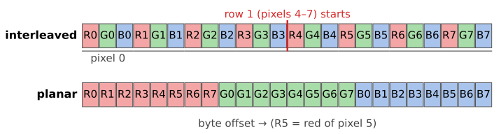
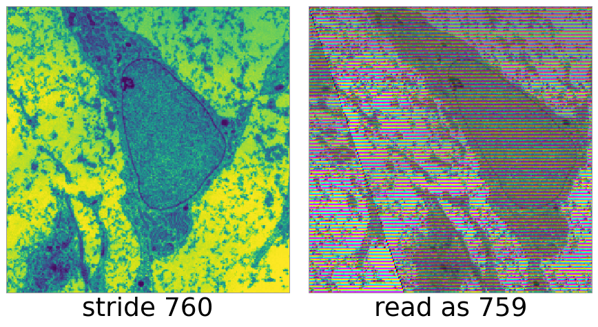
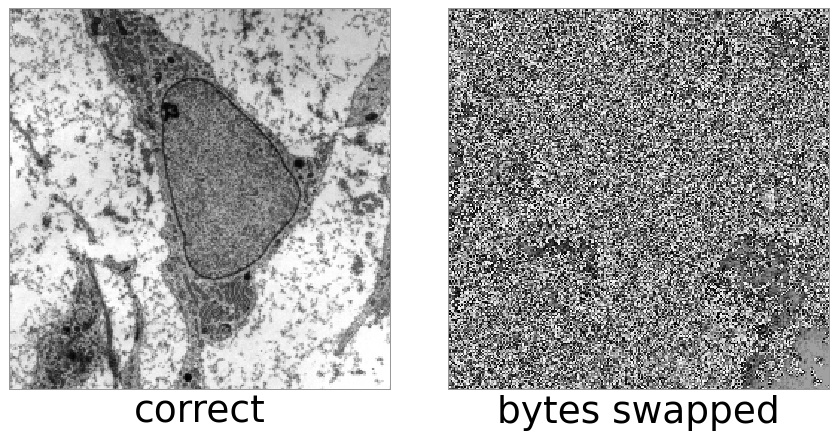
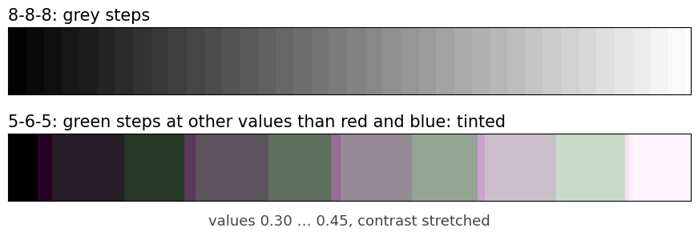
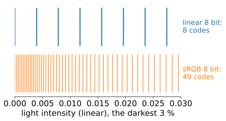
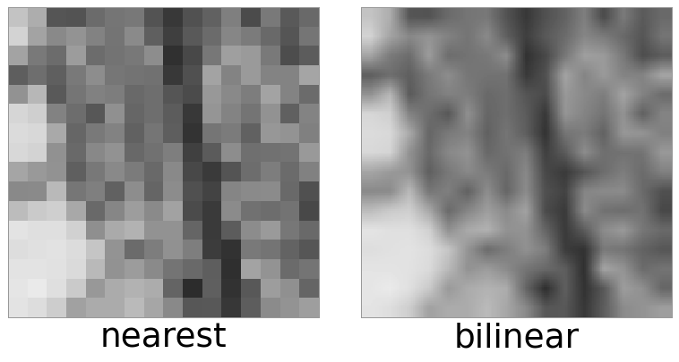
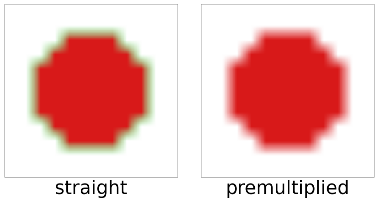
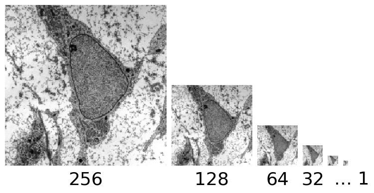

## About this lecture

- An image in memory is **one long row of bytes**. Where is pixel $(x, y)$, channel $c$?
- Layouts: **interleaved** or **planar**, channel order, **row padding**, byte order.
- A graphics card (GPU) stores images as **textures** in a choice of formats: normalised integers, plain integers, floats, packed bits, sRGB. What does each keep, and what does it cost?
- The GPU also **interpolates** (filters) between pixels in hardware. Which formats allow it, and why the stored numbers must be "linear" for it to be right.

Slides titled **The math** give the formulas and proofs; the ideas are complete without them.

::: notes
Unit 3 of the 3D graphics day, after the units on the transformation pipeline and rasterisation, and after the bit-depth day: that day was about how many bits a value needs and how floats behave. This one is about how values are laid out and encoded, using the GPU as the example because it makes the choices explicit: every texture has a declared format. The concepts (layout, stride, normalised vs float, filtering) apply to any image file or array. No graphics programming is needed or taught.
:::

## An image is a row of bytes

A 4 × 2 RGB image, 8 bits per channel, pixels numbered 0–7 row by row:

{fig-alt="Two rows of 24 coloured byte boxes. Interleaved: R0 G0 B0 R1 G1 B1 and so on, with row 1 starting at byte 12. Planar: R0 to R7, then G0 to G7, then B0 to B7." width="100%"}

- Interleaved keeps one pixel's channels together: what screens, cameras and textures use.
- Planar keeps one channel together: convenient when each channel is processed alone (e.g. a microscope with one image per fluorescent dye).
- **Channel order** is a convention: RGBA or **BGRA** (common in camera drivers and on Windows). Swap it by mistake and red and blue trade places.

## Rows are padded: the stride

:::: {.columns}
::: {.column width="55%"}
Hardware likes rows that start at a multiple of 4 (or more) bytes. Each row may end with unused **padding** bytes.

- **Stride** (pitch) = bytes from the start of one row to the start of the next, *including* padding.
- An RGB image 1001 pixels wide: $3 \cdot 1001 = 3003$ bytes of data per row, padded to a stride of **3004**.
- Read it with the wrong stride (3003) and row $y$ is read starting $y$ bytes too early: the image is **sheared** by a third of a pixel per row, and the colours cycle from row to row (each byte is read as the wrong channel).

Always ask an image buffer for its stride; do not compute it from the width.
:::
::: {.column width="45%"}
{fig-alt="Left: a 253 pixel wide RGB image (the cell micrograph in false colour) stored with a stride of 760 bytes, displayed correctly. Right: the same bytes read with a stride of 759: the image is sheared to the left by a third of a pixel per row and every row has its colour channels shifted, giving rainbow stripes." width="100%"}
:::
::::

::: notes
The figure: the course micrograph cropped to 253 × 256 pixels, coloured with a colour map so that it has three channels; 3 · 253 = 759 bytes per row, padded to 760. Micrograph: transmission electron micrograph of a mesenchymal stem cell, Robert M. Hunt, CC BY 3.0, via Wikimedia Commons.
:::

## Bytes in a multi-byte number: endianness

:::: {.columns}
::: {.column width="55%"}
A 16-bit value occupies two bytes. Which comes first?

- **Little-endian** (almost all CPUs and GPUs today): low byte first. 1000 = 0x03E8 is stored as **E8 03**.
- **Big-endian** (some file formats, network order): high byte first, **03 E8**.
- Read little-endian data as big-endian and 1000 becomes 0xE803 = 59 395: a smooth image turns into noise-like garbage, because the low byte changes fastest.

Image file formats state their byte order in the header; 8-bit images do not have the problem.
:::
::: {.column width="45%"}
{fig-alt="Left: the cell micrograph as 16-bit values from 0 to 4000, read correctly. Right: the same bytes read with the wrong byte order: only faint traces of the cell remain under a dense pattern of noise." width="100%"}
:::
::::

::: notes
The figure: the course micrograph scaled to 0–4000 and stored as 16-bit little-endian values, then read big-endian. Micrograph: transmission electron micrograph of a mesenchymal stem cell, Robert M. Hunt, CC BY 3.0, via Wikimedia Commons.
:::

## The math: where is a pixel? {.math}
For an image of width $w$, height $h$, $C$ channels of $B$ bytes each, and row stride $s \ge w C B$, the byte offset of pixel $(x, y)$, channel $c$ is

$$\text{interleaved: } \; y\,s + x\,C B + c\,B, \qquad \text{planar: } \; c\,(h\,s_1) + y\,s_1 + x\,B,$$

where $s_1 \ge w B$ is the stride of one plane. The total size is $h\,s$ (interleaved) or $C\,h\,s_1$ (planar). The matrix index $(i, j)$ of earlier units is (row $y$, column $x$); memory is "row-major": a row is contiguous.

## Texture formats: what a stored number means

A GPU texture has a declared **format**. Three families:

| family | stored | the shader reads | example |
|---|---|---|---|
| **normalised** | integer $k$, $b$ bits | $k/(2^b - 1)$, a number in $[0, 1]$ | 8 bit per channel (RGBA8) |
| **integer** | integer $k$ | $k$ itself | 16-bit unsigned integer |
| **float** | IEEE float | the float | half float (16 bit), float32 |

- Normalised formats make "8 bits" and "10 bits" look the same to the program: both give $[0, 1]$, only the **step** differs.
- Integer formats are **exact** (labels, raw camera counts), but the hardware cannot interpolate them.
- Float formats keep values outside $[0, 1]$, and precision **relative** to the value (floating-point unit).

## Packed formats: bits shared out

When memory or bandwidth is tight, channels get **unequal** numbers of bits in one 16- or 32-bit word:

- **5-6-5**: red 5 bits, green 6, blue 5 = 16 bits per pixel. Green gets the extra bit because the eye is most sensitive to green (colour day). A grey ramp gets **tinted** steps, because green steps at different places than red and blue.
- **10-10-10-2**: 10 bits per colour, 2 bits of alpha = 32 bits, the same memory as 8 bits per channel, but 4 times finer steps. Used for HDR displays and medical monitors.

{fig-alt="A grey ramp from 0.30 to 0.45, contrast stretched. Top, stored with 8 bits per channel: even grey steps. Bottom, stored as 5-6-5: wide steps that alternate between greenish and purplish tints, because green and red/blue round at different values." width="980px" fig-align="center" .nostretch}

## Try it: the same data in different formats

```{=html}
<link rel="stylesheet" href="../demos/dist/demo.css">
<div data-demo="texformats" data-a="RGBA8" data-b="RGB10_A2" data-image="dark"></div>
<script src="../demos/dist/texformats.js"></script>
```

::: notes
The same ramp of values 0.20–0.24 is uploaded twice; the shader stretches 0.20–0.24 to black–white so every stored step shows. 8 bit: 11 bands. 10 bit: 42 bands, much smoother. "565 tint": coloured bands, because red/blue and green step at different values. "darks: sRGB" on the very dark ramp: linear 8 bit only has codes 0 and 1, sRGB 8 bit has 17 codes there. "half vs float" on the very dark ramp: both smooth. "filter an int": the integer texture with linear filtering is black. Click a texel to show the stored bits.
:::

## sRGB storage: more codes for the dark

:::: {.columns}
::: {.column width="58%"}
Light intensities and perceived brightness are not proportional: we notice small differences in dark tones much more than in bright ones.

- An **sRGB-encoded** 8-bit value is not proportional to light: the 256 codes are spaced **closely in the dark** and widely in the bright. Most 8-bit photos and screenshots are stored this way.
- A linear value of 0.005 is code 1 in plain 8 bit, but code 16 in sRGB 8 bit.
- An **sRGB texture format** tells the GPU so: it **decodes** to linear values when the shader reads the texture, *before* filtering or blending.
- Why the curve has its shape, and why averaging must happen on linear values, is the subject of the **colour day**. Here: sRGB is a storage encoding, and the GPU undoes it for you if you declare it.
:::
::: {.column width="42%"}
{fig-alt="Tick marks for the 8-bit codes that fall in the darkest 3 percent of light intensity. Linear 8 bit: 8 widely spaced codes. sRGB 8 bit: 49 closely spaced codes." width="100%"}
:::
::::

## Filtering in hardware

:::: {.columns}
::: {.column width="60%"}
When a texture is drawn larger or smaller than its pixels, the GPU interpolates for free:

- Each pixel gets texture coordinates $(u, v)$, interpolated perspective-correctly across its triangle (previous unit), and the texture is sampled there.
- **nearest**: take the closest texel (blocky); **linear**: bilinear interpolation of the 4 nearest texels (as in the *images* unit).
- Normalised and float formats can be filtered. **Integer** formats cannot: a texture with linear filtering and an integer format is "incomplete" and reads as black. (Interpolating label 3 and label 7 to give 5 would be wrong anyway.)
- Some GPUs cannot filter 32-bit float textures; half floats always can.
- Filtering is a weighted average, so it is only right on values proportional to light: hence the sRGB decode first, and **premultiplied alpha**.
:::
::: {.column width="40%"}
{fig-alt="A 16 by 16 pixel crop of the cell micrograph magnified 12 times. Nearest: visible square blocks. Bilinear: smooth gradations between the texel centres." width="100%"}
:::
::::

::: notes
The figure: a 16 × 16 crop of the course micrograph, magnified 12×. Micrograph: transmission electron micrograph of a mesenchymal stem cell, Robert M. Hunt, CC BY 3.0, via Wikimedia Commons.
:::

## Premultiplied alpha

:::: {.columns}
::: {.column width="58%"}
Alpha $\alpha$ is opacity: 1 = opaque, 0 = fully transparent. A transparent pixel's colour is meaningless but still stored.

- **Straight alpha** stores $(R, G, B, \alpha)$. Average an opaque red texel with a transparent green one: $(0.5, 0.5, 0, 0.5)$: a half-transparent **olive**. Green leaks in from a pixel you cannot see: dark or coloured fringes around cut-out objects.
- **Premultiplied alpha** stores $(\alpha R, \alpha G, \alpha B, \alpha)$. The transparent green becomes $(0, 0, 0, 0)$, and the average is $(0.5, 0, 0, 0.5)$: half-transparent **red**, correct.
- So filtering, blending and resizing images with transparency should work on premultiplied values.
:::
::: {.column width="42%"}
{fig-alt="A small red disc cut out of a 12 by 12 texture whose transparent pixels hold green, magnified 20 times with bilinear filtering and drawn over white. Straight alpha: a pale green halo around the disc. Premultiplied: a clean red edge fading into white." width="100%"}
:::
::::

## The math: compositing and filtering with alpha {.math}
Drawing a source over a destination ("over" operator, Porter–Duff), with premultiplied colours $\mathbf c = \alpha\,\mathbf C$:

$$\mathbf c_\text{out} = \mathbf c_\text{src} + (1 - \alpha_\text{src})\,\mathbf c_\text{dst}, \qquad \alpha_\text{out} = \alpha_\text{src} + (1 - \alpha_\text{src})\,\alpha_\text{dst}.$$

Both lines have the same form, so premultiplied values are filtered and blended with the same linear formula in every channel. A filter with weights $w_i$ gives $\sum w_i \alpha_i \mathbf C_i$ and $\sum w_i \alpha_i$; dividing, the true colour is the **opacity-weighted** average $\sum w_i \alpha_i \mathbf C_i / \sum w_i \alpha_i$, in which transparent texels have no say. Straight alpha would weight every $\mathbf C_i$ equally.

## Mipmaps and memory

:::: {.columns}
::: {.column width="47%"}
- A **mipmap** stores the texture at full, half, quarter, … size, down to 1 × 1. When the texture is drawn small, the GPU reads a pre-shrunk (pre-blurred) level instead of skipping pixels, which would alias (Fourier unit). Cost: **+1/3** memory.

{fig-alt="The cell micrograph at 256, 128, 64, 32, 16 and 8 pixels, side by side, each level an average of 2 by 2 pixels of the one before, continuing down to 1 pixel." width="100%"}
:::
::: {.column width="53%"}
- Memory = width × height × bytes per texel:

| format, 4096 × 4096 | bytes/texel | memory | with mipmaps |
|---|---|---|---|
| RGBA 8 bit | 4 | 64 MiB | 85.3 MiB |
| RGBA half float | 8 | 128 MiB | 170.7 MiB |
| RGBA float32 | 16 | 256 MiB | 341.3 MiB |

- **Compressed** texture formats store 4 × 4 blocks in 4–8 bits per pixel, lossy, decoded in hardware.
:::
::::

::: notes
The figure: the course micrograph and its mipmap levels (2 × 2 averages). Micrograph: transmission electron micrograph of a mesenchymal stem cell, Robert M. Hunt, CC BY 3.0, via Wikimedia Commons.
:::

## The math: why mipmaps cost a third {.math}
Each level has a quarter of the texels of the one before:

$$1 + \tfrac14 + \tfrac1{16} + \dots < \sum_{k=0}^{\infty} 4^{-k} = \frac{1}{1 - 1/4} = \frac43.$$

For a $2^n \times 2^n$ texture the chain has $n + 1$ levels and $\sum_{k=0}^{n} 4^{k} = (4^{n+1} - 1)/3$ texels, just under $\tfrac43 \cdot 4^n$.

## Summary

- An image in memory: interleaved or planar, a channel order, a **stride** per row (with padding), and a byte order for multi-byte values. Get one wrong and the image is sheared, recoloured or scrambled.
- Texture formats: **normalised** ($k/(2^b - 1)$), **integer** (exact, not filterable), **float**, **packed** (5-6-5, 10-10-10-2), **sRGB** (decoded by the GPU).
- Hardware filtering is a weighted average: it needs linear, premultiplied values.
- Memory = texels × bytes per texel (× 4/3 with mipmaps).
