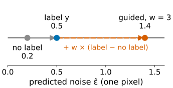
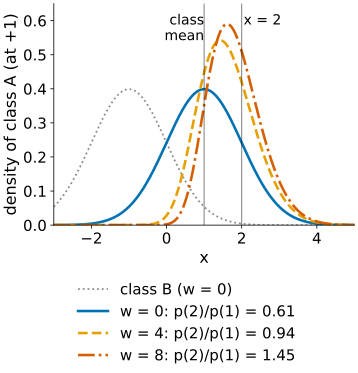
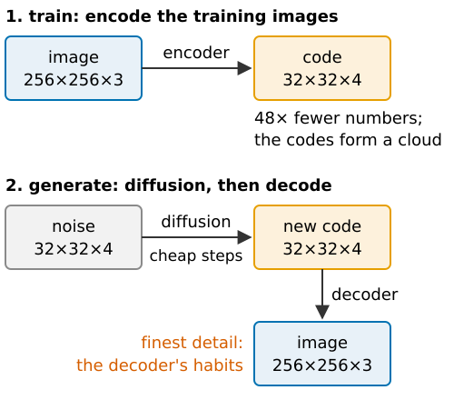

## About this lecture

*How do we ask for a particular kind of image, what does pushing harder do, and why do most image generators work in a compressed space?*

- A **conditional denoiser** takes the label as an extra input.
- **Classifier-free guidance**: one network, label dropped at random during training; at sampling time push from "no label" towards "this label" with a weight $w$.
- What $w$ does: more **typical** samples, less **diversity**, and with large $w$ samples **more extreme** than any real example.
- **Latent diffusion**: diffusion in the latent space of an autoencoder (the [VAE day](../vae/lec.qmd)); cheaper, and the finest detail comes from the **decoder**.

*Slides titled **The math** give the formulas and proofs; the ideas are complete without them.*

::: notes
Third unit of the diffusion-models day. Recalls conditioning by Bayes and the weight w from [diffusion/](../diffusion/lec.qmd) (one slide), and latent spaces from [vae/](../vae/lec.qmd) and [vae-gen/](../vae-gen/lec.qmd). Demos: guidance1d (exact, 1D), genmetrics in guidance mode, latentdiff (the 2D latent of the cell-shape VAE of the [VAE day](../vae-gen/lec.qmd)).
:::

## Recall: conditioning and guidance

From [Diffusion models and generated detail](../diffusion/lec.qmd): a conditional score = unconditional score + the score of the condition (Bayes). Guidance $w > 0$ pushes harder: samples crowd where the condition is **most certain**.

```{=html}
<link rel="stylesheet" href="../demos/dist/demo.css">
<div data-demo="diffusion2d" data-preset="guide"></div>
<script src="../demos/dist/diffusion2d.js"></script>
```

## Conditional denoisers and two kinds of guidance

The label (a class, a treatment, a text, an image) is an **extra input** of the denoiser, learned from labelled pairs.

- **Classifier guidance**: train a separate classifier that works on **noisy** images and add its gradient to the score. Needs a second network trained at every noise level.
- **Classifier-free guidance**: train **one** network, and **drop the label** at random (say 10 % of the time), so it learns both the conditional and the unconditional denoiser. At sampling time, extrapolate:

$$\hat{\boldsymbol\varepsilon} = (1+w)\,\hat{\boldsymbol\varepsilon}(\mathbf x, y) - w\,\hat{\boldsymbol\varepsilon}(\mathbf x, \varnothing).$$

:::: {.columns}
::: {.column width="52%"}
- Example: $\hat\varepsilon_\text{uncond} = 0.2$, $\hat\varepsilon_\text{cond} = 0.5$, $w = 3$: $4 \cdot 0.5 - 3 \cdot 0.2 = 1.4$. The guided prediction overshoots the conditional one, away from the unconditional.
:::
::: {.column width="48%"}
{fig-alt="Number line of the predicted noise for one pixel: without the label 0.2, with the label 0.5, guided with w = 3 at 1.4. The guided value lies beyond the conditional one, 3 times the step from no label to label further on." width="100%"}
:::
::::

## The math: what classifier-free guidance targets {.math}

Scores combine like the predicted noises (each is $-\hat{\boldsymbol\varepsilon}/\sqrt{1-\bar\alpha}$):

$$(1+w)\nabla\log p(\mathbf x\mid y) - w\nabla\log p(\mathbf x) = \nabla\log\big[p(\mathbf x\mid y)^{1+w}p(\mathbf x)^{-w}\big].$$

By Bayes, $p(\mathbf x\mid y) = p(y\mid\mathbf x)p(\mathbf x)/p(y)$, so

$$p(\mathbf x\mid y)^{1+w}p(\mathbf x)^{-w} \propto p(\mathbf x\mid y)\,p(y\mid\mathbf x)^{w}:$$

the class density **sharpened** by the classifier's confidence. For two classes $\mathcal N(\pm1, 1)$ with equal weights, $p(A\mid x) = 1/(1+e^{-2x})$ for the class at $+1$: points beyond the class mean get extra weight.

Caveat: applying the combination at **every noise level** is not the same as sampling this sharpened density (the noised version of a sharpened density is not the sharpened noised density). The demo shows both.

## What $w$ does

:::: {.columns}
::: {.column width="55%"}
- It sharpens the class towards points where the label is **most certain**, i.e. farthest from the other classes, not the most typical members.
- Moderate $w$: cleaner, more typical-looking samples, less diversity: **recall drops** (the class's border regions are no longer generated).
- Large $w$: samples **beyond the class mean**, more extreme than almost any real example; in images: saturated contrast, caricatures.
- Numbers (classes $\mathcal N(\pm1, 1)$): the sharpened density of the class at +1 compares $x = 2$ with its mean $x = 1$ as 0.61 ($w = 0$), 0.94 ($w = 4$), 1.45 ($w = 8$). From $w = 4.6$ on, a point beyond the mean is more likely than the mean itself.
:::
::: {.column width="45%"}
{fig-alt="The density of class A (Gaussian at +1, next to class B at −1) sharpened by p(A given x) to the power w, for w = 0, 4 and 8. With growing w it gets narrower and moves beyond the class mean; the density at x = 2 relative to x = 1 is 0.61, 0.94 and 1.45." width="100%"}
:::
::::

## Try it: guidance in 1D, exactly

```{=html}
<link rel="stylesheet" href="../demos/dist/demo.css">
<div data-demo="guidance1d" data-preset="w3"></div>
<script src="../demos/dist/guidance1d.js"></script>
```

::: notes
Exact conditional and unconditional denoisers; 2 000 samples, 100 steps; numbers from the demo's code. Class A = N(−1, 1), class B = N(+1, 1). "w = 0": guided samples mean −0.99, sd 0.97 (class −1, 1), 0.7 % beyond the 1 % most extreme. "w = 3" (stochastic): mean −1.92, sd 0.71, 91.6 % beyond the class mean, 3.6 % beyond the 1 % extreme; the sharpened density has mean −1.54, sd 0.77. "w = 8" (deterministic): mean −3.43, 53.6 % of the samples beyond the most extreme 1 % of real class members. "guided sampling ≠ sharpened density": w = 3 deterministic: samples mean −2.35, sharpened −1.54. "the sub-mode near B disappears": class A with modes at −2 and 0.6; w = 0: 38 % of samples above −0.5; w = 3: 1.1 % (the sharpened density still has 21.5 %).
:::

## Guidance trades coverage for typicality

```{=html}
<link rel="stylesheet" href="../demos/dist/demo.css">
<div data-demo="genmetrics" data-mode="guidance" data-preset="w2"></div>
<script src="../demos/dist/genmetrics.js"></script>
```

::: notes
genmetrics in guidance mode: ring of 8 blobs, class "upper half" (the four blobs at 0°, 45°, 90°, 135°), 1 000 real class points. w = 0: precision 0.97, recall 0.97; w = 2: 0.96 / 0.60; w = 4: 0.95 / 0.32. Precision stays high (the blobs are narrow, samples stay on them); recall falls because the blobs at 0° and 135°, which border the other class, are emptied: counts 268 256 251 225 at w = 0, 95 429 399 77 at w = 2.
:::

## Conditioning on an image

The condition can be a **measured image**: a blurred or noisy image, another channel, a low-resolution image. The denoiser gets it as extra input and is trained on **pairs** (measurement, target).

- Same rules as with a label: strong guidance gives confident, typical, possibly **wrong** detail.
- This is the bridge to the [next unit](../diffusion-inverse/lec.qmd): restoration and "virtual staining" as conditional generation.
- Text conditioning (image generators from a prompt) feeds text tokens into the network through attention between image patches and text tokens (recall [attention](../attention/lec.qmd)).

## Latent diffusion

:::: {.columns}
::: {.column width="54%"}
An image of $256 \times 256 \times 3 = 196\,608$ numbers; a latent of $32 \times 32 \times 4 = 4\,096$: **48 times fewer**.

1. Train an **autoencoder** first (the [VAE day](../vae/lec.qmd)).
2. Run diffusion on the **latent codes** of the training images.
3. Generate a latent by reverse diffusion, then **decode** it.

- Each step is much cheaper; the diffusion model spends its capacity on layout and content, not on imperceptible pixel detail.
- The latent codes of the training set form a **cloud**. Diffusion learns that cloud instead of assuming the VAE's round Gaussian prior, so samples land where real codes are (fixing the VAE's "nonsense far from the data", [VAE generation](../vae-gen/lec.qmd)).
:::
::: {.column width="46%"}
{fig-alt="Diagram. 1: an autoencoder's encoder maps a 256×256×3 image to a 32×32×4 latent code, 48 times fewer numbers; the codes of the training images form a cloud. 2: generation runs diffusion from noise of size 32×32×4 to a new code, and the decoder turns it into a 256×256×3 image, whose finest detail comes from the decoder's habits." width="100%"}
:::
::::

## Who draws the finest detail?

- The **decoder**. It outputs a mean ([VAE day](../vae-gen/lec.qmd)): whatever the latent cannot represent is filled in by the decoder's **habits**, learned from the training images, not by any measurement or by the diffusion model.
- A crisp one-pixel membrane in a generated cell: the latent said "a cell of this shape here"; the decoder drew the membrane the way membranes looked in its training set.
- Guidance in a latent model acts on the latent: strong guidance pushes codes to the extreme of the class (caricatures), and the decoder renders them faithfully.

## Try it: latent diffusion on cell shapes

```{=html}
<link rel="stylesheet" href="../demos/dist/demo.css">
<div data-demo="latentdiff" data-preset="prior"></div>
<script src="../demos/dist/latentdiff.js"></script>
```

::: notes
The 2D latent space of the cell-shape VAE of the [VAE day](../vae-gen/lec.qmd) (its weights unchanged); 800 synthetic training masks encoded (means and sds). Exact denoiser of the noised codes; 200 samples, 40 deterministic steps; kinds by the nearest code. "VAE prior": decode N(0, I): kinds 10/28/46/16 %, 6 % of samples farther than 0.3 from every code (shapes that look like nothing). "latent diffusion": kinds 17/32/24/27 % (training 25 % each), 0.5 % far. "dividing cells on demand": 86 % dividing (nearest code). "strong guidance" (w = 4): 100 % dividing, mean distance from the origin 3.6 against 1.5 without guidance: the most extreme dumbbells. "tiny spreads": median distance to the nearest code 0.022 against 0.045 with the encoder spreads: copies.
:::

## The math: guided Gaussians and the latent score {.math}

**Guided Gaussian.** $p(x\mid y) = \mathcal N(m, s^2)$, $p(x) = \mathcal N(0, 1)$. Then $p(x\mid y)^{1+w}p(x)^{-w} \propto \exp\big(-\frac{(1+w)(x-m)^2}{2s^2} + \frac{w x^2}{2}\big)$: a Gaussian with precision $\frac{1+w}{s^2} - w$ and mean $\frac{(1+w)m/s^2}{(1+w)/s^2 - w}$, normalisable only if $s^2 < \frac{1+w}{w}$. Example $m = 1$, $s^2 = 0.5$, $w = 1$: precision 3, variance 1/3, mean 4/3: narrower, and **beyond** the class mean.

**Latent diffusion's target.** The encoder maps training image $i$ to $q(\mathbf z\mid\mathbf x_i) = \mathcal N(\boldsymbol\mu_i, \operatorname{diag}\boldsymbol\sigma_i^2)$; the codes form the **aggregate posterior**

$$q(\mathbf z) = \frac1N\sum_{i=1}^N\mathcal N(\mathbf z; \boldsymbol\mu_i, \operatorname{diag}\boldsymbol\sigma_i^2).$$

Noised to level σ it is again a mixture with variances $\boldsymbol\sigma_i^2 + \sigma^2$, and its score is the mixture score of the introduction: $\sum_i r_i(\mathbf z)\,(\boldsymbol\mu_i - \mathbf z)/(\boldsymbol\sigma_i^2 + \sigma^2)$ (elementwise), with responsibilities $r_i$. A network learns this from the codes; the demo uses it exactly. Tiny $\boldsymbol\sigma_i$: the perfect model of a finite set of codes copies them.

## Summary

- Conditioning: the label is an extra input. **Classifier-free guidance** uses one network with the label dropped at random: $(1+w)\cdot$conditional $- w\cdot$unconditional.
- It sharpens the class by the classifier's confidence: more typical, less diverse (recall drops), and with large $w$ more extreme than real data. Guided sampling does not even sample the sharpened density exactly.
- An image can be the condition: restoration as conditional generation ([next unit](../diffusion-inverse/lec.qmd)).
- **Latent diffusion** learns the cloud of an autoencoder's codes: 48× fewer numbers per step; the **decoder** draws the finest detail from its training habits.
