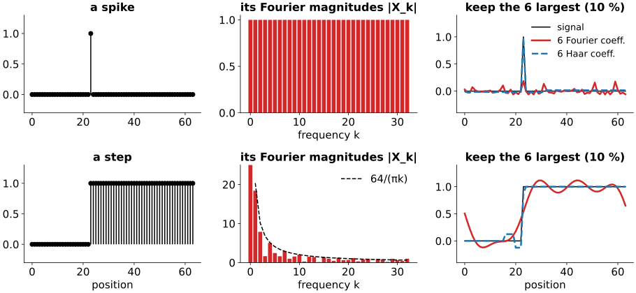
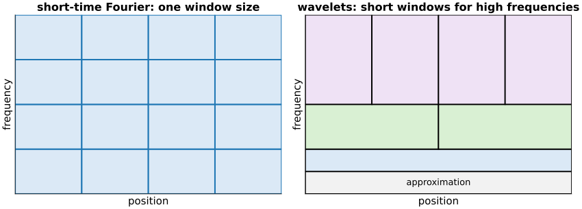
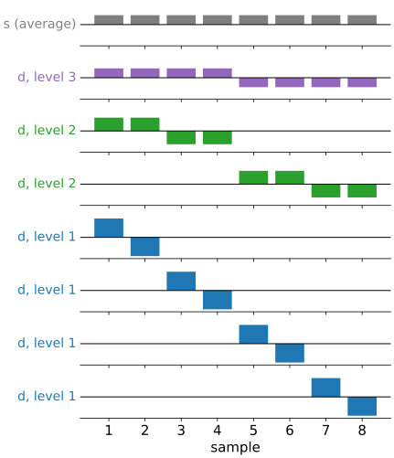

## About this lecture

The Fourier transform rewrites a signal as a sum of waves. Every wave runs over the **whole** signal, so the spectrum says **which** frequencies are present but not **where**. Today: a basis whose functions are **short**.

- A spike and a step in the Fourier basis: every coefficient is busy.
- The short-time Fourier transform, and why one window size cannot serve all frequencies.
- The wavelet idea: **short windows for high frequencies, long windows for low ones**.
- The **Haar transform** by hand: averages and differences, level by level, and back.
- The Haar basis is **orthonormal**, and piecewise-constant signals are **sparse** in it.

*Slides titled **The math** give the formulas and proofs; the ideas are complete without them.*

::: notes
First unit of the wavelets elective (group "Transforms"; the compression day follows and builds on it). Prerequisites: the Fourier unit (change of basis, orthogonality, Parseval) and the kernels unit (convolution). Everything today is on 1D signals of 8 to 256 samples; images come in unit 3.
:::

## Recall: the Fourier basis is global

From *Images in frequency space* (day 1): the DFT is a **change of basis** to waves $e^{2\pi i k n/N}$, each of which extends over the **whole** signal. It is orthogonal, so nothing is lost and energies add up (Parseval).

That is perfect for signals that are periodic or smooth everywhere. Images are not: they are flat in most places, with **edges** and **spots** at a few positions.

## A spike and a step in the Fourier basis

{width="100%"}

- A **spike**: every Fourier magnitude is exactly 1. Where the spike is lives only in the **phases**, spread over all coefficients.
- A **step**: the magnitudes fall off slowly, like $1/k$. Keep the 6 largest of 64 and the result **rings** everywhere (Gibbs).
- 6 coefficients in the Haar basis of this lecture (dashed blue) do much better: 12.5 % and 5.5 % error instead of 90 % and 19 %.

::: notes
N = 64, spike at position 23, step from position 23 (positions from 0). Left: the signal; middle: |X_k| for k = 0..32 (the rest mirror these); for the step the dashed curve is 64/(πk), the envelope for small k. Right: keeping the 6 largest coefficients in a real orthonormal Fourier basis (cosines and sines) and in the Haar basis (6 levels). Relative errors: spike 90 % (Fourier) vs 12.5 % (Haar), step 19 % vs 5.5 %. In the Haar basis both signals have only 7 nonzero coefficients (log2 64 + 1), so 6 of them miss one small one. Ask: why can a single wave never say "here"?
:::

## The math: spectra of a spike and a step {.math}

DFT $X_k = \sum_{n=0}^{N-1} x_n e^{-2\pi i k n/N}$.

- Spike at $n_0$, $x_n = [n = n_0]$: $\;X_k = e^{-2\pi i k n_0/N}$, so $|X_k| = 1$ for **every** $k$. The position $n_0$ is only in the phase $-2\pi k n_0/N$.
- Box of $m$ ones starting at $n_0$ (a step up and a step down): a geometric sum,
$$|X_k| = \left|\sum_{n=n_0}^{n_0+m-1} e^{-2\pi i k n/N}\right| = \left|\frac{\sin(\pi k m/N)}{\sin(\pi k/N)}\right| \approx \frac{N}{\pi k}\,|\sin(\pi k m/N)| \quad (k \ll N).$$
- So the coefficients of a jump decay only like $1/k$: the energy beyond frequency $K$ is $\sum_{k > K} 1/k^2 \approx 1/K$, which falls slowly. Cutting them off leaves an overshoot near the jump of about 9 % of the jump height that does not shrink as $K$ grows (Gibbs phenomenon).

## Fix 1: the short-time Fourier transform

Cut out a piece of the signal with a smooth **window** (the tapers of the Fourier unit), take its DFT, slide the window along.

- Now each coefficient belongs to a **position** (the window) and a **frequency**: a tile in the position–frequency plane.
- A **narrow** window locates the step well, but a few samples contain too few cycles of a slow wave to tell its frequency.
- A **wide** window resolves low frequencies, but smears the step over the whole window.
- **One** window size serves either the edges or the slow variations, not both.

{width="78%"}

## The math: the uncertainty relation {.math}

For a window $w(t)$ with $\int |w|^2 dt = 1$, define its spread in time and in (angular) frequency:
$$\Delta t^2 = \int (t - \bar t)^2 |w(t)|^2 dt, \qquad \Delta\omega^2 = \frac{1}{2\pi}\int (\omega - \bar\omega)^2 |\hat w(\omega)|^2 d\omega.$$

- **Heisenberg–Gabor**: $\Delta t\,\Delta\omega \ge \tfrac12$, with equality only for a Gaussian window (Gabor 1946).
- Squeezing the window in time by a factor $s$, $w(t) \to \sqrt{s}\,w(st)$, multiplies $\Delta t$ by $1/s$ and $\Delta\omega$ by $s$: the **area** of a tile is fixed, only its shape can change.
- The STFT uses the same tile shape everywhere. Wavelets change the shape with the frequency: $\Delta t \propto 1/\omega$, so each tile holds about the **same number of cycles**.

## Fix 2: the wavelet idea

**Short windows for high frequencies, long windows for low frequencies.**

- High frequencies (edges, spots, noise) change quickly: we want to know **exactly where** they are.
- Low frequencies (slow shading) are spread out anyway: a long window gives their frequency precisely, and their position does not matter much.
- So: tall, thin tiles at high frequency; short, wide tiles at low frequency (right panel of the tiling figure).

The simplest way to build such tiles is to keep halving the signal: pairs, then pairs of pairs, ... This is the **Haar transform** (Haar, 1910).

## The Haar transform by hand

Replace each pair $(a, b)$ by its **average** and **half-difference**:
$$s = \frac{a + b}{2}, \qquad d = \frac{a - b}{2}.$$
Keep the $d$s; repeat on the $s$s. For $x = (4, 6, 10, 12, 8, 6, 5, 5)$:

| level | averages $s$ | differences $d$ (kept) |
|---|---|---|
| 1 | $5,\ 11,\ 7,\ 5$ | $-1,\ -1,\ 1,\ 0$ |
| 2 | $8,\ 6$ | $-3,\ 1$ |
| 3 | $7$ | $1$ |

Result (coarse to fine): $(7 \mid 1 \mid -3,\ 1 \mid -1,\ -1,\ 1,\ 0)$. Eight numbers in, eight out: **1 overall average + 1 + 2 + 4 details**, each detail tied to a **place** and a **scale**.

::: notes
Do this on the board first, then with the demo. Point out that the level-1 details are small where the signal is locally flat (the last pair 5, 5 gives 0), and read the level-3 detail: the left half averages 8, the right half 6, so the left half lies 1 above the overall average 7 and the right half 1 below.
:::

## Try it: the Haar transform step by step

```{=html}
<link rel="stylesheet" href="../demos/dist/demo.css">
<div data-demo="haarstep" data-preset="board"></div>
<script src="../demos/dist/haarstep.js"></script>
```

::: notes
Board example, N = 8. Press step three times: the brackets show which pairs are combined next; the grey blocks are the current averages drawn over the signal; the lower panel the coefficients coloured by level. Readout: Σx² = 446 but Σc² = 63 with the 1/2 normalisation. Switch to s = (a+b)/√2: now Σc² = 446. Keep K = 3 (orthonormal): kept 19.80, 2.83 and −6; the reconstruction (orange) is (5, 5, 11, 11, 6, 6, 6, 6), squared error 10 = sum of the dropped squared coefficients. Presets: spike (4 nonzero coefficients), step (a jump inside a pair: 4 nonzero), ramp (details everywhere: Haar only knows constants), constant (one coefficient). "Show basis" draws the transform matrix.
:::

## Going back: nothing is lost

Each step can be undone: from $s$ and $d$,
$$a = s + d, \qquad b = s - d.$$

Board example backwards: $7 \pm 1 \to (8, 6)$; $8 \pm (-3) \to (5, 11)$, $6 \pm 1 \to (7, 5)$; then $5 \pm (-1) \to (4, 6)$, ... back to $x$.

- The Haar transform is a **change of basis**, like the DFT: the same signal, described by different numbers.
- The coefficient of a basis vector says how much of that pattern the signal contains. Which patterns?

## The Haar basis vectors

:::: {.columns}
::: {.column width="48%"}
{width="100%"}
:::
::: {.column width="52%"}
Each coefficient multiplies one pattern; the signal is their sum.

- One **constant** (the overall average),
- one $+/-$ **square wave** over the whole signal,
- two over **half** the signal, four over a **quarter**.

Short patterns for fine detail, long ones for coarse: the wavelet tiling. They are all the same shape, shifted and squeezed: that shape is the Haar **wavelet**.

With $1/\sqrt2$ in place of $1/2$ at each step the patterns all have length 1 and are perpendicular: an **orthonormal** basis.
:::
::::

## The math: the Haar matrix is orthogonal {.math}

Normalised step: $s = (a + b)/\sqrt2$, $d = (a - b)/\sqrt2$, i.e. each pair is multiplied by $\tfrac{1}{\sqrt2}\begin{pmatrix}1 & 1\\ 1 & -1\end{pmatrix}$, an orthogonal matrix (a rotation by 45° and a reflection).

- One level on $N$ samples is block-diagonal in these $2 \times 2$ blocks (after reordering): orthogonal. A product of orthogonal matrices is orthogonal, so the whole transform $c = Hx$ has $H H^\top = I$.
- $N = 4$: $\;H = \begin{pmatrix} \tfrac12 & \tfrac12 & \tfrac12 & \tfrac12 \\ \tfrac12 & \tfrac12 & -\tfrac12 & -\tfrac12 \\ \tfrac1{\sqrt2} & -\tfrac1{\sqrt2} & 0 & 0 \\ 0 & 0 & \tfrac1{\sqrt2} & -\tfrac1{\sqrt2}\end{pmatrix}$, rows of length 1, mutually perpendicular.
- Hence **Parseval**: $\|c\|^2 = x^\top H^\top H x = \|x\|^2$, and the inverse is the transpose, $x = H^\top c$.
- With $1/2$ the rows are still perpendicular but have lengths $2^{-j/2}$: invertible, not orthonormal. Board example: $\|x\|^2 = 446$, but $\sum c^2 = 63$ with $1/2$ and $446$ with $1/\sqrt2$.

## Why this pays off: sparsity

A coefficient is **zero** when its pattern sees a flat signal.

- A **piecewise-constant** signal has nonzero details only where a jump falls inside a pattern: at most one per level, near each jump.
- A **spike** touches only the patterns that contain it: one per level plus the average, $\log_2 N + 1$ coefficients (4 of 8, 9 of 256).
- A **ramp** gives nonzero details everywhere: Haar patterns only see **constants** as "nothing to report". Better wavelets in the next unit.

Few large coefficients and many (near-)zero ones = **sparse**. Keeping only the large ones then loses little.

## Try it: sparsity in two bases

```{=html}
<link rel="stylesheet" href="../demos/dist/demo.css">
<div data-demo="wavesparse" data-wavelets="haar" data-preset="step"></div>
<script src="../demos/dist/wavesparse.js"></script>
```

::: notes
256 samples; Haar with 5 levels (periodic). One slider K keeps the K largest coefficients in both bases. Tour: "step": at K = 8 Fourier has 16.5 % error, Haar 2.8 %; 1 % error needs 176 Fourier and 11 Haar coefficients. "spike": Fourier needs 247 of 256, Haar 6 (5 levels + the approximation). "sine": one Fourier coefficient; Haar needs 218. "Doppler" (frequency changes along the signal): both need many, Fourier 231 and Haar 196. Switch the lower-left panel to "wavelet coefficients by level": the large coefficients sit where the signal jumps.
:::

## The math: error of keeping $K$ coefficients {.math}

Orthonormal basis $\{\mathbf u_i\}$, coefficients $c_i = \mathbf u_i^\top x$, so $x = \sum_i c_i \mathbf u_i$. Keep a set $S$ of $K$ indices: $\hat x = \sum_{i \in S} c_i \mathbf u_i$. Then
$$\|x - \hat x\|^2 = \Big\|\sum_{i \notin S} c_i\mathbf u_i\Big\|^2 = \sum_{i \notin S} c_i^2.$$

- The error is the sum of the **dropped** squared coefficients (Pythagoras), so the best $S$ keeps the $K$ **largest** $|c_i|$.
- The error curve against $K$ depends only on the **sorted** magnitudes $|c|_{(1)} \ge |c|_{(2)} \ge \dots$: a basis is good for a signal when they fall fast.
- This only holds in an orthonormal basis. With the $1/2$ normalisation, coefficients at different levels are not comparable: a level-$j$ coefficient counts $2^j$ times in the error.

## Summary

- The Fourier basis is **global**: a spike or a step spreads over all coefficients, and truncation rings.
- A window trades position against frequency resolution; one window size cannot fit all frequencies. Wavelets use **short windows for high frequencies, long for low**.
- **Haar transform**: pairwise averages and differences, repeated on the averages; inverse $a = s + d$, $b = s - d$.
- With $1/\sqrt2$ it is an **orthonormal** change of basis: energy is preserved, and the error of dropping coefficients is the sum of their squares.
- Piecewise-constant signals are **sparse** in the Haar basis; ramps are not: next unit, wavelets with more **vanishing moments**.
