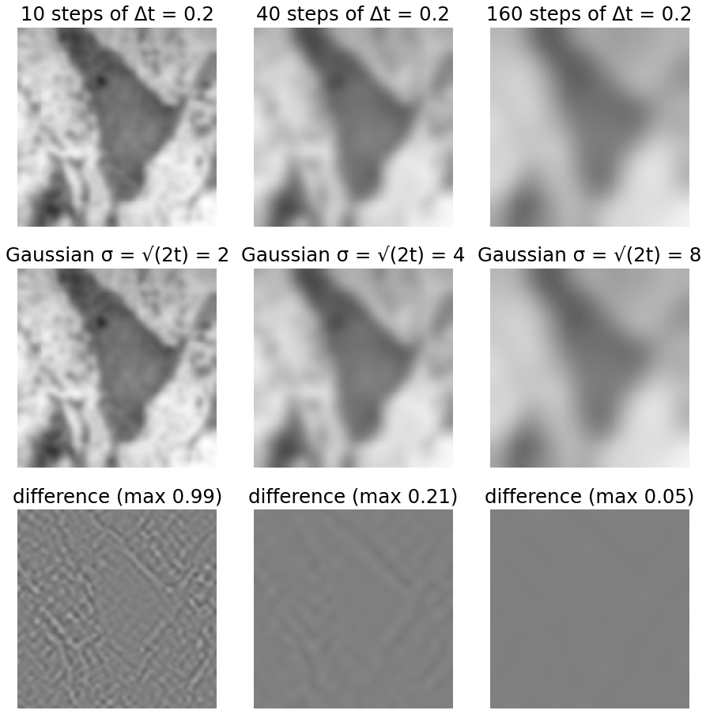
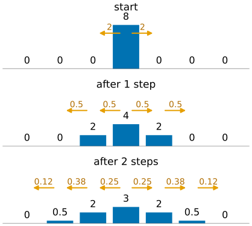
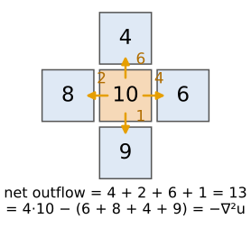
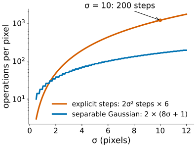
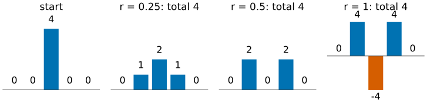
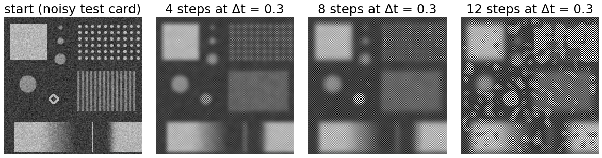
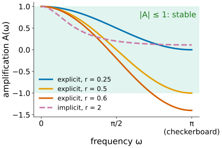
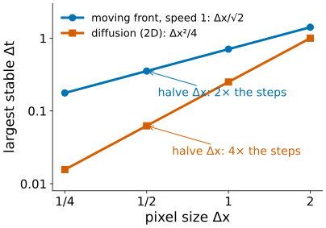
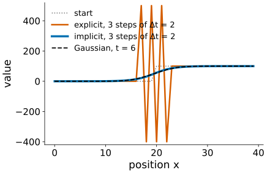

## About this lecture

A Gaussian blur can be built by a **process**: let every pixel move a little towards its neighbours, and repeat. This is the heat equation, and it is the starting point of the whole day: every edge-preserving smoother later today is "diffusion with a twist".

- **Average your neighbours, repeat**: one step by hand; why the total is kept.
- **Heat flow = Gaussian blur** with $\sigma = \sqrt{2t}$: the scale space of the edges day, now built in time.
- **Too large a step explodes**: the checkerboard, and the rule $\Delta t \le \Delta x^2/4$ in 2D.
- **Implicit steps**: stable for any step, and the same as quadratic smoothing.

Slides titled **The math** give the formulas and proofs; the ideas are complete without them.

::: notes
Recalled, not re-taught: the Laplacian kernel and border rules (filtering unit), scale space and causality (edges day), quadratic smoothing (Ising elective, gmrf), the CFL rule for moving fronts (level-set elective). The two elective recalls are self-contained, so students who did not take those electives can follow.
:::

## Recall: scale space

:::: {.columns}
::: {.column width="55%"}
From the edges day ([scale space](../scale-space/lec.qmd)): blurring with Gaussians of growing σ gives a **family** of ever smoother images, and no new structures appear on the way (causality).

A math slide there said the same family solves a **diffusion equation**. Today that slide becomes the main idea:

- run the diffusion for a time $t$ and you have blurred with $\sigma = \sqrt{2t}$;
- change the rules of the diffusion and you get a smoother that a convolution cannot give.

This day writes the equation as $u_t = \Delta u$ (the usual form in the literature); the edges day used $\partial_t L = \tfrac12 \nabla^2 L$ with $t = \sigma^2$. Same equation, time measured differently.
:::
::: {.column width="45%"}
{width="100%" fig-alt="Top row: the micrograph after 10, 40 and 160 explicit heat steps of size 0.2. Middle row: Gaussian blurs with sigma 2, 4 and 8. Bottom row: their differences, at most 0.99, 0.21 and 0.05 grey levels."}

[Micrograph: Robert M. Hunt, CC BY 3.0, via Wikimedia Commons.]{style="font-size: 0.6em; color: #666"}
:::
::::

## Average your neighbours, repeat

:::: {.columns}
::: {.column width="52%"}
One step: every pixel moves a fraction $\Delta t$ of the way from itself towards the **sum of its neighbours' differences**:

$$u \leftarrow u + \Delta t\,(\text{sum of the 4 neighbours} - 4u)$$

The bracket is the [Laplacian kernel](../kernels/lec.qmd) $\begin{smallmatrix}0&1&0\\1&-4&1\\0&1&0\end{smallmatrix}$, so one step is $u \leftarrow u + \Delta t\,\nabla^2 u$.

- **Heat flows from warm to cold**: between two neighbours the amount $\Delta t \times$ (difference) moves from the larger to the smaller.
- What one pixel loses, its neighbour gains: the **total is kept**, if nothing leaves at the border (mirror border).
:::
::: {.column width="48%"}
{width="100%" fig-alt="A row 0 0 0 8 0 0 0 under three steps with Delta t = 1/4. Arrows show how much heat moves between neighbours: 2 to each side in the first step, giving 0 0 2 4 2 0 0, then 0 0.5 2 3 2 0.5 0. The total stays 8."}
:::
::::

## Heat flow, pixel by pixel

:::: {.columns}
::: {.column width="55%"}
The flow out of a pixel into a neighbour is proportional to their **difference** (Fourier's law: heat flows down the gradient).

The **net outflow** of a pixel is the sum of its four flows. In the example: $4 + 2 + 6 + 1 = 13 = 4 \cdot 10 - (6 + 8 + 4 + 9)$, which is minus the Laplacian.

So the step says: **the change of a pixel = minus its net outflow** (times $\Delta t$). In continuous form this is "the change = minus the divergence of the flux", the divergence measuring net outflow (as for a moving front in the level-set elective).
:::
::: {.column width="45%"}
{width="88%" fig-alt="A centre pixel of value 10 with neighbours 6, 8, 4 and 9. Orange arrows carry 4, 2, 6 and 1 units out of the centre; the net outflow is 13, which equals 4 times 10 minus the sum of the neighbours."}
:::
::::

## The math: from averaging to the heat equation {.math}

- Flux between neighbours = $-\nabla u$ (heat flows down the gradient); conservation: $u_t = -\nabla\cdot(\text{flux}) = \nabla\cdot\nabla u = \Delta u = u_{xx} + u_{yy}$.
- Discretely, $u_{xx} \approx u_{i-1} - 2u_i + u_{i+1}$ (Taylor, $\Delta x = 1$), so forward Euler in time gives
$$u_{ij}^{n+1} = u_{ij}^n + \Delta t\,\big(u_{i-1,j}^n + u_{i+1,j}^n + u_{i,j-1}^n + u_{i,j+1}^n - 4u_{ij}^n\big).$$
- Mirror (Neumann) border, $\partial u/\partial n = 0$: the ghost pixel copies the border pixel, no flux leaves, and $\sum_{ij} u_{ij}$ is constant. Zero (Dirichlet) border: the outside is held at 0 and heat leaks out.

## Heat flow is a Gaussian blur

:::: {.columns}
::: {.column width="55%"}
Run the heat equation for a time $t$: the result is the start image convolved with a Gaussian of

$$\sigma = \sqrt{2t}.$$

- The picture: 10, 40 and 160 small steps ($\Delta t = 0.2$, so $t = 2, 8, 32$) next to Gaussian blurs with $\sigma = 2, 4, 8$. The differences are below one grey level.
- Doubling σ needs **four times** the time: $t = \sigma^2/2$.
- One concept, two machines: the convolution is a blur in **one go**, the heat equation a blur **in time**.
:::
::: {.column width="45%"}
{width="100%" fig-alt="The same figure as on the recall slide: explicit heat steps and Gaussians agree to within a grey level."}
:::
::::

## The math: the Gaussian solves the heat equation {.math}

- In 1D, $G(x, t) = \frac{1}{\sqrt{4\pi t}}e^{-x^2/4t}$ (variance $2t$) satisfies $G_t = G_{xx}$: both sides equal $\big(\frac{x^2}{4t^2} - \frac{1}{2t}\big)G$. In 2D the product $G(x, t)\,G(y, t)$ satisfies $G_t = G_{xx} + G_{yy}$.
- So $u(\cdot, t) = G(\cdot, t) * f$ satisfies $u_t = \Delta u$ (differentiate under the integral), and $u \to f$ as $t \to 0$.
- In Fourier ([recall](../fourier/lec.qmd)): $\hat u_t = -|\omega|^2\hat u$, so $\hat u(\omega, t) = e^{-|\omega|^2 t}\hat f(\omega)$: a Gaussian low-pass whose width in space is $\sigma^2 = 2t$. High frequencies decay fastest.

## So why bother with a PDE?

:::: {.columns}
::: {.column width="52%"}
For a plain Gaussian blur: **never**. The explicit scheme needs $t/\Delta t = \sigma^2/(2\Delta t)$ steps; at the largest stable step $\Delta t = 1/4$ that is $2\sigma^2$ steps. σ = 10 takes **200 steps**; a separable Gaussian does it with 2 × 81 multiplications per pixel.

The PDE view pays off the moment the rule **depends on the image**:

- a conductivity $c(x, y)$ per pixel: heat flows inside regions but not across edges (next unit);
- an update in **part** of the image only: fill a hole by letting heat flow into it (inpainting unit).

Neither is a convolution any more, but both are "a few lines in the step".
:::
::: {.column width="48%"}
{width="100%" fig-alt="Operations per pixel against sigma on a log scale: the explicit scheme grows as 12 sigma squared and reaches 1200 at sigma 10 (200 steps); a separable Gaussian grows only linearly, about 160 at sigma 10."}
:::
::::

## One step by hand

:::: {.columns}
::: {.column width="45%"}
A 1D row $(0, 0, 4, 0, 0)$ and $r = \Delta t/\Delta x^2$:

| $r$ | after one step | total |
|---|---|---|
| 1/4 | (0, 1, 2, 1, 0) | 4 |
| 1/2 | (0, 2, 0, 2, 0) | 4 |
| 1 | (0, 4, **−4**, 4, 0) | 4 |

- $r = 1/4$: a smooth bump, as it should be.
- $r = 1/2$: the centre gives away everything and drops to 0.
- $r = 1$: the centre gives away **more than it has**: −4. The total is still 4, but the result is nonsense.
:::
::: {.column width="55%"}
{width="100%" fig-alt="Bar charts: the start row 0 0 4 0 0, and after one step with r = 0.25 (0 1 2 1 0), r = 0.5 (0 2 0 2 0) and r = 1 (0 4 −4 4 0, the centre bar red and negative). The total is 4 in every case."}
:::
::::

## Too large a step explodes

:::: {.columns}
::: {.column width="40%"}
Keep going with $r = 1$: (4, −8, 12, −8, 4), then (−8, 24, −28, 24, −8), … The signs alternate from pixel to pixel and the values **grow** every step: a **checkerboard** pattern.

In 2D the same happens at 1.2 times the limit: any trace of the finest checkerboard (noise has some) is amplified by 1.4 per step.

**Rule** ("no pixel may give away more than it has"): the centre weight $1 - 2d\,r$ must not be negative:

$$\Delta t \le \frac{\Delta x^2}{2d}$$

$\Delta x^2/2$ in 1D, $\Delta x^2/4$ in 2D, $\Delta x^2/6$ in 3D.
:::
::: {.column width="60%"}
{width="100%" fig-alt="The noisy test card and the same image after 4, 8 and 12 explicit steps with Delta t = 0.3, 1.2 times the 2D limit. A fine checkerboard pattern appears and covers the image after 12 steps."}
:::
::::

## The math: von Neumann stability {.math}

:::: {.columns}
::: {.column width="55%"}
Insert one Fourier mode $u_j^n = A^n e^{ij\omega}$ into the 1D step $u_j^{n+1} = u_j^n + r(u_{j-1}^n - 2u_j^n + u_{j+1}^n)$:

$$A = 1 + r(e^{-i\omega} - 2 + e^{i\omega}) = 1 - 4r\sin^2\tfrac{\omega}{2}.$$

- The mode is multiplied by $A$ every step; stable ⇔ $|A| \le 1$ for all ω.
- Worst at $\omega = \pi$ (the checkerboard): $A = 1 - 4r \ge -1$ ⇔ $r \le \tfrac12$.
- In 2D: $A = 1 - 4r(\sin^2\tfrac{\omega_x}{2} + \sin^2\tfrac{\omega_y}{2})$, worst $1 - 8r$: $r \le \tfrac14$. At exactly $r = \tfrac14$ the 2D checkerboard is not damped at all ($A = -1$).
:::
::: {.column width="45%"}
{width="100%" fig-alt="The amplification factor A against frequency for explicit steps with r = 0.25 (ends at 0), 0.5 (ends at −1) and 0.6 (ends at −1.4, outside the green band |A| ≤ 1), and for an implicit step with r = 2, which stays between 0 and 1."}
:::
::::

## The math: the explicit step as a matrix {.math}

- One step is a matrix: $u^{n+1} = (I - \Delta t\,L)\,u^n$ with $L$ the graph Laplacian of the pixel grid ($L = D - W$: degree minus adjacency).
- $L$ is symmetric with eigenvalues in $[0, 4d)$ for $\Delta x = 1$ (in 1D with Neumann border: $2 - 2\cos(\pi k/n)$, $k = 0, \dots, n-1$; the eigenvectors are the DCT basis).
- Stable ⇔ every eigenvalue of $I - \Delta t L$ lies in $[-1, 1]$ ⇔ $\Delta t \le 2/\lambda_{\max}$, i.e. $\Delta t \le 1/(2d)$.
- **Maximum principle**: for $r \le 1/2$ (1D) the new value is a convex combination of old values with weights $(r, 1 - 2r, r)$: no new maxima or minima. This is the discrete form of the causality of scale space.

## Recall: the CFL rule for moving fronts

:::: {.columns}
::: {.column width="55%"}
In the level-set elective ([level-set equation](../levelset-eq/lec.qmd)) a curve moves with speed $F$, and an explicit step may move the front **at most one pixel** (Courant–Friedrichs–Lewy):

$$\Delta t \le \frac{\Delta x}{\sqrt2\,|F|} \quad \text{(2D)}.$$

Diffusion is **stricter**: $\Delta t \le \Delta x^2/4$ grows with the **square** of the pixel size.

| | front | diffusion |
|---|---|---|
| limit | $\propto \Delta x$ | $\propto \Delta x^2$ |
| halve the pixel size | 2× the steps | **4×** the steps |
| work in 2D (× 4 pixels) | 8× | **16×** |
:::
::: {.column width="45%"}
{width="100%" fig-alt="Largest stable time step against the pixel size on log axes: for a front with speed 1 it is Delta x over root 2 (slope 1); for 2D diffusion it is Delta x squared over 4 (slope 2). Halving the pixel size costs 2 times the steps for the front and 4 times for diffusion."}
:::
::::

## Try it: heat flow in 1D

```{=html}
<link rel="stylesheet" href="../demos/dist/demo.css">
<div data-demo="heatflow" data-preset="gauss"></div>
<script src="../demos/dist/heatflow.js"></script>
```

::: notes
A profile with a plateau, a two-pixel peak, a ramp and noise. Blue: after the steps; red dotted: the Gaussian with σ = √(2t). Lower left: A(ω) for the current step, the red dot at the checkerboard frequency. Tour: "heat = Gaussian" (20 steps at 0.9 × the limit, t = 9, σ = 4.24): blue and red coincide to 0.44 grey levels. Press play: the peak goes first (high frequencies decay fastest), then the plateau rounds. "at the limit": A(π) = −1, still bounded. Set Δt / limit to 1.05: after about 34 steps the checkerboard is visible and then explodes; at 1.2 it takes 8 steps. "implicit": Δt = 8 × the limit, 5 steps, smooth, and close to the Gaussian (2.9 grey levels at most). "zero border": the total falls from 10240 to 8134 in 150 steps; "mirror border": it stays 10240.
:::

## Implicit steps: stable for any $\Delta t$

:::: {.columns}
::: {.column width="52%"}
Instead of computing the new image from the old one, **solve** for it: the new image is the one whose own Laplacian step leads back to the old image,

$$(I + \Delta t\,L)\,u^{\text{new}} = u^{\text{old}}.$$

- Stable for **any** $\Delta t$: each mode is divided by $1 + \Delta t\lambda \ge 1$.
- A huge step is just a big blur, not an accurate one in time (the picture: 3 steps of $\Delta t = 2$, close to the Gaussian; the explicit scheme explodes).
- One implicit step **is** the quadratic smoother of the Ising elective ([gmrf](../gmrf/lec.qmd)) with λ = Δt: $(0, 3, 0) \to (0.75, 1.5, 0.75)$ for $\Delta t = 1$.
- Price: a sparse linear system per step (cheap in 1D, a tridiagonal solve).
:::
::: {.column width="48%"}
{width="100%" fig-alt="A step edge after three steps of Delta t = 2: the explicit scheme (orange) oscillates between −400 and 500; the implicit scheme (blue) gives a smooth ramp close to the Gaussian for t = 6 (black dashed)."}
:::
::::

## The math: implicit and semi-implicit steps {.math}

- Von Neumann for the implicit step: $A = \dfrac{1}{1 + 4r\sin^2(\omega/2)} \in (0, 1]$ for every $r > 0$: unconditionally stable, monotone (no sign flips).
- 1D: $I + \Delta t L$ is tridiagonal, solved in $O(n)$ (Thomas algorithm).
- 2D with mirror border: $L$ is diagonalised by the 2D DCT ([recall](../dct/lec.qmd), if taken), eigenvalues $(2 - 2\cos\frac{\pi k}{w}) + (2 - 2\cos\frac{\pi l}{h})$. One implicit step = DCT, divide each coefficient by $1 + \Delta t\lambda_{kl}$, inverse DCT.
- With an image-dependent conductivity (next units) the DCT no longer diagonalises $L$; semi-implicit schemes solve one sparse system per step, or split it into 1D tridiagonal solves along rows and columns.

## Try it: σ = 10 by explicit steps

```{=html}
<div data-demo="heatflow" data-preset="sigma10"></div>
<script src="../demos/dist/heatflow.js"></script>
```

::: notes
2D tab, the micrograph. Left: after explicit steps; middle: the Gaussian with σ = √(2t); right: their difference (grey = 0). Preset "σ = 10 takes 200 steps" at exactly the limit 1/4: the largest difference is 0.96 grey levels; at the limit the finest checkerboard is not damped, so it is visible in the difference. At 0.9 × the limit (222 steps) the difference drops to 0.04. Then "1.2 × the limit" on the test card: after 8 steps the checkerboard covers the image; step on and it explodes. The ms readout: one step costs well under a millisecond here, but 200 of them are still slower than one Gaussian.
:::

## Diffusion is everywhere

- **Optical flow** ([Horn–Schunck](../horn-schunck/lec.qmd)): the Jacobi iterations smooth the flow field by averaging neighbours: a diffusion of the motion.
- **Registration** ([non-rigid](../nonrigid-reg/lec.qmd)): demons-style methods regularise the deformation by Gaussian smoothing after every step.
- **Smoothing splines** ([spline fitting](../spline-fit/lec.qmd)): the penalty on curvature is the same "data + λ · roughness" pattern as one implicit step.
- **Diffusion models** (generative day): a different "diffusion". There noise is **added** step by step; here neighbours are **averaged**. The words are shared, the processes are not.

## Summary

- One step: each pixel moves towards its neighbours, $u \leftarrow u + \Delta t\,\nabla^2 u$; the total is kept with a mirror border.
- Repeating it solves the **heat equation** $u_t = \Delta u$; after time $t$ the image is a **Gaussian blur** with $\sigma = \sqrt{2t}$.
- For a plain blur, convolve: the explicit scheme needs about $2\sigma^2$ steps. The PDE pays off when the rule depends on the image.
- **Stability**: $\Delta t \le \Delta x^2/(2d)$ ($1/4$ in 2D); beyond it a checkerboard grows. Diffusion limits scale with $\Delta x^2$, fronts with $\Delta x$.
- **Implicit** steps solve a sparse system and are stable for any $\Delta t$; one implicit step is quadratic smoothing with λ = Δt.
