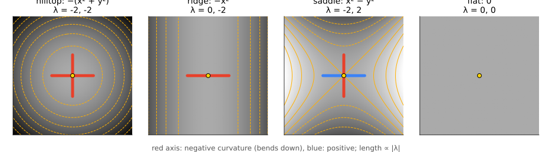
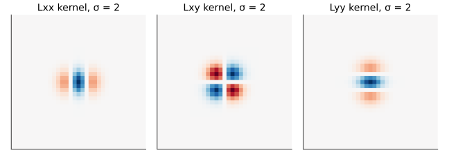
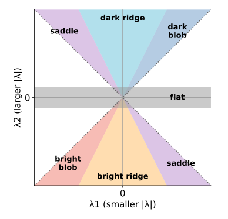
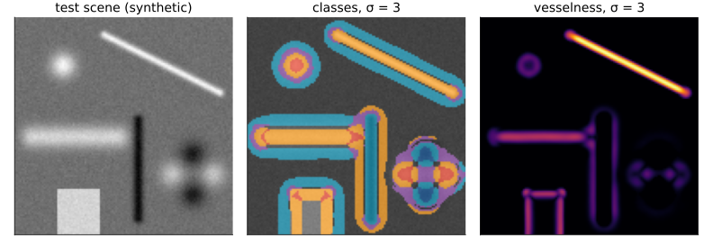

## About this lecture

The LoG of the last unit adds up the curvature in two directions. Today we keep the two curvatures **apart**: the second-derivative test from calculus, applied at every pixel.

- The **Hessian**: a symmetric 2 × 2 matrix of second derivatives per pixel, at scale σ.
- Its **eigenvalues** are the curvatures along two perpendicular directions; its **eigenvectors** are those directions.
- **Classification**: bright or dark **blob**, **ridge** (line), **saddle**, **flat**.
- **Trace** (the LoG) and **determinant**.
- **Vesselness** (Frangi): a score for line-like structures, over several scales.

*Slides titled **The math** give the formulas and proofs; the ideas are complete without them.*

## The image as a landscape

Read the (smoothed) image as a **height map**: bright = high.

{width="100%"}

- A bright spot is a **hilltop**: it bends down in every direction.
- A bright line is a **ridge**: it bends down across the line, and not at all along it.
- Two bright spots with two dark gaps between them make a **pass** (saddle): down one way, up the other.
- A plain is **flat**. The question at each pixel: how does the surface bend, and in which directions?

## The Hessian at every pixel

Three second derivatives of the Gaussian-smoothed image $L$ at scale σ (separable kernels, as in the Canny unit):

$$H = \begin{pmatrix} L_{xx} & L_{xy} \\ L_{xy} & L_{yy} \end{pmatrix}$$

{width="62%" fig-align="center"}

- $L_{xx}$: curvature along $x$; $L_{yy}$: along $y$ (down); $L_{xy}$: how the $x$-slope changes going down (the "twist").
- $H$ is **symmetric**, so (recall the PCA unit) it has two real eigenvalues and two **perpendicular** eigenvectors.

## Eigenvalues are curvatures

- The curvature in a direction $\mathbf u$ is a number that depends on $\mathbf u$. The **eigenvectors** of $H$ are the directions of the **largest** and **smallest** curvature; the **eigenvalues** are those curvatures.
- We order them by size: $|\lambda_1| \le |\lambda_2|$. So $\lambda_2$ is the strongest bending, $\lambda_1$ the weakest, in the perpendicular direction.
- Negative eigenvalue: the brightness bends **down** (a bright structure). Positive: bends **up** (a dark structure).

Example: $f = -x^2$ (a bright ridge along $y$). $H = \begin{pmatrix} -2 & 0 \\ 0 & 0 \end{pmatrix}$: $\lambda_1 = 0$ with eigenvector $(0, 1)$, **along** the ridge; $\lambda_2 = -2$ with eigenvector $(1, 0)$, **across** it.

## The math: curvature in a direction {.math}

Second-order Taylor expansion around a pixel $\mathbf x$:

$$L(\mathbf x + \mathbf h) \approx L(\mathbf x) + \nabla L^\top\mathbf h + \tfrac12\,\mathbf h^\top H\,\mathbf h.$$

- Along a unit vector $\mathbf u$ the second derivative (curvature of the profile) is $\mathbf u^\top H\mathbf u$.
- Maximise or minimise $\mathbf u^\top H\mathbf u$ subject to $\mathbf u^\top\mathbf u = 1$: Lagrange gives $H\mathbf u = \lambda\mathbf u$, and then $\mathbf u^\top H\mathbf u = \lambda$ (a Rayleigh quotient, the same algebra as PCA).
- So the extreme curvatures are the eigenvalues, along the eigenvectors. At a critical point ($\nabla L = 0$) this is the **second-derivative test**: both negative = maximum, both positive = minimum, opposite signs = saddle.

## The math: eigenvalues in closed form {.math}

For a symmetric $\begin{pmatrix} a & b \\ b & c \end{pmatrix}$ (here $a = L_{xx}$, $b = L_{xy}$, $c = L_{yy}$):

$$\lambda_{\pm} = \frac{a + c}{2} \pm \sqrt{\Big(\frac{a - c}{2}\Big)^2 + b^2}, \qquad \theta = \tfrac12\operatorname{atan2}(2b,\; a - c)$$

where θ is the angle of the eigenvector of $\lambda_+$ (in image coordinates, $y$ down).

- Two numbers do not depend on how the image is rotated: the **trace** $a + c = \lambda_+ + \lambda_-$ and the **determinant** $ac - b^2 = \lambda_+\lambda_-$.
- Example: $\begin{pmatrix} -8 & 4 \\ 4 & -8 \end{pmatrix}$: $\lambda = -8 \pm 4$, i.e. $-4$ and $-12$; θ = ½·atan2(8, 0) = 45°: the eigenvector of $-4$ (the weak curvature) is $(1, 1)/\sqrt2$, along the diagonal.

## Reading the two eigenvalues

{width="40%" fig-align="center"}

| $\lambda_1$ (small) | $\lambda_2$ (large) | structure |
|---|---|---|
| ≈ 0 | strongly < 0 | **bright ridge** (line); $\lambda_1$'s eigenvector points **along** it |
| < 0, similar size | < 0 | **bright blob** |
| opposite sign | | **saddle** |
| ≈ 0 | ≈ 0 | **flat** |

Dark structures: the same with the signs flipped. An **edge** gives a weak, mixed answer: a half-ridge on each side, nothing on the edge itself. The Hessian is not an edge detector.

## Try it: the Hessian per pixel

```{=html}
<link rel="stylesheet" href="../demos/dist/demo.css">
<div data-demo="hessian" data-preset="hill" data-presets="hill,ridge,saddle,edge,trace"></div>
<script src="../demos/dist/hessian.js"></script>
```

::: notes
Left: the image (tabs: classes, λ1, λ2, trace, determinant, vesselness, best σ), with the glyph at the clicked pixel: two axes along the eigenvectors, length ∝ |λ|, red = negative curvature. Middle: the (λ1, λ2) plane with the class regions and a scatter of the pixels. Tour: "hilltop": f = −(x² + y²), H = [−2 0; 0 −2] (the quadratic presets show H in the units of f). Drag c to 0: "ridge", H = [−2 0; 0 0], the glyph is a single red bar across the ridge. Set c = +1: saddle (red across, blue along). Set a = c = −1, b = −2: f = −(x + y)², H = [−2 −2; −2 −2], λ = 0 and −4, a diagonal ridge. "An edge is not a ridge": test scene, σ = 3, on the step at x = 25: flat on the edge itself (λ2 = −3.87, below the threshold 4), a bright ridge just inside (−10.76 at x = 26), a dark ridge just outside (+4.25 at x = 24). "The LoG cannot tell…": trace tab: the blob and the thin line are both strongly negative (−31.3 and −28.8 at σ = 3); determinant tab: 245 for the blob, 2.7 for the line.
:::

## Trace and determinant

Two numbers per pixel that do not depend on the orientation:

- **Trace** $\lambda_1 + \lambda_2 = L_{xx} + L_{yy}$: the **LoG** of the last unit. A blob with λ = (−10, −10) and a ridge with λ = (0, −20) both have trace −20: the LoG **cannot tell a blob from a line**.
- **Determinant** $\lambda_1\lambda_2$: 100 for the blob, 0 for the ridge. Large only when **both** curvatures are large: the "determinant of Hessian" blob detector.
- Pointer: the integral-image elective computes the determinant of Hessian with box filters for speed (as in the SURF keypoint detector).

## Vesselness: a score for lines

Frangi et al. (1998): a number between 0 and 1 that is large on bright lines (vessels, filaments, membranes) and small elsewhere.

- **Reward**: $\lambda_2$ strongly negative, i.e. a strong structure is present.
- **Penalise**: $|\lambda_1/\lambda_2|$ large, i.e. a blob, not a line.
- Two knobs: **β** sets how strictly blobs are rejected; **c** sets what counts as "strong" (above the noise).
- Example (β = 0.5, c = 15): a line with λ = (0, −20) scores 0.59; a blob with λ = (−10, −10) only 0.05.
- Dark lines: flip the sign test.

## The math: Frangi's vesselness (2D) {.math}

With $|\lambda_1| \le |\lambda_2|$ (for bright lines):

$$\mathcal V = \begin{cases} 0 & \lambda_2 > 0 \\[2pt] \exp\!\Big(-\dfrac{R_B^2}{2\beta^2}\Big)\Big(1 - \exp\!\Big(-\dfrac{S^2}{2c^2}\Big)\Big) & \text{otherwise} \end{cases}
\qquad R_B = \frac{\lambda_1}{\lambda_2},\quad S = \sqrt{\lambda_1^2 + \lambda_2^2}.$$

- $R_B$ is 0 for a perfect line and 1 for a round blob; the first factor is the "blobness" penalty.
- $S$ (the Frobenius norm of $H$) is small in flat, noisy regions; the second factor is the "structureness" reward.
- Example: $H = \begin{pmatrix} -20 & 2 \\ 2 & -3 \end{pmatrix}$: $\lambda = -2.77, -20.23$, $R_B = 0.137$, $S = 20.42$; $\mathcal V = 0.963 \cdot 0.604 = 0.58$.
- In 3D (one line): a 3 × 3 Hessian with three eigenvalues; blob (all three large), tube (two large), sheet (one large).

## Multi-scale: one σ is not enough

- A line responds best when σ matches its **width**: a thin filament at small σ, a thick vessel at large σ.
- Compute the Hessian at several σ, **normalise by σ²** (as in the scale-space unit, so the scales are comparable), take the **maximum** vesselness over σ.
- The winning σ grows with the line width (for a line with a Gaussian profile of width $s$, $\sigma^2\lambda_2$ peaks at $\sigma = \sqrt2\,s$; exercise).
- Failure: at **junctions** two lines cross, both curvatures are large, and the junction looks like a blob: vesselness fades exactly where branches meet.

{width="72%" fig-align="center"}

## Try it: vesselness over scales

```{=html}
<link rel="stylesheet" href="../demos/dist/demo.css">
<div data-demo="hessian" data-preset="vessel" data-presets="vessel,thick,multi,cell"></div>
<script src="../demos/dist/hessian.js"></script>
```

::: notes
Test scene at σ = 3: the blob at (28, 28) scores 0.10, the thin line 0.84, the thick line 0.40, the dark line 0 (bright mode). "One σ misses the thick line": σ = 1.5, the thick line (Gaussian width 4.5) scores only 0.06. "Multi-scale" (σ = 1 … 8, 8 levels): the thick line reaches 0.70 at σ = 5.94, the thin line 0.87 at σ = 2.44; the "best σ" tab colours each line by its scale. "Membranes in the micrograph": dark lines, σ = 2, c = 20: the nuclear envelope scores up to 0.97 at (94, 126); the texture also responds.
:::

## Ridges in practice

- **Microscopy**: membranes, filaments (microtubules, actin), neurites, vessels.
- **Medical images**: blood vessels in retinal photographs and angiograms (Frangi's original use).
- **Other**: roads in aerial images, cracks, the ridges of fingerprints.
- Vessel and neuron networks (skeletonising them, measuring branches, junctions) are the subject of the skeleton elective; it builds on this unit.

## Summary

- **Hessian** = the 2 × 2 matrix of second derivatives of the smoothed image, at every pixel.
- Its **eigenvalues** are the extreme curvatures, its **eigenvectors** their (perpendicular) directions; order $|\lambda_1| \le |\lambda_2|$.
- Both negative: bright **blob**; $\lambda_2 \ll 0$, $\lambda_1 \approx 0$: bright **ridge** (along $\lambda_1$'s eigenvector); opposite signs: **saddle**; both ≈ 0: **flat**. Edges: weak half-ridges.
- **Trace** = LoG (blob or ridge, cannot tell); **determinant**: blobs only.
- **Vesselness**: rewards strong $\lambda_2$, penalises blob-like $|\lambda_1/\lambda_2|$; take the maximum over σ (normalised by σ²).
