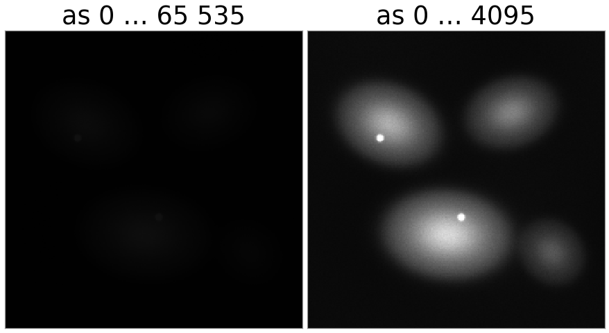
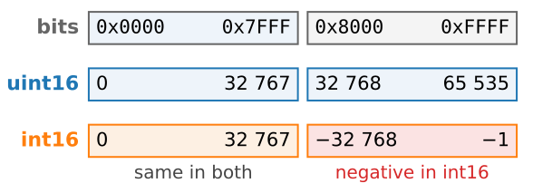
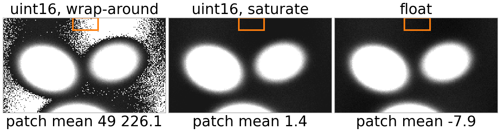
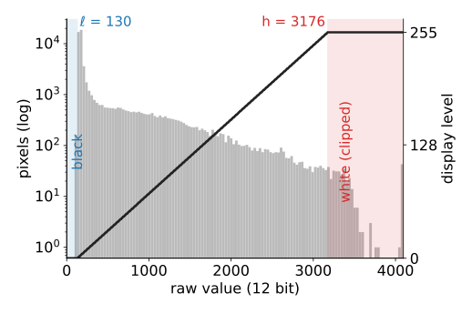
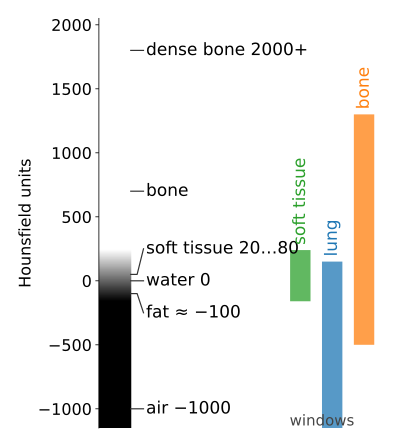
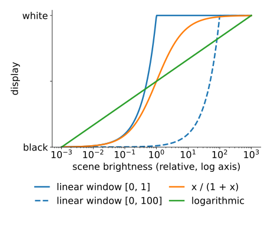

## About this lecture

- Scientific and medical images have **12 or 16 bits** per pixel. Screens show 8.
- How the numbers are **stored**: containers, alignment, packing, signed and unsigned types.
- How arithmetic on them **breaks**: wrap-around, saturation, and why we compute in a wider type.
- How to **show** them: windows, CT window/level, contrast stretching, colour maps.

Slides titled **The math** give the formulas and proofs; the ideas are complete without them.

::: notes
The previous unit said how many bits are worth measuring. This one is about the daily life of those bits: the black image that is not black, the background subtraction that turns the background white, the CT window. All of it is simple, and all of it causes real errors in real projects.
:::

## Where high bit depths come from

| source | typical bits | stored as |
|---|---|---|
| scientific camera (microscopy, astronomy) | 12, 14 or 16 | 16-bit unsigned |
| CT scanner | 12 (Hounsfield units, −1024 … 3071) | 16-bit signed, or unsigned with an offset |
| digital X-ray, mammography | 12–16 | 16-bit unsigned |
| raw photo from a camera | 12–14 | 16-bit, or packed |
| your screen | 8 per colour channel (some 10) | |

A memory **container** comes in 8, 16 or 32 bits. A 12-bit value sits in a 16-bit box with 4 bits to spare.

## The black image

:::: {.columns}
::: {.column width="56%"}
A 12-bit camera writes values 0…4095 into a 16-bit file. A viewer that assumes the full 16-bit range maps 0 → black and 65 535 → white:

$$4095 \;\mapsto\; 255 \cdot \tfrac{4095}{65\,535} \approx 16 \text{ of } 255.$$

The brightest pixel is shown as a dark grey: the image **looks black**, but nothing is wrong with the data. Only the display range is wrong.
:::
::: {.column width="44%"}
{fig-alt="The same synthetic 12-bit fluorescence image twice. Left, displayed as 0 to 65 535: almost black, the cells barely visible. Right, displayed as 0 to 4095: four cells with bright nuclei." width="100%"}
:::
::::

- **LSB-aligned**: the 12 bits are the low bits; values 0…4095. The usual case.
- **MSB-aligned**: the 12 bits are shifted to the top (value × 16); values 0…65 520, every 16th value used. Displays fine, but the histogram is a comb.
- **Packed**: two 12-bit pixels in 3 bytes, no wasted bits (25 % smaller); must be unpacked before use.

## Try it: show a 12-bit image

```{=html}
<link rel="stylesheet" href="../demos/dist/demo.css">
<div data-demo="window16" data-image="fluo" data-preset="full"></div>
<script src="../demos/dist/window16.js"></script>
```

::: notes
Starts with the window 0–65535: black. Switch histogram axis between type range and data range. Click 0–4095: the cells appear. min–max is almost the same here (the data reach 4095 because two spots saturate). Percentiles 0.5–99.5 % gives a much better picture: the saturated spots no longer set the scale. Show hi-lo: blue and red mark what is clipped. Then MSB-aligned with data-range histogram: a comb, every 16th value. Keep the subtraction presets for the next slide.
:::

## Integer types

:::: {.columns}
::: {.column width="48%"}
| type | bits | range |
|---|---|---|
| unsigned 8-bit (uint8) | 8 | 0 … 255 |
| signed 8-bit (int8) | 8 | −128 … 127 |
| unsigned 16-bit (uint16) | 16 | 0 … 65 535 |
| signed 16-bit (int16) | 16 | −32 768 … 32 767 |
| signed 32-bit (int32) | 32 | about ±2.1 × 10⁹ |
:::
::: {.column width="52%"}
{fig-alt="Three aligned bars. The 16-bit patterns 0x0000 to 0xFFFF; read as uint16 they mean 0 to 65 535; read as int16 the bottom half 0x0000 to 0x7FFF means 0 to 32 767 in both, and the top half 0x8000 to 0xFFFF means minus 32 768 to minus 1." width="100%"}
:::
::::

- Signed integers use **two's complement**: −1 is stored as all ones (0xFFFF in 16 bits), −30 as 65 506.
- The same 16 bits mean 65 506 as uint16 and −30 as int16. **The bits do not know their type**; the file header or your program decides.

## When the result does not fit

Subtract a background of 160 from a pixel of 150, in uint16:

| arithmetic | result | what you see |
|---|---|---|
| **wrap-around** (what plain integer arithmetic does) | 65 526 | the darkest pixels become the **brightest** |
| **saturation** (clip to the range) | 0 | negatives become 0: the noise is cut on one side, the **mean is biased up** |
| **float** (or a wider signed type) | −10 | correct; decide later what to do with negatives |

Same trap when averaging: in uint16, $(40\,000 + 30\,000)/2$ gives 2232 instead of 35 000, because the sum wraps before the division.

{fig-alt="The fluorescence image after subtracting 160, all shown with the same window from minus 60 to 600. Wrap-around: the background is full of white speckles, patch mean 49 226. Saturate: the background is a flat dark grey, patch mean 1.4. Float: the background noise is intact, patch mean minus 7.9. The top part of the image is shown, with the background patch outlined." width="76%" fig-align="center"}

## The math: wrap-around is arithmetic modulo $2^n$ {.math}
An $n$-bit unsigned integer stores every result **modulo** $2^n$:

$$a \ominus b = (a - b) \bmod 2^n, \qquad 150 \ominus 160 = -10 + 65\,536 = 65\,526.$$

Two's complement uses the same rule to store negatives: $-x$ is stored as $2^n - x$. That is why addition and subtraction circuits do not care whether a number is signed: only the **interpretation** of the top half of the range differs ($2^{n-1} \dots 2^n - 1$ means $-2^{n-1} \dots -1$).

Saturation is $\min(\max(a - b, 0), 2^n - 1)$: not modular, and not linear either; $\mathbb E[\max(X, 0)] > \mathbb E[X]$ when $X$ has noise around 0.

## Rules for arithmetic

- **Compute in a wider type**: convert to float (or int32) *before* subtracting, adding, averaging, filtering. A filter with negative weights needs signed results anyway.
- **Convert back on purpose**, with an explicit scale and clip, and only for storage or display.
- Watch the **conventions**: some programs scale floats to [0, 1], others keep raw counts. Converting 4095 (uint16) to a "[0, 1] float" can give $4095/65\,535 \approx 0.0625$, not 1.
- Summing frames: 16 frames of a 12-bit camera fit in uint16 ($16 \cdot 4095 = 65\,520$); the 17th does not.

## Showing 12–16 bits on an 8-bit screen: windows

:::: {.columns}
::: {.column width="52%"}
A **window** $[\ell, h]$ maps raw values linearly to the 256 display levels and clips the rest:

- $v \le \ell$ → black, $v \ge h$ → white, in between a linear ramp.
- **Window/level**: width $W = h - \ell$, centre $L = (\ell + h)/2$.
- A narrow window spreads a small range of values over all display levels: **more contrast**, more clipping.
- **Auto-contrast**: set $\ell$ and $h$ to percentiles (say 0.5 % and 99.5 %), so a few saturated or dead pixels do not set the scale.

The window changes only the **display**. Measure on the raw values.
:::
::: {.column width="48%"}
{fig-alt="Histogram of the 12-bit fluorescence image on a log scale, with the display mapping drawn on top: black below the 0.5 percent percentile 130, a straight ramp up to the 99.5 percent percentile 3176, white above. The clipped ranges are shaded blue and red." width="100%"}
:::
::::

## The math: the window formula {.math}
The display level of a raw value $v$ is the straight line through $(\ell, 0)$ and $(h, 255)$, clipped and rounded:

$$d(v) = \operatorname{round}\!\left(255 \cdot \operatorname{clip}\!\left(\frac{v - \ell}{h - \ell},\; 0,\; 1\right)\right).$$

With width $W = h - \ell$, one display level covers $W/256$ raw values: for $W = 4096$, 16 raw values share one grey on screen. A **LUT** (look-up table) generalises this: any function from raw value to colour, stored as a table. The window is the linear LUT.

## CT: Hounsfield units and windows

:::: {.columns}
::: {.column width="62%"}
CT measures X-ray attenuation $\mu$ and reports it relative to water, in **Hounsfield units** (HU): air −1000, fat ≈ −100, water 0, soft tissue 20–80, bone several hundred to 2000+.

Soft tissue differs by tens of HU, but the image spans 4000 HU: no single window shows everything. Radiologists switch between standard windows:

| window | W | L | range shown |
|---|---|---|---|
| soft tissue | 400 | 40 | −160 … 240 |
| lung | 1500 | −600 | −1350 … 150 |
| bone | 1800 | 400 | −500 … 1300 |

Files often store HU + 1024 as unsigned numbers, with the offset in the header; forget it and every window is 1024 HU off.
:::
::: {.column width="38%"}
{fig-alt="A vertical Hounsfield scale from minus 1000 to 2000 with air, fat, water, soft tissue, bone and dense bone marked, and three coloured bars beside it for the soft-tissue window (minus 160 to 240), the lung window (minus 1350 to 150) and the bone window (minus 500 to 1300)." width="100%"}
:::
::::

## The math: Hounsfield units {.math}
$$\text{HU} = 1000 \cdot \frac{\mu - \mu_\text{water}}{\mu_\text{water} - \mu_\text{air}}.$$

Water is 0 and air is −1000 by construction; one HU is 0.1 % of the attenuation of water. A stored value $s$ becomes HU through a linear **rescale**, $\text{HU} = a\,s + c$ (often $a = 1$, $c = -1024$), recorded in the file header.

## Try it: CT windows

```{=html}
<div data-demo="window16" data-image="ct" data-preset="soft"></div>
```

::: notes
Synthetic slice: body, fat layer, lungs with vessels, a vertebra at the back, an organ between the lungs with a faint lesion 20 HU brighter than its surroundings. Soft tissue: organs visible, lungs black, bone white. Lung: vessels in the lung, everything else white. Bone: the cortical rim. Narrow W150 L70: the lesion appears. Then "uint16 HU+1024" with the soft-tissue preset: everything white, because the window was meant for HU, not for stored numbers.
:::

## Colour maps, HDR and tone mapping

:::: {.columns}
::: {.column width="55%"}
- A **LUT** can map grey values to colours. A "hi-lo" LUT marks clipped pixels (blue below, red above): use it to set a window honestly. Perceptual colour maps are on the colour day.
- **High dynamic range** (HDR) scenes span $10^5 : 1$ or more. A linear window either loses the shadows or the highlights.
- **Tone mapping** compresses the range with a non-linear curve (e.g. logarithmic, or $x/(1 + x)$), globally or adapted to the neighbourhood. Good for looking, bad for measuring: it changes the ratios between pixels.
:::
::: {.column width="45%"}
{fig-alt="Display value against scene brightness on a log axis spanning a million to one. A linear window over 0 to 1 is white for everything brighter than 1; a linear window over 0 to 100 is black for everything below about 1; the curves x over 1 plus x and logarithmic rise gradually over the whole range." width="100%"}
:::
::::

## Summary

- 12-bit data in a 16-bit container look black when shown as 0…65 535: the **display range**, not the data, is wrong.
- Integer arithmetic **wraps** (modulo $2^n$) or **saturates**; both are wrong for negative results. Compute in float or a wider type.
- A **window** maps a range of raw values to the 256 display levels; CT uses standard windows in **Hounsfield units**.
- Displays, LUTs and tone mapping are for **looking**; analysis uses the raw numbers.
