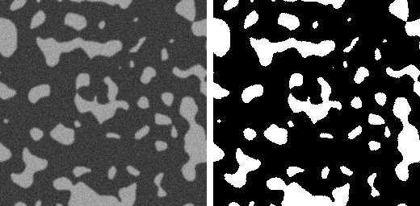
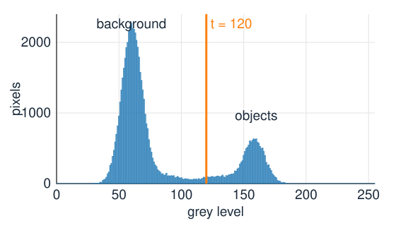
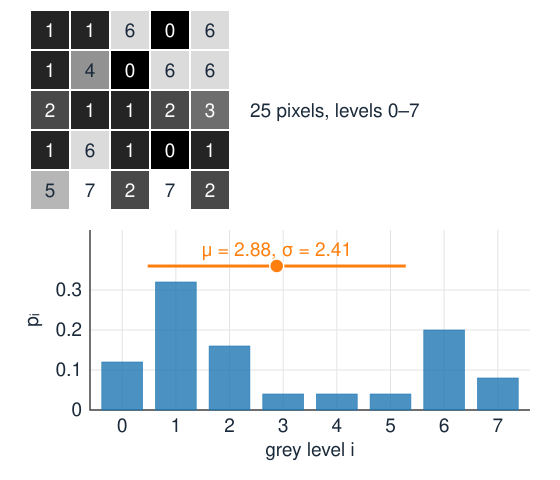
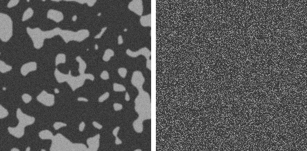
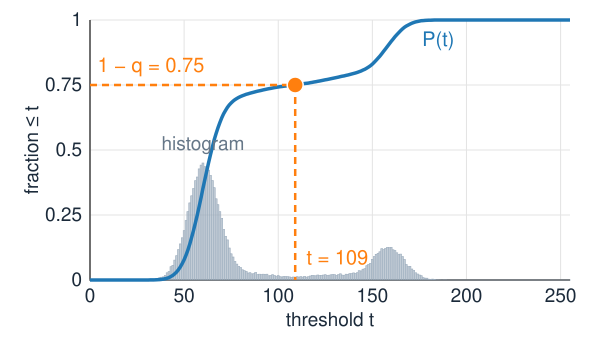
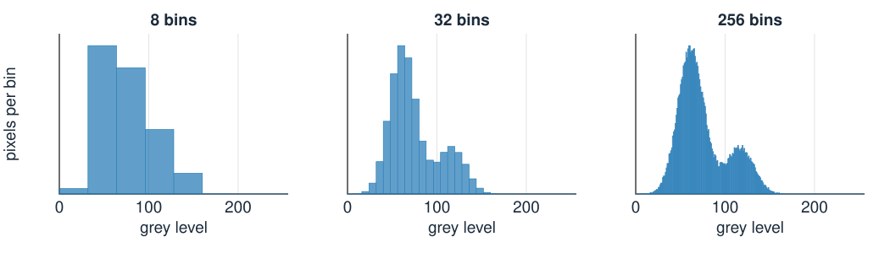
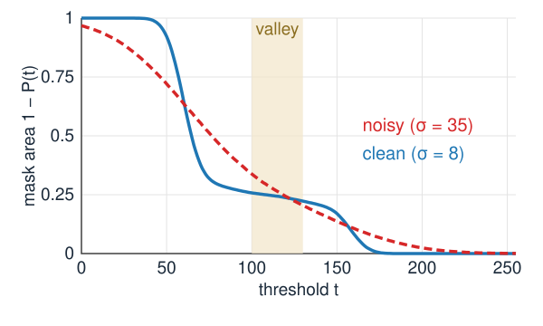
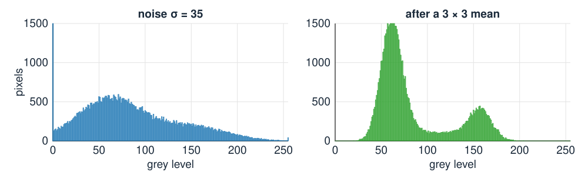
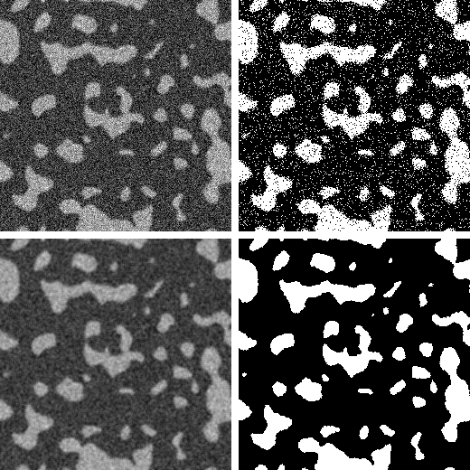

## About this lecture

Part I treated images as arrays of numbers. Part II asks which pixels belong to an **object**. The simplest answer: the bright ones.

- A **threshold** turns an image into a **binary mask**: the first segmentation.
- The **histogram** counts how many pixels have each grey level; it is a probability distribution.
- The **cumulative histogram** gives the fraction of pixels below $t$, and the **percentile** threshold.
- **Bins**, and what makes a threshold **good**: a deep valley between two peaks.
- **Noise** fills the valley; **smoothing first** brings it back, at a price.

*Slides titled **The math** give the formulas and proofs; the ideas are complete without them.*

::: notes
First day of Part II. Recalls: images as arrays (day 1), bit depth (day 3), the noise model of the camera noise unit (day 3), mean and Gaussian filters (day 1). New words introduced here and used by every later segmentation day: segmentation, binary mask, foreground/background, ground truth.
:::

## Which pixels are object?

{width="62%"}

Left: a synthetic image of bright blobs on a dark background. Right: the pixels brighter than $t = 120$, in white.

- A **segmentation** splits the pixels into **object** (foreground) and **background**.
- The simplest rule: object where $I(x) > t$. The result is a **binary mask** $B(x) \in \{0, 1\}$.
- The **ground truth** is the true mask: known by construction for a synthetic image, drawn by hand for a real one.
- The rule looks at each pixel **alone**: its grey level, nothing else.

## The histogram

{width="55%"}

- Sort the pixels into piles by grey level and count: $h_i$ = number of pixels with grey level $i$.
- Two **peaks**: background around 60, objects around 160. A threshold in the **valley** between them separates the two.
- Divide by the number of pixels $N$: the **normalised histogram** $p_i = h_i / N$, the fraction of pixels with grey level $i$. The fractions add up to 1: it is a **probability distribution** of the grey level of a random pixel.

By hand: a $5 \times 5$ image with grey levels 0–7 has counts $h = (3, 8, 4, 1, 1, 1, 5, 2)$, so $p_0 = 3/25 = 0.12$.

## The math: the histogram as a distribution {.math}

With $L$ grey levels $i = 0, \dots, L-1$ and $N$ pixels:

$$p_i = \frac{h_i}{N}, \qquad \sum_{i} p_i = 1, \qquad \mu = \sum_i i\, p_i, \qquad \sigma^2 = \sum_i (i - \mu)^2 p_i = \sum_i i^2 p_i - \mu^2 .$$

These are the mean and variance of the grey level of a pixel chosen at random.

:::: {.columns}
::: {.column width="56%"}
Two **running sums** will be used again and again:

$$\begin{aligned} P(t) &= \textstyle\sum_{i \le t} p_i && \text{(cumulative histogram)},\\ M(t) &= \textstyle\sum_{i \le t} i\, p_i && \text{(first moment)}. \end{aligned}$$

The $5 \times 5$ example: $\mu = 2.88$, $\sigma^2 = 5.79$. One pass over the image ($O(N)$) builds the histogram; every quantity on the next slides then costs $O(L)$.
:::
::: {.column width="44%"}
{fig-alt="The 5 × 5 example image with grey levels 0 to 7, and its normalised histogram with the mean 2.88 and one standard deviation (2.41) either side marked." width="88%"}
:::
::::

## The histogram forgets where pixels are

{width="62%"}

Right: the same pixels, **shuffled** to random positions. Same grey levels, so **the same histogram**, and the same threshold.

- A histogram method cannot tell an object from scattered bright noise: shape, size and neighbours are invisible to it.
- Everything in this unit and the next uses the histogram only. Neighbours come back with local thresholds and hysteresis (two units on), and with graph cuts (day 13).

## The cumulative histogram and the percentile threshold

:::: {.columns}
::: {.column width="56%"}
$P(t)$ = fraction of pixels with grey level $\le t$ = the fraction that a threshold at $t$ calls **background**.

- The **mask area** is $1 - P(t)$: read it off for any $t$, without thresholding the image.
- **Percentile threshold**: if you know that objects cover a fraction $q$ of the image (say 2 % of the pixels are fluorescent spots), choose $t$ with $P(t) = 1 - q$: "keep the brightest 2 %".
- A robust baseline when the object fraction is known and stable; useless when it varies from image to image.

Example: in a $512 \times 512$ image, "the brightest 2 %" means about 5243 pixels, wherever the valley is.
:::
::: {.column width="44%"}
{fig-alt="The cumulative histogram P(t) of the blob image rises in two steps, one per peak. A dashed line at height 0.75 meets the curve at t = 109: the threshold that keeps the brightest 25 %." width="100%"}

The blob image: objects are 25 % of the pixels, so $P(t) = 0.75$ gives $t = 109$, in the valley.
:::
::::

## Bins

{width="100%"}

- **8-bit** images: 256 natural bins, one per grey level.
- **16-bit** containers (the bit-depth day: a 12-bit camera uses only 0–4095 of 0–65535): 65 536 bins are mostly empty. Bin over the range of the data instead.
- Too **few** bins merge the peaks and hide the valley; too **many** bins give a spiky histogram with few pixels per bin.

## Try it: histogram and threshold

```{=html}
<link rel="stylesheet" href="../demos/dist/demo.css">
<div data-demo="histthresh" data-preset="clean"></div>
<script src="../demos/dist/histthresh.js"></script>
```

::: notes
Left: the image with the mask in orange; drag the threshold on the histogram or on the lower plot. The lower plot is the mask area 1 − P(t). Tour: "clean bimodal": anywhere in the valley (about 100 to 130) the mask area hardly changes (25.8 % to 22.3 %) and Dice stays between 0.94 and 0.99 (best 0.991 at t = 108). "too few bins": with 8 bins the two peaks become a staircase. "percentile: brightest 25 %": the synthetic objects cover exactly 25 % of the pixels. Then "noise fills the valley" and "blur restores it" for the next slides.
:::

## What makes a threshold good?

:::: {.columns}
::: {.column width="58%"}
A **bimodal** histogram with a **deep valley**: every $t$ in the valley gives nearly the same mask.

- The mask area changes by the number of pixels **at** the threshold: $1 - P(t)$ drops by $p_t$ when $t$ moves up by one. In a deep valley $p_t \approx 0$: the area curve is **flat**, and the choice of $t$ hardly matters.
- A **shallow** valley: the area curve is steep, every grey level of $t$ moves many pixels, and the result depends on a choice nobody can justify.
- In the demo: the clean blobs lose 1.2 pixels per thousand per grey level in the valley, the noisy ones 4.4: almost four times as sensitive.
:::
::: {.column width="42%"}
{fig-alt="The mask area 1 − P(t) against t for the clean blobs (solid) and the noisy blobs (dashed). In the valley from 100 to 130 the clean curve is nearly flat; the noisy one keeps falling." width="100%"}
:::
::::

"Good" gets two precise meanings today: a **criterion on the histogram** (next unit), and agreement with the **ground truth** (the evaluation unit).

## The math: the slope of the area curve {.math}

The mask area as a function of $t$ is $A(t) = 1 - P(t) = \sum_{i > t} p_i$, so

$$A(t) - A(t+1) = p_{t+1}.$$

For continuous grey levels with density $p(x)$: $A'(t) = -p(t)$. The sensitivity of the mask to the threshold **is** the histogram at the threshold.

- A threshold in a valley where $p(t) = 0$ is locally insensitive: small errors in $t$ change nothing.
- Uncertainty $\delta t$ in the threshold changes the area by about $p(t)\,\delta t$.

## Noise fills the valley

{width="100%"}

- The camera noise unit (day 3): each pixel = true value + noise of standard deviation $\sigma_n$.
- Each peak gets **wider** by the noise; the two peaks **overlap**, and the valley fills up (left, $\sigma_n = 35$).
- Pixels in the overlap are on the wrong side of **any** $t$: isolated wrong pixels, salt-and-pepper in the mask.
- Numbers: background 50, objects 110, $\sigma_n = 20$, $t = 80$ in the middle: $6.7\,\%$ of the pixels of each class land on the wrong side.

## Smoothing first

:::: {.columns}
::: {.column width="63%"}
Average each pixel with its neighbours (**mean** or **Gaussian** filter, from the filtering unit on day 1) before thresholding.

- Noise is independent from pixel to pixel: an average of $n$ pixels has noise $\sigma_n / \sqrt n$. A $3 \times 3$ mean divides it by 3.
- Each peak **narrows**, and the valley comes back (right, same image after a $3 \times 3$ mean).
- The example above: $\sigma_n = 20 \to 6.7$, the wrong fraction drops from $6.7\,\%$ to $0.0003\,\%$.
- The **median** of the window is the non-linear alternative: it ignores a single outlier completely (median of $50, 52, 48, 51, 250, 49, 50, 53, 47$ is 50; the mean is 72.2). Denoisers are compared on the deconvolution day; rank filters come back on the morphology day.

**The price**: edges blur. Pixels at the boundary become a mix of object and background (**partial volume**): they fill the valley again, and small or thin objects lose contrast.
:::
::: {.column width="37%"}
{fig-alt="Top: the blob image with noise of standard deviation 35 and its mask at t = 110, full of isolated wrong pixels. Bottom: the same image after a 3 × 3 mean, and its clean mask at the same threshold." width="100%"}

Top: noise $\sigma_n = 35$, $t = 110$: 10 % of the pixels wrong. Bottom: after a $3 \times 3$ mean: 1.5 %.
:::
::::

## The math: averaging noise {.math}

Let the noise values $n_1, \dots, n_n$ be independent with variance $\sigma^2$. A weighted average $\bar n = \sum_k w_k n_k$ with $\sum_k w_k = 1$ has

$$\operatorname{Var}(\bar n) = \sum_k w_k^2\, \sigma^2 .$$

- Mean filter, $w_k = 1/n$: $\operatorname{Var} = \sigma^2/n$, the standard deviation drops by $\sqrt n$ (by 3 for $3 \times 3$).
- $\sum w_k^2$ is smallest for equal weights: for a given number of pixels the mean removes the most noise. A Gaussian of width $s$ pixels behaves like a mean over about $4\pi s^2$ pixels.
- The tail fraction: with class means $\mu_0 < \mu_1$, equal noise $\sigma$ and $t$ in the middle, the wrong fraction per class is $1 - \Phi\!\left(\tfrac{\mu_1 - \mu_0}{2\sigma}\right)$; smoothing by $\sqrt n$ multiplies the argument by $\sqrt n$.

## Try it: noise and smoothing

```{=html}
<link rel="stylesheet" href="../demos/dist/demo.css">
<div data-demo="histthresh" data-preset="noise"></div>
<script src="../demos/dist/histthresh.js"></script>
```

::: notes
Tour: "noise fills the valley" (noise 35): there is no valley; Dice at t = 110 is 0.813, the best possible is 0.823 at t = 119. "blur restores it" (Gaussian σ = 1.5): the valley is back, Dice 0.970 at t = 110. Tick median 3×3 instead of the blur: Dice 0.960. Push blur σ to 3: the blobs' edges smear, and the best Dice drops to 0.949. Log scale shows the small bins. Last: "the micrograph": where is the valley? (Dark objects: tick "dark objects".)
:::

## Summary

- A threshold turns an image into a **binary mask**: object where $I(x) > t$. Each pixel is judged alone.
- The **histogram** $h_i$ counts pixels per grey level; $p_i = h_i/N$ is a probability distribution. It forgets **where** the pixels are.
- The **cumulative histogram** $P(t)$ is the background fraction; $1 - P(t)$ is the mask area. **Percentile** threshold: $P(t) = 1 - q$.
- **Bins**: 256 for 8-bit; for 16-bit data bin over the data range.
- A good threshold sits in a **deep valley**: the mask area hardly changes with $t$.
- **Noise** widens the peaks and fills the valley; **smoothing** narrows them (noise $/\sqrt n$) but blurs the edges.
