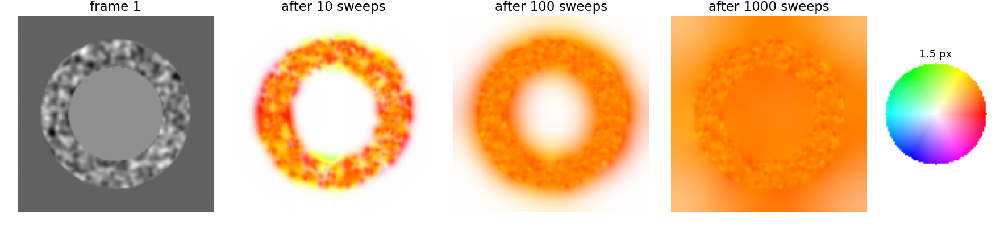
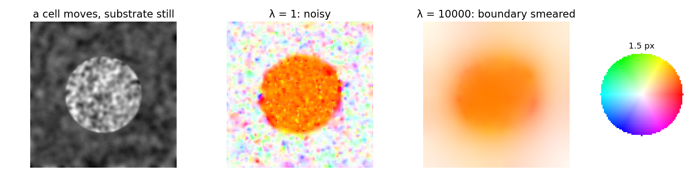

## About this lecture

Lucas–Kanade answers only where a window has texture. Horn and Schunck (1981) ask for a flow field that fits the constraints **and** is smooth everywhere.

- The flow as a **regularised energy**: data + λ·smoothness, the pattern of the deconvolution day.
- What λ does; **filling-in** of flat regions.
- The update: **average the neighbours, step towards the constraint line**.
- Sharp **motion boundaries** and robust penalties.
- **Evaluating** a flow field: endpoint error, angular error, and the warping residual when there is no ground truth.

*Slides titled **The math** give the formulas and proofs; the ideas are complete without them.*

::: notes
Owner of Horn–Schunck, filling-in, endpoint and angular error and the warping residual. Recalls the regularisation pattern from regularise/ (deconvolution day) and the energy over labels from seg-energy/ (graph cuts). Robust penalties: pointer to the regularise table and gmrf/ (Ising elective). The hsflow demo uses the same frame pairs as lkflow.
:::

## Recall: misfit + λ·penalty

From [the regularisation unit](../regularise/lec.qmd): when the data alone do not determine the answer, minimise

**misfit to the data** + λ · **penalty on implausible answers**.

- Deconvolution: the unknown was the sharp image, the penalty its roughness.
- Here: the unknown is the **flow field** $(u, v)$; the misfit is how badly each pixel's constraint is violated; the penalty is how much **neighbouring vectors differ**.
- Graph cuts ([segmentation energy](../seg-energy/lec.qmd)) had the same structure with labels instead of vectors.

## Horn–Schunck: the idea

Every pixel pays for two things:

- **data**: its distance from its own constraint line (squared);
- **smoothness**: λ times how much its vector differs from its neighbours' (squared).

λ small: trust the constraints (noisy; flat regions undetermined). λ large: a smooth field that blurs across motion boundaries.

The result is **dense**: a vector at every pixel, including flat regions. Lucas–Kanade gives vectors with holes and a confidence.

## Filling-in

{width="100%" fig-align="center"}

In a flat region there are no constraints, but smoothness pulls the flow in from the textured pixels around it. Over the iterations the flow **spreads inwards like heat**: about a pixel per iteration, so a large flat region needs hundreds of iterations.

## The update in words

Each iteration, every pixel

1. takes the **average** of its neighbours' vectors,
2. moves that average **towards its own constraint line**, by a step that is large where its gradient is strong and small where the gradient is weak or λ is large.

A pixel already on its line keeps the average. A pixel in a flat region just takes the average: that is the filling-in.

By hand: $(I_x, I_y, I_t) = (2, 0, -4)$ (line $u = 2$), neighbour average $(0, 0)$, λ = 1: the new vector is $(1, 0)$, half way to the line. With λ = 0 it jumps onto the line: $(2, 0)$.

## The math: Horn–Schunck {.math}

Discrete energy over pixels $p$ and 4-neighbour pairs $(p, q)$:
$$E(u, v) = \sum_p (I_x u_p + I_y v_p + I_t)^2 + \lambda \sum_{(p, q)} \big[(u_p - u_q)^2 + (v_p - v_q)^2\big].$$
With the neighbour averages $\bar u_p, \bar v_p$, setting $\partial E/\partial u_p = \partial E/\partial v_p = 0$ gives $(I_x^2 + 4\lambda)u + I_xI_y v = 4\lambda\bar u - I_xI_t$ and its twin, solved by
$$u = \bar u - I_x\,\frac{I_x\bar u + I_y\bar v + I_t}{4\lambda + I_x^2 + I_y^2},\qquad v = \bar v - I_y\,\frac{I_x\bar u + I_y\bar v + I_t}{4\lambda + I_x^2 + I_y^2}.$$

- Applied to all pixels repeatedly: an iterative solver of a sparse linear system. $E$ is a sum of squares of linear functions: convex, one minimum.
- Updating the pixels in checkerboard order (first the "black", then the "white" ones) makes each half-step an exact minimisation: $E$ never increases (the demo does this).
- Continuous form (Euler–Lagrange): $I_x(I_xu + I_yv + I_t) - \lambda\nabla^2 u = 0$, and the same for $v$.

## Try it: Horn–Schunck

```{=html}
<link rel="stylesheet" href="../demos/dist/demo.css">
<div data-demo="hsflow" data-preset="fill"></div>
<script src="../demos/dist/hsflow.js"></script>
```

::: notes
The sweeps are animated. Tour: "filling-in" (ring around a flat disc, λ = 100, shift 1.5 px): after 100 sweeps the centre is still white (u ≈ 0); after 300 the colour has crept in (centre u = 0.42); after 1000, u = 1.06 of the true 1.30; the mean EPE falls from 0.98 (10 sweeps) to 0.18 (2000). Switch to the Lucas–Kanade tab: holes in the flat parts, mean EPE 0.52. "λ small" (λ = 1, micrograph): noisy, mean EPE 0.48 after 300 sweeps. Then compute the EPE-vs-λ curve: on the micrograph (300 sweeps) the minimum is near λ = 1600 (0.11 px), below Lucas–Kanade (0.19 px); too large λ is worse again (0.97 at λ = 25 000).
:::

## Sharp motion boundaries

The squared penalty hates jumps: a jump of 2 costs 4 times a jump of 1. So it blurs the border between a moving cell and the still background.

- **Robust penalties** (total variation, Charbonnier): pay for the **size** of a jump, not its square; one sharp jump becomes cheaper than a smeared ramp. Pointer: the "total variation" row of the [regularisation table](../regularise/lec.qmd), and [MRF priors](../gmrf/lec.qmd) on the Ising elective.
- A **robust data term** ignores pixels where brightness constancy fails (occlusions, bleaching).
- Modern variational flow = robust data + robust smoothness + coarse-to-fine + warping (the pyramid of the last unit works for Horn–Schunck too).

{width="80%" fig-align="center"}

## Lucas–Kanade or Horn–Schunck?

| | Lucas–Kanade | Horn–Schunck |
|---|---|---|
| assumption | constant flow in a window | smooth flow everywhere |
| output | vectors where there is texture, plus a confidence | a dense field |
| knob | window size ρ | λ |
| computation | closed form per pixel | many iterations |
| flat regions | no answer (honest) | filled in from the surroundings (plausible, unchecked) |
| large motion | pyramid + warping | pyramid + warping |

Learned flow networks (modern deep learning day) are trained on synthetic sequences and evaluated in exactly the way of the next slides.

## Evaluating a flow field: with ground truth

Make test data whose motion is known: warp a real image by a known flow (as in the demos), or simulate a sequence.

- **Endpoint error** (EPE): the length of (estimate − truth), per pixel; its mean over the image; its map. Errors concentrate at motion boundaries and in flat regions.
- **Angular error** (AE): the angle between $(u, v, 1)$ and $(u_{gt}, v_{gt}, 1)$, the older measure. It punishes errors at **slow** pixels much more: estimate $(0.1, 0)$ against truth $(0.6, 0)$ has EPE 0.5 and AE 25°; $(2, 1)$ against $(2.5, 1)$ also has EPE 0.5 but AE only 5.8°. EPE is preferred.
- Choose λ (or ρ) by the EPE on synthetic data that **resembles** your real data.

## The math: error measures {.math}

$$\mathrm{EPE} = \sqrt{(u - u_{gt})^2 + (v - v_{gt})^2},\qquad
\mathrm{AE} = \arccos\frac{u\,u_{gt} + v\,v_{gt} + 1}{\sqrt{u^2 + v^2 + 1}\,\sqrt{u_{gt}^2 + v_{gt}^2 + 1}} .$$

- The "+1" treats each flow as a direction in space–time, $(u, v, 1)$: the AE is the angle between the two space–time directions.
- For slow motions the space–time vectors are nearly $(0, 0, 1)$, so a small absolute error is a large angle; for fast motions the same absolute error is a small angle.
- Both are 0 iff the estimate equals the truth; EPE is in pixels and easy to interpret.

## Without ground truth: the warping residual

On real data there is no truth. Warp frame 2 back by the estimated flow and subtract frame 1: the **warping residual**.

- A correct flow (and brightness constancy) leaves only noise.
- A **small residual is necessary, not sufficient**: in a flat region, a wrong flow leaves no residual (flat moved anywhere is still flat). The aperture problem hides errors in the residual too.
- Large residuals point to failures: motion boundaries, occlusions, bleaching.
- Recall the discrepancy idea of the regularisation unit: a residual much smaller than the noise means overfitting.

## Try it: evaluating

```{=html}
<link rel="stylesheet" href="../demos/dist/demo.css">
<div data-demo="hsflow" data-preset="boundary"></div>
<script src="../demos/dist/hsflow.js"></script>
```

::: notes
"Boundary: quadratic vs robust": a textured cell moving 1.5 px over a still substrate, noise 4. After 500 sweeps at λ = 300: mean EPE 0.22 px with the quadratic penalty, 0.19 with the robust one (toggle it and press restart); the EPE map shows the error ring at the cell border. "λ large" (10 000): the boundary is smeared over many pixels (EPE 0.47). "Residual without truth": the ring scene stopped after 60 sweeps: the flat centre still has flow 0 (EPE about 1.5 px there) but its residual is smaller than average: the residual cannot see errors in flat regions. "4 px rotation: pyramid": without the pyramid 0.92 px, with it 0.08 px.
:::

## Summary

- **Horn–Schunck**: minimise data misfit + λ·(differences between neighbouring vectors): the regularisation pattern with a vector field as the unknown.
- Update: **average the neighbours, step towards the constraint line**; flat regions are **filled in** from their surroundings, slowly.
- λ: small = noisy, large = smeared motion boundaries; **robust** penalties keep sharp boundaries.
- LK: local, sparse, with a confidence. HS: global, dense. Both need small motion or a pyramid.
- Evaluate with **endpoint error** against known motion; without truth, the **warping residual** finds failures but cannot prove correctness.
