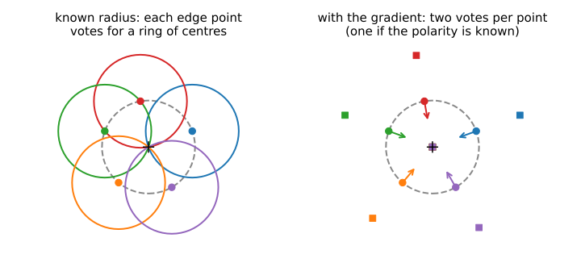
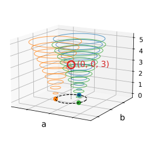
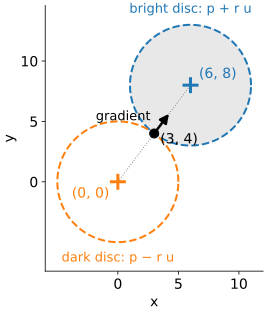
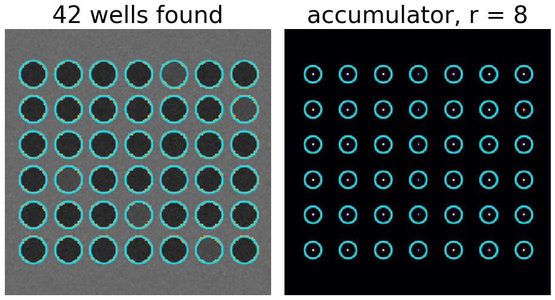
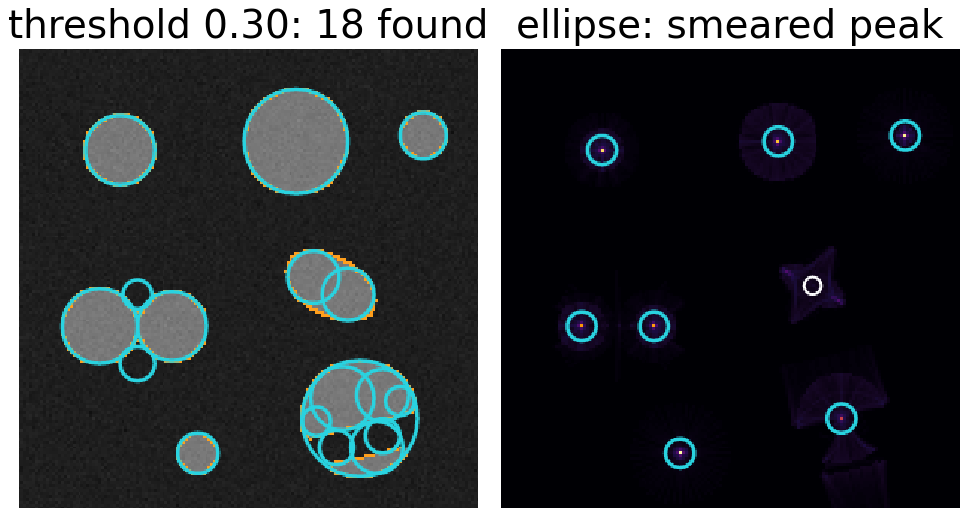
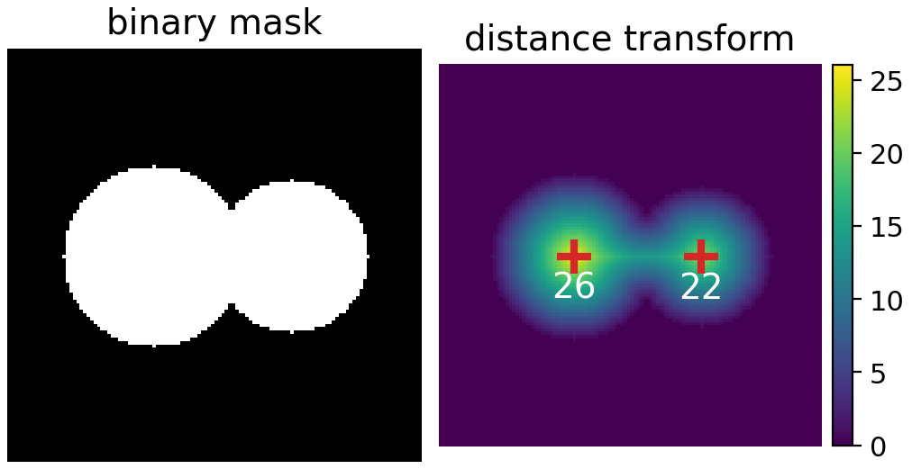
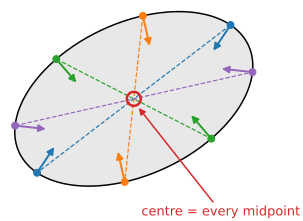

## About this lecture

The line unit let every edge point vote for all lines through it. Circles work the same way, with one more parameter (Kimme, Ballard & Sklansky, 1975).

- A circle has **three** parameters: centre $(a, b)$ and radius $r$.
- **Known radius**: every edge point votes for a ring of possible centres; the rings meet at the true centre.
- **Unknown radius**: a 3D accumulator, and what each extra parameter costs.
- The **gradient direction** points at the centre: two votes per radius instead of a whole ring.
- Applications, failure modes, alternatives, and ellipses briefly.

*Slides titled **The math** give the formulas and proofs; the ideas are complete without them.*

::: notes
Second unit of the Hough day; builds on the line unit (voting, accumulator, peaks, NMS, gradient voting). Coordinates here are pixel coordinates (column, row): the centre of a circle is a pixel position, and the centre accumulator looks like the image.
:::

## Circles: three numbers

A circle is the set of points at distance $r$ from a centre $(a, b)$:

$$(x - a)^2 + (y - b)^2 = r^2.$$

- Three parameters, so the parameter space is **3D**: one axis for each of $a$, $b$, $r$.
- An edge point $(x, y)$ is on every circle whose centre is at distance $r$ from it.
- For a fixed $r$ those centres form a **circle of radius $r$ around the edge point**.

## Known radius: rings of votes

{width="88%" fig-align="center"}

Left: with a known radius, each edge point (dots) votes for all centres at distance $r$: a ring around it. All rings pass through the true centre (+). The accumulator is a 2D image of the same size as the input, with a peak at every centre.

## Try it: circles of votes

```{=html}
<link rel="stylesheet" href="../demos/dist/demo.css">
<div data-demo="houghcircle" data-preset="one"></div>
<script src="../demos/dist/houghcircle.js"></script>
```

::: notes
Panels: image with edge points (orange) and detections (cyan), the accumulator slice at the radius on the slider, the maximum over all radii. Values are votes / (2πr): the fraction of a full circumference that voted. Tour: "one radius" (r = 12): the edge point at the top of the upper-left disc is selected; its votes are the dashed ring in the slice. Two discs have r = 12: peaks 0.85 and 0.80; the others give rings of votes but no sharp peak. "wrong radius" (r = 15, no disc has it): highest value 0.25, nothing detected; the slice shows bright rings and blurred spots. Then "scan the radius" (r = 5–24, next slides): all 7 discs found, 1.37 million votes.
:::

## The math: a ring-shaped kernel {.math}

With a known radius, the accumulator at a candidate centre $\mathbf c$ counts the edge pixels at distance $r$:

$$H_r(\mathbf c) = \sum_{\mathbf p} E(\mathbf p)\,K_r(\mathbf p - \mathbf c), \qquad K_r(\mathbf d) = \big[\, \big|\,\|\mathbf d\| - r\,\big| < \tfrac12 \,\big],$$

with $E$ the binary edge map and $K_r$ a **ring** of radius $r$ and width one pixel. This is a correlation of the edge map with a ring (a convolution, since the ring is symmetric): the kernels unit's weighted sum, with a ring as the kernel ([Filtering & convolution](../kernels/lec.qmd)). The ring has about $2\pi r$ pixels (a digital ring slightly fewer: 56 for $r = 10$), so dividing by $2\pi r$ gives the fraction of the circumference that is present.

## Unknown radius: a 3D accumulator

:::: {.columns}
::: {.column width="56%"}
Repeat for every radius in a range: one $(a, b)$ slice per radius, stacked into a 3D accumulator $(a, b, r)$. Each edge point now votes for a **cone** of centres (rings growing with $r$).

- A circle is a peak in 3D: the right centre **and** the right radius.
- NMS in 3D: largest in a window in $a$, $b$ and $r$.
- Cost: a 256 × 256 image with 40 radii has 2.6 million bins. With 5000 edge points and radii 5 to 40, each point casts $\sum 2\pi r \approx 5100$ votes: about 25 million votes.
- Every extra parameter **multiplies** the bins and the votes by the number of steps along it.
:::
::: {.column width="44%"}
{width="100%" fig-alt="Three edge points on a circle of radius 3 around the origin. Above each point, its votes form a cone: a ring of radius r at every height r. The three cones meet in a single point, (a, b, r) = (0, 0, 3): the centre and the radius of the circle."}
:::
::::


## The math: the cost of each parameter {.math}

- With $n$ steps per parameter and $d$ parameters, the accumulator has $n^d$ bins: lines $n^2$, circles $n^3$, ellipses $n^5$.
- Full voting: each edge point votes along a $(d-1)$-dimensional surface of parameter space (a curve for lines, a cone for circles): $O(n^{d-1})$ votes per point.
- Gradient voting fixes one more parameter per point: for circles, the gradient fixes the direction from the point to the centre, leaving only $r$ free: $O(n)$ votes per point instead of $O(n^2)$.
- Memory can be cut by keeping only a 2D centre map (votes summed over $r$), then estimating $r$ per detected centre from a radius histogram of its edge points.

## The gradient points at the centre

:::: {.columns}
::: {.column width="62%"}
On a circle, the gradient of the image is **radial**: it points straight towards the centre, or straight away from it.

- **Bright disc on a dark background**: the gradient points inward, the centre is at $\mathbf p + r\,\mathbf u$ ($\mathbf u$ the unit gradient).
- **Dark disc on a bright background**: outward, the centre is at $\mathbf p - r\,\mathbf u$.
- Unknown polarity: vote for **both**, two votes per radius. Known polarity: **one**.

Example: radius 5, edge point $(3, 4)$, unit gradient $(0.6, 0.8)$: candidate centres $(3, 4) \pm 5\,(0.6, 0.8) = (6, 8)$ or $(0, 0)$.

From $2\pi r$ votes per radius to 1 or 2: for radii 5 to 40, from about 5100 to 36 or 72 votes per point.
:::
::: {.column width="38%"}
{width="100%" fig-alt="The worked example: an edge point at (3, 4) with gradient direction (0.6, 0.8), shown as an arrow. If the disc is brighter than the background, its centre lies 5 along the gradient, at (6, 8); if it is darker, 5 against it, at (0, 0). Both candidate circles of radius 5 are drawn dashed and pass through the edge point."}
:::
::::


## Try it: gradient voting and a range of radii

```{=html}
<link rel="stylesheet" href="../demos/dist/demo.css">
<div data-demo="houghcircle" data-preset="grad"></div>
<script src="../demos/dist/houghcircle.js"></script>
```

::: notes
"gradient voting", bright on dark, radii 5–24: 15,437 votes instead of 1,370,005 (full voting, preset "scan the radius"); all 7 discs found, but peaks are lower (0.40 to 0.74 instead of 0.68 to 0.99): the gradient direction is not exact, so the votes for large radii scatter. The selected point at the top of the r = 18 disc votes one dot per radius (magenta) along its gradient; at r = 18 it hits the centre. Switch polarity to "dark on bright": no disc is found (maximum 0.06): every vote goes the wrong way. "either": 30,203 votes, same detections. Click a centre in the slice: the votes at that centre against r (radius histogram), peak at the true radius.
:::

## Applications

:::: {.columns}
::: {.column width="58%"}
- **Nuclei, round cells, vesicles**: bright or dark discs of a known range of radii. Gradient voting with the right polarity.
- **Colonies** on an agar plate: many discs, different radii.
- **Wells** of a multi-well plate: a **known radius** (one slice) and a regular grid. (Demo: "plate wells": all 42 wells, dark on bright.)
- **Powder diffraction rings**: concentric circles around a **known centre**. Then only $r$ is unknown: the accumulator is a 1D **histogram of radius** at that centre. (Demo: "diffraction rings": click the centre.)
- A detected centre as the **starting point** of a boundary search in polar coordinates (the dynamic-programming elective).
:::
::: {.column width="42%"}
{width="100%" fig-alt="Demo still of a multi-well plate: 42 dark wells on a bright plate, each with a detected circle in cyan. Right: the accumulator slice at the known radius 8, one sharp peak per well, on a regular grid."}
:::
::::


## When circles go wrong

:::: {.columns}
::: {.column width="58%"}
- **Not quite circles**: an ellipse or an irregular cell has no single centre. Its votes smear over several centres and radii; the peak is low and wide. (Demo: "ellipse".)
- **Touching or overlapping cells**: a shared or missing boundary removes votes from both; parts of two circles can add up to a weak extra peak.
- **Low threshold**: any curved piece of boundary has a centre of curvature and collects some votes there. (Demo: "low threshold: false circles": the ellipse gives two false circles of radius 9 near its ends.)
- **Wrong radius range**: a circle outside the range is never found; a range that is too wide costs time and invites false peaks.
- **Strong straight edges** nearby: their votes form bright lines in the accumulator.
:::
::: {.column width="42%"}
{width="100%" fig-alt="Left: with threshold 0.30 the demo reports 18 circles for 7 discs: small false circles at the ends of the ellipse and inside the disc that a band partly hides. Right: the maximum of the accumulator over all radii for the ellipse preset: instead of a sharp spot, the ellipse gives a smeared, star-shaped patch of votes."}
:::
::::


## Alternatives for round objects

:::: {.columns}
::: {.column width="56%"}
- **Distance transform peaks** (the morphology day): from a **binary mask**, the centre of a disc is the pixel farthest from the background; touching discs give two peaks. They also make **markers for the watershed** (the watershed day).
- **Blob detection** with the Laplacian of Gaussian at scale $\sigma \approx r/\sqrt2$ (the edges day): a **region**-based cousin that uses the inside of the disc, not its edge.
- **Circle Hough**: works on **edges**, tolerates gaps and partial occlusion, and gives the radius.
:::
::: {.column width="44%"}
{width="100%" fig-alt="Left: a binary mask of two overlapping discs of radius 26 and 22. Right: its distance transform, brightest at the two disc centres; the two local maxima, marked with crosses, have values 26 and 22, the radii of the discs."}
:::
::::


## Ellipses, briefly

:::: {.columns}
::: {.column width="60%"}
An ellipse needs **five** parameters: centre (2), the two semi-axes (2) and an angle (1). A full 5D accumulator is impractical: with 50 steps per parameter that is 312 million bins.

Two ways out:

- **Find the centre first**: two edge points with **parallel** gradients on an ellipse lie symmetrically about its centre; their midpoints vote for the centre in 2D. Then find the remaining three parameters.
- **Hypothesise and verify**: fit an ellipse to 5 random edge points and count how many others agree (the RANSAC unit).
:::
::: {.column width="40%"}
{width="100%" fig-alt="An ellipse with four pairs of edge points in different colours. The two points of a pair lie on opposite sides and have parallel (opposite) gradient arrows; the dashed line joining them passes through the centre of the ellipse, so the midpoints of all pairs coincide at the centre, ringed in red."}
:::
::::


## The math: conics have five degrees of freedom {.math}

Every ellipse (and every conic) is the zero set of a quadratic:

$$A x^2 + B xy + C y^2 + D x + E y + F = 0, \qquad B^2 - 4AC < 0 \text{ for an ellipse}.$$

Six coefficients, but multiplying all of them by the same non-zero number gives the same curve: **5 degrees of freedom**, so five points in general position determine a conic (one linear equation per point, a $5 \times 6$ system with a one-dimensional null space). A circle is the special case $B = 0$, $A = C$: three degrees of freedom, as in $(a, b, r)$.

## Summary

- A circle has 3 parameters; an edge point votes for a **ring** of centres per radius (a **cone** over all radii).
- Known radius: a 2D accumulator, the **edge map correlated with a ring**.
- Unknown radius: 3D, and the cost grows **with every parameter**.
- The **gradient points at the centre**: 1 or 2 votes per radius, depending on whether the **polarity** is known.
- Watch for non-circular objects, touching objects, the radius range and the threshold.
- Ellipses (5 parameters) need the centre first, or hypothesise-and-verify.
